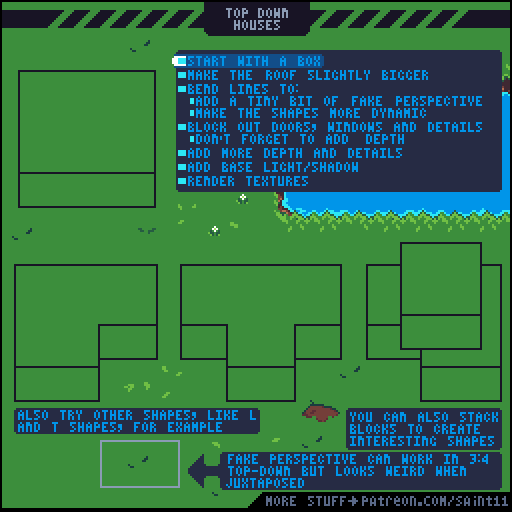
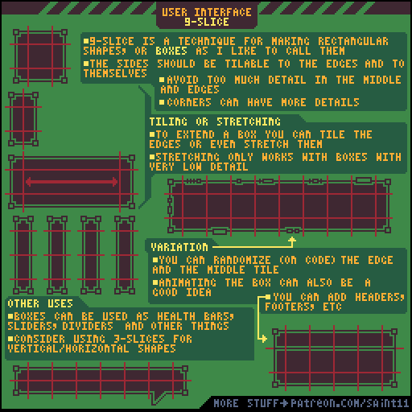

# Pixel Game Art Director

给 AI agent 使用的像素游戏美术资料与制作辅助 skill：按任务检索教程和配图，建立共同美术规范，准备制作资料包，并检查已有素材的技术一致性。

优先服务俯视角像素游戏，也覆盖动画、素材工作流、Godot 集成和游戏 UI。**本库提供知识与检查工具；检索到教程、通过技术检查，都不等于已经做完游戏美术或验证了 UI。**

## 内容与范围

| 内容 | 数量 | 实际包含 |
|---|---:|---|
| 独立来源教程 | 92 篇 | 25 绘画、12 动画、27 素材制作、24 游戏开发、4 UI 专题 |
| 本地图像文件 | 661 个 | 原始教程图/GIF、截图和辅助抽帧；不等于 661 件可用游戏素材 |
| 美术风格配方 | 8 套 | 乡村、限色掌机、双色、街机、低饱和幻想、哥特、等距、霓虹 |
| UI 视觉主题配方 | 6 套 | 木框纸面、紧凑掌机、醒目街机、幻想装饰、暗石铁器、全息终端 |
| UI 设计维度 | 8 个轴 / 27 个可组合值 | 视觉表现、世界关系、空间位置、信息编码、密度、出现时机、时间策略、输入导航 |
| UI 系统模式 | 16 类 | 玩家决策、内容字段、结构、状态、输入、异常恢复和验收 |
| 真实游戏 UI 案例 | 14 例 / 28 个图像链接 | 分别标记官方截图、开发者设计稿、官方指南；商业图不打包为开放素材 |
| 设计研究与规范 | 22 个不同来源 | 原始研究、设计理论、平台指南、评估方法；保留适用范围与局限 |
| 任务路由 | 11 类 | 从场景、角色与动画，到 UI、引擎和已有素材审查 |

风格配方是整理者编写的可调参数建议。引用图用于讲解技法，**不是每种风格的完整成品示例**。四篇 UI 专题覆盖九宫格、Theme、容器布局和锚点；已有 HUD 与显示缩放资料可配合阅读。新增设计研究是原创综合说明，不计为新抓取的完整教程。八个设计轴与十六个系统是工作框架，不宣称为统一学术分类。

- [Skill 入口](SKILL.md)：供 agent 按任务逐步读取。
- [完整教程目录](library/CATALOG.md)：逐篇查来源、许可、正文和配图。
- [风格设计](references/style-design.md) · [UI 设计与验证](references/ui-design.md)
- [UI 研究图谱（HTML）](review/ui-design-atlas/index.html) · [设计基础与分类](references/ui-design-foundations.md) · [16 类系统模式](references/ui-system-patterns.md)
- [UI 评估方法](references/ui-evaluation-method.md) · [设计合同模板](assets/templates/ui-design-contract.json) · [乡村商店推演示例](examples/ui-design-reasoning.md)
- [真实游戏 UI 案例](references/ui-case-studies.md) · [UI 内容审核与缺口](references/ui-content-audit.md)
- [一致性检查方法](references/consistency-review.md) · [技术检查输出示例](examples/audit-demo/EXAMPLE.md)
- [来源与许可](THIRD_PARTY_NOTICES.md)：代码和第三方内容不是同一许可证。

## UI 资料怎样用于实际设计

先说明玩家在当前情境要做的决定，再从系统模式提取真实内容字段与操作路径。随后独立选择拟物/平面等视觉表现、世界归属、屏幕或空间位置等维度，补齐成功、空、禁用、错误和恢复状态。最后按 [评估方法](references/ui-evaluation-method.md) 做静态检查、原型走查或用户任务观察，并记录证据等级。

例如，乡村商店可以使用纸质账本，也可以使用平面商品列表；两者都需要明确价格、数量、总价、余额与背包接收。详见 [同一个商店任务的三种表达](examples/ui-design-reasoning.md)。拟物不自动等于世界内界面，也不自动提升沉浸或可用性。

HTML 图谱可在下载后用浏览器打开；公开版本从原站加载参考图，完整分析和来源同时保存在 Markdown / JSON 中，agent 不依赖网页运行。

## 看看现有教学图

### 俯视房屋与场景



Pedro Medeiros / Saint11，[*Top-Down Houses*](https://github.com/saint11/Saint11Tutorials/blob/ce1393eb2c46441d917134a9fd52e15575ee10a7/Top-Down-Houses-Compressed.gif)，[CC BY 4.0](https://creativecommons.org/licenses/by/4.0/)。原图原样保存；[对应中文导读](library/tutorials/drawing/ART-008-top-down-houses.md)为整理改编。

### UI 九宫格的结构



Pedro Medeiros / Saint11，[*UI 9-Slice*](https://github.com/saint11/Saint11Tutorials/blob/ce1393eb2c46441d917134a9fd52e15575ee10a7/UI-9-Slice.gif)，[CC BY 4.0](https://creativecommons.org/licenses/by/4.0/)。这张图说明可缩放边框的原理，不代表六种 UI 配方的最终视觉效果。

## 安装与调用

将此仓库完整复制到 agent 的 skills 目录，保留所有相对路径。例如 Codex 可使用 `~/.codex/skills/pixel-game-art-director/`，入口为 `SKILL.md`。不要只复制入口文件。客户端需要重新读取技能目录时，开启新会话。

可直接向 agent 发出任务：

> 用 $pixel-game-art-director 为乡村俯视游戏检索房屋、树木和水岸教程，建立共同视角、光源和像素密度规范，再制作小样。

> 用 $pixel-game-art-director 设计暗黑背包 UI，检查最长中文名称、焦点、选中和禁用状态。

完整说明见 [INSTALL.md](INSTALL.md)。没有技能自动发现功能的 agent，也可以直接读取入口和运行下面的脚本。

## 命令行

从仓库根目录执行；检索与资料包功能仅需 Python 3.9+ 标准库。

```bash
python3 scripts/search.py --task '俯视农舍、树木和草地' --limit 6 --json
python3 scripts/search.py --task '暗黑背包UI' --kind all --style dark-gothic --ui-style dark-stone --json
python3 scripts/search.py --id ART-008 --json
python3 scripts/search.py --task '背包和商店UI' --kind case --json
python3 scripts/search.py --task '制作配方界面' --kind system --json
python3 scripts/search.py --task '拟物化菜单' --kind axis --json
python3 scripts/search.py --id shop-trade --json
python3 scripts/search.py --list ui-axes --json
python3 scripts/task_bundle.py --task '乡村地图的房屋和植被' --style cozy-rural --out ../pixel-output/village-brief --copy-figures
python3 scripts/init_art_bible.py --style cozy-rural --ui-style wood-paper --out ./outputs/village-art-bible
```

资料包保留教程 ID、来源、许可和配图归属；美术规范初稿不会把建议色板或未知尺寸变成已经确认的硬性规则。

检查已有图片需要 Pillow：

```bash
python3 -m pip install -r requirements.txt
python3 scripts/audit_assets.py /path/to/project/assets --contract /path/to/audit-contract.json --out ./outputs/asset-review
```

检查器只读取输入图片，输出报告和最近邻联系表。没有配置的规则显示 `NOT_CONFIGURED`；缺少完整技术证据时显示 `INCOMPLETE`。机器结果无论通过与否，整体都仍标记 `NEEDS_VISUAL_REVIEW`，因为视角、光源、材质、轮廓节奏与场景融合需要看图判断。

## 验证与维护

```bash
python3 scripts/test_retrieval.py
python3 scripts/test_audit_assets.py
python3 scripts/test_ui_cases.py
python3 scripts/test_ui_design.py
```

发布前已检查本地链接、图像解码和哈希，并运行任务检索、资料包署名、搬迁路径与检查器行为测试。v1.2.0 的设计研究与脚本验证见 [版本验证报告](validation/UI-DESIGN-V1.2.md)；既有教程与素材检查见 [验证报告](validation/FINAL.md)。这些检查不代表逐篇运行过原教程，也不代表已经验证某个游戏的真实 UI 交互。

[资料库维护说明](library/MAINTENANCE.md)介绍索引重建与采集。Godot 内容固定到 4.5 分支，Saint11 图源固定到提交 `ce1393eb2c46441d917134a9fd52e15575ee10a7`；版本快照不代表最新软件行为。

## 许可

原创脚本、技能编排、独立风格配方和测试夹具采用 [MIT](LICENSE)。第三方教程及其改编保留 **CC BY 4.0、CC BY 3.0、GFDL 1.3 或更新版本**等原许可。图片上的商标、游戏角色或署名截图不会因汇编进入此库而成为本项目原创资产。

再分发或改编资料时，保留对应作者、来源、许可和修改说明。详见 [THIRD_PARTY_NOTICES.md](THIRD_PARTY_NOTICES.md) 与 [library/LICENSES.md](library/LICENSES.md)。
