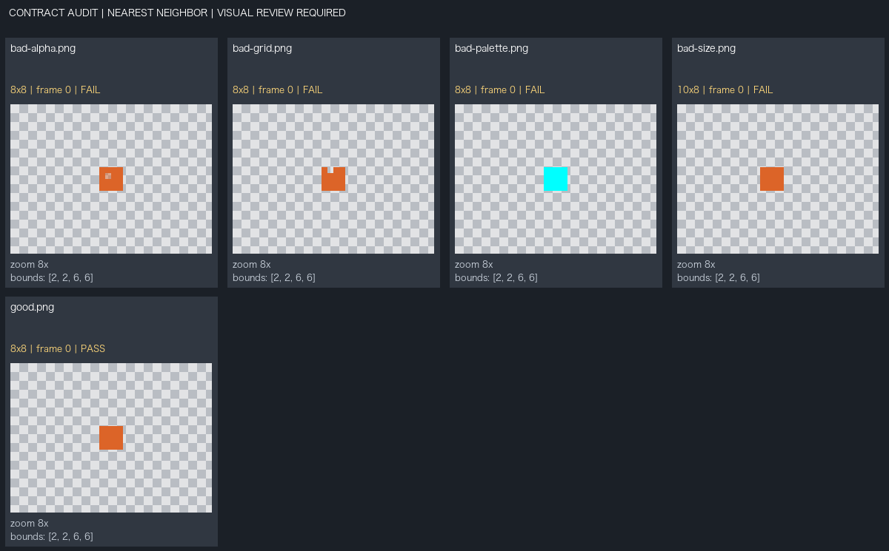

# 像素素材一致性检查报告

机器检查：**FAIL**。整体：**NEEDS_VISUAL_REVIEW**。

此报告只测量明确配置的规则，不给画风、视角、光源或审美质量自动判通过。源图片未修改。

输入素材 5 个；配置合同：`../audit-contract.json`。

## bad-alpha.png

原图：[bad-alpha.png](<../inputs/bad-alpha.png>)；机器状态 **FAIL**。

**原始测量（不含合格判断）：** 画布 [(8, 8)]；已测各帧可见RGB颜色数 1–1；已测帧的半透明像素合计 1。
首个已测帧可见边界 [2, 2, 6, 6]；透明边距（左/上/右/下） [2, 2, 2, 2]。完整逐帧数值见 report.json。

检查帧 1/1，SHA-256 `e13daf5e660f29856e9fdf1668d04bfe32c90dbeda03220fc9649f51ab3e1d5f`。

| 检查项 | 状态 | 期望值 | 实测值 / 解释 |
|---|---|---|---|
| canvas_size | PASS | `[8,8]` | {"frame_sizes":[[8,8]]}；Decoded logical frame canvas dimensions must match the contract. |
| size_multiple | PASS | `[2,2]` | {"frame_sizes":[[8,8]]}；Canvas dimensions must be divisible by the configured x/y multiples. |
| grid_scale | FAIL | `2` | {"frames":[{"index":0,"misaligned_dimensions":false,"unequal_blocks":1,"sample_blocks":[[2,2]]}]}；Every origin-aligned NxN output block must repeat one RGBA pixel; fully transparent RGB is ignored. This does not infer artistic pixel quality. |
| alpha_policy | FAIL | `"binary"` | {"partial_alpha_pixels":1,"transparent_pixels":48}；Partial alpha is allowed only according to the contract; this measure does not prove white halos or their absence. |
| palette | PASS | `{"colors":["#DC6428"],"max_distance":0}` | {"frames":[{"index":0,"worst_rgb_distance":0,"outside_pixels":0,"sample_outside_colors":[]}]}；Visible RGB colors are compared to the explicit palette using Euclidean RGB distance, not perceptual color similarity. |
| max_colors | PASS | `1` | {"max_colors_in_one_frame":1,"union_rgb_colors":1}；Limit applies per decoded frame to visible RGB; union count is reported separately. Hidden RGB and alpha values are not separate colors. |
| margins | PASS | `{"min":[2,2,2,2],"max":[2,2,2,2]}` | {"frames":[{"index":0,"margins_ltrb":[2,2,2,2]}]}；Transparent margins use the bounding box of all alpha>0 pixels. Empty frames have no measurable bounds and fail a configured margin rule. |
| bottom_anchor | PASS | `{"padding":2,"tolerance":0}` | {"frames":[{"index":0,"bottom_padding":2}]}；Measures the lowest nontransparent pixel against the canvas bottom, not a semantic foot, pivot, or engine ground contact. |
| animation_canvas_consistency | PASS | `true` | {"decoded_frame_sizes":[[8,8]],"frame_count":1}；Checks composited logical frames. GIF/WebP internal delta rectangles are not source sprite frame dimensions; PNG sequences are separate assets. |

## bad-grid.png

原图：[bad-grid.png](<../inputs/bad-grid.png>)；机器状态 **FAIL**。

**原始测量（不含合格判断）：** 画布 [(8, 8)]；已测各帧可见RGB颜色数 1–1；已测帧的半透明像素合计 0。
首个已测帧可见边界 [2, 2, 6, 6]；透明边距（左/上/右/下） [2, 2, 2, 2]。完整逐帧数值见 report.json。

检查帧 1/1，SHA-256 `e48b9a3a0328ecabcbd4fe4b0c0fe8e466de620823e16a35c5c34b995b9cd33d`。

| 检查项 | 状态 | 期望值 | 实测值 / 解释 |
|---|---|---|---|
| canvas_size | PASS | `[8,8]` | {"frame_sizes":[[8,8]]}；Decoded logical frame canvas dimensions must match the contract. |
| size_multiple | PASS | `[2,2]` | {"frame_sizes":[[8,8]]}；Canvas dimensions must be divisible by the configured x/y multiples. |
| grid_scale | FAIL | `2` | {"frames":[{"index":0,"misaligned_dimensions":false,"unequal_blocks":1,"sample_blocks":[[2,2]]}]}；Every origin-aligned NxN output block must repeat one RGBA pixel; fully transparent RGB is ignored. This does not infer artistic pixel quality. |
| alpha_policy | PASS | `"binary"` | {"partial_alpha_pixels":0,"transparent_pixels":49}；Partial alpha is allowed only according to the contract; this measure does not prove white halos or their absence. |
| palette | PASS | `{"colors":["#DC6428"],"max_distance":0}` | {"frames":[{"index":0,"worst_rgb_distance":0,"outside_pixels":0,"sample_outside_colors":[]}]}；Visible RGB colors are compared to the explicit palette using Euclidean RGB distance, not perceptual color similarity. |
| max_colors | PASS | `1` | {"max_colors_in_one_frame":1,"union_rgb_colors":1}；Limit applies per decoded frame to visible RGB; union count is reported separately. Hidden RGB and alpha values are not separate colors. |
| margins | PASS | `{"min":[2,2,2,2],"max":[2,2,2,2]}` | {"frames":[{"index":0,"margins_ltrb":[2,2,2,2]}]}；Transparent margins use the bounding box of all alpha>0 pixels. Empty frames have no measurable bounds and fail a configured margin rule. |
| bottom_anchor | PASS | `{"padding":2,"tolerance":0}` | {"frames":[{"index":0,"bottom_padding":2}]}；Measures the lowest nontransparent pixel against the canvas bottom, not a semantic foot, pivot, or engine ground contact. |
| animation_canvas_consistency | PASS | `true` | {"decoded_frame_sizes":[[8,8]],"frame_count":1}；Checks composited logical frames. GIF/WebP internal delta rectangles are not source sprite frame dimensions; PNG sequences are separate assets. |

## bad-palette.png

原图：[bad-palette.png](<../inputs/bad-palette.png>)；机器状态 **FAIL**。

**原始测量（不含合格判断）：** 画布 [(8, 8)]；已测各帧可见RGB颜色数 1–1；已测帧的半透明像素合计 0。
首个已测帧可见边界 [2, 2, 6, 6]；透明边距（左/上/右/下） [2, 2, 2, 2]。完整逐帧数值见 report.json。

检查帧 1/1，SHA-256 `22307bc35543ea1a30876b38b89128ca6a5e642b11c7f4c5b6b30549525db87b`。

| 检查项 | 状态 | 期望值 | 实测值 / 解释 |
|---|---|---|---|
| canvas_size | PASS | `[8,8]` | {"frame_sizes":[[8,8]]}；Decoded logical frame canvas dimensions must match the contract. |
| size_multiple | PASS | `[2,2]` | {"frame_sizes":[[8,8]]}；Canvas dimensions must be divisible by the configured x/y multiples. |
| grid_scale | PASS | `2` | {"frames":[{"index":0,"misaligned_dimensions":false,"unequal_blocks":0,"sample_blocks":[]}]}；Every origin-aligned NxN output block must repeat one RGBA pixel; fully transparent RGB is ignored. This does not infer artistic pixel quality. |
| alpha_policy | PASS | `"binary"` | {"partial_alpha_pixels":0,"transparent_pixels":48}；Partial alpha is allowed only according to the contract; this measure does not prove white halos or their absence. |
| palette | FAIL | `{"colors":["#DC6428"],"max_distance":0}` | {"frames":[{"index":0,"worst_rgb_distance":344.456,"outside_pixels":16,"sample_outside_colors":[{"color":"#00FFFF","pixels":16,"distance":344.456}]}]}；Visible RGB colors are compared to the explicit palette using Euclidean RGB distance, not perceptual color similarity. |
| max_colors | PASS | `1` | {"max_colors_in_one_frame":1,"union_rgb_colors":1}；Limit applies per decoded frame to visible RGB; union count is reported separately. Hidden RGB and alpha values are not separate colors. |
| margins | PASS | `{"min":[2,2,2,2],"max":[2,2,2,2]}` | {"frames":[{"index":0,"margins_ltrb":[2,2,2,2]}]}；Transparent margins use the bounding box of all alpha>0 pixels. Empty frames have no measurable bounds and fail a configured margin rule. |
| bottom_anchor | PASS | `{"padding":2,"tolerance":0}` | {"frames":[{"index":0,"bottom_padding":2}]}；Measures the lowest nontransparent pixel against the canvas bottom, not a semantic foot, pivot, or engine ground contact. |
| animation_canvas_consistency | PASS | `true` | {"decoded_frame_sizes":[[8,8]],"frame_count":1}；Checks composited logical frames. GIF/WebP internal delta rectangles are not source sprite frame dimensions; PNG sequences are separate assets. |

## bad-size.png

原图：[bad-size.png](<../inputs/bad-size.png>)；机器状态 **FAIL**。

**原始测量（不含合格判断）：** 画布 [(10, 8)]；已测各帧可见RGB颜色数 1–1；已测帧的半透明像素合计 0。
首个已测帧可见边界 [2, 2, 6, 6]；透明边距（左/上/右/下） [2, 2, 4, 2]。完整逐帧数值见 report.json。

检查帧 1/1，SHA-256 `97869ac42a39ec19550a987ec8f21bbd732e91b35a1f8241e8f767955b023447`。

| 检查项 | 状态 | 期望值 | 实测值 / 解释 |
|---|---|---|---|
| canvas_size | FAIL | `[8,8]` | {"frame_sizes":[[10,8]]}；Decoded logical frame canvas dimensions must match the contract. |
| size_multiple | PASS | `[2,2]` | {"frame_sizes":[[10,8]]}；Canvas dimensions must be divisible by the configured x/y multiples. |
| grid_scale | PASS | `2` | {"frames":[{"index":0,"misaligned_dimensions":false,"unequal_blocks":0,"sample_blocks":[]}]}；Every origin-aligned NxN output block must repeat one RGBA pixel; fully transparent RGB is ignored. This does not infer artistic pixel quality. |
| alpha_policy | PASS | `"binary"` | {"partial_alpha_pixels":0,"transparent_pixels":64}；Partial alpha is allowed only according to the contract; this measure does not prove white halos or their absence. |
| palette | PASS | `{"colors":["#DC6428"],"max_distance":0}` | {"frames":[{"index":0,"worst_rgb_distance":0,"outside_pixels":0,"sample_outside_colors":[]}]}；Visible RGB colors are compared to the explicit palette using Euclidean RGB distance, not perceptual color similarity. |
| max_colors | PASS | `1` | {"max_colors_in_one_frame":1,"union_rgb_colors":1}；Limit applies per decoded frame to visible RGB; union count is reported separately. Hidden RGB and alpha values are not separate colors. |
| margins | FAIL | `{"min":[2,2,2,2],"max":[2,2,2,2]}` | {"frames":[{"index":0,"margins_ltrb":[2,2,4,2]}]}；Transparent margins use the bounding box of all alpha>0 pixels. Empty frames have no measurable bounds and fail a configured margin rule. |
| bottom_anchor | PASS | `{"padding":2,"tolerance":0}` | {"frames":[{"index":0,"bottom_padding":2}]}；Measures the lowest nontransparent pixel against the canvas bottom, not a semantic foot, pivot, or engine ground contact. |
| animation_canvas_consistency | PASS | `true` | {"decoded_frame_sizes":[[10,8]],"frame_count":1}；Checks composited logical frames. GIF/WebP internal delta rectangles are not source sprite frame dimensions; PNG sequences are separate assets. |

## good.png

原图：[good.png](<../inputs/good.png>)；机器状态 **PASS**。

**原始测量（不含合格判断）：** 画布 [(8, 8)]；已测各帧可见RGB颜色数 1–1；已测帧的半透明像素合计 0。
首个已测帧可见边界 [2, 2, 6, 6]；透明边距（左/上/右/下） [2, 2, 2, 2]。完整逐帧数值见 report.json。

检查帧 1/1，SHA-256 `bcfcb6161e40f10d5bb1347b019cf6308c903563c48c5a3cc4f8b15c2d5210b5`。

| 检查项 | 状态 | 期望值 | 实测值 / 解释 |
|---|---|---|---|
| canvas_size | PASS | `[8,8]` | {"frame_sizes":[[8,8]]}；Decoded logical frame canvas dimensions must match the contract. |
| size_multiple | PASS | `[2,2]` | {"frame_sizes":[[8,8]]}；Canvas dimensions must be divisible by the configured x/y multiples. |
| grid_scale | PASS | `2` | {"frames":[{"index":0,"misaligned_dimensions":false,"unequal_blocks":0,"sample_blocks":[]}]}；Every origin-aligned NxN output block must repeat one RGBA pixel; fully transparent RGB is ignored. This does not infer artistic pixel quality. |
| alpha_policy | PASS | `"binary"` | {"partial_alpha_pixels":0,"transparent_pixels":48}；Partial alpha is allowed only according to the contract; this measure does not prove white halos or their absence. |
| palette | PASS | `{"colors":["#DC6428"],"max_distance":0}` | {"frames":[{"index":0,"worst_rgb_distance":0,"outside_pixels":0,"sample_outside_colors":[]}]}；Visible RGB colors are compared to the explicit palette using Euclidean RGB distance, not perceptual color similarity. |
| max_colors | PASS | `1` | {"max_colors_in_one_frame":1,"union_rgb_colors":1}；Limit applies per decoded frame to visible RGB; union count is reported separately. Hidden RGB and alpha values are not separate colors. |
| margins | PASS | `{"min":[2,2,2,2],"max":[2,2,2,2]}` | {"frames":[{"index":0,"margins_ltrb":[2,2,2,2]}]}；Transparent margins use the bounding box of all alpha>0 pixels. Empty frames have no measurable bounds and fail a configured margin rule. |
| bottom_anchor | PASS | `{"padding":2,"tolerance":0}` | {"frames":[{"index":0,"bottom_padding":2}]}；Measures the lowest nontransparent pixel against the canvas bottom, not a semantic foot, pivot, or engine ground contact. |
| animation_canvas_consistency | PASS | `true` | {"decoded_frame_sizes":[[8,8]],"frame_count":1}；Checks composited logical frames. GIF/WebP internal delta rectangles are not source sprite frame dimensions; PNG sequences are separate assets. |

## 必须进行的图像审阅

- **MANUAL_REVIEW / perspective**：视角、可见屋顶/墙面比例、脚底投影是否与项目参考一致
- **MANUAL_REVIEW / lighting**：主光方向、受光面、投影长度和环境光是否协调
- **MANUAL_REVIEW / material**：木材、岩石、金属和布料的明暗与纹理是否有统一尺度
- **MANUAL_REVIEW / silhouette**：轮廓节奏、细杆、必要透明孔洞和造型识别性是否保留
- **MANUAL_REVIEW / style**：色彩关系、细节密度和角色/场景/UI是否属于同一视觉体系
- **MANUAL_REVIEW / animation**：关键姿态、重心、节奏、脚部接触与循环接缝是否自然
- **MANUAL_REVIEW / ui**：真实显示尺寸下文字、状态、焦点、图标和输入热区是否可读可操作

人工审阅后另写实际观察、对应文件/位置、严重性和修复建议；不要把此机器报告改写为已完成视觉验收。
