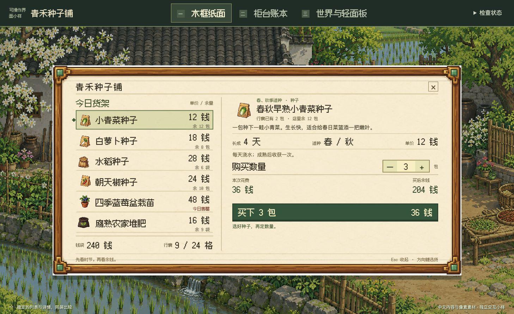
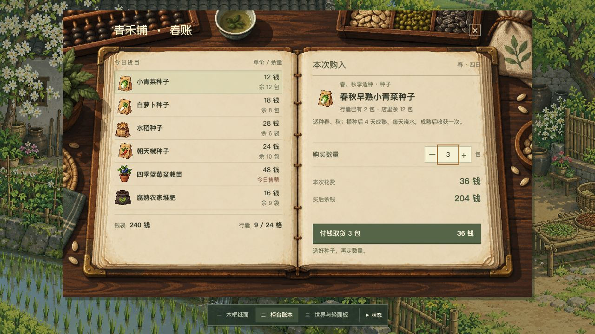
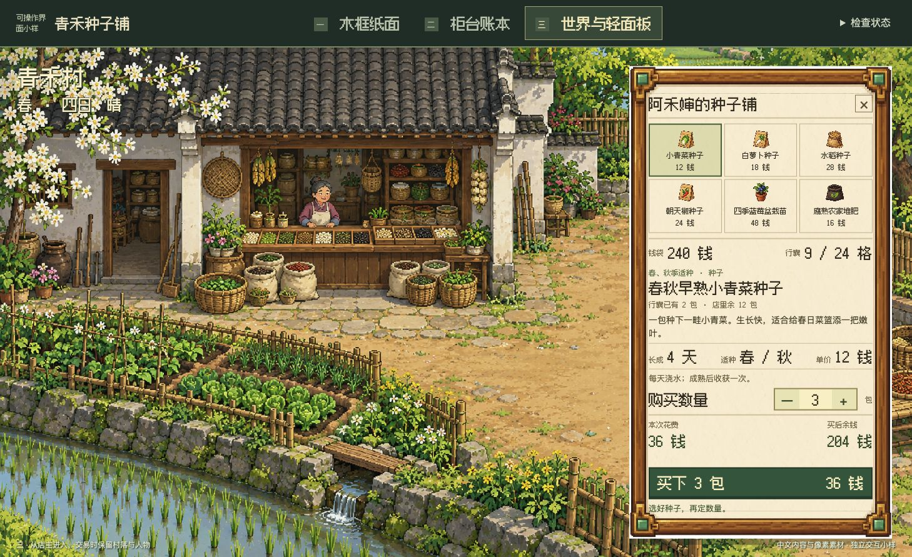

# 青禾种子铺：三种可操作界面

同一乡村商店、同一套商品、同一份钱袋与库存，比较三种界面结构。中文商品名、数量、价格、库存、说明与交易反馈均由真实文本层渲染；背景、木框、账本和商品来自本地光栅图像。它是独立的交互小样，没有漫游、存档或完整种植系统。

## 运行

在仓库根目录运行：

```bash
python3 -m http.server 8775 --bind 127.0.0.1 --directory examples/rural-shop-demo
```

浏览器打开 `http://127.0.0.1:8775/`。使用 ES 模块，不能直接双击 HTML 的 `file:` 地址。运行时无需外部图片、字体服务或构建依赖。

## 同任务对比

### 一 · 木框纸面

左侧列表同时显示价格与余量，右侧查看详情、数量与结算。适合连续选货和比较；大面板会遮住较多场景。



### 二 · 柜台账本

将列表和详情放在两张空白书页，商品、交易计算与按钮语义保持不变。账本、算盘和纸袋建立柜台联系。窄屏会重排为平铺账目，而非把整本书缩小到无法阅读。



### 三 · 世界与轻面板

先从店主入口进入，再在右侧交易，保留店主、柜台、菜圃和村落。选择格更紧凑，详情随当前商品显示。短高桌面窗口会用单排图标与价格，商品全名保留在详情及可访问标签中。



以上三图为 1458 × 891 浏览器原始截图，均是 240 钱、9/24 格、选中小青菜种子 3 包的相同初始比较状态；36 钱是预览花费，204 钱是购买后的预计余额。

## 操作与状态

- 点击商品，输入 1–99 的整数数量，或用加减按钮调整；按钮显示本次数量和总价。
- 点击购买会同步更新余额、背包占用、库存和持有量；切换方案保留这些数据。
- `Esc` 收起并把焦点还给店主入口；`E` 打开；商品格中的方向键按当前行列移动。
- 右上“检查状态”提供正常、缺款、满包、全部售罄夹具及恢复初始状态。它是审核工具，不是游戏系统内容。
- 失败交易不扣款；小数等无效数量会给出原因。购买后的短暂忙碌状态防止同一次快速重复激活。
- 刷新重置，未写入浏览器存储。每单位商品暂占一格，容量为 24；这只是小样规则，详见 [数据合同](data-contract.json)。

## 一致性与制作来源

[项目主题合同](theme-contract.json) 固定了共同主题、角色差异和有理由的例外。三种方案改变结构，沿用同一场景、商品图集、纸木材质、绿色购买动作和锈红错误信息。UI、图标与世界允许不同表现尺度，但不能分别选择另一套画风。

四张图由内置图像生成工具制作，原图未经图像后处理：[完整提示词](assets/prompt-set.md)、[尺寸与哈希及来源](assets/asset-provenance.json)。标题与主控件使用原始 [Fusion Pixel 12px](assets/font/font-source.json)，保留 [OFL](assets/font/OFL.txt) 及上游许可；长中文正文按用途采用系统字体。动态文字没有烘焙进图像。

这些是**像素风格光栅原型素材**。图集有半透明像素，严格硬 alpha 门槛失败；原生逻辑网格、统一有限色板和逐物体光照仍未完成生产验收。源图尺寸大、CSS 设置 `pixelated` 都不能证明它是合格的原生像素素材。背景中的店主未拆成角色动画，整幅村落也不是可复用地形图块。

## 验证

```bash
node --test examples/rural-shop-demo/shop-model.test.mjs
python3 scripts/validate_theme_contract.py examples/rural-shop-demo/theme-contract.json --json
```

验证器核查合同结构和证据绑定，不自动判断画面美感。此示例预期返回结构 `PASS`、记录 `INCOMPLETE`、严格像素生产 `OBSERVED_FAIL`，退出码 `1`；这是对实际源图的诚实记录，不是运行失败。

已检查交易、跨方案状态、缺款/满包/售罄、长中文、方向键与关闭后的焦点；检查了 1280 × 720、1458 × 891，另检查 1920 × 1080 账本与 390 × 844 窄屏账本。窄屏有面板内滚动，见 [窄屏截图](screenshots/04-mobile.jpg)。没有进行真实玩家研究、屏幕阅读器或实体触屏测试。

详细结果：[版本验证报告](../../validation/SHOP-COHESION-V1.3.md)。研究依据：[同主题画面拆解](../../references/visual-game-studies.md)、[整体主题约束](../../references/theme-cohesion-contract.md)。
