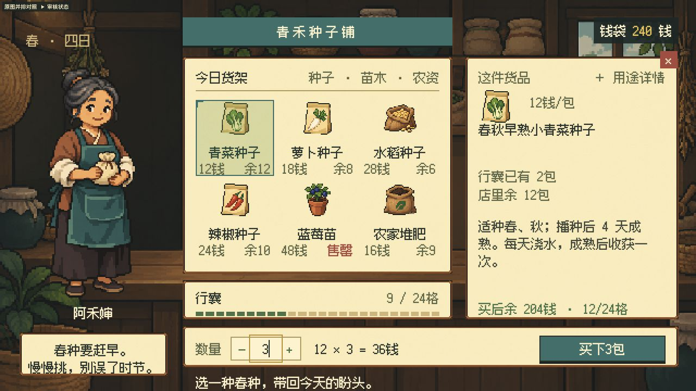

# 青禾种子铺 v2：柜台选货界面

v1.4.0 当前入口是一套 640×360 逻辑舞台上的柜台界面：店主、货架、当前商品签、行囊和结算台共同组织画面。六商品的原 ID、价格、库存、持有量与交易模型保留，真实种植／使用条件同屏呈现。旧 A/B/C 三方案不再作为当前运行模式，代码、源图、截图与报告保留为历史。

本轮先查看真实商店原图，再整体重做。[并排对照板](../../review/shop-benchmark/index.html) 包含 Moonlighter 商人服务、Stardew Valley 种子购买两张官方远程图、冻结的旧 v1.3.1 截图，以及新稿；[证据说明](../../review/shop-benchmark/README.md) 区分真实任务、可见事实和设计迁移。商业原图没有用作生成输入或项目成品素材。



这张截图用于审阅当前构图；数量、余额等状态以截图及对应报告为准，不把一张正常状态图当作全部交互验证。

## 运行

在仓库根目录运行：

```bash
python3 scripts/preview_shop.py
```

打开 <http://127.0.0.1:8775/>。预览服务的根路径自动跳转到 `/examples/rural-shop-demo/`，同时服务仓库根目录，页面里的“原图并排对照”链接可正常到达 `/review/shop-benchmark/`。可用 `--port 8780` 更换端口。

当前入口为 [index.html](index.html)，加载 [shop-v2.css](shop-v2.css) 和 [shop-v2.mjs](shop-v2.mjs)。ES modules 需要 HTTP，不要直接双击 `file:` 页面。商店运行只使用本地三张新图和本地字体；对照板上的两张商业参考图仍需联网从官方来源加载。

## 当前信息结构与操作

- 左侧店主承担人物身份，中央 3×2 货架比较六件商品及价格／余量；右侧商品签保留完整名称、已有量、余量、真实种植／使用条件和单价，长用途说明可展开。
- 行囊区域显示当前容量；结算台集中购买数量、计算式、买后余钱与容量、唯一购买动作。每份商品占一格、容量 24 是演示规则，见 [数据合同](data-contract.json)。
- 点击商品或使用方向键、`Home`／`End` 选择；数量框接收 1–99 整数，或用加减按钮调整。真实条件来自原商品数据，季节说明不额外禁止本例购买。
- 购买继续调用原 `quote()` 与 `purchase()`。成功同步更新余额、库存、持有量和容量；失败不扣款。短暂忙碌状态阻止同次快速重复激活。
- `Esc` 先关闭展开的用途详情，再收起商店并把焦点还给店主入口；`E` 重新打开。上方“审核状态”提供正常、缺款、满包、全部售罄及重置，属于审阅工具。
- 刷新重置演示数据，没有游戏存档、漫游、种植系统或新增出售系统。代码行为与本版实际走查结论分开记录。

## 同一逻辑舞台，而非逐件换画风

[本轮美术方向](art-direction-v2.md) 和 [v2 主题合同](theme-contract-v2.json) 固定共同颜色职责、材质、视角和光照。店主与六件商品来自同一张原创母版；背景和纸木面板引用这张母版作风格与配色参考。它们不分别从商业游戏取样，也不为每件资产另选画风。

运行方式有三个不同层次：

1. 三张生成 PNG 保持原样；[atlas.json](assets/v2/atlas.json) 只记录母版主体边界，没有修改或导出裁切图。主框按 `alpha > 8` 加少量留白测量；也保留原始非零 alpha 范围，不能将主体框冒充完全无损的透明边界。
2. Canvas `drawImage` 将背景、店主、商品及面板九宫格采样到 640×360 逻辑画布，关闭图像平滑。商品图等比容纳在 32×32 逻辑区域，店主等比容纳在 140×216 区域；面板源切片为 72px，显示边框为 4 逻辑像素。渲染器搬运真实光栅，不用代码绘画这些素材。
3. 画布、DOM 文字与交互控件共享逻辑舞台，再整体按 1×／2×／3× 等整数倍率显示。主体中文为 12 逻辑像素 Fusion Pixel，2× 时为 24 屏幕像素；层级主要通过区域、颜色、对齐和留白表达。审阅工具位于舞台外，使用系统字。

640px 以下不把整个界面非整数缩小：保持 1× 原尺寸，提供横向查看和横屏提示。不能把这种适配称为已解决完整竖屏可用性，也不能把整数显示等同于原始 PNG 已有统一原生网格。

## 新源图、历史与许可

本轮共三次内置 `image_gen` 调用，每张保留原图、完整提示词和来源；后两张以本项目原创母版为参考：

| 当前源图 | 内容 | 记录 |
|---|---|---|
| [merchant-and-goods-source.png](assets/v2/merchant-and-goods-source.png) | 店主与六商品，一张透明母版 | [提示词](assets/v2/merchant-and-goods-prompt.md) · [来源／限制](assets/v2/merchant-and-goods-provenance.json) |
| [environment.png](assets/v2/environment.png) | 无文字和人物的室内柜台背景 | [提示词](assets/v2/environment-prompt.md) · [来源／限制](assets/v2/environment-provenance.json) |
| [panel.png](assets/v2/panel.png) | 同家族纸木面板 | [提示词](assets/v2/panel-prompt.md) · [来源／切片](assets/v2/panel-provenance.json) |

仓库共保留 8 张 AI 源 PNG：旧 5 张加新 3 张，当前运行只引用新 3 张与原 [Fusion Pixel 字体](assets/font/font-source.json)。旧 [shop.css](shop.css)、[shop.mjs](shop.mjs)、[theme-contract.json](theme-contract.json) 和 `01-wood.jpg`／`02-ledger.jpg`／`03-world.jpg` 属于此前方案，不代表当前入口；[冻结的旧稿基线](../../review/shop-benchmark/screenshots/v1.3.1-world.jpg) 不随后续截图变化。

八张 AI 图仅在实际持有权利的范围内按根 MIT 提供，不保证独占性或独立版权保护。字体保持 SIL OFL 1.1 与所有上游声明，商业参考图不纳入开放素材许可，详见 [第三方声明](../../THIRD_PARTY_NOTICES.md)。

## 生产边界与验证

这仍是交互与美术原型。新母版有真实透明空隙，但可见区域包含部分 alpha，硬 alpha 尚未通过；三张源图的统一原生网格、严格材质色阶和调色量化也未完成验收。Canvas 采样与整数显示只说明运行渲染约定，不代表完成了一套合格的原生像素 PNG 导出。背景也不是可复用地形图块，店主没有动画序列。

```bash
node --test examples/rural-shop-demo/shop-model.test.mjs
python3 scripts/validate_theme_contract.py examples/rural-shop-demo/theme-contract-v2.json --json
```

交易测试检查模型行为，合同验证检查结构、绑定与记录；两者都不能证明画面好看。当前截图、运行走查、源图失败及未完成项见 [v1.4 验证报告](../../validation/SHOP-BENCHMARK-V1.4.md)。[v1.3.1 报告](../../validation/UI-REVISION-V1.3.1.md) 和 [v1.3 报告](../../validation/SHOP-COHESION-V1.3.md) 仅保留历史，不作为新版自动通过证据。用户尚未接受视觉效果时，不宣称视觉问题已解决。
