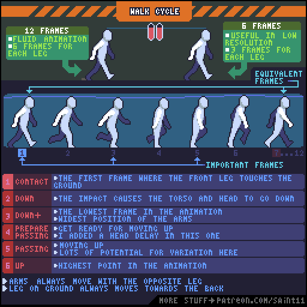
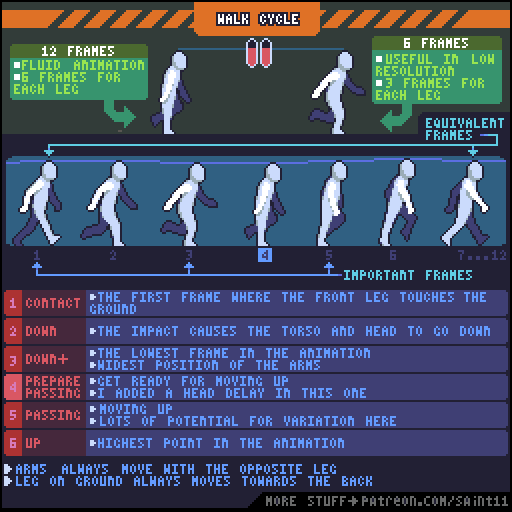
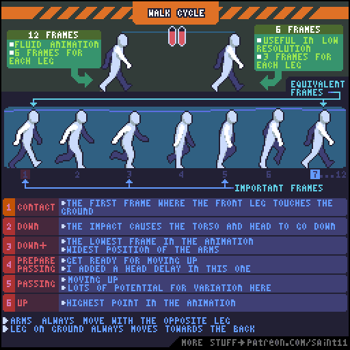
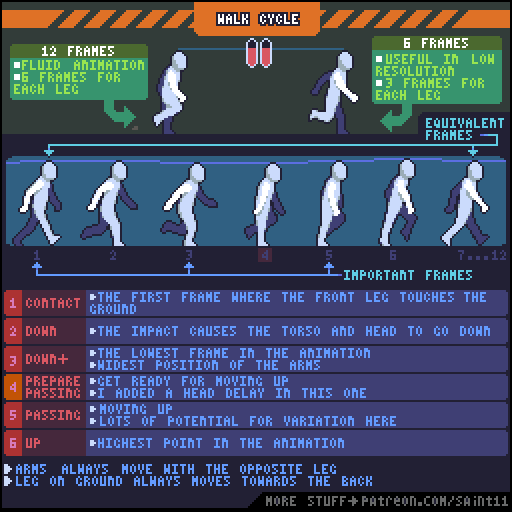

# 侧视行走：接触、下压、经过与抬升

用接触、下压、经过和抬升组织行走，比较12帧与6帧版本。

## 用途与前提

适合制作像素角色动画、评审动作稿，或为引擎动画状态准备资产。先具备：能画稳定的角色侧面轮廓；理解帧与时间轴。

## 原作者教程图（本地原始 GIF）

图源：[Pedro Medeiros / Walk.gif](https://github.com/saint11/Saint11Tutorials/blob/ce1393eb2c46441d917134a9fd52e15575ee10a7/Walk.gif)，CC BY 4.0。原文件 512×512，12个合成GIF帧，总时长约1200 ms。**这是整个教程图的GIF容器帧数，不是每个角色示例的推荐动画帧数。**

## 关键概念（原图中文整理）

- 原图比较12帧与6帧行走：分别给每条腿6帧和3帧。低分辨率下，减少中间帧也能保持动作可读。
- 行走不是整个人水平平移：落脚冲击使头和躯干降低，重心随后上升。
- 手臂与对侧腿配合。相对角色身体，支撑脚在触地期间向后移动。

## 操作步骤（根据原图重述）

1. 先画接触姿势 Contact：前腿刚触地，建立步幅与角色高度。
2. 画 Down：脚接触地面的冲击让躯干和头下降。继续画 Down+，它是本例最低点，手臂到最外侧位置。
3. 画 Prepare passing：准备交叉步，原作者在这一格给头部加入稍晚发生的运动。
4. 画 Passing：腿从身体下方通过，重心向上。可以在这一段改变摆臂或身体姿势，形成角色个性。
5. 画 Up：这一周期的最高点；接着进入另一条腿的接触动作。
6. 复制另一侧的动作逻辑，重新处理前后遮挡；检查双臂始终与对侧腿相配。对比删减中间帧后的6帧结果。

## 如何读图

上方两个人比较不同帧数的流畅度；中间横排是同一只脚的一组姿势。蓝色标记指出重要关键帧，底部表格解释六种姿势。竖向高度变化是重心运动，而非随意抖动。

### 静态关键帧

以下按GIF总帧序列的四个位置抽取，方便不支持动画的阅读器。它们不是动作逐帧全集；完整时序以原始GIF为准。

原GIF第0帧（从0计），时间约0 ms；帧截取，未重绘。

原GIF第3帧（从0计），时间约300 ms；帧截取，未重绘。

原GIF第6帧（从0计），时间约600 ms；帧截取，未重绘。

原GIF第9帧（从0计），时间约900 ms；帧截取，未重绘。

## 实作练习（整理者补充）

整理者练习：用同一个32×32角色做6帧和12帧侧视行走；让两版一整步的总时长相同，以免把速度差误当成质量差。帧率由项目决定，不把教程示例当成固定标准。

## 验收清单（整理者补充）

- [ ] 两版各自循环回首帧无停顿或跳位。
- [ ] 落脚时角色不向上弹，触地阶段脚与场景速度协调。
- [ ] 头部的上下移动有周期，轮廓不会一帧胖一帧瘦。

## 常见问题（整理者补充）

- 只复制贴图水平平移，缺少上下重心变化。
- 把加帧和加速混为一谈；比较版本时没有保持周期时长。

## 给读取本文的 agent

先使用文字中的概念和步骤，再按需要打开本地GIF/关键帧。不要仅凭图片文件名推断动作规则；不要把画法示例解释为固定帧率、固定碰撞箱或已经在某个引擎中测试。导出时记录画布尺寸、脚底锚点、方向、帧时长及状态标签。

## 来源、许可与整理说明

- 原作者：Pedro Medeiros（Saint11）。
- 固定版本来源：[Walk.gif](https://github.com/saint11/Saint11Tutorials/blob/ce1393eb2c46441d917134a9fd52e15575ee10a7/Walk.gif)。
- 授权证据：[仓库 README](https://github.com/saint11/Saint11Tutorials/blob/ce1393eb2c46441d917134a9fd52e15575ee10a7/README.md)；许可证：[Creative Commons Attribution 4.0 International](https://creativecommons.org/licenses/by/4.0/)。
- 本地获取日期：2026-10-29。原始GIF SHA-256：`f465b4f9281c1cd2e2faa9753fddcf96b4d6d3a9c54575950043272149eb820d`。
- 变更：原GIF原样保存；额外PNG由GIF帧截取；中文概念和步骤为依据原图的人工整理，未声称逐字全文OCR。练习、验收、常见问题与agent操作建议是整理者补充。中文改编也按CC BY 4.0提供，署名原作者并标注整理者为本教程库。
- 未运行游戏工程；效果示例属于作者原图。原图中的风格偏好不作为所有项目的硬性规则。
