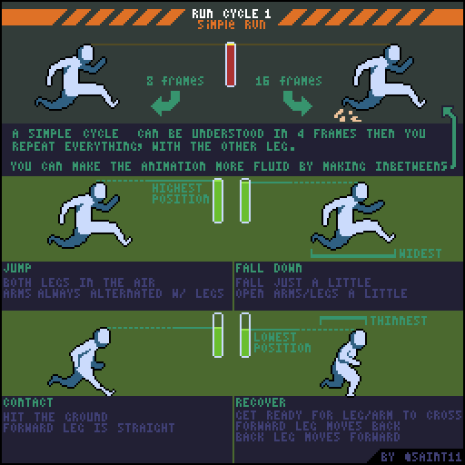
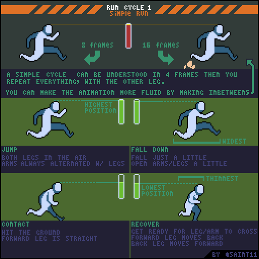

# 侧视跑步：腾空、下落、接触与恢复

先建立跑步四种核心姿态，再用插帧控制流畅度。

## 用途与前提

适合制作像素角色动画、评审动作稿，或为引擎动画状态准备资产。先具备：ANIM-001。

## 原作者教程图（本地原始 GIF）

图源：[Pedro Medeiros / RunCycleSimple.gif](https://github.com/saint11/Saint11Tutorials/blob/ce1393eb2c46441d917134a9fd52e15575ee10a7/RunCycleSimple.gif)，CC BY 4.0。原文件 512×512，32个合成GIF帧，总时长约2560 ms。**这是整个教程图的GIF容器帧数，不是每个角色示例的推荐动画帧数。**

## 关键概念（原图中文整理）

- 原图把一侧腿的基本跑步概括为四种姿态，再为另一侧重复；展示8帧和16帧版本。
- 跑步有双脚离地的腾空阶段；它与行走的区别不是单纯播放更快。
- 关键姿势先成立，增加中间帧才有意义。

## 操作步骤（根据原图重述）

1. 画 Jump：两条腿都在空中，手臂与腿保持相反摆动；这一阶段靠近最高位置。
2. 画 Fall down：角色略微下落，双臂与双腿张开一点，准备触地。
3. 画 Contact：向前伸的腿接触地面、较直，身体到较低位置。
4. 画 Recover：腿弯曲，前腿准备后移、后腿准备前移，双臂也将交叉。
5. 把四种姿势应用到另一侧腿，注意前后遮挡；先得到短周期。
6. 在关键姿态间加中间帧，比较8帧和16帧结果；保持轮廓、体积与周期时长。

## 如何读图

顶端展示两种帧数的跑步。下方四格分别是腾空、下落、接触和恢复，旁边的竖条标注身体高低；绿色框强调高点，接触格标低点。

### 静态关键帧

以下按GIF总帧序列的四个位置抽取，方便不支持动画的阅读器。它们不是动作逐帧全集；完整时序以原始GIF为准。

原GIF第0帧（从0计），时间约0 ms；帧截取，未重绘。

原GIF第8帧（从0计），时间约640 ms；帧截取，未重绘。

原GIF第16帧（从0计），时间约1280 ms；帧截取，未重绘。

原GIF第24帧（从0计），时间约1920 ms；帧截取，未重绘。

## 实作练习（整理者补充）

整理者练习：给同一角色制作“散步”和“冲刺”，分别使用ANIM-001与本篇逻辑。先只画单色剪影；让另一位观察者不看名称也能分辨两种动作。

## 验收清单（整理者补充）

- [ ] 至少有清楚的腾空段和触地段。
- [ ] 腿交叉前后关系清晰，不像双腿同时向同侧摆。
- [ ] 低点与落地相关，插帧后没有出现身体长度突变。

## 常见问题（整理者补充）

- 把行走动画加速作为唯一跑步版本。
- 直接追求16帧，却没有先解决四种关键姿态的可读性。

## 给读取本文的 agent

先使用文字中的概念和步骤，再按需要打开本地GIF/关键帧。不要仅凭图片文件名推断动作规则；不要把画法示例解释为固定帧率、固定碰撞箱或已经在某个引擎中测试。导出时记录画布尺寸、脚底锚点、方向、帧时长及状态标签。

## 来源、许可与整理说明

- 原作者：Pedro Medeiros（Saint11）。
- 固定版本来源：[RunCycleSimple.gif](https://github.com/saint11/Saint11Tutorials/blob/ce1393eb2c46441d917134a9fd52e15575ee10a7/RunCycleSimple.gif)。
- 授权证据：[仓库 README](https://github.com/saint11/Saint11Tutorials/blob/ce1393eb2c46441d917134a9fd52e15575ee10a7/README.md)；许可证：[Creative Commons Attribution 4.0 International](https://creativecommons.org/licenses/by/4.0/)。
- 本地获取日期：2026-10-29。原始GIF SHA-256：`f7a1b449bb6880149620e8fe30cbb2ed21088091323b28195ae87c65b11f4909`。
- 变更：原GIF原样保存；额外PNG由GIF帧截取；中文概念和步骤为依据原图的人工整理，未声称逐字全文OCR。练习、验收、常见问题与agent操作建议是整理者补充。中文改编也按CC BY 4.0提供，署名原作者并标注整理者为本教程库。
- 未运行游戏工程；效果示例属于作者原图。原图中的风格偏好不作为所有项目的硬性规则。
