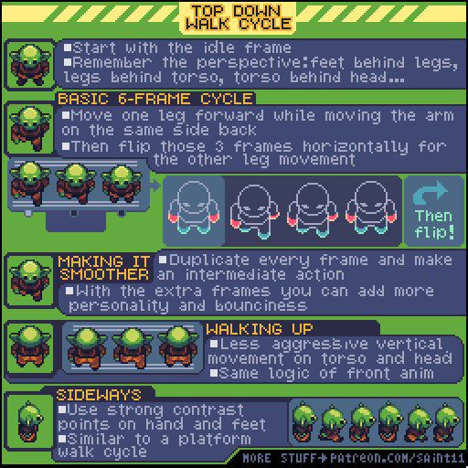
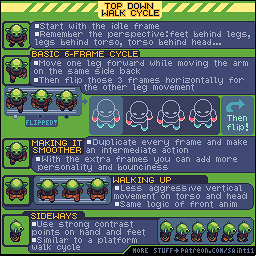

# 俯视行走：六帧周期与四方向遮挡

从站姿建立俯视六帧行走，保持头、躯干、腿和脚的层叠关系。

## 用途与前提

适合制作像素角色动画、评审动作稿，或为引擎动画状态准备资产。先具备：能画正面俯视站姿；ANIM-001。

## 原作者教程图（本地原始 GIF）

图源：[Pedro Medeiros / TopDownWalkCycle.gif](https://github.com/saint11/Saint11Tutorials/blob/ce1393eb2c46441d917134a9fd52e15575ee10a7/TopDownWalkCycle.gif)，CC BY 4.0。原文件 512×512，12个合成GIF帧，总时长约1200 ms。**这是整个教程图的GIF容器帧数，不是每个角色示例的推荐动画帧数。**

## 关键概念（原图中文整理）

- 原图提醒俯视角色的遮挡顺序：脚在腿后、腿在躯干后、躯干在头后。这里是常见游戏俯视表现，并非完全垂直向下的正投影。
- 正面六帧循环可从一条腿前进、同侧手臂后退开始，再制作另一侧。
- 背面与侧面可借用运动逻辑，但仍需重画可见部位。

## 操作步骤（根据原图重述）

1. 从静止帧开始，先确定头部、肩部、躯干和脚的遮挡关系。
2. 让一条腿向前，同时让同侧手臂向后，制作半周期。
3. 为另一条腿制作对应半周期，原图用水平翻转说明基本结构；服饰不对称时须修正。
4. 需要更平顺时，把隔一帧的姿态复制，再绘制中间动作；不要只重复画面而不改变姿态。
5. 绘制向上行走：给躯干和头较明显的纵向运动，沿用正面动作的节奏。
6. 绘制侧向：让手与脚用较强的明暗对比区分；它的动作结构接近侧视行走。

## 如何读图

第一行标出站姿和遮挡；第二至四行把手脚动作拆开，并用“flip”说明另一半。后面依次展示增加中间动作、向上行走、侧向行走。

### 静态关键帧

以下按GIF总帧序列的四个位置抽取，方便不支持动画的阅读器。它们不是动作逐帧全集；完整时序以原始GIF为准。

原GIF第0帧（从0计），时间约0 ms；帧截取，未重绘。

原GIF第3帧（从0计），时间约300 ms；帧截取，未重绘。

原GIF第6帧（从0计），时间约600 ms；帧截取，未重绘。

原GIF第9帧（从0计），时间约900 ms；帧截取，未重绘。

## 实作练习（整理者补充）

整理者练习：制作同一角色的下、上、左、右四向行走。使用同一画布与脚底锚点。给角色加一个单肩包，专门验证镜像后是否需要重画。

## 验收清单（整理者补充）

- [ ] 四方向的头身比例和脚底锚点一致。
- [ ] 脚没有穿透躯干，手臂不会错贴在脸上。
- [ ] 单肩包、刀鞘等不对称细节不会因镜像换边。

## 常见问题（整理者补充）

- 把“俯视”理解为随意缩短腿，而没有控制层叠。
- 整张正面动画简单镜像充当所有方向。

## 给读取本文的 agent

先使用文字中的概念和步骤，再按需要打开本地GIF/关键帧。不要仅凭图片文件名推断动作规则；不要把画法示例解释为固定帧率、固定碰撞箱或已经在某个引擎中测试。导出时记录画布尺寸、脚底锚点、方向、帧时长及状态标签。

## 来源、许可与整理说明

- 原作者：Pedro Medeiros（Saint11）。
- 固定版本来源：[TopDownWalkCycle.gif](https://github.com/saint11/Saint11Tutorials/blob/ce1393eb2c46441d917134a9fd52e15575ee10a7/TopDownWalkCycle.gif)。
- 授权证据：[仓库 README](https://github.com/saint11/Saint11Tutorials/blob/ce1393eb2c46441d917134a9fd52e15575ee10a7/README.md)；许可证：[Creative Commons Attribution 4.0 International](https://creativecommons.org/licenses/by/4.0/)。
- 本地获取日期：2026-10-29。原始GIF SHA-256：`b21c27c41e4b91976b2198517bd6a9f6aeac7ce29e9b6bfdbf65e275ed6d7738`。
- 变更：原GIF原样保存；额外PNG由GIF帧截取；中文概念和步骤为依据原图的人工整理，未声称逐字全文OCR。练习、验收、常见问题与agent操作建议是整理者补充。中文改编也按CC BY 4.0提供，署名原作者并标注整理者为本教程库。
- 未运行游戏工程；效果示例属于作者原图。原图中的风格偏好不作为所有项目的硬性规则。
