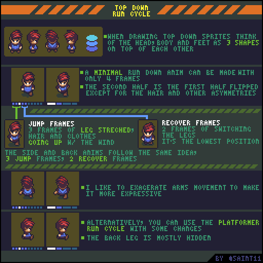
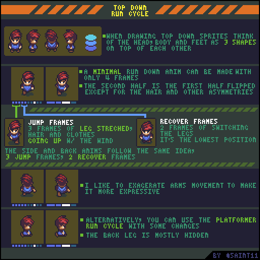

# 俯视跑步：层叠体块、腾空与恢复

把头、躯干和脚当作层叠体块，设计正面、背面与侧面的跑步。

## 用途与前提

适合制作像素角色动画、评审动作稿，或为引擎动画状态准备资产。先具备：ANIM-002；ANIM-003。

## 原作者教程图（本地原始 GIF）

图源：[Pedro Medeiros / TopDownRun.gif](https://github.com/saint11/Saint11Tutorials/blob/ce1393eb2c46441d917134a9fd52e15575ee10a7/TopDownRun.gif)，CC BY 4.0。原文件 512×512，10个合成GIF帧，总时长约1000 ms。**这是整个教程图的GIF容器帧数，不是每个角色示例的推荐动画帧数。**

## 关键概念（原图中文整理）

- 原作者把头、身体和脚看作三个叠在一起的形状，以维持俯视角色的体积。
- 图中说明最简跑步可用4帧，但更详细的展示分成3个腾空帧和3个恢复帧；这是不同复杂度的方案。
- 另一半可复用动作结构，但头发和不对称装饰不能不加检查地翻转。

## 操作步骤（根据原图重述）

1. 先把头、躯干和脚分成可辨认的色块，确定站姿中的遮挡顺序。
2. 画腾空阶段：腿伸展，头发和衣物随头部一起向上，但可保留适度延迟。
3. 画恢复阶段：腿向下收回或切换支撑，身体到最低处。
4. 构造另一半周期；检查发型、服装和装备的左右差异。
5. 向上与侧向跑步沿用腾空/恢复逻辑，原图为侧面和背面各示范2个腾空帧加2个恢复帧，不要求所有方向都采用正面的3+3。原作者在背面夸张手臂摆动以增强表现力。
6. 侧面也可参考横版跑步，但应调整俯视下后腿大多被遮挡的情况。

## 如何读图

顶行显示层叠体块和多方向角色；中段比较最简循环与腾空/恢复分组。底部两行给出背面和侧面的摆臂、腿部遮挡。

### 静态关键帧

以下按GIF总帧序列的四个位置抽取，方便不支持动画的阅读器。它们不是动作逐帧全集；完整时序以原始GIF为准。

原GIF第0帧（从0计），时间约0 ms；帧截取，未重绘。

原GIF第2帧（从0计），时间约200 ms；帧截取，未重绘。

原GIF第5帧（从0计），时间约500 ms；帧截取，未重绘。

原GIF第7帧（从0计），时间约700 ms；帧截取，未重绘。

## 实作练习（整理者补充）

整理者练习：给ANIM-003角色增加四向冲刺，每方向先做最简关键帧版，再做有头发延迟的版；导出时保留相同画布与帧标签。

## 验收清单（整理者补充）

- [ ] 跑步具有清楚的身体高低变化，四方向节奏相近。
- [ ] 后腿被遮挡时仍能辨认支撑关系。
- [ ] 头发不会机械地与头部每一像素同步。

## 常见问题（整理者补充）

- 把4帧示意误当成所有项目必须使用的固定帧数。
- 为增强跑步幅度而破坏角色原有体积。

## 给读取本文的 agent

先使用文字中的概念和步骤，再按需要打开本地GIF/关键帧。不要仅凭图片文件名推断动作规则；不要把画法示例解释为固定帧率、固定碰撞箱或已经在某个引擎中测试。导出时记录画布尺寸、脚底锚点、方向、帧时长及状态标签。

## 来源、许可与整理说明

- 原作者：Pedro Medeiros（Saint11）。
- 固定版本来源：[TopDownRun.gif](https://github.com/saint11/Saint11Tutorials/blob/ce1393eb2c46441d917134a9fd52e15575ee10a7/TopDownRun.gif)。
- 授权证据：[仓库 README](https://github.com/saint11/Saint11Tutorials/blob/ce1393eb2c46441d917134a9fd52e15575ee10a7/README.md)；许可证：[Creative Commons Attribution 4.0 International](https://creativecommons.org/licenses/by/4.0/)。
- 本地获取日期：2026-10-29。原始GIF SHA-256：`0cd238fc69d8c8c3df759960d3c2c5eb9f13d900b6e06d0c1a3a8256ba9f40c0`。
- 变更：原GIF原样保存；额外PNG由GIF帧截取；中文概念和步骤为依据原图的人工整理，未声称逐字全文OCR。练习、验收、常见问题与agent操作建议是整理者补充。中文改编也按CC BY 4.0提供，署名原作者并标注整理者为本教程库。
- 未运行游戏工程；效果示例属于作者原图。原图中的风格偏好不作为所有项目的硬性规则。
