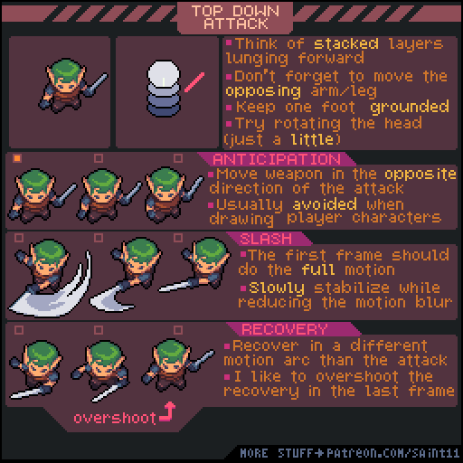
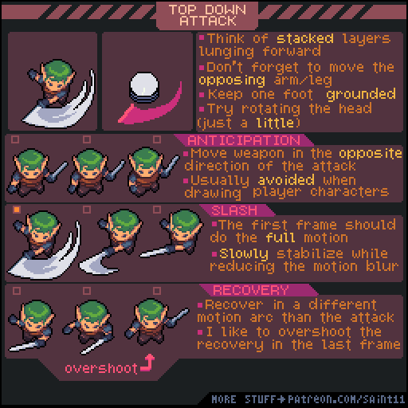
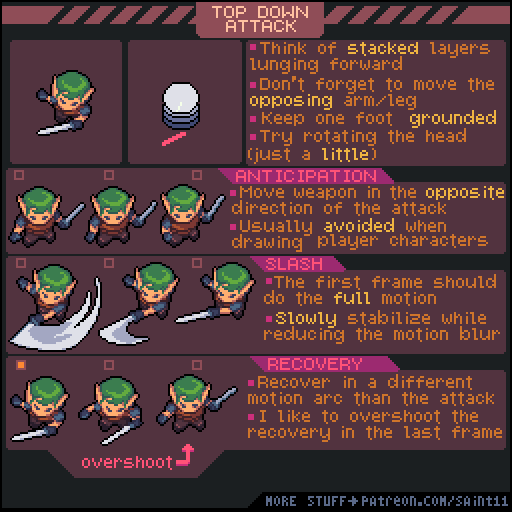

# 俯视攻击：预备、斩击与回收

从层叠身体的前倾开始，组织武器预备、完整斩击和不同路径的回收。

## 用途与前提

适合制作像素角色动画、评审动作稿，或为引擎动画状态准备资产。先具备：ANIM-003；能画持武器站姿。

## 原作者教程图（本地原始 GIF）

图源：[Pedro Medeiros / TopDownAttack.gif](https://github.com/saint11/Saint11Tutorials/blob/ce1393eb2c46441d917134a9fd52e15575ee10a7/TopDownAttack.gif)，CC BY 4.0。原文件 512×512，11个合成GIF帧，总时长约920 ms。**这是整个教程图的GIF容器帧数，不是每个角色示例的推荐动画帧数。**

## 关键概念（原图中文整理）

- 攻击时可把身体想成向前倾斜的层叠体块，带动头部与对侧手脚。
- 通常保留一只脚触地，动作更有支点。
- 原作者说玩家角色经常避免明显预备动作，这是响应感的取舍，不是所有攻击都禁止预备。

## 操作步骤（根据原图重述）

1. 画前倾的主要攻击姿势；移动对侧手臂和腿，保留一只脚在地面，可轻微转头。
2. 若需要预备 Anticipation，让武器先朝攻击的反方向移动；敌人招式可据此给玩家提示。
3. 进入 Slash：原图建议第一张斩击帧就表达完整运动范围，用轮廓和拖影交代快速挥击。
4. 后续斩击帧逐渐稳定，同时减少运动拖影，让武器位置重新清晰。
5. 进入 Recovery：用不同于挥出的路径回收，不只是把攻击帧倒放。
6. 可在回收末尾稍微越过静止位置再归位，形成 overshoot；检查这个过冲不影响需要的控制响应。

## 如何读图

上方层叠示意解释身体前倾；中间三组是预备、斩击和回收。最后“overshoot”标注末帧越过平衡点的回弹。

### 静态关键帧

以下按GIF总帧序列的四个位置抽取，方便不支持动画的阅读器。它们不是动作逐帧全集；完整时序以原始GIF为准。

原GIF第0帧（从0计），时间约0 ms；帧截取，未重绘。

原GIF第2帧（从0计），时间约160 ms；帧截取，未重绘。

原GIF第5帧（从0计），时间约400 ms；帧截取，未重绘。

原GIF第8帧（从0计），时间约680 ms；帧截取，未重绘。

## 实作练习（整理者补充）

整理者练习：为同一把短剑做快速玩家攻击和慢速敌人预告攻击。MD记录“伤害生效帧/可取消帧”作为你自己的实现约定，原图没有提供这些引擎规则。

## 验收清单（整理者补充）

- [ ] 支撑脚与武器轨迹清晰，持剑手不在动画中换边。
- [ ] 第一张攻击帧能读出方向与距离。
- [ ] 回收与挥出路径有所区别，循环到待机不跳位。

## 常见问题（整理者补充）

- 用插帧把攻击无限放慢，失去快速挥击的表现。
- 把动画拖影范围直接当作引擎碰撞范围；二者需要单独设计。

## 给读取本文的 agent

先使用文字中的概念和步骤，再按需要打开本地GIF/关键帧。不要仅凭图片文件名推断动作规则；不要把画法示例解释为固定帧率、固定碰撞箱或已经在某个引擎中测试。导出时记录画布尺寸、脚底锚点、方向、帧时长及状态标签。

## 来源、许可与整理说明

- 原作者：Pedro Medeiros（Saint11）。
- 固定版本来源：[TopDownAttack.gif](https://github.com/saint11/Saint11Tutorials/blob/ce1393eb2c46441d917134a9fd52e15575ee10a7/TopDownAttack.gif)。
- 授权证据：[仓库 README](https://github.com/saint11/Saint11Tutorials/blob/ce1393eb2c46441d917134a9fd52e15575ee10a7/README.md)；许可证：[Creative Commons Attribution 4.0 International](https://creativecommons.org/licenses/by/4.0/)。
- 本地获取日期：2026-10-29。原始GIF SHA-256：`a9ba14c6bfd58ccf7c73a072cf810eae320aee608b3a68ec4c53c0c7c08e508d`。
- 变更：原GIF原样保存；额外PNG由GIF帧截取；中文概念和步骤为依据原图的人工整理，未声称逐字全文OCR。练习、验收、常见问题与agent操作建议是整理者补充。中文改编也按CC BY 4.0提供，署名原作者并标注整理者为本教程库。
- 未运行游戏工程；效果示例属于作者原图。原图中的风格偏好不作为所有项目的硬性规则。
