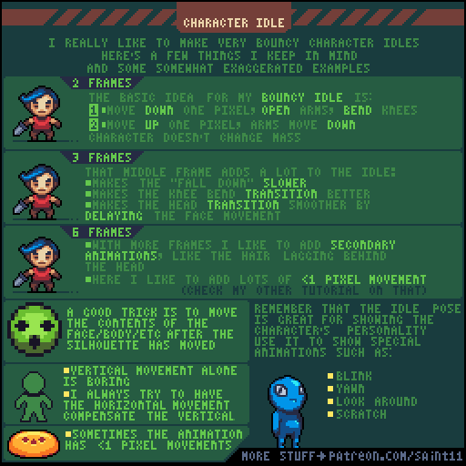
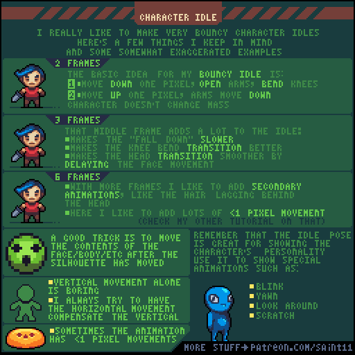
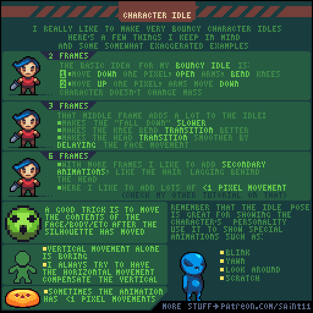

# 待机动画：两帧、三帧、六帧与次级运动

从微小上下变化扩展到头发延迟、横向补偿和角色性格动作。

## 用途与前提

适合制作像素角色动画、评审动作稿，或为引擎动画状态准备资产。先具备：完成稳定角色站姿。

## 原作者教程图（本地原始 GIF）

图源：[Pedro Medeiros / characterIdle.gif](https://github.com/saint11/Saint11Tutorials/blob/ce1393eb2c46441d917134a9fd52e15575ee10a7/characterIdle.gif)，CC BY 4.0。原文件 512×512，60个合成GIF帧，总时长约6000 ms。**这是整个教程图的GIF容器帧数，不是每个角色示例的推荐动画帧数。**

## 关键概念（原图中文整理）

- 原图示范富有弹性的待机，包含2、3、6帧不同复杂度；夸张程度应服务角色。
- 两帧基础版是在下压时张开手臂、弯膝，上升时让手臂向下；整体体积保持稳定。
- 更多帧可让头部、脸和头发错开节奏，形成次级运动。

## 操作步骤（根据原图重述）

1. 以站姿为基准，制作身体下降1像素和上升1像素的两个姿势，配合膝盖与手臂，避免整体缩放。
2. 加入第三帧，使下落更慢，并改善膝部过渡；头与脸可以稍晚开始移动。
3. 扩展到六帧时，给头发加入跟随头部但略延迟的变化。
4. 外轮廓不易移动时，可先移动脸、身体内部或牙齿等内容，再移动轮廓。
5. 加入适度水平运动补偿单纯竖直起伏，让动作更自然。
6. 用眨眼、打哈欠、四处看、挠痒等低频动作表达性格；与常驻呼吸循环分开设计。

## 如何读图

左侧三组人物是2、3、6帧比较；中下部头骨解释内部先动、轮廓后动；右下角色列表给出额外性格动作。

### 静态关键帧

以下按GIF总帧序列的四个位置抽取，方便不支持动画的阅读器。它们不是动作逐帧全集；完整时序以原始GIF为准。

原GIF第0帧（从0计），时间约0 ms；帧截取，未重绘。

原GIF第15帧（从0计），时间约1500 ms；帧截取，未重绘。

原GIF第30帧（从0计），时间约3000 ms；帧截取，未重绘。

原GIF第45帧（从0计），时间约4500 ms；帧截取，未重绘。

## 实作练习（整理者补充）

整理者练习：为村民做安静呼吸，为活泼商人做弹性呼吸，再各加一次眨眼。保留无动作站姿，比较动画是否让人物更容易识别。

## 验收清单（整理者补充）

- [ ] 角色体积和脚底位置保持稳定。
- [ ] 循环不是整张贴图反复上下位移。
- [ ] 次级运动有先后，不会同时乱动产生噪点。

## 常见问题（整理者补充）

- 直接把人物压缩拉伸导致像素宽高失真。
- 循环过于夸张，让原本安静的角色一直像在跳舞。

## 给读取本文的 agent

先使用文字中的概念和步骤，再按需要打开本地GIF/关键帧。不要仅凭图片文件名推断动作规则；不要把画法示例解释为固定帧率、固定碰撞箱或已经在某个引擎中测试。导出时记录画布尺寸、脚底锚点、方向、帧时长及状态标签。

## 来源、许可与整理说明

- 原作者：Pedro Medeiros（Saint11）。
- 固定版本来源：[characterIdle.gif](https://github.com/saint11/Saint11Tutorials/blob/ce1393eb2c46441d917134a9fd52e15575ee10a7/characterIdle.gif)。
- 授权证据：[仓库 README](https://github.com/saint11/Saint11Tutorials/blob/ce1393eb2c46441d917134a9fd52e15575ee10a7/README.md)；许可证：[Creative Commons Attribution 4.0 International](https://creativecommons.org/licenses/by/4.0/)。
- 本地获取日期：2026-10-29。原始GIF SHA-256：`f9c9cb05273ae16327d45f8ccd39d506c3e7dff52321b5bfae2558b15f9831d4`。
- 变更：原GIF原样保存；额外PNG由GIF帧截取；中文概念和步骤为依据原图的人工整理，未声称逐字全文OCR。练习、验收、常见问题与agent操作建议是整理者补充。中文改编也按CC BY 4.0提供，署名原作者并标注整理者为本教程库。
- 未运行游戏工程；效果示例属于作者原图。原图中的风格偏好不作为所有项目的硬性规则。
