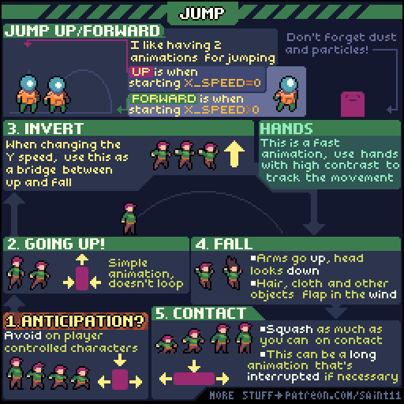
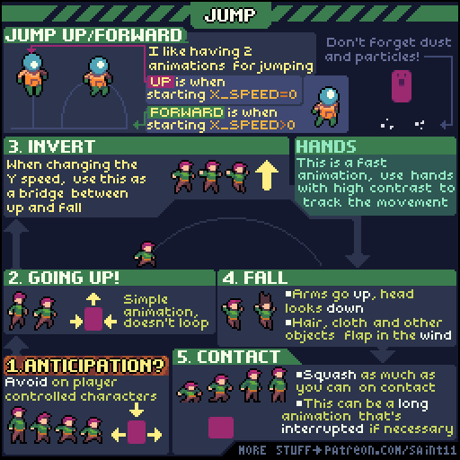
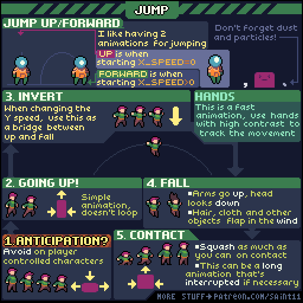
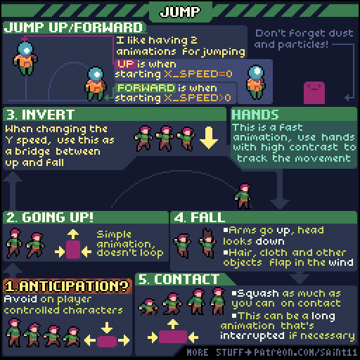

# 跳跃与落地：上升、拐点、下落和接触

区分原地起跳和前向跳跃，并把顶点过渡与落地压缩做清楚。

## 用途与前提

适合制作像素角色动画、评审动作稿，或为引擎动画状态准备资产。先具备：ANIM-002；理解游戏跳跃状态。

## 原作者教程图（本地原始 GIF）

图源：[Pedro Medeiros / Jump.gif](https://github.com/saint11/Saint11Tutorials/blob/ce1393eb2c46441d917134a9fd52e15575ee10a7/Jump.gif)，CC BY 4.0。原文件 512×512，24个合成GIF帧，总时长约1920 ms。**这是整个教程图的GIF容器帧数，不是每个角色示例的推荐动画帧数。**

## 关键概念（原图中文整理）

- 原图作者倾向分开制作水平速度为0的向上跳与水平速度大于0的向前跳。
- 上升、垂直速度反向的顶点、下落和落地是不同阶段，不能全部循环同一组帧。
- 快速动作可用高对比的手部帮助观察者追踪。

## 操作步骤（根据原图重述）

1. 按是否有水平运动准备两种起跳姿势。原图对玩家控制角色提示慎用长预备动作。
2. 画 Going up：上升动作简单、不要循环。
3. 在垂直速度即将换向时画 Invert，作为上升与下降的桥接。
4. 画 Fall：双臂抬起、头朝下看；头发、衣物等受运动影响，姿态与上升不同。
5. 画 Contact：落地时压缩身体，突出受力；作者指出这个动画可以较长，但应在必要时被打断。
6. 按需加落地尘土或粒子；把角色动作与粒子保持同一接触时刻。

## 如何读图

图的编号按起跳预备、上升、拐点、下落、接触排列，页面视觉排布并不是编号顺序。左上的轨迹比较垂直跳与前向跳。

### 静态关键帧

以下按GIF总帧序列的四个位置抽取，方便不支持动画的阅读器。它们不是动作逐帧全集；完整时序以原始GIF为准。

原GIF第0帧（从0计），时间约0 ms；帧截取，未重绘。

原GIF第6帧（从0计），时间约480 ms；帧截取，未重绘。

原GIF第12帧（从0计），时间约960 ms；帧截取，未重绘。

原GIF第18帧（从0计），时间约1440 ms；帧截取，未重绘。

## 实作练习（整理者补充）

整理者练习：制作村民跨水沟的跳跃。先单独导出五个动作段，再在引擎里用速度与触地状态切换；状态判断代码属于实施练习，非原图原文。

## 验收清单（整理者补充）

- [ ] 到顶点不会瞬间从上升姿势跳成完全相反姿势。
- [ ] 下落动画与水平移动速度可兼容。
- [ ] 落地压缩有恢复，快速连跳可以按项目要求中断。

## 常见问题（整理者补充）

- 把完整跳跃做成恒速循环，滞空时间一变就对不上。
- 动画中脚已触地，引擎中的角色仍在空中。

## 给读取本文的 agent

先使用文字中的概念和步骤，再按需要打开本地GIF/关键帧。不要仅凭图片文件名推断动作规则；不要把画法示例解释为固定帧率、固定碰撞箱或已经在某个引擎中测试。导出时记录画布尺寸、脚底锚点、方向、帧时长及状态标签。

## 来源、许可与整理说明

- 原作者：Pedro Medeiros（Saint11）。
- 固定版本来源：[Jump.gif](https://github.com/saint11/Saint11Tutorials/blob/ce1393eb2c46441d917134a9fd52e15575ee10a7/Jump.gif)。
- 授权证据：[仓库 README](https://github.com/saint11/Saint11Tutorials/blob/ce1393eb2c46441d917134a9fd52e15575ee10a7/README.md)；许可证：[Creative Commons Attribution 4.0 International](https://creativecommons.org/licenses/by/4.0/)。
- 本地获取日期：2026-10-29。原始GIF SHA-256：`2f77444610d7fdbba9c4be049c2b2f731c34f0865ff660a28b38d21c61a52690`。
- 变更：原GIF原样保存；额外PNG由GIF帧截取；中文概念和步骤为依据原图的人工整理，未声称逐字全文OCR。练习、验收、常见问题与agent操作建议是整理者补充。中文改编也按CC BY 4.0提供，署名原作者并标注整理者为本教程库。
- 未运行游戏工程；效果示例属于作者原图。原图中的风格偏好不作为所有项目的硬性规则。
