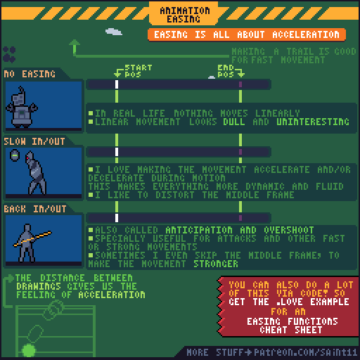
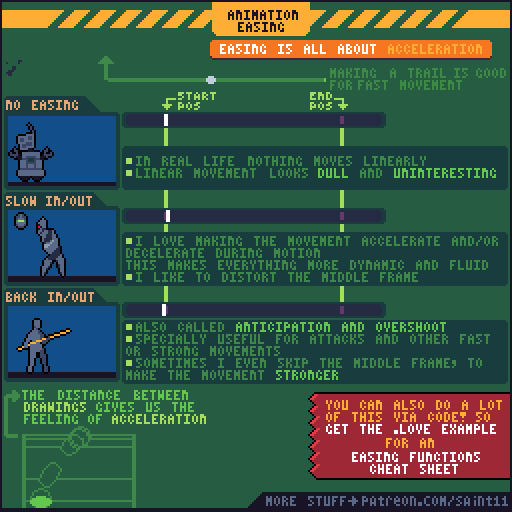
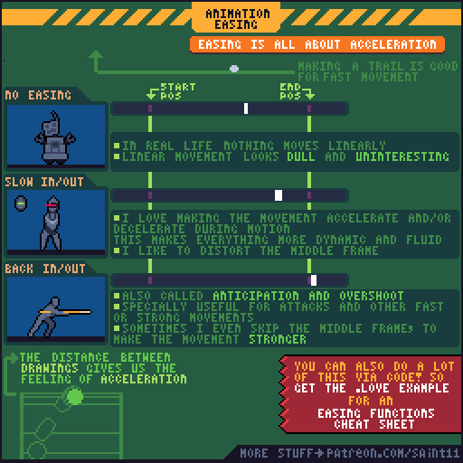
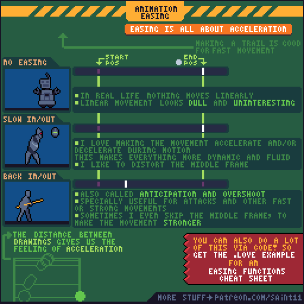

# 动画缓动：用间距表达加速、减速与过冲

通过逐帧位置间距理解线性、缓入缓出、预备与过冲。

## 用途与前提

适合制作像素角色动画、评审动作稿，或为引擎动画状态准备资产。先具备：理解帧间时间与帧间位移。

## 原作者教程图（本地原始 GIF）

图源：[Pedro Medeiros / Easings.gif](https://github.com/saint11/Saint11Tutorials/blob/ce1393eb2c46441d917134a9fd52e15575ee10a7/Easings.gif)，CC BY 4.0。原文件 512×512，23个合成GIF帧，总时长约1840 ms。**这是整个教程图的GIF容器帧数，不是每个角色示例的推荐动画帧数。**

## 关键概念（原图中文整理）

- 原图把 easing 解释为加速度问题；等间距同时间的运动看起来接近匀速。
- 缓入缓出改变运动中的间距，原作者也会变形中间帧来增强动感。
- 预备和过冲可让攻击等有力动作更明确，也可轻微跳过中间帧让节奏更有力。

## 操作步骤（根据原图重述）

1. 先做两个端点间的等时、等距运动，保留为基准。
2. 制作 Slow in/out：在两端减少相邻帧位置差，在中段增加位置差，比较速度变化。
3. 用运动轨迹或点标出每一帧；点之间的距离就是理解加减速的关键。
4. 制作 Back in/out：先往相反方向小幅预备，到终点后略微超过再回来。
5. 在快速段试用更明显的中间帧变形，判断轮廓是否仍能读懂。
6. 若使用代码缓动，也要在实际像素分辨率检查位置量化；原图提到可用代码，但未规定具体引擎实现。

## 如何读图

左侧三组实例对比无缓动、缓入缓出、带预备和过冲的动作；右侧彩条标起点终点。下方曲线和轨迹解释速度感觉来自相邻位置的距离。

### 静态关键帧

以下按GIF总帧序列的四个位置抽取，方便不支持动画的阅读器。它们不是动作逐帧全集；完整时序以原始GIF为准。

原GIF第0帧（从0计），时间约0 ms；帧截取，未重绘。

原GIF第5帧（从0计），时间约400 ms；帧截取，未重绘。

原GIF第11帧（从0计），时间约880 ms；帧截取，未重绘。

原GIF第17帧（从0计），时间约1360 ms；帧截取，未重绘。

## 实作练习（整理者补充）

整理者练习：同一扇农舍木门做三种开启动作，端点与总时长完全一致，只改变逐帧间距。说明哪种适合轻门、哪种适合沉重门。

## 验收清单（整理者补充）

- [ ] 比较的总时长与端点一致。
- [ ] 缓动是位移规律变化，不是随机增删帧。
- [ ] 过冲幅度不会让物体穿墙或离开关节。

## 常见问题（整理者补充）

- 套用平滑曲线后出现亚像素模糊，却没检查整数坐标显示。
- 把所有动作都加同样夸张的弹性过冲。

## 给读取本文的 agent

先使用文字中的概念和步骤，再按需要打开本地GIF/关键帧。不要仅凭图片文件名推断动作规则；不要把画法示例解释为固定帧率、固定碰撞箱或已经在某个引擎中测试。导出时记录画布尺寸、脚底锚点、方向、帧时长及状态标签。

## 来源、许可与整理说明

- 原作者：Pedro Medeiros（Saint11）。
- 固定版本来源：[Easings.gif](https://github.com/saint11/Saint11Tutorials/blob/ce1393eb2c46441d917134a9fd52e15575ee10a7/Easings.gif)。
- 授权证据：[仓库 README](https://github.com/saint11/Saint11Tutorials/blob/ce1393eb2c46441d917134a9fd52e15575ee10a7/README.md)；许可证：[Creative Commons Attribution 4.0 International](https://creativecommons.org/licenses/by/4.0/)。
- 本地获取日期：2026-10-29。原始GIF SHA-256：`c210d363be3511752bb1401df905f59b359cda0b6bd5d724930483d43755ac30`。
- 变更：原GIF原样保存；额外PNG由GIF帧截取；中文概念和步骤为依据原图的人工整理，未声称逐字全文OCR。练习、验收、常见问题与agent操作建议是整理者补充。中文改编也按CC BY 4.0提供，署名原作者并标注整理者为本教程库。
- 未运行游戏工程；效果示例属于作者原图。原图中的风格偏好不作为所有项目的硬性规则。
