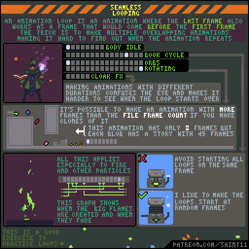
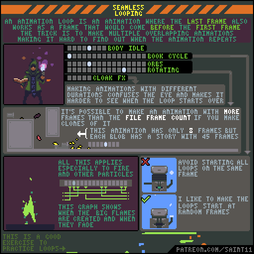
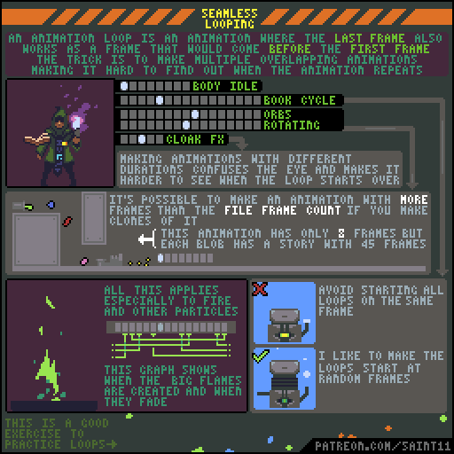
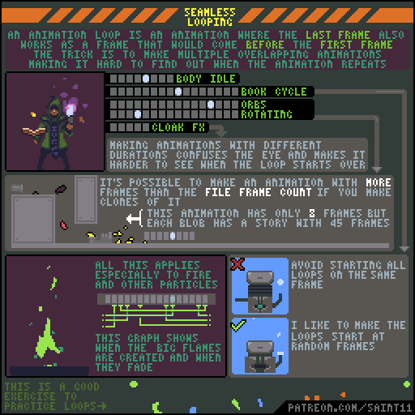

# 无缝循环：错开周期与粒子出生时刻

让尾帧自然接首帧，利用不同周期和不同相位减弱循环痕迹。

## 用途与前提

适合制作像素角色动画、评审动作稿，或为引擎动画状态准备资产。先具备：知道图层和时间轴。

## 原作者教程图（本地原始 GIF）

图源：[Pedro Medeiros / loop.gif](https://github.com/saint11/Saint11Tutorials/blob/ce1393eb2c46441d917134a9fd52e15575ee10a7/loop.gif)，CC BY 4.0。原文件 512×512，16个合成GIF帧，总时长约1600 ms。**这是整个教程图的GIF容器帧数，不是每个角色示例的推荐动画帧数。**

## 关键概念（原图中文整理）

- 无缝循环的尾帧应当能自然成为首帧之前的一帧，不要求尾帧与首帧完全相同。
- 原图用法师、漂浮书、旋转法阵与披风特效的重叠动作，让循环起点不明显。
- 粒子和火焰可错开出生与消失时间；不要所有对象同帧重启。

## 操作步骤（根据原图重述）

1. 先独立确认主体动作尾帧到首帧连续。
2. 为书、法阵、披风等次级对象安排不同长度或不同开始时刻的循环。
3. 把各对象时间轴画出来，对照同时重置的时间点。
4. 原图展示在8帧文件内放置克隆、错开状态，制造更长故事段的视觉印象；整理时区分文件帧数与观众感到的周期。
5. 为火焰或粒子错开出现与渐隐时刻，避免所有粒子在同帧消失。
6. 在实际场景中给重复物体不同初始相位；原作者倾向随机起始帧，实际项目可固定随机种子便于复现。

## 如何读图

上方时间轴分别显示法师、书、法阵和披风。中部小滴块展示错开克隆的组合效果；下方X与勾对比全部同时播放和错开相位。

### 静态关键帧

以下按GIF总帧序列的四个位置抽取，方便不支持动画的阅读器。它们不是动作逐帧全集；完整时序以原始GIF为准。

原GIF第0帧（从0计），时间约0 ms；帧截取，未重绘。

原GIF第4帧（从0计），时间约400 ms；帧截取，未重绘。

原GIF第8帧（从0计），时间约800 ms；帧截取，未重绘。

原GIF第12帧（从0计），时间约1200 ms；帧截取，未重绘。

## 实作练习（整理者补充）

整理者练习：做三盏相同灯笼的微光动画。先同步播放，再设置不同起始帧；录下10秒观察是否能轻易指出循环重置点。

## 验收清单（整理者补充）

- [ ] 尾帧到首帧不多停一拍。
- [ ] 不同物体不会周期性整齐闪灭。
- [ ] 组合周期不会要求不可接受的贴图帧数。

## 常见问题（整理者补充）

- 复制首帧到最后一帧后额外播放，造成循环停顿。
- 将随机相位误当成每帧随机改变动作，产生闪烁。

## 给读取本文的 agent

先使用文字中的概念和步骤，再按需要打开本地GIF/关键帧。不要仅凭图片文件名推断动作规则；不要把画法示例解释为固定帧率、固定碰撞箱或已经在某个引擎中测试。导出时记录画布尺寸、脚底锚点、方向、帧时长及状态标签。

## 来源、许可与整理说明

- 原作者：Pedro Medeiros（Saint11）。
- 固定版本来源：[loop.gif](https://github.com/saint11/Saint11Tutorials/blob/ce1393eb2c46441d917134a9fd52e15575ee10a7/loop.gif)。
- 授权证据：[仓库 README](https://github.com/saint11/Saint11Tutorials/blob/ce1393eb2c46441d917134a9fd52e15575ee10a7/README.md)；许可证：[Creative Commons Attribution 4.0 International](https://creativecommons.org/licenses/by/4.0/)。
- 本地获取日期：2026-10-29。原始GIF SHA-256：`6f702df42bfd40d528bcd12d4356f41d3fd9ecb80b05debdc60b7768f5d0d7aa`。
- 变更：原GIF原样保存；额外PNG由GIF帧截取；中文概念和步骤为依据原图的人工整理，未声称逐字全文OCR。练习、验收、常见问题与agent操作建议是整理者补充。中文改编也按CC BY 4.0提供，署名原作者并标注整理者为本教程库。
- 未运行游戏工程；效果示例属于作者原图。原图中的风格偏好不作为所有项目的硬性规则。
