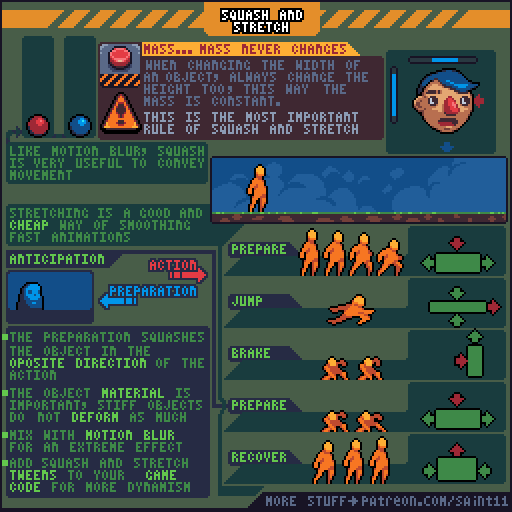
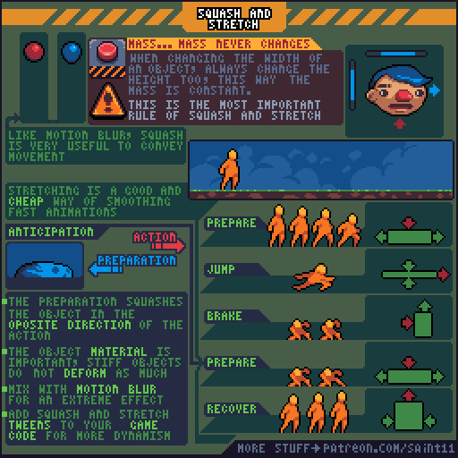
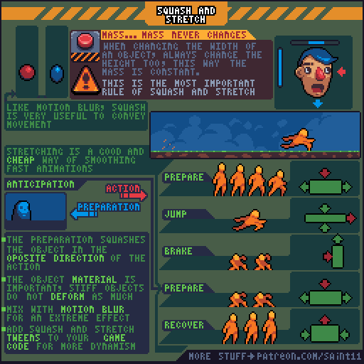
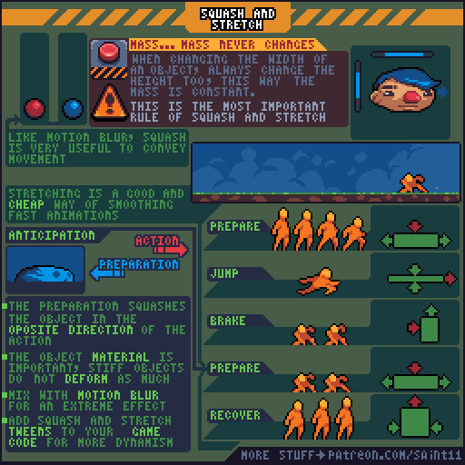

# 挤压与拉伸：动作方向、材质和体积感

用一压一伸交代发力，同时保持视觉体积并按材质调整变形幅度。

## 用途与前提

适合制作像素角色动画、评审动作稿，或为引擎动画状态准备资产。先具备：ANIM-008。

## 原作者教程图（本地原始 GIF）

图源：[Pedro Medeiros / Squash.gif](https://github.com/saint11/Saint11Tutorials/blob/ce1393eb2c46441d917134a9fd52e15575ee10a7/Squash.gif)，CC BY 4.0。原文件 512×512，19个合成GIF帧，总时长约1520 ms。**这是整个教程图的GIF容器帧数，不是每个角色示例的推荐动画帧数。**

## 关键概念（原图中文整理）

- 原图写“mass never changes”，意指表现上保持物体的质量/体积感；宽度变化时要相应补偿高度，不是在教物理质量计算。
- 预备时通常沿主要动作的反向压缩，然后沿动作方向伸展。
- 物体材质决定变形幅度，较硬物体应少变形。

## 操作步骤（根据原图重述）

1. 用简单圆球练习压扁时变宽、拉长时变窄，检查视觉体积是否稳定。
2. 画准备动作：沿行动相反的方向压缩，给出发力信号。
3. 画跳起或快速前冲：沿运动方向拉长，用少量关键帧表达速度。
4. 画制动：按受力方向压缩，再为恢复准备反向动作。
5. 画恢复：回到基准姿态；可结合ANIM-008的过冲让动作有弹性。
6. 对比软史莱姆、人物、石块的幅度；原作者也建议将变形与运动拖影结合。

## 如何读图

顶端圆球与人脸对比宽高补偿；右边橙色人物依次演示准备、跳跃、刹车、再次准备和恢复，绿色箭头表示扩张/压缩方向。

### 静态关键帧

以下按GIF总帧序列的四个位置抽取，方便不支持动画的阅读器。它们不是动作逐帧全集；完整时序以原始GIF为准。

原GIF第0帧（从0计），时间约0 ms；帧截取，未重绘。

原GIF第4帧（从0计），时间约320 ms；帧截取，未重绘。

原GIF第9帧（从0计），时间约720 ms；帧截取，未重绘。

原GIF第14帧（从0计），时间约1120 ms；帧截取，未重绘。

## 实作练习（整理者补充）

整理者练习：同一条跳跃路径分别制作软团子和木箱版本，路径、时长一致，仅改变形变程度；让观察者从动画判断材质。

## 验收清单（整理者补充）

- [ ] 形变前后视觉体积稳定。
- [ ] 方向与发力、刹车时机一致。
- [ ] 硬材质不会像橡皮泥一样剧烈扭动。

## 常见问题（整理者补充）

- 直接非整数缩放整张像素图，生成不等宽像素。
- 只拉长不压缩，造成角色时大时小。

## 给读取本文的 agent

先使用文字中的概念和步骤，再按需要打开本地GIF/关键帧。不要仅凭图片文件名推断动作规则；不要把画法示例解释为固定帧率、固定碰撞箱或已经在某个引擎中测试。导出时记录画布尺寸、脚底锚点、方向、帧时长及状态标签。

## 来源、许可与整理说明

- 原作者：Pedro Medeiros（Saint11）。
- 固定版本来源：[Squash.gif](https://github.com/saint11/Saint11Tutorials/blob/ce1393eb2c46441d917134a9fd52e15575ee10a7/Squash.gif)。
- 授权证据：[仓库 README](https://github.com/saint11/Saint11Tutorials/blob/ce1393eb2c46441d917134a9fd52e15575ee10a7/README.md)；许可证：[Creative Commons Attribution 4.0 International](https://creativecommons.org/licenses/by/4.0/)。
- 本地获取日期：2026-10-29。原始GIF SHA-256：`67aa9b80a30b5716b11c78540d76c1efd512efd857b15a8305b3e5ce47704f6b`。
- 变更：原GIF原样保存；额外PNG由GIF帧截取；中文概念和步骤为依据原图的人工整理，未声称逐字全文OCR。练习、验收、常见问题与agent操作建议是整理者补充。中文改编也按CC BY 4.0提供，署名原作者并标注整理者为本教程库。
- 未运行游戏工程；效果示例属于作者原图。原图中的风格偏好不作为所有项目的硬性规则。
