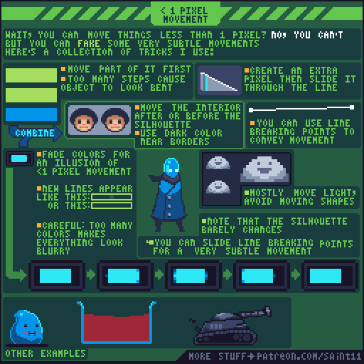
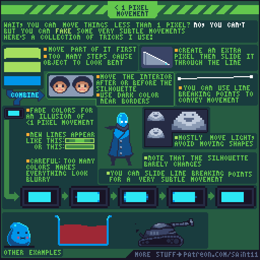
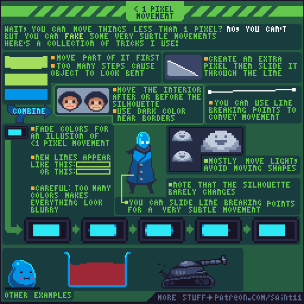

# 亚像素运动错觉：轮廓、内部与色阶

在整数像素网格内，通过错时移动局部与色阶制造小于1像素的运动感。

## 用途与前提

适合制作像素角色动画、评审动作稿，或为引擎动画状态准备资产。先具备：掌握像素轮廓与有限调色板；ANIM-006。

## 原作者教程图（本地原始 GIF）

图源：[Pedro Medeiros / Subpixel.gif](https://github.com/saint11/Saint11Tutorials/blob/ce1393eb2c46441d917134a9fd52e15575ee10a7/Subpixel.gif)，CC BY 4.0。原文件 512×512，17个合成GIF帧，总时长约1700 ms。**这是整个教程图的GIF容器帧数，不是每个角色示例的推荐动画帧数。**

## 关键概念（原图中文整理）

- 原图先澄清：像素并不能真的移动小于1个网格；这里讲的是视觉错觉。
- 可让局部先移动，或让内部与轮廓不同步。
- 颜色渐变可以辅助极小运动，但颜色过多会模糊像素。

## 操作步骤（根据原图重述）

1. 选择轮廓稳定的待机角色，先只移动内部的脸或高光，再让外轮廓跟上。
2. 对较长的边缘，尝试先移动其中一段；不要切成太多小段，否则整体看起来弯曲。
3. 原图示范增加一个像素并沿边线滑动，让观察者感到更细小的位移。
4. 在明暗边界逐帧改变少量色值，使视觉重心缓慢偏移；控制调色板，不增加大量近似色。
5. 用灯光或高光变化代替整体形状变化；原作者提示这种方式主要用于光，少改大轮廓。
6. 在最终原始分辨率检查效果：放大看得出的精细变化，缩小时也要能读到。

## 如何读图

绿色顶部说明不能真正移动半像素；各小格分别展示局部先动、内部先动、线段额外像素滑移、色阶渐变，以及头部/云朵/披风/机甲应用。

### 静态关键帧

以下按GIF总帧序列的四个位置抽取，方便不支持动画的阅读器。它们不是动作逐帧全集；完整时序以原始GIF为准。

原GIF第0帧（从0计），时间约0 ms；帧截取，未重绘。

原GIF第4帧（从0计），时间约400 ms；帧截取，未重绘。

原GIF第8帧（从0计），时间约800 ms；帧截取，未重绘。

原GIF第12帧（从0计），时间约1200 ms；帧截取，未重绘。

## 实作练习（整理者补充）

整理者练习：让16×16村民在外轮廓几乎不变的情况下轻轻呼吸。限制最多新增两种中间色，比较仅位移与位移加色阶的差别。

## 验收清单（整理者补充）

- [ ] 没有启用双线性过滤或真的把贴图放在半像素坐标上。
- [ ] 主轮廓和物体体积不漂移。
- [ ] 新增颜色数量受控，边缘没有持续脏灰或闪烁。

## 常见问题（整理者补充）

- 把渲染器亚像素坐标与像素画的亚像素运动错觉混用。
- 用很多相近颜色补偿动作，最终失去清晰的像素簇。

## 给读取本文的 agent

先使用文字中的概念和步骤，再按需要打开本地GIF/关键帧。不要仅凭图片文件名推断动作规则；不要把画法示例解释为固定帧率、固定碰撞箱或已经在某个引擎中测试。导出时记录画布尺寸、脚底锚点、方向、帧时长及状态标签。

## 来源、许可与整理说明

- 原作者：Pedro Medeiros（Saint11）。
- 固定版本来源：[Subpixel.gif](https://github.com/saint11/Saint11Tutorials/blob/ce1393eb2c46441d917134a9fd52e15575ee10a7/Subpixel.gif)。
- 授权证据：[仓库 README](https://github.com/saint11/Saint11Tutorials/blob/ce1393eb2c46441d917134a9fd52e15575ee10a7/README.md)；许可证：[Creative Commons Attribution 4.0 International](https://creativecommons.org/licenses/by/4.0/)。
- 本地获取日期：2026-10-29。原始GIF SHA-256：`91ecf5e66b7ce0737dea9dbf48e7d9c0ded662c5c8ca4b960c166be687421183`。
- 变更：原GIF原样保存；额外PNG由GIF帧截取；中文概念和步骤为依据原图的人工整理，未声称逐字全文OCR。练习、验收、常见问题与agent操作建议是整理者补充。中文改编也按CC BY 4.0提供，署名原作者并标注整理者为本教程库。
- 未运行游戏工程；效果示例属于作者原图。原图中的风格偏好不作为所有项目的硬性规则。
