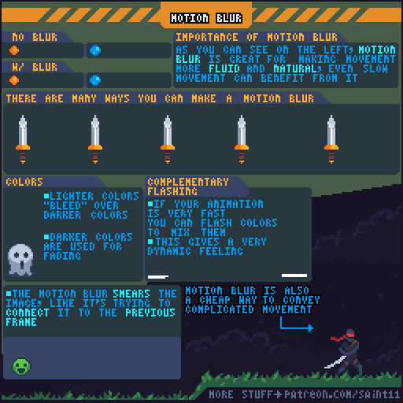
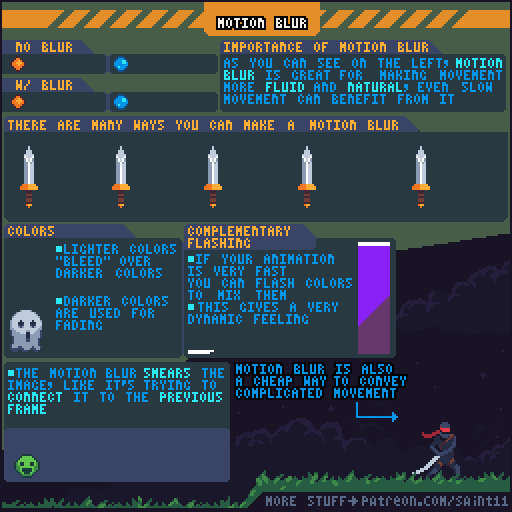
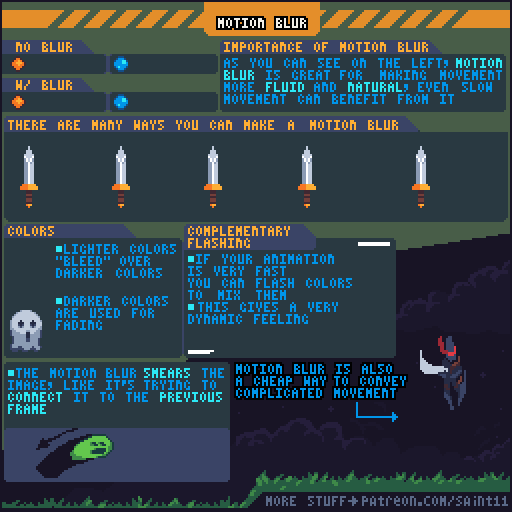
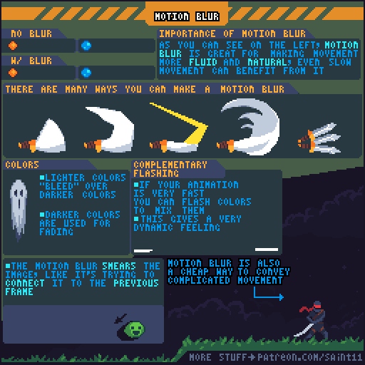

# 运动拖影：用少量帧连接快速动作

用像素形状与色阶绘制拖影，使高速运动保持方向和力度。

## 用途与前提

适合制作像素角色动画、评审动作稿，或为引擎动画状态准备资产。先具备：ANIM-005或ANIM-008。

## 原作者教程图（本地原始 GIF）

图源：[Pedro Medeiros / MotionBlur.gif](https://github.com/saint11/Saint11Tutorials/blob/ce1393eb2c46441d917134a9fd52e15575ee10a7/MotionBlur.gif)，CC BY 4.0。原文件 512×512，32个合成GIF帧，总时长约2560 ms。**这是整个教程图的GIF容器帧数，不是每个角色示例的推荐动画帧数。**

## 关键概念（原图中文整理）

- 原图中的motion blur主要是绘制出来的拖影/拉伸帧，而非对成品套摄影模糊滤镜。
- 拖影把当前形状与前一帧位置联系起来，能用较少帧表达复杂快速动作。
- 原图展示多种剑的拖影形状；不存在适用于所有动作的同一模板。

## 操作步骤（根据原图重述）

1. 先制作不带拖影的快速动作，标出相邻关键帧的位移。
2. 在位移最大处设计方向明确的拉长形状，让它连接前后姿态。
3. 试不同宽度与形状的武器拖影，保持主要武器或角色轮廓仍可定位。
4. 用较亮颜色向较暗区域延伸表现快速运动，再用较暗颜色让拖影渐退。
5. 原图还介绍高速动画中偶尔闪现互补色的表现方法；这是可选风格，实施时应检查刺激性并准备低闪烁版本。
6. 减少拖影，让动作在终点恢复清楚形状；用原始尺寸播放检查方向而非只看放大的静态帧。

## 如何读图

上方同一光点比较有无拖影；中间几把剑展示不同拖影形状，下面说明明暗颜色、互补色闪现及快速复杂姿态的运用。

### 静态关键帧

以下按GIF总帧序列的四个位置抽取，方便不支持动画的阅读器。它们不是动作逐帧全集；完整时序以原始GIF为准。

原GIF第0帧（从0计），时间约0 ms；帧截取，未重绘。

原GIF第8帧（从0计），时间约640 ms；帧截取，未重绘。

原GIF第16帧（从0计），时间约1280 ms；帧截取，未重绘。

原GIF第24帧（从0计），时间约1920 ms；帧截取，未重绘。

## 实作练习（整理者补充）

整理者练习：给镰刀收割动作做两版：仅两张关键帧、以及加一张手绘拖影。保持动作总时长，比较辨识方向与命中时刻的差异。

## 验收清单（整理者补充）

- [ ] 拖影出现在快速段而非全程残留。
- [ ] 没有用模糊滤镜生成大量半透明杂色。
- [ ] 终点武器和手部位置清楚，低闪烁版保留相同动作信息。

## 常见问题（整理者补充）

- 以增加透明渐变代替设计清楚的运动轮廓。
- 拖影遮住目标或视觉范围远大于实际攻击范围。

## 给读取本文的 agent

先使用文字中的概念和步骤，再按需要打开本地GIF/关键帧。不要仅凭图片文件名推断动作规则；不要把画法示例解释为固定帧率、固定碰撞箱或已经在某个引擎中测试。导出时记录画布尺寸、脚底锚点、方向、帧时长及状态标签。

## 来源、许可与整理说明

- 原作者：Pedro Medeiros（Saint11）。
- 固定版本来源：[MotionBlur.gif](https://github.com/saint11/Saint11Tutorials/blob/ce1393eb2c46441d917134a9fd52e15575ee10a7/MotionBlur.gif)。
- 授权证据：[仓库 README](https://github.com/saint11/Saint11Tutorials/blob/ce1393eb2c46441d917134a9fd52e15575ee10a7/README.md)；许可证：[Creative Commons Attribution 4.0 International](https://creativecommons.org/licenses/by/4.0/)。
- 本地获取日期：2026-10-29。原始GIF SHA-256：`a94b0e13e62623b36fa8e01823fb52e8a731345762eac5b11d5d66b34cca597d`。
- 变更：原GIF原样保存；额外PNG由GIF帧截取；中文概念和步骤为依据原图的人工整理，未声称逐字全文OCR。练习、验收、常见问题与agent操作建议是整理者补充。中文改编也按CC BY 4.0提供，署名原作者并标注整理者为本教程库。
- 未运行游戏工程；效果示例属于作者原图。原图中的风格偏好不作为所有项目的硬性规则。
