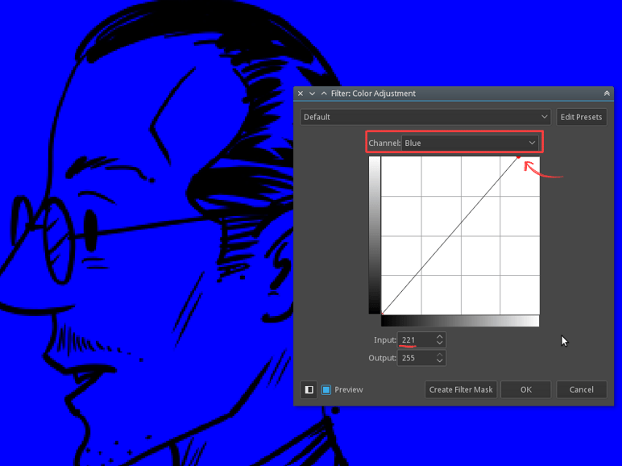
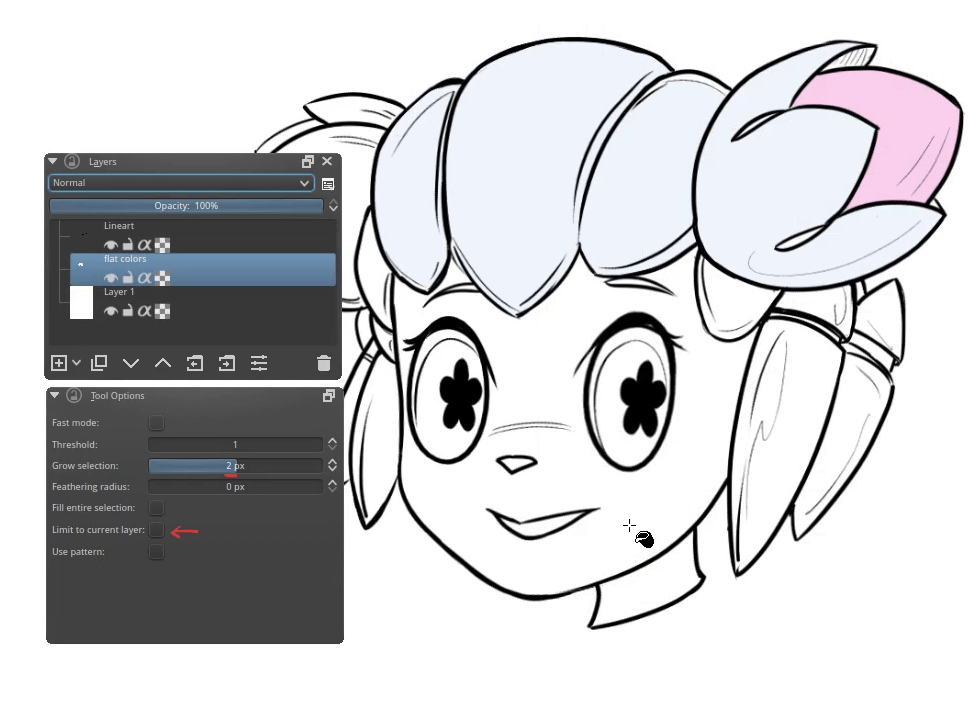
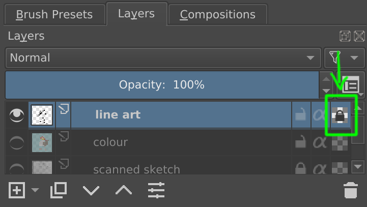
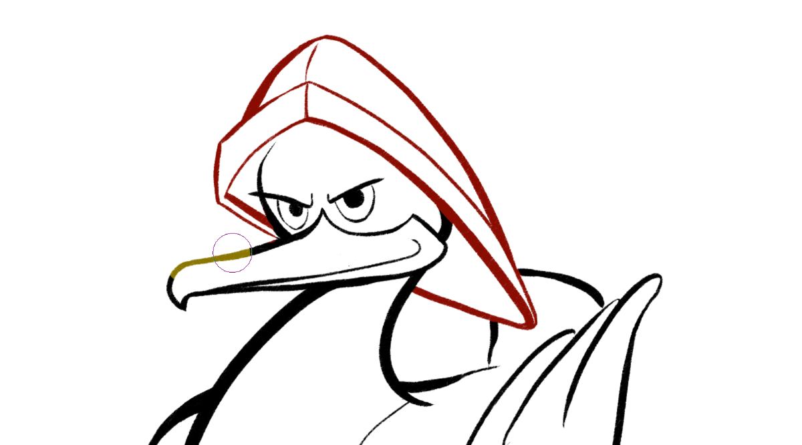
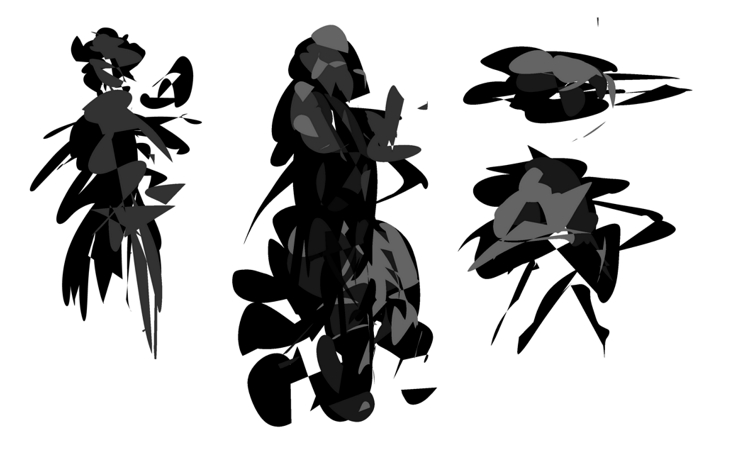
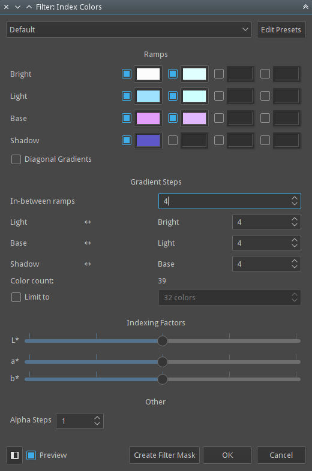

# 像素素材、平铺纹理与索引色工作流

> **内容边界**：下方“授权原文”是官方主内容的 Markdown 转换；中文操作路线、练习与验收由整理者编写，不是作者逐句翻译，也不代表已在本机运行软件验证。

## 中文任务导读

在同一制作流程里区分构图草稿、平涂、无缝纹理和索引色效果。重点阅读原文 Preparing Tiles and Textures 与 Creating Pixel Art。

**前提**：能够新建、保存和打开 Krita 文档；先确定目标像素尺寸、色板与透明度要求。

### 操作路线

1. 建立独立原稿与导出副本，先决定目标画布尺寸、色板和光源。
2. 制作地表纹理时开启 View → Wrap Around Mode；在边缘落笔并观察相邻副本的接缝。
3. 需要灰度映射工作流时，在绘画层上方添加 Index Color 滤镜层，指定各明度对应的颜色。
4. 按原文图层示意将抖色图案放在绘画层上方、索引色层下方；最后在原始尺寸检查轮廓与碎点。

### 配图怎么读

图层堆叠展示索引色、抖色图案与底稿的相对位置；重点看每一层负责改变颜色还是改变画面本身。 图内界面与作品保留原貌；示例转用于像素素材时仍按本篇验收条件检查。

### 练习与验收（整理者补充）

用 32×32 画布做一块草地，连续平铺 3×3 观察边界；再制作一个保持相同色板的泥地变体。

- [ ] 四边连续平铺无突然断纹。
- [ ] 缩回 100% 时主要形状仍可读。
- [ ] 交付尺寸、色板与透明边界有记录。

### 版本与适用边界

原文的高分辨率像素效果方法不等于逐像素精修；自动索引和抖色后仍需检查边缘、细杆和孔洞。

抓取时页面标题标注 **Krita Manual 5.3.0**；这是文档快照版本，不构成已发布软件版本或本机功能的验证。原文中保留的 `Added/Changed/Deprecated in version` 是兼容性依据。

## 来源、许可与修改记录

- 原文：[Common Workflows](https://docs.krita.org/en/tutorials/common_workflows.html)
- 作者：Wolthera van Hövell tot Westerflier；Vancemoss；Raghavendra Kamath
- 页内作者与许可原始声明：[RST 源文件](../../sources/asset-production/MAKE-001/original.rst)；[线上原始声明](https://docs.krita.org/en/_sources/tutorials/common_workflows.rst.txt)。
- 许可：[GNU Free Documentation License 1.3 or later](https://www.gnu.org/licenses/fdl-1.3.html)；[本地许可证全文](../../licenses/krita-GFDL-1.3.txt)。各图若有独立作者或许可，沿用原文紧邻图像的署名，不把作品许可自动泛化为文档许可。
- 修改历史：2026-10-29，Codex 为本教程库新增中文导读、练习和验收；将官方 HTML 主内容转换为 Markdown，去除导航与页脚，将控制图标转为文字、将教学图像存为本地文件。正文、步骤、代码、表格与图像说明保留。
- 本修改版沿用 GFDL 1.3 或更新版本。保留作者声明和上游链接；未添加 Invariant Sections、Front-Cover Texts 或 Back-Cover Texts。外链视频、安装包和关联页面没有自动下载或转录。

## 授权原文（英语，完整主内容转换）

## Common Workflows

Krita’s main goal is to help artists create a digital painting from scratch. Krita is used by comic artists, matte painters, texture artists, and illustrators around the world. This section explains some common workflow that artists use in Krita. When you open a new document in Krita for the first time, you can start painting instantly. The brush tool is selected by default and you just have to paint on the canvas. However, let us look at what artists do in Krita. Below are some of the common workflows used in Krita:

### Speed Painting and Conceptualizing

Some artists work only on the digital medium, sketching and visualizing concepts in Krita from scratch. As the name suggests a technique of painting done within a matter of hours to quickly visualize the basic scene, character, look and feel of the environment or to denote the general mood and overall concept is called a **speed painting**. Finishing and finer details are not the main goals of this type of painting, but the representation of form value and layout is the main goal.

Some artists set a time limit to complete the painting while some paint casually. Speed painting then can be taken forward by adding finer details and polish to create a final piece. Generally, artists first block in the composition by adding patches and blobs of flat colors, defining the silhouette, etc. Krita has some efficient brushes for this situation, for example, the brushes under **Block Tag** like Block fuzzy, Block basic, layout\_block, etc.

After the composition and a basic layout has been laid out the artists add as many details as possible in the given limited time, this requires a decent knowledge of forms, value perspective and proportions of the objects. Below is an example of speed paint done by [David Revoy](https://www.davidrevoy.com/) in an hours time.

Artwork by David Revoy, license : [CC-BY](https://creativecommons.org/licenses/by/3.0/)

You can view the recorded speed painting demo for the above image [on Youtube](https://www.youtube.com/watch?v=93lMLEuxSLk).

### Colorizing Line Art

Often an artist, for example a comic book colorist, will need to take a pencil sketch or other line art of some sort and use Krita to paint underneath it. This can be either an image created digitally or something that was done outside the computer and has been scanned.

#### Preparing the line art

If your images have a white or other single-tone background, you can use either of the following methods to prepare the art for coloring:

Place the line art at the top of the layer stack and set its layer blending mode to Multiply.

If you want to clean the line art a bit you can press the `Ctrl + L` shortcut or go to Filters ‣ Adjust ‣ Levels.

You can clean the unwanted grays by moving the white triangle in the input levels section to left and darken the black by moving the black triangle to right.

If you draw in blue pencils and then ink your line art you may need to remove the blue lines first to do that go to Filters ‣ Adjust ‣ Color adjustment curves or press the `Ctrl + M` shortcut.

Now select **Red** from the drop-down, click on the top right node on the graph and slide it all the way down. Or you can click on the top right node and enter **0** in the input field. Repeat this step for **Green** too.

Now the whole drawing will have a blue overlay, zoom in and check if the blue pencil lines are still visible slightly. If you still see them, then go to **Blue** Channel in the color adjustment and shift the top right node towards left a bit, Or enter a value around 190 (one that removes the remaining rough lines) in the input box.

Now apply the color adjustment filter, yes we still have lots of blue on the artwork. Be patient and move on to the next step. Go to Filters ‣ Adjust ‣ Desaturate or press the `Ctrl + Shift + U` shortcut. Now select Max from the list.

Hint

It is good to use non-photo-blue pencils to create the blue lines as those are easy to remove. If you are drawing digitally in blue lines use #A4DDED color as this is closer to non-photo-blue color.

You can learn more about doing a sketch from blue sketch to digital painting [here in a tutorial by David Revoy](https://www.davidrevoy.com/article239/clean-blue-sketch-traditional-line-art-to-color-it-digital-with-in-krita).

After you have a clean black and white line art you may need to erase the white color and keep only black line art, to achieve that go to Filters ‣ Colors ‣ Color to Alpha… menu item. Use the dialog box to turn all the white areas of the image transparent. The Color Selector is set to White by default. If you have imported scanned art and need to select another color for the paper color then you would do it here.

This will convert the white color in your line art to alpha i.e. it will make the white transparent leaving only the line art. Your line art can be in grayscale color space, this is a unique feature in Krita which allows you to keep a layer in a color-space independent from the image.

#### Laying in Flat Colors

There are many ways to color a line art in Krita, but generally, these three are common among the artists.

1. Paint blocks of color directly with block brushes.
2. Fill with Flood Fill Tool.
3. Use a Colorize Mask.

##### Blocking with brush

The first is the more traditional method of taking a shape brush or using the geometric tools to lay in color. This would be similar to using an analog marker or brush on paper. There are various block brushes in Krita, you can select **Block** Tag from the drop-down in the brush presets docker and use the brushes listed there.

Add a layer underneath your line art layer and start painting with the brush. If you want to correct any area you can press the `E` key and convert the same brush into an eraser. You can also use a layer each for different colors for more flexibility.

##### Filling with Flood Fill tool

The second method is to use the Flood fill tool to fill large parts of your line art quickly. This method generally requires closed gaps in the line art. To begin with this method place your line art on a separate layer. Then activate the flood fill tool and set the Grow selection to 2px, uncheck Limit to current layer if previously checked.

Choose a color from color selector and just click on the area you want to fill the color. As we have expanded the fill with grow selection the color will be filled slightly underneath the line art thus giving us a clean fill.

##### Colorize Mask

The third method is to take advantage of the built-in [Colorize Mask](https://docs.krita.org/en/reference_manual/tools/colorize_mask.html#colorize-mask). This is a powerful tool that can dramatically improve your workflow and cut you down on your production time. To begin coloring with the Colorize Mask, select your line art layer and click the Colorize Mask Editing Tool icon in the toolbar.

With the Colorize Mask Editing Tool enabled, click on the canvas—this will add a Colorize Mask layer to your document and make your lineart look a little blurry. You can now lay down solid brush strokes to indicate which areas should be colored in what colors:

Whenever you press the Update button in the Tool Options, you will see which colors will fill which areas. You can continue to edit your brush strokes until you are happy with the result. To get a clean look of your painting, disable the “Edit key strokes” checkbox:

Once you are done, you can convert the Colorize Mask layer into a paint layer in the Layers docker. Have a look at the [Colorize Mask](https://docs.krita.org/en/reference_manual/tools/colorize_mask.html#colorize-mask) manual to learn more about this tool.

#### Changing Line Art Color

To change the color of your line art, you can use the Alpha Lock feature. In the layer docker, click on the rightmost icon of your line art layer. It’s the icon that looks like a little checker board:

When Alpha Lock is enabled, you can only change the *color* of the pixels, not their opacity—meaning that everything you paint will only change the colors of your existing lines, not add new lines.

If you want to change the color of your line art to one solid color, you can now use the bucket fill tool and it will only apply to your existing lines. Or if you want to apply several different colors to specific areas of your line art, you can quickly paint over your line art with a broad brush:

### Painting

#### Starting from chaos

Here, you start by making a mess through random shapes and texture, then taking inspirations from the resulting chaos you can form various concepts. It is kind of like making things from clouds or finding recognizable shapes of things in abstract and random textures. Many concept artists work with this technique.

You can use brushes like the shape brush, or the spray brush to paint a lot of different shapes, and from the resulting noise, you let your brain pick out shapes and compositions.

You then refine these shapes to look more like shapes you think they look, and paint them over with a normal paintbrush. This method is best done in a painting environment.

#### Starting from a value based underground

This method finds its origins in old oil-painting practice: You first make an under-painting and then paint over it with color, having the dark underground shine through.

With Krita you can use blending modes for this purpose. Choosing the color blending mode on a layer on top allows you to change the colors of the image without changing the relative luminosity. This is useful, because humans are much more sensitive to tonal differences than the difference in saturation and hue. This’ll allow you to work in grayscale before going into color for the polishing phase.

You can find more about this technique [here](https://www.davidrevoy.com/article185/tutorial-getting-started-with-krita-1-3-bw-portrait).

### Preparing Tiles and Textures

Many artists use Krita to create textures for 3d assets used for games animation, etc. Krita has many texture templates for you to choose and get started with creating textures. These templates have common sizes, bit depth and color profiles that are used for texturing workflow.

Krita also has a real-time seamless tile mode to help texture artist prepare tiles and texture easily and check if it is seamless on the fly. The tiled mode is called wrap-around mode, to activate this mode got to View ‣ Wrap Around Mode. Now when you paint the canvas is tiled in real-time allowing you to create seamless pattern and texture, it is also easy to prepare interlocking patterns and motifs in this mode.

### Creating Pixel Art

Krita can also be used to create a high definition pixel painting. The pixel art look can be achieved by using Index color filter layer and overlaying dithering patterns. The general layer stack arrangement is as shown below.

The index color filter maps specific user-selected colors to the grayscale value of the artwork. You can see the example below, the strip below the black and white gradient has an index color applied to it so that the black and white gradient gets the color selected to different values.

You can choose the required colors and ramps in the index color filter dialog as shown below.

Dithering can be used to enhance the look of the art and to ease the banding occurred by the index color filter. Krita has a variety of dithering patterns by default, these can be found in pattern docker. You can use these patterns as fill layer, then set the blend mode to **overlay** and adjust the opacity according to your liking. Generally, an opacity range of 10% - 25% is ideal.

Paint the artwork in grayscale and add an index color filter layer at the top then add the dithering pattern fill layer below the index color filter but above the artwork layer, as shown in the layer stack arrangement above. You can paint or adjust the artwork at any stage as we have added the index color filter as a filter layer.

You can add different groups for different colors and add different dithering patterns for each group.

Below is an example painted with this layer arrangement.

## 本地配图清单

| 图 | 本地文件 | 原始来源 |
|---|---|---|
| 1 | [Figure 1: Speedpaint of Pepper & Carrot by deevad (David Revoy).](../../assets/asset-production/MAKE-001/Pepper-speedpaint-deevad.jpg) | [原图](https://docs.krita.org/en/_images/Pepper-speedpaint-deevad.jpg) |
| 2 | [Figure 2: Level filter dialog.](../../assets/asset-production/MAKE-001/Levels-filter.png) | [原图](https://docs.krita.org/en/_images/Levels-filter.png) |
| 3 | [Figure 3: Remove blue lines from image step 1.](../../assets/asset-production/MAKE-001/Color-adjustment-cw.png) | [原图](https://docs.krita.org/en/_images/Color-adjustment-cw.png) |
| 4 | [Figure 4: Removing blue lines from scan step 2.](../../assets/asset-production/MAKE-001/Color-adjustment-02.png) | [原图](https://docs.krita.org/en/_images/Color-adjustment-02.png) |
| 5 | [Figure 5: Remove blue lines from scans step 3.](../../assets/asset-production/MAKE-001/Color-adjustment-03.png) | [原图](https://docs.krita.org/en/_images/Color-adjustment-03.png) |
| 6 | [Figure 6: Remove blue lines from scans step 4.](../../assets/asset-production/MAKE-001/Color-adjustment-04.png) | [原图](https://docs.krita.org/en/_images/Color-adjustment-04.png) |
| 7 | [Figure 7: Color to alpha dialog box.](../../assets/asset-production/MAKE-001/Color-to-alpha.png) | [原图](https://docs.krita.org/en/_images/Color-to-alpha.png) |
| 8 | [Figure 8: Flood fill in krita.](../../assets/asset-production/MAKE-001/Floodfill-krita.png) | [原图](https://docs.krita.org/en/_images/Floodfill-krita.png) |
| 9 | [Figure 9: Colorize Mask Editing Tool in the toolbar.](../../assets/asset-production/MAKE-001/krita-colorize-mask-01.png) | [原图](https://docs.krita.org/en/_images/krita-colorize-mask-01.png) |
| 10 | [Figure 10: Colorize Mask with brush strokes](../../assets/asset-production/MAKE-001/krita-colorize-mask-02.png) | [原图](https://docs.krita.org/en/_images/krita-colorize-mask-02.png) |
| 11 | [Figure 11: Colorize Mask result](../../assets/asset-production/MAKE-001/krita-colorize-mask-03.png) | [原图](https://docs.krita.org/en/_images/krita-colorize-mask-03.png) |
| 12 | [Figure 12: Alpha lock button](../../assets/asset-production/MAKE-001/layer-alpha-lock.png) | [原图](https://docs.krita.org/en/_images/layer-alpha-lock.png) |
| 13 | [Figure 13: Changing Line Art Color](../../assets/asset-production/MAKE-001/color-lineart.png) | [原图](https://docs.krita.org/en/_images/color-lineart.png) |
| 14 | [Figure 14: Starting a painting from chaotic sketch.](../../assets/asset-production/MAKE-001/Chaos2.jpg) | [原图](https://docs.krita.org/en/_images/Chaos2.jpg) |
| 15 | [Figure 15: Layer stack setup for pixel art.](../../assets/asset-production/MAKE-001/Layer-docker-pixelart.png) | [原图](https://docs.krita.org/en/_images/Layer-docker-pixelart.png) |
| 16 | [Figure 16: Color mapping in index color to grayscale.](../../assets/asset-production/MAKE-001/Gradient-pixelart.png) | [原图](https://docs.krita.org/en/_images/Gradient-pixelart.png) |
| 17 | [Figure 17: Index color filter dialog.](../../assets/asset-production/MAKE-001/Index-color-filter1.png) | [原图](https://docs.krita.org/en/_images/Index-color-filter1.png) |
| 18 | [Figure 18: Pixel art done in Krita.](../../assets/asset-production/MAKE-001/Kiki-pixel-art.png) | [原图](https://docs.krita.org/en/_images/Kiki-pixel-art.png) |
