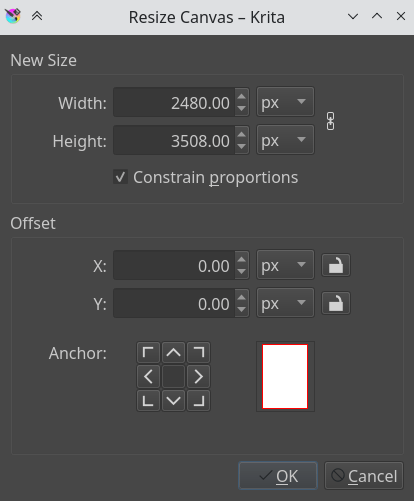
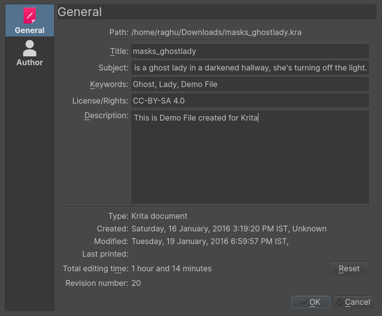
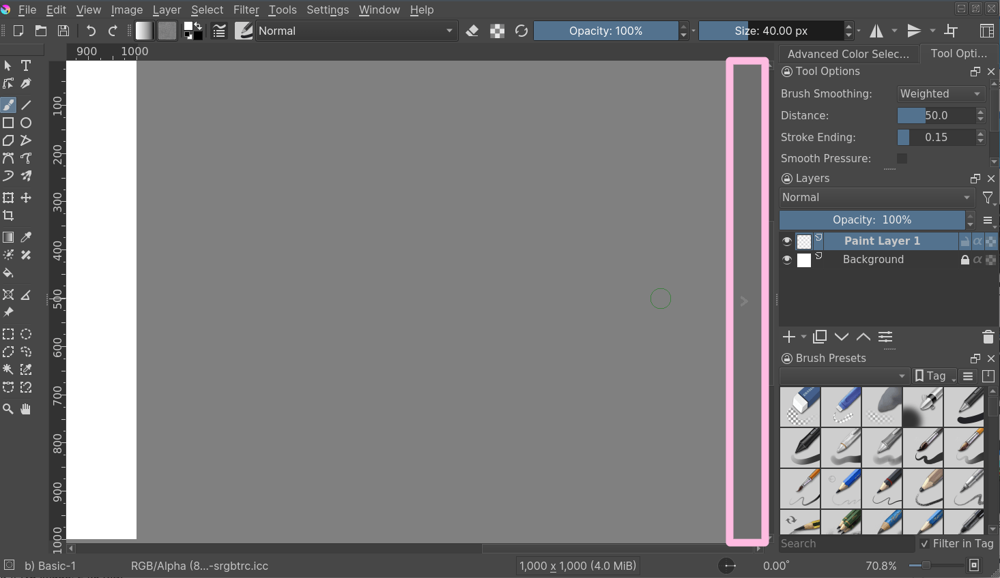
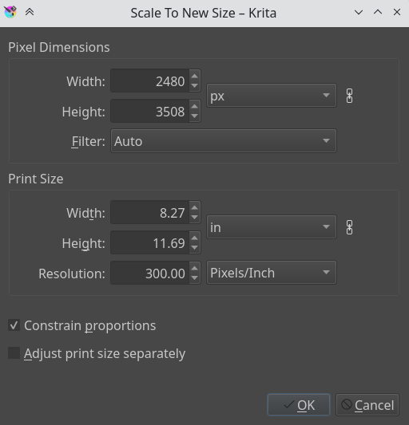

# 画布尺寸、像素尺寸、裁切与素材导出

> **内容边界**：下方“授权原文”是官方主内容的 Markdown 转换；中文操作路线、练习与验收由整理者编写，不是作者逐句翻译，也不代表已在本机运行软件验证。

## 中文任务导读

避免混淆扩大画布与重采样图像，建立可回到原稿的素材文件流程。

**前提**：能够新建、保存和打开 Krita 文档；先确定目标像素尺寸、色板与透明度要求。

### 操作路线

1. 先在图像属性中记录实际宽高像素；PPI 主要关系到印刷尺寸，不是游戏精灵的网格尺寸。
2. 使用 Resize Canvas 增加留白，并用偏移控制已有内容的位置。
3. 只有确需改变内容大小时才用 Scale Image to New Size；像素素材应检查所选插值算法。
4. 保留含图层的 .kra 主文件，再另行导出透明 PNG，重新打开导出文件检查。

### 配图怎么读

这里是扩展画布对话框，重点看宽高、保持比例和偏移控制；增加空白不应自动改变原有精灵的像素尺寸。 图内界面与作品保留原貌；示例转用于像素素材时仍按本篇验收条件检查。

### 练习与验收（整理者补充）

把 32×32 的道具放入 48×48 画布，保持底部接地点一致；输出原尺寸 PNG 与原稿。

- [ ] 扩画布后道具本身的像素不变。
- [ ] 透明边缘没有被背景色填实。
- [ ] 导出 PNG 与原稿能对应同一版本。

### 版本与适用边界

一般绘画的分辨率建议不直接适用于游戏素材；以最终像素尺寸与引擎显示倍率为准。

抓取时页面标题标注 **Krita Manual 5.3.0**；这是文档快照版本，不构成已发布软件版本或本机功能的验证。原文中保留的 `Added/Changed/Deprecated in version` 是兼容性依据。

## 来源、许可与修改记录

- 原文：[Working with Images](https://docs.krita.org/en/user_manual/working_with_images.html)
- 作者：Wolthera van Hövell tot Westerflier；Raghavendra Kamath；Scott Petrovic
- 页内作者与许可原始声明：[RST 源文件](../../sources/asset-production/MAKE-002/original.rst)；[线上原始声明](https://docs.krita.org/en/_sources/user_manual/working_with_images.rst.txt)。
- 许可：[GNU Free Documentation License 1.3 or later](https://www.gnu.org/licenses/fdl-1.3.html)；[本地许可证全文](../../licenses/krita-GFDL-1.3.txt)。各图若有独立作者或许可，沿用原文紧邻图像的署名，不把作品许可自动泛化为文档许可。
- 修改历史：2026-10-29，Codex 为本教程库新增中文导读、练习和验收；将官方 HTML 主内容转换为 Markdown，去除导航与页脚，将控制图标转为文字、将教学图像存为本地文件。正文、步骤、代码、表格与图像说明保留。
- 本修改版沿用 GFDL 1.3 或更新版本。保留作者声明和上游链接；未添加 Invariant Sections、Front-Cover Texts 或 Back-Cover Texts。外链视频、安装包和关联页面没有自动下载或转录。

## 授权原文（英语，完整主内容转换）

## Working with Images

Computers work with files and as a painting program, Krita works with
images as the type of file it creates and manipulates.

### What do Images Contain?

If you have a text document, it of course contains letters, strung in
the right order, so the computer loads them as coherent sentences.

#### Raster Data

This is the main data on the paint layers you make. So these are the
strokes with the paint brush and look pixelated up close. A multi-layer
file will contain several of such layers, that get overlaid on top of
each other so make the final image.

A single layer file will usually only contain raster data.

#### Vector Data

These are mathematical operations that tell the computer to draw pixels
on a spot. This makes them much more scalable, because you just tell the
operation to make the coordinates 4 times bigger to scale it up. Due to
this vector data is much more editable, lighter, but at the same time
it’s also much more CPU intensive.

#### Operation Data

Stuff like the filter layers, that tells Krita to change the colors of a
layer, but also transparency masks, group layer and transformation masks
are saved to multi-layer files. Being able to load these depend on the
software that initially made the file. So Krita can load and save
groups, transparency masks and layer effects from PSD, but not load or
save transform masks.

### Metadata

Metadata is information like the creation date, author, description and
also information like DPI.

### Image size

The image size is the dimension and resolution of the canvas. Image size
has direct effect file size of the Krita document. The more pixels that
need to be remembered and the higher the bit depth of the color, the
heavier the resulting file will be.

#### DPI/PPI

`DPI` stands for *Dots per Inch*, `PPI` stands for *Pixels per
Inch*. In printing industry, suppose if your printer prints at 300
`DPI`. It means it is actually putting 300 dots of colors in an area
equal to an Inch. This means the number of pixels your artwork has in a
relative area of an inch.

`DPI` is the concern of the printer, and artists while creating
artwork should keep `PPI` in mind. According to the `PPI` you have
set, the printers can decide how large your image should be on a piece
of paper.

Some standards:

72 PPI
:   This is the default PPI of monitors as assumed by all programs. It
    is not fully correct, as most monitors these days have 125 PPI or
    even 300 PPI for the retina devices. Nonetheless, when making an
    image for computer consumption, this is the default.

120 PPI
:   This is often used as a standard for low-quality posters.

300 PPI
:   This is the minimum you should use for quality prints.

600 PPI
:   The quality used for line art for comics.

#### Color depth

We went over color depth in the [Color Management page](https://docs.krita.org/en/general_concepts/colors.html#general-concept-color). What you need to
understand is that Krita has image color spaces, and layer color spaces,
the latter which can save memory if used right. For example, having a
line art layer in grayscale can half the memory costs.

#### Image color space vs layer color space vs conversion.

Because there’s a difference between image color space and layer color space, you can change only the image color space in Image ‣ Properties… which will leave the layers alone. But if you want to change the color space of the file including all the layers you can do it by going to Image ‣ Convert Image Color Space… this will convert all the layers color space as well.

### Author and Description

Krita will automatically save who created the image into your image’s
metadata. Along with the other data such as time and date of creation
and modification, Krita also shows editing time of a document in the
document information dialog, useful for professional illustrators,
speed-painters to keep track of the time they worked on artwork for
billing purposes. It detects when you haven’t performed actions for a
while, and has a precision of ±60 seconds. You can empty it in the
document info dialog and of course by unzipping you `.kra` file and
editing the metadata there.

These things can be edited in File ‣ Document Information, and for the author’s information Settings ‣ Configure Krita… ‣ Author. Profiles can be switched under Settings ‣ Active Author Profile.

#### Setting the canvas background color

You can set the canvas background color via Image ‣ Image Background
Color and Transparency… menu item. This allows you to turn the background color
non-transparent and to change the color. This is also useful for certain file
formats which force a background color instead of transparency. PNG and
JPG export use this color as the default color to fill in transparency
if you do not want to export transparency.

If you come in from a program like **Paint Tool SAI**, then using this
option, or using As canvas color radio button at Background:
section in the new file options, will allow you to work in a slightly more comfortable
environment, where transparency isn’t depicted with checkered boxes.

#### Basic transforms

There are some basic transforms available in the Image menu.

Shear Image…
:   This will allow you to skew the whole image and its layers.

Rotate
:   This show a submenu that will allow you to rotate the image and all its layers quickly.

Mirror Image Horizontally/Vertically
:   This will allow you to mirror the whole image with all its layers.

But there are more options than that…

### Cropping and resizing the canvas

You can crop and image with the
[Crop Tool](https://docs.krita.org/en/reference_manual/tools/crop.html#crop-tool), to cut away extra space and improve the composition.

#### Trimming

Using Image ‣ Trim to Current Layer, Krita resizes the
image to the dimensions of the layer selected. Useful for when you paste
a too large image into the layer and want to resize the canvas to the extent
of this layer.

Image ‣ Trim to Selection is a faster cousin to the crop
tool. This helps us to resize the canvas to the dimension of any active selection.
This is especially useful with right-clicking the layer on the layer stack and
choosing Select Opaque. Image ‣ Trim to Selection
will then crop the canvas to the selection bounding box.

Image ‣ Trim to Image Size is actually for layers, and will trim all
layers to the size of the image, making your files lighter by getting
rid of invisible data.

### Resizing the canvas

You can also resize the canvas via Image ‣ Resize Canvas… (or
the `Ctrl + Alt + C` shortcut). The dialog box is shown below.

In this, Constrain proportions checkbox will make sure the height and width stay
in proportion to each other as you change them. Offset indicates
where the new canvas space is added around the current image. You
basically decide where the current image goes (if you press the
left-button, it’ll go to the center left, and the new canvas space will
be added to the right of the image).

Another way to resize the canvas according to the need while drawing is
when you scroll away from the end of the canvas, you can see a strip with
an arrow appear. Clicking this will extend the canvas in that direction.
You can see the arrow marked in red in the example below:

#### Resizing the image

Scale Image to New Size… allows you to resize the whole image. Also,
importantly, this is where you can change the resolution or *upres* your
image. So for instance, if you were initially working at 72 PPI to block
in large shapes and colors, images, etc… And now you want to really get
in and do some detail work at 300 or 400 PPI this is where you would make
the change.

Like all other dialogs where a chain link appears, when the chain is
linked the aspect ratio is maintained. To disconnect the chain, just click
on the link and the two halves will separate.

#### Separating Images

This powerful image manipulation feature lets you separate an image into
its different components or channels.

This is useful for people working in print, or people manipulating game
textures. There’s no combine functionality, but what you can do, if
using colored output, is to set two of the channels to the addition
[Blending Modes](https://docs.krita.org/en/reference_manual/blending_modes.html#blending-modes).

For grayscale images in the RGB space, you can use the Copy Red, Copy
Green and Copy Blue blending modes, with using the red one for the red
channel image, etc.

### Saving, Exporting and Opening Files

When Krita creates or opens a file, it has a copy of the file in memory,
that it edits. This is part of the way how computers work: They make a
copy of their file in the RAM. Thus, when saving, Krita takes its copy
and copies it over the existing file. There’s a couple of tricks you can
do with saving.

Save
:   Krita saves the current image in its memory to a defined place on
    the hard-drive. If the image hadn’t been saved before, Krita will
    ask you where to save it.

Save As…
:   Make a copy of your current file by saving it with a different name.
    Krita will switch to the newly made file as its active document.

Open…
:   Open a saved file. Fairly straightforward.

Export…
:   Save a file to a new location without actively opening it. Useful
    for when you are working on a layered file, but only need to save a
    flattened version of it to a certain location.

Open Existing Document as Untitled Document…
:   This is a bit of an odd one, but it opens a file, and forgets where
    you saved it to, so that when pressing ‘save’ it asks you where to
    save it. This is also called ‘import’ in other programs.

Create Copy from Current Image
:   Makes a new copy of the current image. Similar to Open
    Existing Document as Untitled Document…, but then with already
    opened files.

Save Incremental Version
:   Saves the current image as `filename_XXX.kra` and switches the
    current document to it.

Save Incremental Backup
:   Copies and renames the last saved version of your file to a backup file and saves your document under the original name.

Note

Since Krita’s file format is compressed data file, in case of a corrupt or broken file you can open it with archive managers and extract the contents of the layers. This will help you to recover as much as possible data from the file. On Windows, you will need to rename it to `filename.zip` to open it.

## 本地配图清单

| 图 | 本地文件 | 原始来源 |
|---|---|---|
| 1 | [Figure 1: document information screen](../../assets/asset-production/MAKE-002/document_information_screen.png) | [原图](https://docs.krita.org/en/_images/document_information_screen.png) |
| 2 | [Figure 2: Resize Canvas](../../assets/asset-production/MAKE-002/Resize_Canvas.png) | [原图](https://docs.krita.org/en/_images/Resize_Canvas.png) |
| 3 | [Figure 3: Infinite canvas](../../assets/asset-production/MAKE-002/Infinite-canvas.png) | [原图](https://docs.krita.org/en/_images/Infinite-canvas.png) |
| 4 | [Figure 4: Scale Image to New Size](../../assets/asset-production/MAKE-002/Scale_Image_to_New_Size.png) | [原图](https://docs.krita.org/en/_images/Scale_Image_to_New_Size.png) |
| 5 | [Figure 5: Separate Image](../../assets/asset-production/MAKE-002/Separate_Image.png) | [原图](https://docs.krita.org/en/_images/Separate_Image.png) |
