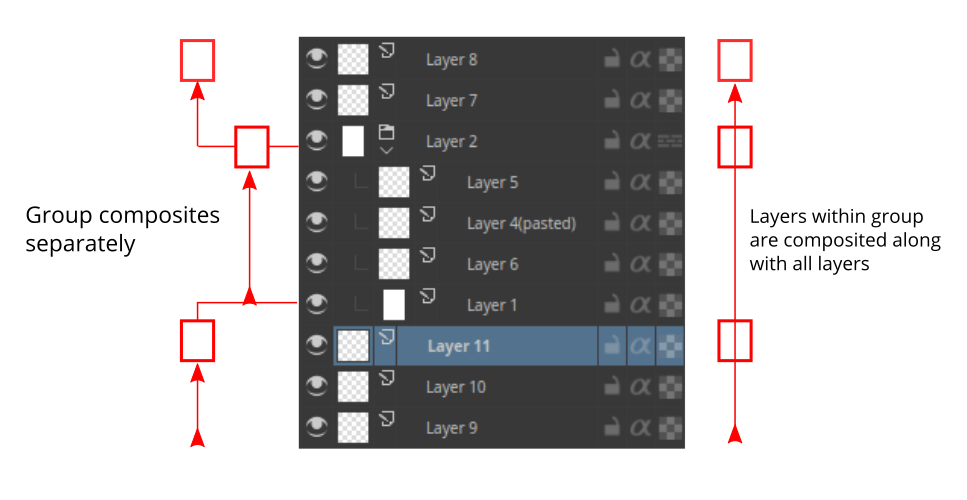
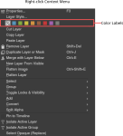
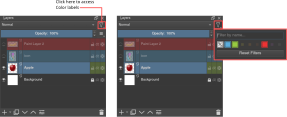
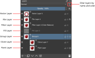
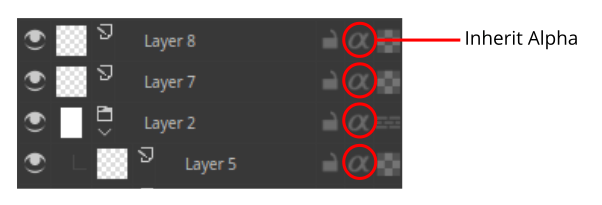
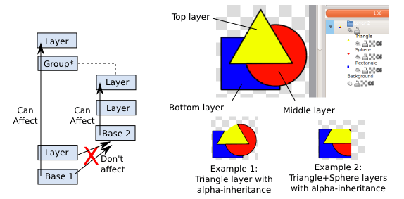
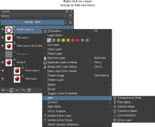
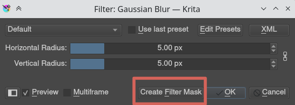

# 分层、图层组与遮罩：保持素材可修改

> **内容边界**：下方“授权原文”是官方主内容的 Markdown 转换；中文操作路线、练习与验收由整理者编写，不是作者逐句翻译，也不代表已在本机运行软件验证。

## 中文任务导读

为树、建筑和家具拆出轮廓、底色、阴影与细节，同时理解组内合成。

**前提**：能够新建、保存和打开 Krita 文档；先确定目标像素尺寸、色板与透明度要求。

### 操作路线

1. 把底色、描边、阴影和高光放在独立图层，按物体建立图层组。
2. 观察原文 Layer-composite 图，确认上层、下层及组的合成顺序。
3. 需要限定阴影区域时使用组内 Alpha Inheritance，并检查组的 Pass Through 设置。
4. 对可回退的修正优先使用遮罩或滤镜层；导出前检查隐藏层与合成结果。

### 配图怎么读

合成示意图把图层当作依次叠放的透明平面；先确认组内合成，再理解上层如何受到下层透明范围限制。 图内界面与作品保留原貌；示例转用于像素素材时仍按本篇验收条件检查。

### 练习与验收（整理者补充）

为一间房子建立屋顶、墙体、门窗三组，每组至少有底色和阴影；只改屋顶配色而不影响其他组。

- [ ] 各部件可独立修改。
- [ ] 透明洞口仍保持透明。
- [ ] 组的显示结果与导出一致。

### 版本与适用边界

图层类型和遮罩是编辑结构，不自动对应引擎中的可交互物件；导出前仍需确定精灵拆分方式。

抓取时页面标题标注 **Krita Manual 5.3.0**；这是文档快照版本，不构成已发布软件版本或本机功能的验证。原文中保留的 `Added/Changed/Deprecated in version` 是兼容性依据。

## 来源、许可与修改记录

- 原文：[Introduction to Layers and Masks](https://docs.krita.org/en/user_manual/layers_and_masks.html)
- 作者：Wolthera van Hövell tot Westerflier；Raghavendra Kamath；Scott Petrovic；AnetK；Bugsbane；Alan；Lundin
- 页内作者与许可原始声明：[RST 源文件](../../sources/asset-production/MAKE-003/original.rst)；[线上原始声明](https://docs.krita.org/en/_sources/user_manual/layers_and_masks.rst.txt)。
- 许可：[GNU Free Documentation License 1.3 or later](https://www.gnu.org/licenses/fdl-1.3.html)；[本地许可证全文](../../licenses/krita-GFDL-1.3.txt)。各图若有独立作者或许可，沿用原文紧邻图像的署名，不把作品许可自动泛化为文档许可。
- 修改历史：2026-10-29，Codex 为本教程库新增中文导读、练习和验收；将官方 HTML 主内容转换为 Markdown，去除导航与页脚，将控制图标转为文字、将教学图像存为本地文件。正文、步骤、代码、表格与图像说明保留。
- 本修改版沿用 GFDL 1.3 或更新版本。保留作者声明和上游链接；未添加 Invariant Sections、Front-Cover Texts 或 Back-Cover Texts。外链视频、安装包和关联页面没有自动下载或转录。

## 授权原文（英语，完整主内容转换）

## Introduction to Layers and Masks

Krita supports layers which help to better control parts and elements of your painting.

Think of an artwork or collage made with various stacks of papers with some papers cut such that they show the paper beneath them while some hide what’s beneath them. If you want to replace an element in the artwork, you replace that piece of paper instead of drawing the entire thing. In Krita instead of papers we use *Layers*. Layers are part of the document which may or may not be transparent, they may be smaller or bigger than the document itself, they can arrange one above other, named and grouped.

Layers can give better control over your artwork for example you can re-color an entire artwork just by working on the separate color layer and thereby not destroying the line art which will reside above this color layer.

You can edit individual layers, you can even add special effects to them, like Layer styles, blending modes, transparency, filters and transforms. Krita takes all these layers in its layer stack, including the special effects and combines or composites together a final image. This is just one of the many digital image manipulation tricks that **Krita** has up its sleeve!

Usually, when you put one paint layer on top of another, the upper paint layer will be fully visible, while the layer behind it will either be obscured, occluded or only partially visible.

### Managing layers

Some artists draw with limited number of layers, but some prefer to have different elements of the artwork on separate layer. Krita has some good layer management features which make the layer management task easy.

You can [group layers](https://docs.krita.org/en/reference_manual/layers_and_masks/group_layers.html#group-layers) and organize the elements of your artwork.

The layer order can be changed or layers can be moved in and out of a group in the layer stack by simply holding them and dragging and dropping. Layers can also be copied across documents while in the [subwindow mode](https://docs.krita.org/en/reference_manual/preferences/general_settings.html#window-settings), by dragging and dropping from one document to another.

These features save time and also help artists in maintaining the file with a layer stack which will be easy to understand for others who work on the same file. In addition to these layers and groups can both be labeled and filtered by colors, thus helping the artists to visually differentiate them.

To assign a color label to your layer or layer group you have to [right mouse button] on the layer and choose one of the given colors from the context menu. To remove an already existing color label you can click on the ‘x’ marked box in the context menu.

Once you assign color labels to your layers, you can then filter layers having similar color label by clicking on one or more colors in the list from the drop-down situated in the top-right corner of the layer docker.

Added in version 5.0: You can also use this dropdown to filter the layers by layer name.

### Types of Layers

The image above shows the various types of layers in [Layers](https://docs.krita.org/en/reference_manual/dockers/layers.html#layer-docker). Each layer type has a different purpose for example all the vector elements can be only placed on a vector layer and similarly normal raster elements are mostly on the paint layer, [Layers and Masks](https://docs.krita.org/en/reference_manual/layers_and_masks.html#cat-layers-and-masks) page contains more information about these types layers.

Now Let us see how these layers are composited in Krita.

### How are layers composited in Krita?

In Krita, the visible layers form a composite image which is shown on the canvas. The order in which Krita composites the layers is from bottom to top, much like the stack of papers we discussed above. As we continue adding layers, the image we see changes, according to the properties of the newly added layers on top.

Group Layers composite separately from the other layers in the stack, except when pass through mode is activated. The layers inside a group form a composite image first and then this composite is taken into consideration while the layer stack is composited to form a whole image. If the pass through mode is activated by pressing the icon similar to bricked wall, the layers within the group are considered as if they are outside that particular group in the layer stack, however, the visibility of the layers in a group depends on the visibility of the group.

The groups in a PSD file saved from Photoshop have pass-through mode on by default unless they are specifically set with other blending modes.

### Inherit Alpha or Clipping layers

There is a clipping feature in Krita called inherit alpha. It is denoted by an alpha icon in the layer stack.

It can be somewhat hard to figure out how the *inherit alpha* feature works in Krita for the first time. Once you click on the inherit alpha icon on the layer stack, the pixels of the layer you are painting on are confined to the combined pixel area of all the layers below it. That means if you have the default white background layer as first layer, clicking on the inherit alpha icon and painting on any layer above will seem to have no effect as the entire canvas is filled with white. Hence, it is advised to put the base layer that you want the pixels to clip in a group layer. As mentioned above, group layers are composited separately, hence the layer which is the lowest layer in a group becomes the bounding layer and the content of the layers above this layer clips to it if inherit alpha is enabled.

You can also enable alpha inheritance to a group layer.

### Masks and Filters

Krita supports non-destructive editing of the content of the layer. Non-destructive editing means editing or changing a layer or image without actually changing the original source image permanently, the changes are just added as filters or masks over the original image while keeping it intact, this helps a lot when your workflow requires constant back and forth. You can go back to original image with a click of a button. Just hide the filter or mask you have your initial image.

You can add various filters to a layer with Filter mask, or add Filter layer which will affect the whole image. Layers can also be transformed non-destructively with the transformation masks, and even have portions temporarily hidden with a Transparent Mask. Non-destructive effects like these are very useful when you change your mind later, or need to make a set of variations of a given image.

Note

You can merge all visible layers by selecting everything first Layer ‣ Select ‣ Visible Layers. Then Combine them all by merging Layer ‣ Merge with Layer Below.

These filters and masks are accessible through the right-click menu (as shown in the image below) and the Plus icon on the layer docker.

You can also add a filter as a mask from filter dialog itself, by
clicking on the Create Filter Mask button.

All the filters and masks can also be applied over a group too, thus making it easy to non-destructively edit multiple layers at once. In the [category Layers and masks](https://docs.krita.org/en/reference_manual/layers_and_masks.html#cat-layers-and-masks) you can read more about the individual types of layers and masks.

[Layer Docker](https://docs.krita.org/en/reference_manual/dockers/layers.html#layer-docker) has more information about the shortcuts and other layer management workflows.

## 本地配图清单

| 图 | 本地文件 | 原始来源 |
|---|---|---|
| 1 | [Figure 1: Layer color filters](../../assets/asset-production/MAKE-003/Layer-color-filters.svg) | [原图](https://docs.krita.org/en/_images/Layer-color-filters.svg) |
| 2 | [Figure 2: Layer color filters menu](../../assets/asset-production/MAKE-003/Layer-color-filters-menu.svg) | [原图](https://docs.krita.org/en/_images/Layer-color-filters-menu.svg) |
| 3 | [Figure 3: Krita types of layers](../../assets/asset-production/MAKE-003/Krita-types-of-layers.svg) | [原图](https://docs.krita.org/en/_images/Krita-types-of-layers.svg) |
| 4 | [Figure 4: Passthrough mode ](../../assets/asset-production/MAKE-003/Passthrough-mode_.png) | [原图](https://docs.krita.org/en/_images/Passthrough-mode_.png) |
| 5 | [Figure 5: Layer composite](../../assets/asset-production/MAKE-003/Layer-composite.png) | [原图](https://docs.krita.org/en/_images/Layer-composite.png) |
| 6 | [Figure 6: Inherit alpha 02](../../assets/asset-production/MAKE-003/Inherit-alpha-02.png) | [原图](https://docs.krita.org/en/_images/Inherit-alpha-02.png) |
| 7 | [Figure 7: Inherit alpha krita](../../assets/asset-production/MAKE-003/Inherit-alpha-krita.jpg) | [原图](https://docs.krita.org/en/_images/Inherit-alpha-krita.jpg) |
| 8 | [Figure 8: Krita tutorial2 I.1 2](../../assets/asset-production/MAKE-003/Krita-tutorial2-I.1-2.png) | [原图](https://docs.krita.org/en/_images/Krita-tutorial2-I.1-2.png) |
| 9 | [Figure 9: Layer right click](../../assets/asset-production/MAKE-003/Layer-right-click.svg) | [原图](https://docs.krita.org/en/_images/Layer-right-click.svg) |
| 10 | [Figure 10: Filtermask button](../../assets/asset-production/MAKE-003/Filtermask-button.png) | [原图](https://docs.krita.org/en/_images/Filtermask-button.png) |
