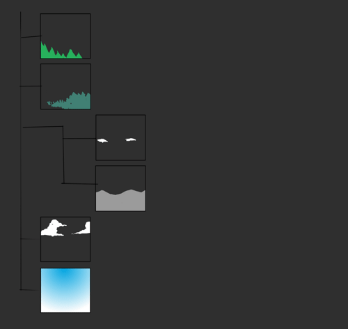
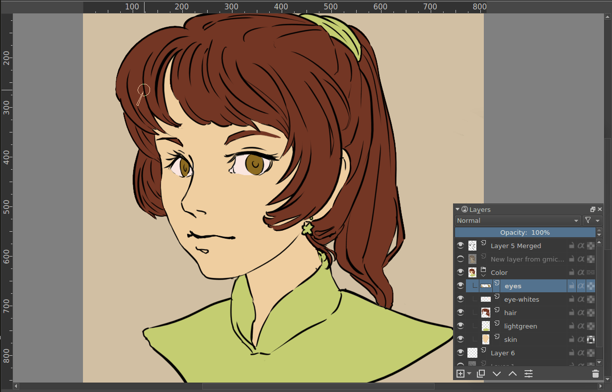
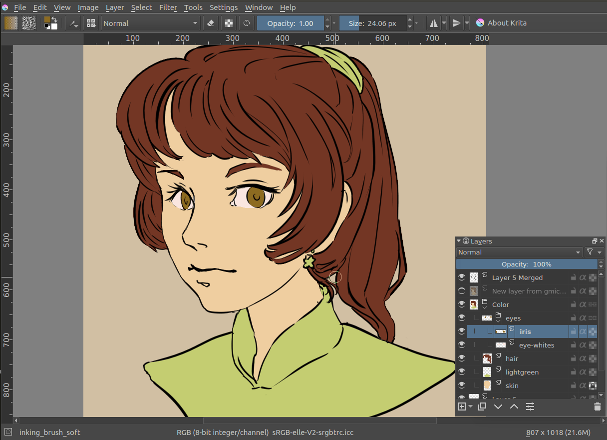
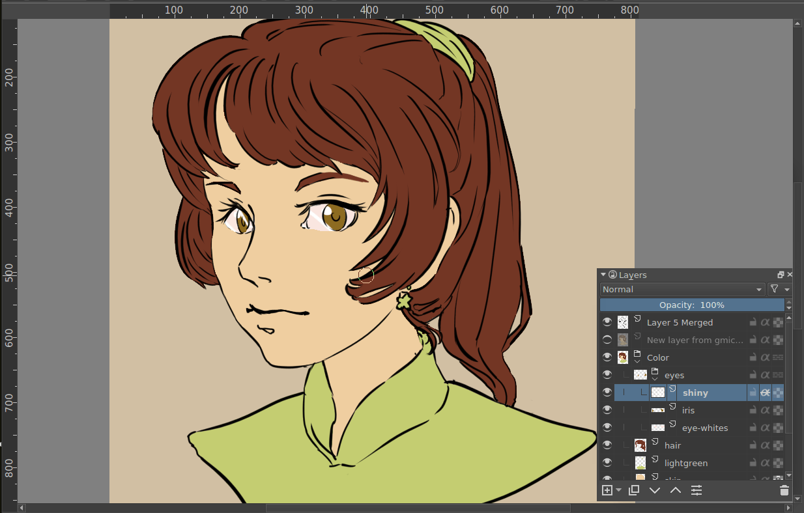
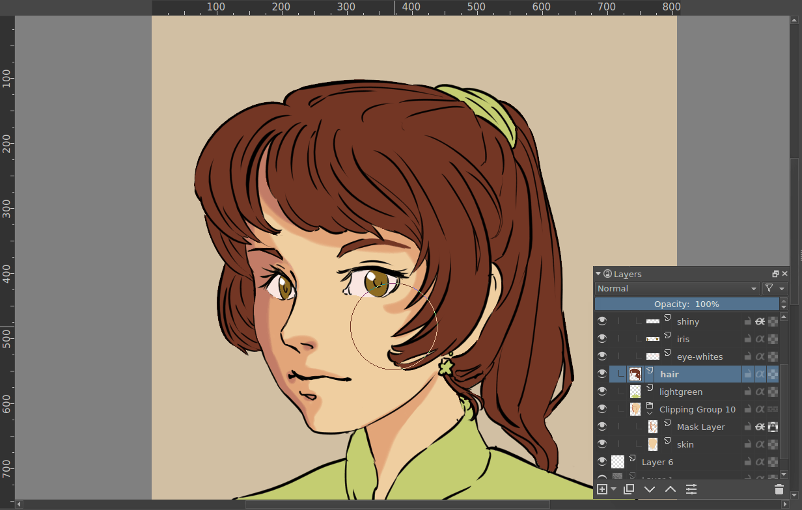
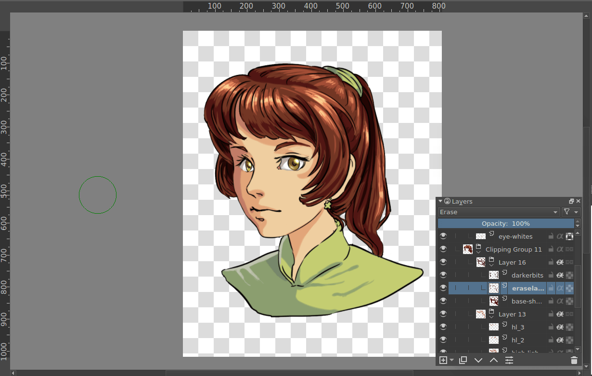
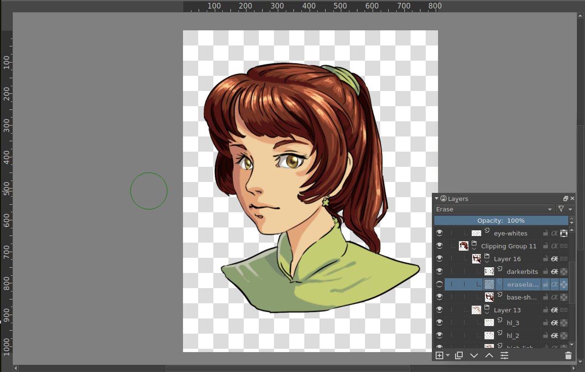

# 用 Alpha Inheritance 给素材分层上色

> **内容边界**：下方“授权原文”是官方主内容的 Markdown 转换；中文操作路线、练习与验收由整理者编写，不是作者逐句翻译，也不代表已在本机运行软件验证。

## 中文任务导读

在既有物体轮廓内添加多层阴影与高光，减少改色时损伤边缘。

**前提**：能够新建、保存和打开 Krita 文档；先确定目标像素尺寸、色板与透明度要求。

### 操作路线

1. 把需要作为剪裁范围的底色层放进同一个普通图层组。
2. 在底色层上方新建阴影或高光层，先画一笔明显越界的颜色用于观察。
3. 打开该层 Alpha Inheritance；对照原文前后图确认颜色仅出现在组内下方合成的不透明区域。
4. 需要快速建立结构时使用 Ctrl+Shift+G 创建快速剪裁组，并确认没有启用组的 Pass Through。

### 配图怎么读

动态图展示图层组先单独合成，再参与整幅图像的叠放；后续逐步截图对比普通笔触与继承透明度后的边界。 图内界面与作品保留原貌；示例转用于像素素材时仍按本篇验收条件检查。

### 练习与验收（整理者补充）

给一棵树的树冠增加两层受同一轮廓限制的阴影与高光，随后改变底色测试可维护性。

- [ ] 越界笔触不会污染透明背景。
- [ ] 树冠和树干的范围没有意外合并。
- [ ] 改变底色后阴影结构仍可编辑。

### 版本与适用边界

Krita 的组内透明度继承与其他软件的单层剪贴遮罩规则不同，不要直接套用别的软件图层操作。

抓取时页面标题标注 **Krita Manual 5.3.0**；这是文档快照版本，不构成已发布软件版本或本机功能的验证。原文中保留的 `Added/Changed/Deprecated in version` 是兼容性依据。

## 来源、许可与修改记录

- 原文：[Clipping Masks and Alpha Inheritance](https://docs.krita.org/en/tutorials/clipping_masks_and_alpha_inheritance.html)
- 作者：Wolthera van Hövell tot Westerflier；Vancemoss
- 页内作者与许可原始声明：[RST 源文件](../../sources/asset-production/MAKE-004/original.rst)；[线上原始声明](https://docs.krita.org/en/_sources/tutorials/clipping_masks_and_alpha_inheritance.rst.txt)。
- 许可：[GNU Free Documentation License 1.3 or later](https://www.gnu.org/licenses/fdl-1.3.html)；[本地许可证全文](../../licenses/krita-GFDL-1.3.txt)。各图若有独立作者或许可，沿用原文紧邻图像的署名，不把作品许可自动泛化为文档许可。
- 修改历史：2026-10-29，Codex 为本教程库新增中文导读、练习和验收；将官方 HTML 主内容转换为 Markdown，去除导航与页脚，将控制图标转为文字、将教学图像存为本地文件。正文、步骤、代码、表格与图像说明保留。
- 本修改版沿用 GFDL 1.3 或更新版本。保留作者声明和上游链接；未添加 Invariant Sections、Front-Cover Texts 或 Back-Cover Texts。外链视频、安装包和关联页面没有自动下载或转录。

## 授权原文（英语，完整主内容转换）

## Clipping Masks and Alpha Inheritance

Krita doesn’t have clipping mask functionality in the manner that Photoshop and programs that mimic Photoshop’s functionality have. That’s because in Krita, unlike such software, a group layer is not an arbitrary collection of layers.
Rather, in Krita, group layers are composited separately from the rest of the stack, and then the result is added into the stack. In other words, in Krita group layers are in effect distinct images inside your image.

The exception is when using pass-through mode, meaning that alpha inheritance won’t work right when turning on pass-through on the layer.

When we turn on alpha inheritance, the alpha-inherited layer keeps the same transparency as the layers below.

Combined with group layers this can be quite powerful. A situation where this is particularly useful is the following:

Here we have an image with line art and a layer for each flat of colors. We want to add complicated multi-layered shading to this, while keeping the neatness of the existing color flats.
To get a clipping mask working, you first need to put layers into a group. You can do this by making a group layer and drag-and-dropping the layers into it, or by selecting the layers you want grouped and pressing the `Ctrl + G` shortcut. Here we do that with the iris and the eye-white layers.

We add a layer for the highlight above the other two layers, and add some white scribbles.

In the above, we have our layer with a white scribble on the left, and on the right, the same layer, but with alpha inheritance active, limiting it to the combined area of the iris and eye-white layers.

Now there’s an easier way to set up alpha inheritance. If you select a layer or set of layers and press the `Ctrl + Shift + G` shortcut, you create a quick clipping group. That is, you group the layers, and a ‘mask layer’ set with alpha inheritance is added on top.

The fact that alpha inheritance can use the composited transparency from a combination of layers means that you can have a layer with the erase-blending mode in between, and have that affect the area that the layer above is clipped to.
Above, the lower image is exactly the same as the upper one, except with the erase-layer hidden. Filters can also affect the alpha inheritance:

Above, the blur filter layer gives different results when in different places, due to different parts being blurred.

## 本地配图清单

| 图 | 本地文件 | 原始来源 |
|---|---|---|
| 1 | [Figure 1: Animation showing that groups are composed before the rest of composition takes place.](../../assets/asset-production/MAKE-004/Composition_animation.gif) | [原图](https://docs.krita.org/en/_images/Composition_animation.gif) |
| 2 | [Figure 2: An image showing the way layers composite in Krita.](../../assets/asset-production/MAKE-004/Layer-composite.png) | [原图](https://docs.krita.org/en/_images/Layer-composite.png) |
| 3 | [Figure 3: An image showing how the alpha inheritance works and affects layers.](../../assets/asset-production/MAKE-004/Krita-tutorial2-I.1-2.png) | [原图](https://docs.krita.org/en/_images/Krita-tutorial2-I.1-2.png) |
| 4 | [Figure 4: An image with line art and a layer for each flat of color.](../../assets/asset-production/MAKE-004/Tut_Clipping_1.png) | [原图](https://docs.krita.org/en/_images/Tut_Clipping_1.png) |
| 5 | [Figure 5: An image showing how the alpha inheritance works and affects layers.](../../assets/asset-production/MAKE-004/Tut_Clipping_2.png) | [原图](https://docs.krita.org/en/_images/Tut_Clipping_2.png) |
| 6 | [Figure 6: Clipping mask step 3.](../../assets/asset-production/MAKE-004/Tut_Clipping_3.png) | [原图](https://docs.krita.org/en/_images/Tut_Clipping_3.png) |
| 7 | [Figure 7: Clipping mask step 4.](../../assets/asset-production/MAKE-004/Tut_Clipping_4.png) | [原图](https://docs.krita.org/en/_images/Tut_Clipping_4.png) |
| 8 | [Figure 8: Clipping mask step 5.](../../assets/asset-production/MAKE-004/Tut_Clipping_5.png) | [原图](https://docs.krita.org/en/_images/Tut_Clipping_5.png) |
| 9 | [Figure 9: Clipping mask step 6.](../../assets/asset-production/MAKE-004/Tut_Clipping_6.png) | [原图](https://docs.krita.org/en/_images/Tut_Clipping_6.png) |
| 10 | [Figure 10: Clipping mask step 7.](../../assets/asset-production/MAKE-004/Tut_Clipping_7.png) | [原图](https://docs.krita.org/en/_images/Tut_Clipping_7.png) |
| 11 | [Figure 11: Filter layers and alpha inheritance.](../../assets/asset-production/MAKE-004/Tut_clip_blur.gif) | [原图](https://docs.krita.org/en/_images/Tut_clip_blur.gif) |
