# 平涂上色：填充、选区与色块拆分

> **内容边界**：下方“授权原文”是官方主内容的 Markdown 转换；中文操作路线、练习与验收由整理者编写，不是作者逐句翻译，也不代表已在本机运行软件验证。

## 中文任务导读

把线稿转换成干净、可编辑的分色素材，比较不同填色方法的边界表现。

**前提**：能够新建、保存和打开 Krita 文档；先确定目标像素尺寸、色板与透明度要求。

### 操作路线

1. 先判断线稿是否在独立透明图层，白底线稿需选定处理方式再上色。
2. 新建底色层，在封闭区域使用填充，或用选区明确要填的范围。
3. 参考原文多种方法的优缺点，比较 Multiply、选区、Color to Alpha 与 Colorize Mask。
4. 在透明或对比色背景上检查线条与底色之间的空隙，再按部件保留色块图层。

### 配图怎么读

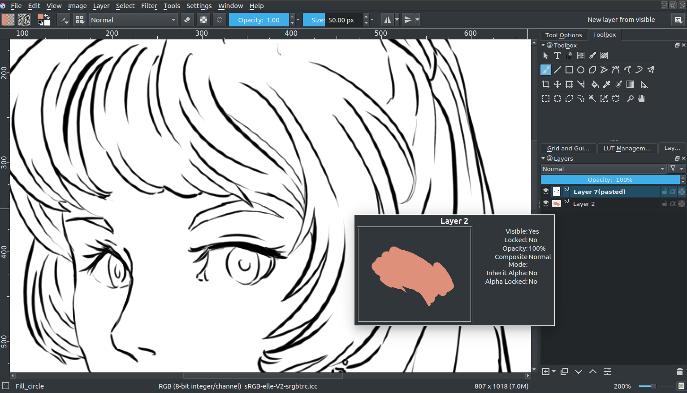

截图把底色和线稿分开；阅读时比较当前选中图层、混合模式以及填充是否伸入线条下方。 图内界面与作品保留原貌；示例转用于像素素材时仍按本篇验收条件检查。

### 练习与验收（整理者补充）

画一个带把手的水壶，分别用填充和选区上色，比较把手孔洞与细线的保留情况。

- [ ] 把手内孔没有被误填。
- [ ] 底色没有穿过细轮廓。
- [ ] 改一个部件颜色不会污染相邻部件。

### 版本与适用边界

原文含普通插画的抗锯齿处理；严格像素资产应根据目标规范关闭羽化并重新检查边界颜色。

抓取时页面标题标注 **Krita Manual 5.3.0**；这是文档快照版本，不构成已发布软件版本或本机功能的验证。原文中保留的 `Added/Changed/Deprecated in version` 是兼容性依据。

## 来源、许可与修改记录

- 原文：[Flat Coloring](https://docs.krita.org/en/tutorials/flat-coloring.html)
- 作者：Wolthera van Hövell tot Westerflier
- 页内作者与许可原始声明：[RST 源文件](../../sources/asset-production/MAKE-005/original.rst)；[线上原始声明](https://docs.krita.org/en/_sources/tutorials/flat-coloring.rst.txt)。
- 许可：[GNU Free Documentation License 1.3 or later](https://www.gnu.org/licenses/fdl-1.3.html)；[本地许可证全文](../../licenses/krita-GFDL-1.3.txt)。各图若有独立作者或许可，沿用原文紧邻图像的署名，不把作品许可自动泛化为文档许可。
- 修改历史：2026-10-29，Codex 为本教程库新增中文导读、练习和验收；将官方 HTML 主内容转换为 Markdown，去除导航与页脚，将控制图标转为文字、将教学图像存为本地文件。正文、步骤、代码、表格与图像说明保留。
- 本修改版沿用 GFDL 1.3 或更新版本。保留作者声明和上游链接；未添加 Invariant Sections、Front-Cover Texts 或 Back-Cover Texts。外链视频、安装包和关联页面没有自动下载或转录。

## 授权原文（英语，完整主内容转换）

## Flat Coloring

So you’ve got a cool black on white drawing, and now you want to color it! The thing we’ll aim for in this tutorial is to get your line art colored in with flat colors. So no shading just yet. We’ll be going through some techniques for preparing the line art, and we’ll be using the layer docker to put each color on a separate layer, so we can easily access each color when we add shading.

Note

This tutorial is adapted from this [tutorial](http://theratutorial.tumblr.com/post/66584924501/flat-colouring-in-the-kingdom-of-2d-layers-are) by the original author.

### Understanding Layers

To fill line art comfortably, it’s best to take advantage of the layerstack. The layer stack is pretty awesome, and it’s one of those features that make digital art super-convenient.

In traditional art, it is not uncommon to first draw the full background before drawing the subject. Or to first draw a line art and then color it in. Computers have a similar way of working.

In programming, if you tell a computer to draw a red circle, and then afterwards tell it to draw a smaller yellow circle, you will see the small yellow circle overlap the red circle. Switch the commands around, and you will not see the yellow circle at all: it was drawn before the red circle and thus ‘behind’ it.

This is referred to as the “drawing order”. So like the traditional artist, the computer will first draw the images that are behind everything, and layer the subject and foreground on top of it. The layer docker is a way for you to control the drawing order of multiple images, so for example, you can have your line art drawn later than your colors, meaning that the lines will be drawn over the colors, making it easier to make it neat!

Other things that a layer stack can do are blending the colors of different layers differently with blending modes, using a filter in the layer stack, or using a mask that allows you to make parts transparent.

Tip

Programmers talk about transparency as ‘’Alpha’’, which is because the ‘a’ symbol is used to present transparency in the algorithms for painting one color on top of another. Usually when you see the word ‘’Alpha’’ in a graphics program, just think of it as affecting the transparency.

### Preparing your line art

Put the new layer underneath the layer containing the line art (drag and drop or use the up/down arrows for that), and draw on it.

…And notice nothing happening. This is because the white isn’t transparent. You wouldn’t really want it to either, how else would you make convincing highlights? So what we first need to do to color in our drawing is prepare our line art. There’s several methods of doing so, each with varying qualities.

### The Multiply Blending Mode

So, typically, to get a black and white line art usable for coloring, you can set the blending mode of the line art layer to Multiply. You do this by selecting the layer and going to the drop-down that says **Normal** and setting that to **Multiply**.

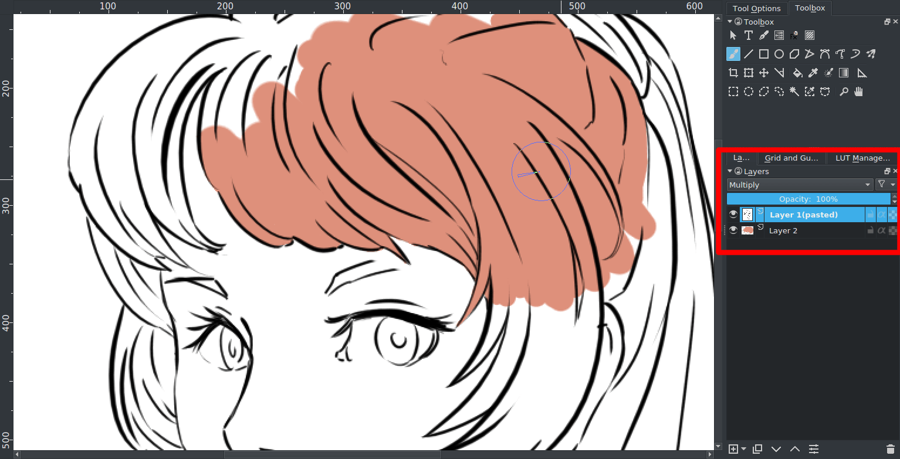

And then you should be able to see your colors!

Multiply is not a perfect solution however. For example, if through some image editing magic I make the line art blue, it results into this:

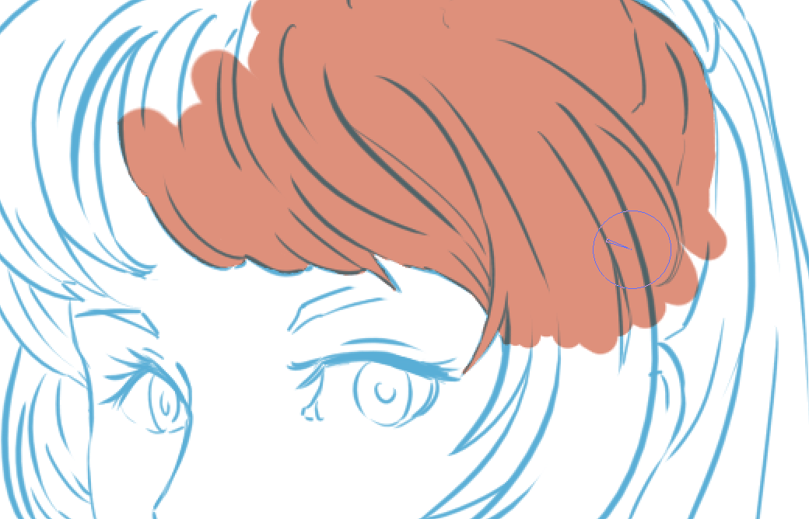

This is because multiply literally multiplies the colors. So it uses maths!

What it first does is take the values of the RGB channels, then divides them by the max (because we’re in 8bit, this is 255), a process we call normalising. Then it multiplies the normalized values. Finally, it takes the result and multiplies it with 255 again to get the result values.

|  | Pink | Pink (normalized) | Blue | Blue (normalized) | Normalized, multiplied | Result |
| --- | --- | --- | --- | --- | --- | --- |
| Red | 222 | 0.8705 | 92 | 0.3607 | 0.3139 | 80 |
| Green | 144 | 0.5647 | 176 | 0.6902 | 0.3897 | 99 |
| Blue | 123 | 0.4823 | 215 | 0.8431 | 0.4066 | 103 |

This isn’t completely undesirable, and a lot of artists use this effect to add a little richness to their colors.

#### Advantages

Easy, can work to your benefit even with colored lines by softening the look of the lines while keeping nice contrast.

#### Disadvantages

Not actually transparent. Is a little funny with colored lines.

### Using Selections

The second method is one where we’ll make it actually transparent. In other programs this would be done via the channel docker, but Krita doesn’t do custom channels, instead it uses Selection Masks to store custom selections.

1. Duplicate your line art layer.
2. Convert the duplicate to a selection mask. [right mouse button] the layer, then Convert ‣ to Selection Mask.

   > 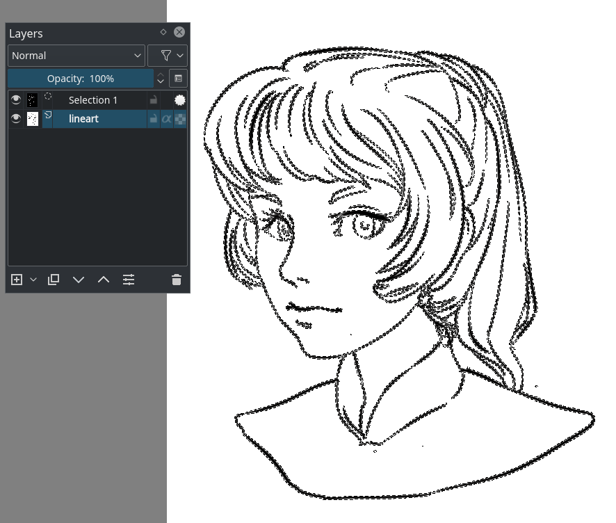
3. Invert the selection mask. Select ‣ Invert Selection.
4. Make a new layer, and do Edit ‣ Fill with Foreground Color.

   > 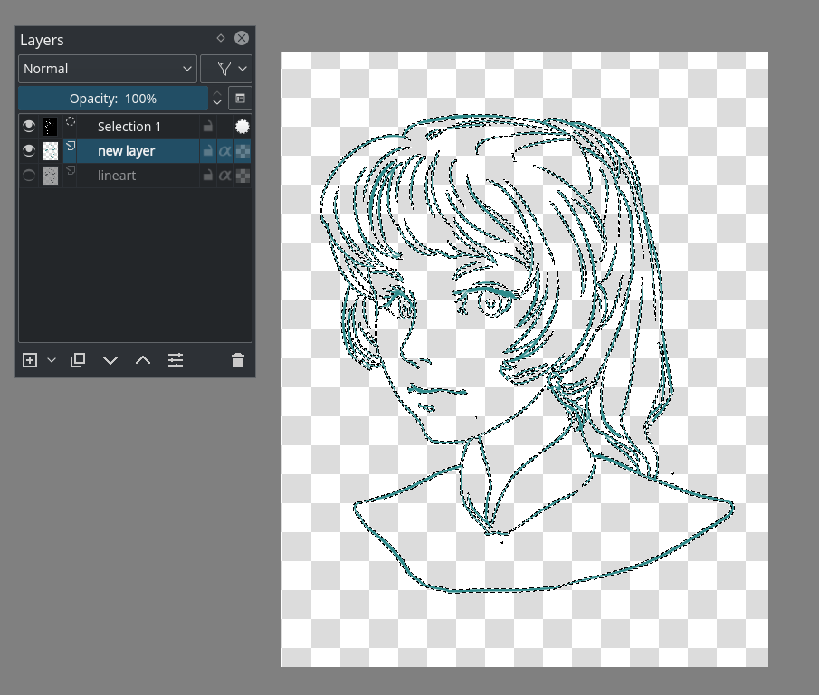

And you should now have the line art on a separate layer.

#### Advantages

Actual transparency.

#### Disadvantages

Doesn’t work when the line art is colored.

### Using Masks

This is a simpler variation of the above.

1. Make a filled layer underneath the line art layer.

   > 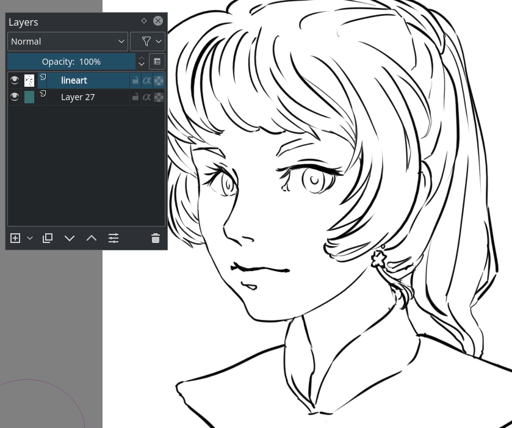
2. Convert the line art layer to a transparency mask [right mouse button] the layer, then Convert ‣ to Transparency Mask.

   > 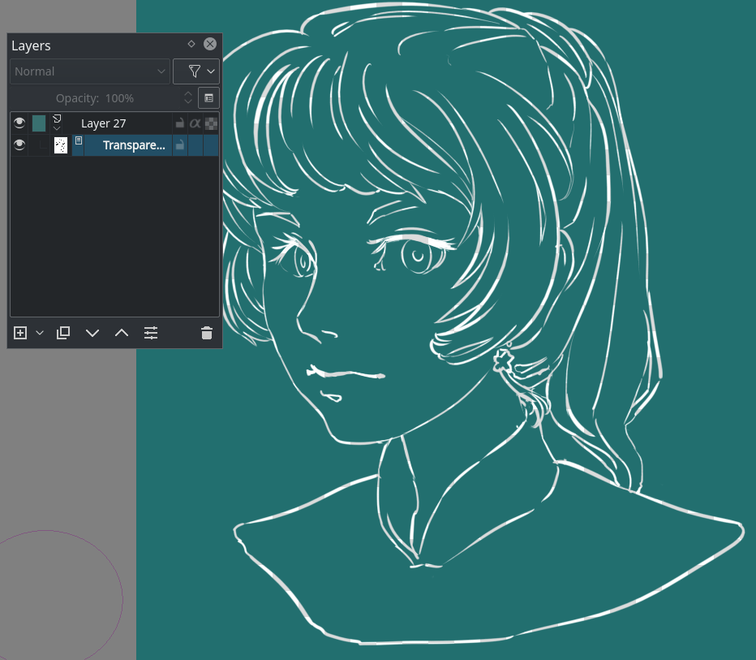
3. Invert the transparency mask by going to Filter ‣ Adjust ‣ Invert.

   > 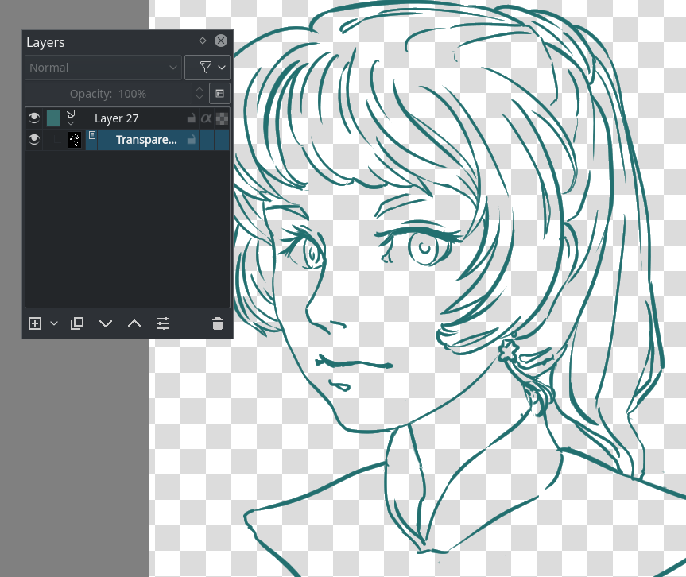

#### Advantages

Actual transparency. You can also very easily doodle a pattern on the filled layer where the mask is on without affecting the transparency.

#### Disadvantages

Doesn’t work when the line art is colored already. We can still get faster.

### Using Color to Alpha

By far the fastest way to get transparent line art.

1. Select the line art layer and apply the Filter: Color to Alpha dialog under Filters ‣ Colors ‣ Color to Alpha… menu item. The default values should be sufficient for line art.

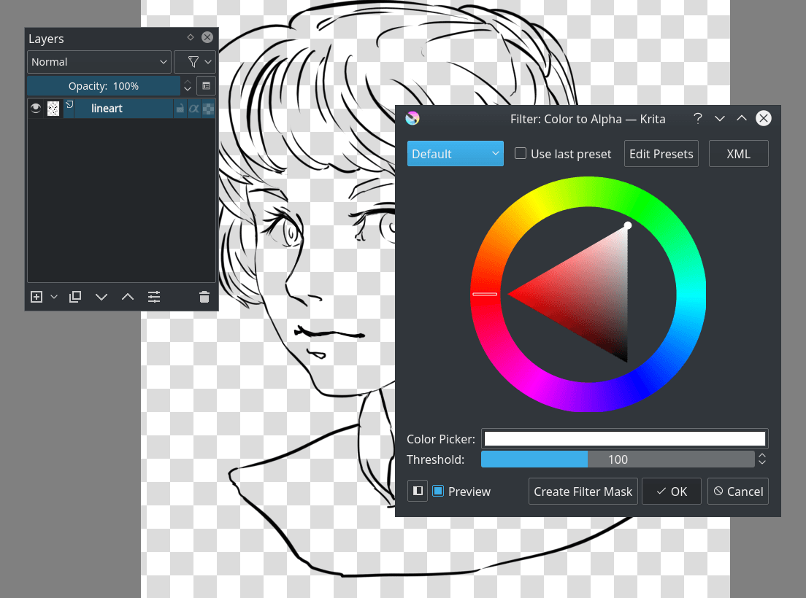

#### Advantages

Actual transparency. Works with colored line art as well, because it removes the white specifically.

#### Disadvantages

You’ll have to lock the layer transparency or separate out the alpha via the right-click menu if you want to easily color it.

##### Coloring the image

Much like preparing the line art, there are many different ways of coloring a layer.

You could for example fill in everything by hand, but while that is very precise it also takes a lot of work. Let’s take a look at the other options, shall we?

### Fill Tool

In most cases the fill-tool can’t deal with the anti-aliasing (the soft edge in your line art to make it more smooth when zoomed out) In Krita you have the grow-shrink option. Setting that to say… 2 expands the color two pixels.

Threshold decides when the fill-tool should consider a different color pixel to be a border. And the feathering adds an extra soft border to the fill.

Now, if you click on a gapless-part of the image with your preferred color… (Remember to set the opacity to 1.0!)

Depending on your line art, you can do flats pretty quickly. But setting the threshold low can result in little artifacts around where lines meet:

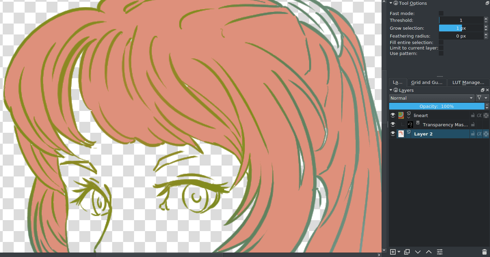

However, setting the threshold high can end with the fill not recognizing some of the lighter lines. Besides these little artifacts can be removed with the brush easily.

#### Advantages

Pretty darn quick depending on the available settings.

#### Disadvantages

Again, not great with gaps or details. And it works best with aliased line art.

### Selections

Selections work using the selection tools.

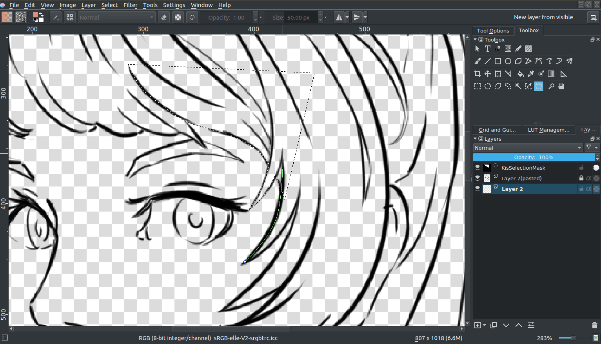

For example with the [Path Selection Tool](https://docs.krita.org/en/reference_manual/tools/path_select.html#bezier-curve-selection-tool) you can easily select a curved area, and the with `Shift +` [left mouse button] (not [left mouse button] `+ Shift`, there’s a difference!) you can easily add to an existing selection.

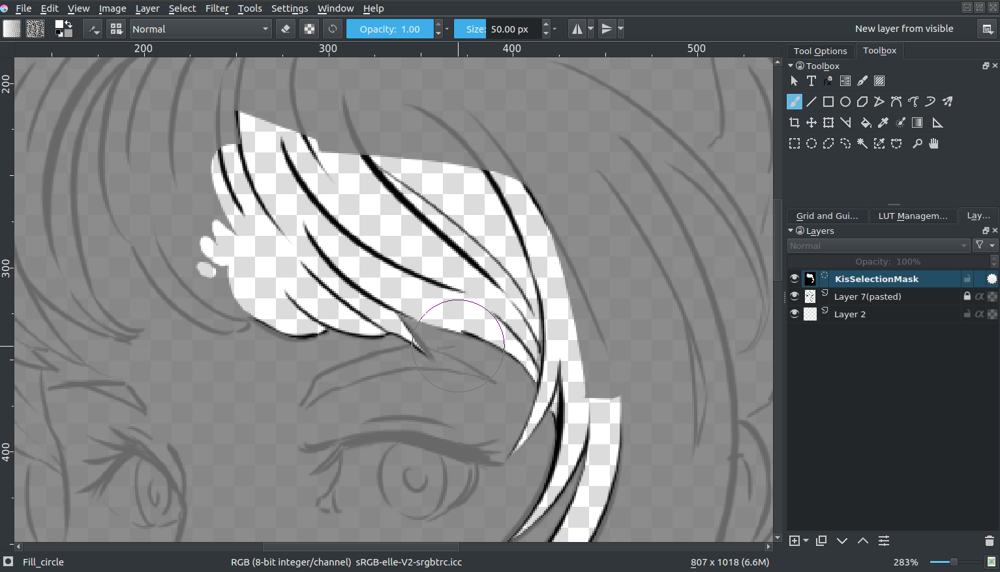

You can also edit the selection if you have Select ‣ Show Global Selection Mask turned on. Then you can select the global selection mask, and paint on it. (Above with the alternative selection mode, activated in the lower-left corner of the stats bar)

When done, select the color you want to fill it with and press the `Shift + Backspace` shortcut.

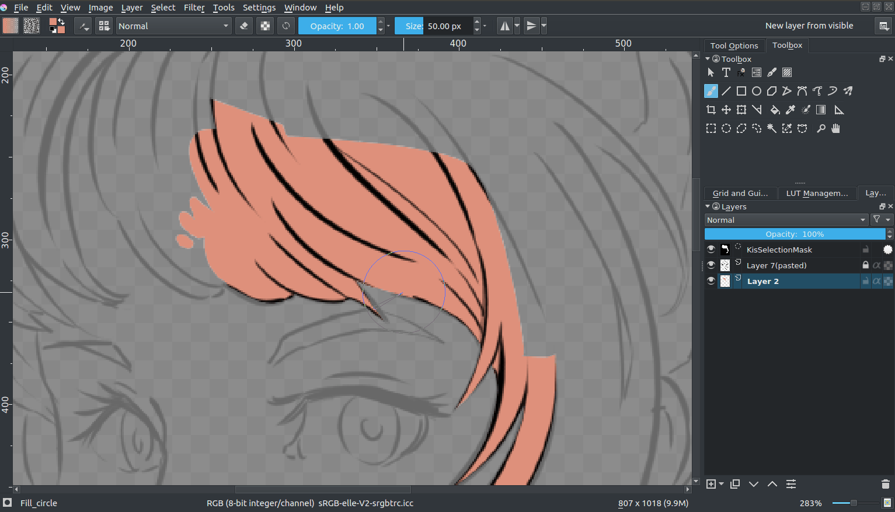

You can save selections in selection masks by [right mouse button] a layer, and then going to Add ‣ Local Selection. You first need to deactivate a selection by pressing the circle before adding a new selection.

This can serve as an alternative way to split out different parts of the image, which is good for more painterly pieces:

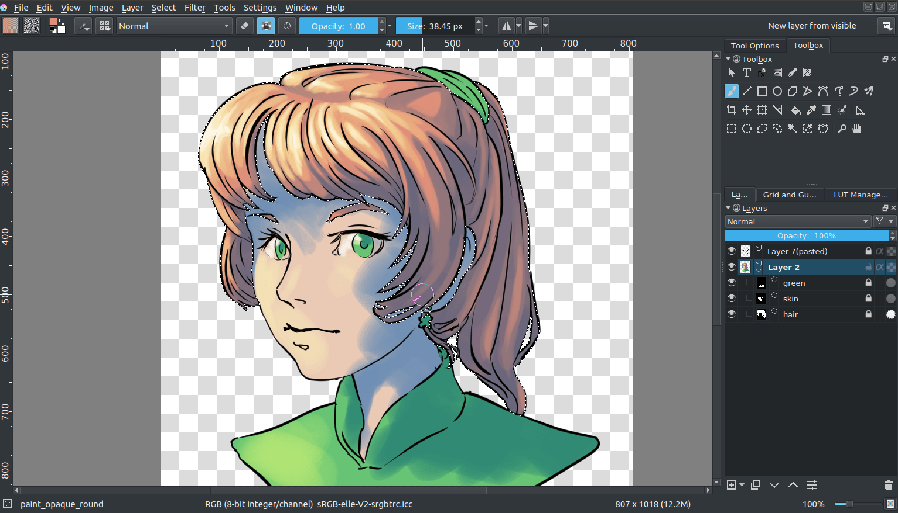

#### Advantages

A bit more precise than filling.

#### Disadvantages

Previewing your color isn’t as easy.

### Geometric tools

So you have a tool for making rectangles or circles. And in the case of Krita, a tool for bezier curves.
Select the path tool (), and set the tool options to fill=foreground and outline=none. Make sure that your opacity is set to 1.00 (fully opaque).

By clicking and holding, you can influence how curvy a line draw with the path tool is going to be. Letting go of the mouse button confirms the action, and then you’re free to draw the next point.

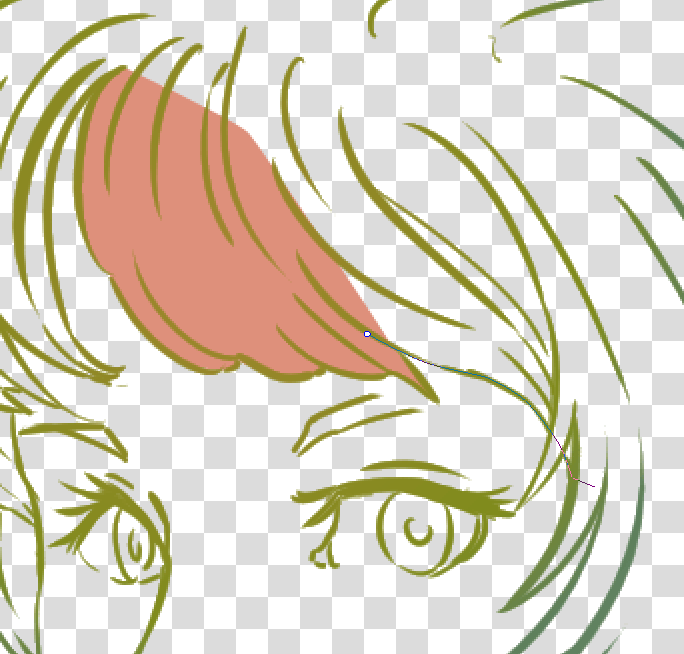

You can also erase with a geometric tool. Just press the `E` key or the eraser button.

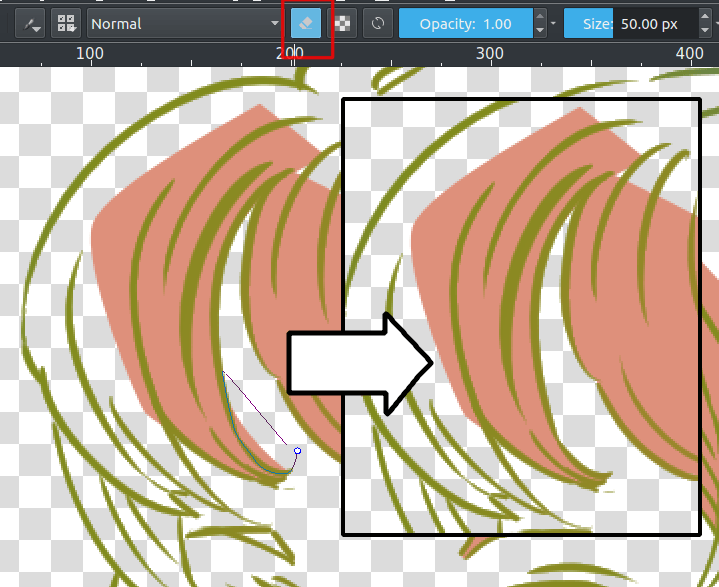

#### Advantages

Quicker than using the brush or selections. Also decent with line art that contains gaps.

#### Disadvantages

Fiddly details aren’t easy to fill in with this. So I recommend skipping those and filling them in later with a brush.

### Colorize Mask

So it works like this:

1. Select the colorize mask tool.
2. Tick the layer you’re using.
3. Paint the colors you want to use on the colorize mask.
4. Click update to see the results:

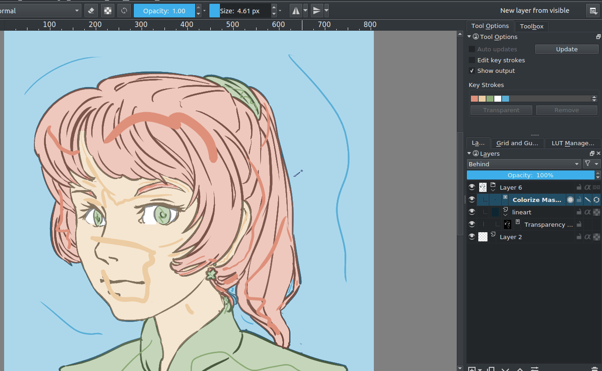

When you are satisfied, [right mouse button] the colorize mask, and go to Convert ‣ Paint Layer. This will turn the colorize mask to a generic paint layer. Then, you can fix the last issues by making the line art semi-transparent and painting the flaws away with a pixel art brush.

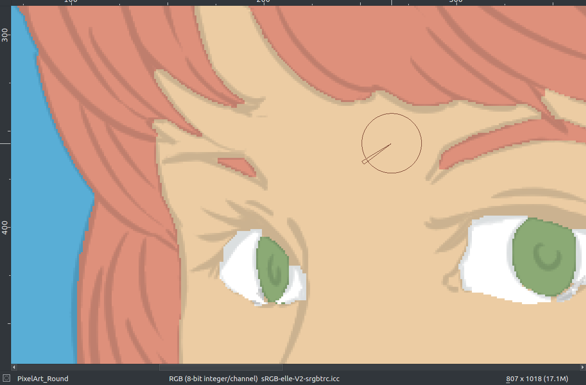

Then, when you are done, split the layers via Layer ‣ Split ‣ Split Layer. There are a few options you can choose, but the following should be fine:

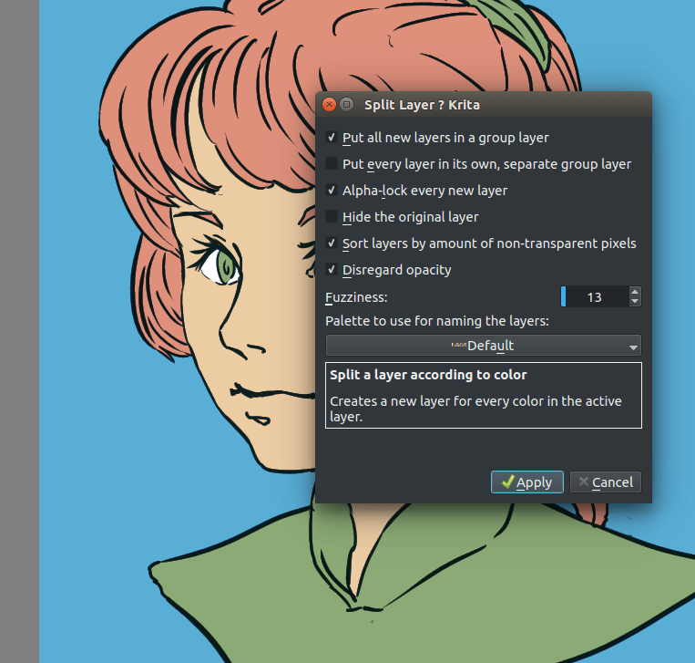

Finally, press **Ok** and you should get the following. Each color patch it on a different layer, named by the palette in the menu and alpha locked, so you can start painting right away!

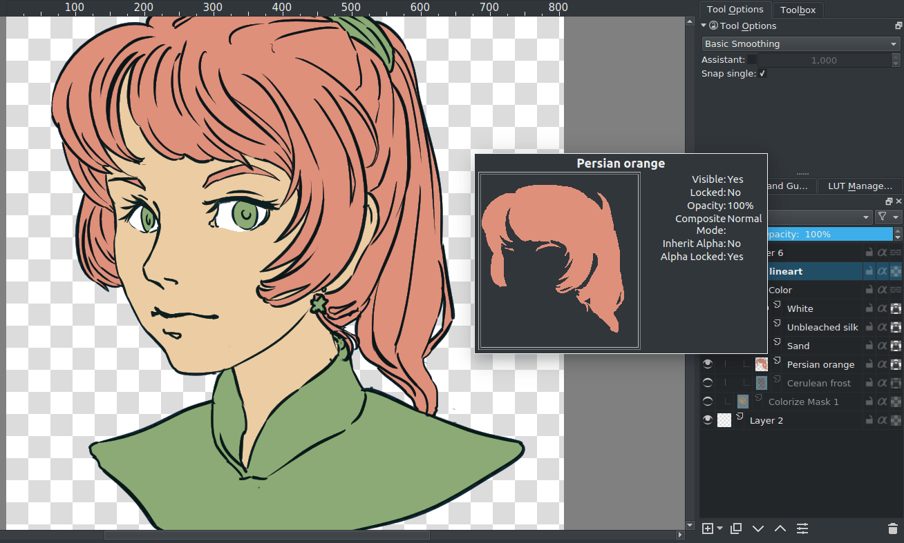

#### Advantages

Works with anti-aliased line art. Really quick to get the base work done. Can auto-close gaps.

#### Disadvantages

No anti-aliasing of its own. You have to choose between getting details right or the gaps auto-closed.

### Conclusion

I hope this has given you a good idea of how to fill in flats using the various techniques, as well as getting a hand of different Krita features. Remember that a good flat filled line art is better than a badly shaded one, so keep practicing to get the best out of these techniques!

## 本地配图清单

| 图 | 本地文件 | 原始来源 |
|---|---|---|
| 1 | [Figure 1: Layer structure for flatting in krita.](../../assets/asset-production/MAKE-005/Krita_filling_lineart14.png) | [原图](https://docs.krita.org/en/_images/Krita_filling_lineart14.png) |
| 2 | [Figure 2: Blend mode setup of line art flat coloring.](../../assets/asset-production/MAKE-005/Krita_filling_lineart1.png) | [原图](https://docs.krita.org/en/_images/Krita_filling_lineart1.png) |
| 3 | [Figure 3: Effects of multiply blend mode.](../../assets/asset-production/MAKE-005/Krita_filling_lineart2.png) | [原图](https://docs.krita.org/en/_images/Krita_filling_lineart2.png) |
| 4 | [Figure 4: Krita filling lineart selection 1](../../assets/asset-production/MAKE-005/Krita_filling_lineart_selection_1.png) | [原图](https://docs.krita.org/en/_images/Krita_filling_lineart_selection_1.png) |
| 5 | [Figure 5: Krita filling lineart selection 2](../../assets/asset-production/MAKE-005/Krita_filling_lineart_selection_2.png) | [原图](https://docs.krita.org/en/_images/Krita_filling_lineart_selection_2.png) |
| 6 | [Figure 6: Krita filling lineart mask 1](../../assets/asset-production/MAKE-005/Krita_filling_lineart_mask_1.png) | [原图](https://docs.krita.org/en/_images/Krita_filling_lineart_mask_1.png) |
| 7 | [Figure 7: Krita filling lineart mask 2](../../assets/asset-production/MAKE-005/Krita_filling_lineart_mask_2.png) | [原图](https://docs.krita.org/en/_images/Krita_filling_lineart_mask_2.png) |
| 8 | [Figure 8: Krita filling lineart mask 3](../../assets/asset-production/MAKE-005/Krita_filling_lineart_mask_3.png) | [原图](https://docs.krita.org/en/_images/Krita_filling_lineart_mask_3.png) |
| 9 | [Figure 9: Krita filling lineart color to alpha](../../assets/asset-production/MAKE-005/Krita_filling_lineart_color_to_alpha.png) | [原图](https://docs.krita.org/en/_images/Krita_filling_lineart_color_to_alpha.png) |
| 10 | [Figure 10: Fill-tool icon.](../../assets/asset-production/MAKE-005/fill_tool.svg) | [原图](https://docs.krita.org/en/_images/fill_tool.svg) |
| 11 | [Figure 11: Colors filled with fill tool.](../../assets/asset-production/MAKE-005/Krita_filling_lineart7.png) | [原图](https://docs.krita.org/en/_images/Krita_filling_lineart7.png) |
| 12 | [Figure 12: Selecting with selection tools for filling color.](../../assets/asset-production/MAKE-005/Krita_filling_lineart15.png) | [原图](https://docs.krita.org/en/_images/Krita_filling_lineart15.png) |
| 13 | [Figure 13: Selection mask in Krita.](../../assets/asset-production/MAKE-005/Krita_filling_lineart16.png) | [原图](https://docs.krita.org/en/_images/Krita_filling_lineart16.png) |
| 14 | [Figure 14: Filling color in selection.](../../assets/asset-production/MAKE-005/Krita_filling_lineart17.png) | [原图](https://docs.krita.org/en/_images/Krita_filling_lineart17.png) |
| 15 | [Figure 15: Result of coloring made with the help of selection tools.](../../assets/asset-production/MAKE-005/Krita_filling_lineart18.png) | [原图](https://docs.krita.org/en/_images/Krita_filling_lineart18.png) |
| 16 | [Figure 16: path tool](../../assets/asset-production/MAKE-005/bezier_curve.svg) | [原图](https://docs.krita.org/en/_images/bezier_curve.svg) |
| 17 | [Figure 17: Filling color in line art using path tool.](../../assets/asset-production/MAKE-005/Krita_filling_lineart8.png) | [原图](https://docs.krita.org/en/_images/Krita_filling_lineart8.png) |
| 18 | [Figure 18: Erasing with path tool.](../../assets/asset-production/MAKE-005/Krita_filling_lineart9.png) | [原图](https://docs.krita.org/en/_images/Krita_filling_lineart9.png) |
| 19 | [Figure 19: Coloring with colorize mask.](../../assets/asset-production/MAKE-005/Krita_filling_lineart10.png) | [原图](https://docs.krita.org/en/_images/Krita_filling_lineart10.png) |
| 20 | [Figure 20: Result from the colorize mask.](../../assets/asset-production/MAKE-005/Krita_filling_lineart11.png) | [原图](https://docs.krita.org/en/_images/Krita_filling_lineart11.png) |
| 21 | [Figure 21: Slitting colors into islands.](../../assets/asset-production/MAKE-005/Krita_filling_lineart12.png) | [原图](https://docs.krita.org/en/_images/Krita_filling_lineart12.png) |
| 22 | [Figure 22: Resulting color islands from split layers.](../../assets/asset-production/MAKE-005/Krita_filling_lineart13.png) | [原图](https://docs.krita.org/en/_images/Krita_filling_lineart13.png) |
