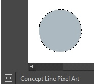
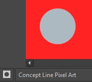
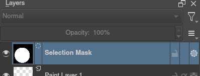

# 选区、透明度选区与局部修整

> **内容边界**：下方“授权原文”是官方主内容的 Markdown 转换；中文操作路线、练习与验收由整理者编写，不是作者逐句翻译，也不代表已在本机运行软件验证。

## 中文任务导读

把修改限定到精确范围，防止重着色或清理时破坏相邻像素。

**前提**：能够新建、保存和打开 Krita 文档；先确定目标像素尺寸、色板与透明度要求。

### 操作路线

1. 根据目标形状选矩形、多边形、自由或颜色相关选区工具。
2. 在工具选项中确认当前是替换、增加、减去还是相交模式。
3. 需要按素材已有轮廓选择时，从图层透明度建立选区；复杂边缘可查看全局选区遮罩。
4. 完成局部操作后取消选区，并在 100% 与放大视图分别检查成品。

### 配图怎么读

蚂蚁线只表示选区边界，并不显示全部透明程度；后续遮罩显示方式可以帮助判断柔边或遗漏区域。 图内界面与作品保留原貌；示例转用于像素素材时仍按本篇验收条件检查。

### 练习与验收（整理者补充）

只修改竹椅坐面颜色，同时保留椅腿和中间镂空；保存修改前后的同坐标截图。

- [ ] 选区没有遗漏孤立但有效的像素。
- [ ] 羽化设置符合像素素材要求。
- [ ] 取消选区后无被遮住的边缘错误。

### 版本与适用边界

像素选区与向量选区的编辑方式不同；从高分辨率插画迁移时不要默认沿用平滑边缘设置。

抓取时页面标题标注 **Krita Manual 5.3.0**；这是文档快照版本，不构成已发布软件版本或本机功能的验证。原文中保留的 `Added/Changed/Deprecated in version` 是兼容性依据。

## 来源、许可与修改记录

- 原文：[Selections](https://docs.krita.org/en/user_manual/selections.html)
- 作者：Scott Petrovic；Wolthera van Hövell tot Westerflier；Hulmanen；Raghavendra Kamath；Ross Rosales
- 页内作者与许可原始声明：[RST 源文件](../../sources/asset-production/MAKE-006/original.rst)；[线上原始声明](https://docs.krita.org/en/_sources/user_manual/selections.rst.txt)。
- 许可：[GNU Free Documentation License 1.3 or later](https://www.gnu.org/licenses/fdl-1.3.html)；[本地许可证全文](../../licenses/krita-GFDL-1.3.txt)。各图若有独立作者或许可，沿用原文紧邻图像的署名，不把作品许可自动泛化为文档许可。
- 修改历史：2026-10-29，Codex 为本教程库新增中文导读、练习和验收；将官方 HTML 主内容转换为 Markdown，去除导航与页脚，将控制图标转为文字、将教学图像存为本地文件。正文、步骤、代码、表格与图像说明保留。
- 本修改版沿用 GFDL 1.3 或更新版本。保留作者声明和上游链接；未添加 Invariant Sections、Front-Cover Texts 或 Back-Cover Texts。外链视频、安装包和关联页面没有自动下载或转录。

## 授权原文（英语，完整主内容转换）

## Selections

Selections allow you to pick a specific area of your artwork to change. This is useful when you want to move a section of the painting, transform it, or paint on it without affecting the other sections. There are many selection tools available that select in different ways. Once an area is selected, most tools will stay inside that area. On that area you can draw or use gradients to quickly get colored and/or shaded shapes with hard edges. The selections in Krita are not limited to the canvas boundary, so you can also select portions of the painting that are beyond the canvas boundary.

### Creating Selections

The most common selection tools all exist at the bottom of the toolbox. Each tool selects things slightly differently. The links for each tool go into a more detailed description of how to use it.

|  |  |  |
| --- | --- | --- |
| [Rectangular Selection Tool](https://docs.krita.org/en/reference_manual/tools/rectangular_select.html#rectangle-selection-tool) | [toolselectrect] | Select the shape of a square. |
| [Elliptical Selection Tool](https://docs.krita.org/en/reference_manual/tools/elliptical_select.html#ellipse-selection-tool) | [toolselectellipse] | Select the shape of a circle. |
| [Polygonal Selection Tool](https://docs.krita.org/en/reference_manual/tools/polygonal_select.html#polygonal-selection-tool) | [toolselectpolygon] | Click where you want each point of the Polygon to be. Double click to end your polygon and finalize your selection area. Use the `Shift + Z` shortcut to undo last point. |
| [Freehand Selection Tool](https://docs.krita.org/en/reference_manual/tools/freehand_select.html#freehand-selection-tool) | [toolselectfreehand] | freehand/Lasso tool is used for a rough selection by drawing the selection outline freehand on the canvas. |
| [Similar Color Selection Tool](https://docs.krita.org/en/reference_manual/tools/similar_select.html#similar-selection-tool) | [toolselectsimilar] | Similar Color Selection Tool. |
| [Contiguous Selection Tool](https://docs.krita.org/en/reference_manual/tools/contiguous_select.html#contiguous-selection-tool) | [toolselectcontiguous] | Contiguous or “Magic Wand” selects a field of color. Adjust the Fuzziness to allow more changes in the field of color, by default limited to the current layer. |
| [Path Selection Tool](https://docs.krita.org/en/reference_manual/tools/path_select.html#path-selection-tool) | [toolselectpath] | Path select an area based on a vector path, click to get sharp corners or drag to get flowing lines and close the path with the `Enter` key or connecting back to the first point. |
| [Magnetic Selection Tool](https://docs.krita.org/en/reference_manual/tools/magnetic_select.html#magnetic-selection-tool) | [toolselectmagnetic] | Magnetic selection makes a free hand selection where the selection snaps to sharp contrasts in the image. |

Note

You can also use the transform tools on your selection, a great way to try different proportions on parts of your image.

### Editing Selections

The tool options for each selection tool gives you the ability to modify
your selection.

|  |  |  |
| --- | --- | --- |
| Action | Modifier | Description |
| Replace | Ctrl | Replace the current selection. |
| Intersect | Shift + Alt | Get the overlapping section of both selections. |
| Add | Shift | Add the new selection to the current selection. |
| Subtract | Alt | Subtract the selection from the current selection. |
| Symmetric Difference | – | Make a selection where both the new and current do not overlap. |

You can change this in [Tools Settings](https://docs.krita.org/en/reference_manual/preferences/general_settings.html#tool-options-settings).

If you hover over a selection with a selection tool and no selection is activated, you can move it. To quickly go into transform mode, [right mouse button] and select Edit Selection.

### Removing Selections

If you want to delete the entire selection, the easiest way is to deselect everything. Select ‣ Deselect. Shortcut `Ctrl + Shift + A`.
When you have one of the selection tool active, and the mode of selection is in intersect, replace or symmetric difference then you can also deselect by just [left mouse button] anywhere on the canvas.

### Display Modes

In the bottom left-hand corner of the status bar there is a button to toggle how the selection is displayed. The two display modes are the following: (Marching) Ants and Mask. The red color with Mask can be changed in the preferences. You can edit the color under Settings ‣ Configure Krita… ‣ Display ‣ Selection Overlay. If there is no selection,
this button will not do anything.

Ants display mode (default) is best if you want to see the areas that are not selected.

Mask display mode is good if you are interested in seeing the various transparency levels for your selection. For example, when you have a selection with very soft edges due using feathering.

Changed in version 4.2: Mask mode is activated as well when a selection mask is the active layer so you can see the different selection levels.

### Global Selection Mask (Painting a Selection)

The global Selection Mask is your selection that appears on the layers docker. By default, this is hidden, so you will need to make it visible via Select ‣ Show Global Selection Mask.

Once the global Selection Mask is shown, you will need to create a selection. The benefit of using this is that you can paint your
selection using any of the normal painting tools, including the transform and move. The information is saved as grayscale.

You can enter the global selection mask mode quickly from the selection tools by doing [right mouse button] and select Edit Selection.

### Selection from layer transparency

You can create a selection based on a layer’s transparency by right-clicking on the layer in the layer docker and selecting Select Opaque from the context menu.

Added in version 4.2: You can also do this for adding, subtracting and intersecting by going to Select ‣ Select Opaque, where you can find specific actions for each.

If you want to quickly select parts of layers, you can hold the `Ctrl +` [left mouse button] shortcut on the layer *thumbnail*. To add a selection do `Ctrl + Shift +` [left mouse button] , to remove `Ctrl + Alt +` [left mouse button] and to intersect `Ctrl + Shift + Alt +` [left mouse button] . This works with any mask that has pixel or vector data (so everything but transform masks).

### Pixel and Vector Selection Types

Vector selections allow you to modify your selection with vector anchor tools. Pixel selections allow you to modify selections with pixel information. They both have their benefits and disadvantages. You can convert one type of selection to another.

When creating a selection, you can select what type of selection you want from the Mode in the selection tool options: Pixel or Vector. By default this will be Vector.

Vector selections can be modified as any other [vector shape](https://docs.krita.org/en/user_manual/vector_graphics.html#vector-graphics) with the [Shape Selection Tool](https://docs.krita.org/en/reference_manual/tools/shape_selection.html#shape-selection-tool), if you try to paint on a vector selection mask it will be converted into a pixel selection. You can also convert vector shapes to selection. In turn, vector selections can be made from vector shapes, and vector shapes can be converted to vector selections using the options in the Selection menu. Krita will add a new vector layer for this shape.

One of the most common reasons to use vector selections is that they give you the ability to move and transform a selection without the kind of resize artifacts you get with a pixel selection. You can also use the [Shape Edit Tool](https://docs.krita.org/en/reference_manual/tools/shape_edit.html#shape-edit-tool) to change the anchor points in the selection, allowing you to precisely adjust bezier curves or add corners to rectangular selections.

If you started with a pixel selection, you can still convert it to a
vector selection to get these benefits. Go to Select ‣ Convert to Vector Selection.

Note

If you have multiple levels of transparency when you convert a selection to vector, you will lose the semi-transparent values.

### Selection Action Bar

This assistant toolbar is used to perform actions on selections. It appears when you have a selection active, and it provides quick access to common selection-related actions.

Go to Settings ‣ Configure Krita.. ‣ General ‣ Tools, to enable or disable the Selection Action Bar.

Actions
:   Select All
    :   Select all content in the current layer.

    Deselect
    :   Deselect the current selection.

    Invert Selection
    :   Invert the current selection, selecting everything that was not selected before.

    Crop to Selection
    :   Crop to the current selection, removing everything outside of it.

    Fill with Foreground Color
    :   Fill the current selection with the foreground color.

    Copy to New Layer
    :   Copy the current selection to a new layer.

    Drag Handle
    :   Click and drag this handle to move the selection around the canvas.

### Common Shortcuts while Using Selections

- Copy – `Ctrl + C` or `Ctrl + Ins`
- Paste – `Ctrl + V` or `Shift + Ins`
- Cut – `Ctrl + X`, `Shift + Del`
- Copy From All Layers – `Ctrl + Shift + C`
- Copy Selection to New Layer – `Ctrl + Alt + J`
- Cut Selection to New Layer – `Ctrl + Shift + J`
- Display or hide selection with `Ctrl + H`
- Select Opaque – `Ctrl +` [left mouse button] on layer thumbnail.
- Select Opaque (Add) – `Ctrl + Shift +` [left mouse button] on layer thumbnail.
- Select Opaque (Subtract) – `Ctrl + Alt +` [left mouse button] on layer thumbnail.
- Select Opaque (Intersect) – `Ctrl + Shift + Alt +` [left mouse button] on layer thumbnail.

## 本地配图清单

| 图 | 本地文件 | 原始来源 |
|---|---|---|
| 1 | [Figure 1: Ants displayMode](../../assets/asset-production/MAKE-006/Ants-displayMode.jpg) | [原图](https://docs.krita.org/en/_images/Ants-displayMode.jpg) |
| 2 | [Figure 2: Mask displayMode](../../assets/asset-production/MAKE-006/Mask-displayMode.jpg) | [原图](https://docs.krita.org/en/_images/Mask-displayMode.jpg) |
| 3 | [Figure 3: Global selection mask](../../assets/asset-production/MAKE-006/Global-selection-mask.png) | [原图](https://docs.krita.org/en/_images/Global-selection-mask.png) |
| 4 | [Figure 4: Vector pixel selections](../../assets/asset-production/MAKE-006/Vector-pixel-selections.jpg) | [原图](https://docs.krita.org/en/_images/Vector-pixel-selections.jpg) |
