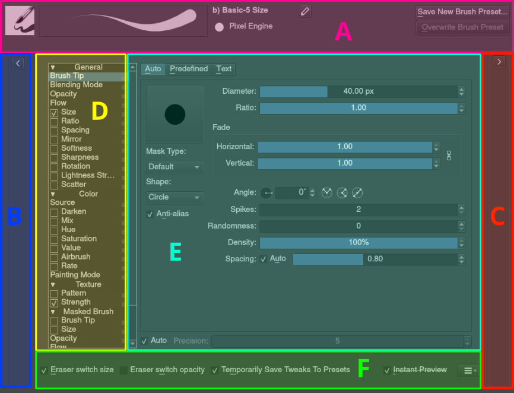
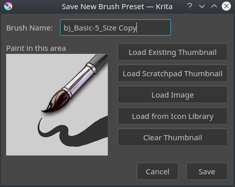
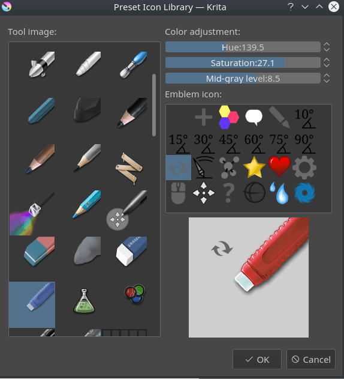
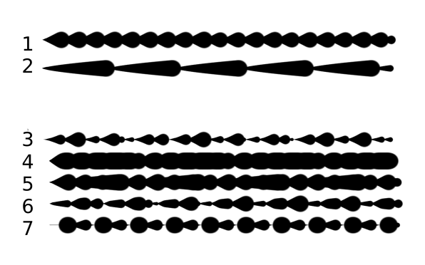
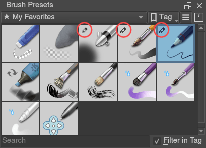

# 保存与共享一致的像素绘画笔刷预设

> **内容边界**：下方“授权原文”是官方主内容的 Markdown 转换；中文操作路线、练习与验收由整理者编写，不是作者逐句翻译，也不代表已在本机运行软件验证。

## 中文任务导读

把尺寸、笔尖与输入响应保存为可复用预设，降低不同素材间的工具差异。

**前提**：能够新建、保存和打开 Krita 文档；先确定目标像素尺寸、色板与透明度要求。

### 操作路线

1. 复制一个接近目标的预设，在 F5 设置面板逐项检查笔尖、尺寸与间距。
2. 对像素精修单独建立固定尺寸、固定不透明度的预设；用测试笔画确认压力是否改变结果。
3. 通过 Save New Brush Preset 保存名称和图标，保留原预设用于回退。
4. 共享时检查预设是否依赖额外笔尖和图案；优先用资源包一起导出。

### 配图怎么读

预设保存对话框同时包含名称和预览图；保存成功后还要重载，确认笔尖、压力响应等参数一并保留。 图内界面与作品保留原貌；示例转用于像素素材时仍按本篇验收条件检查。

### 练习与验收（整理者补充）

保存“1px 修边”和“色块铺底”两个预设；重启后用相同输入比较笔画是否一致。

- [ ] 预设重载后尺寸和边缘行为一致。
- [ ] 使用者能找到依赖的笔尖与图案。
- [ ] 软边绘画预设不会混入严格像素修边流程。

### 版本与适用边界

原文示例为勾线笔刷并建议抗锯齿；像素修边预设需要另行关闭平滑相关参数，不能照搬示例数值。

抓取时页面标题标注 **Krita Manual 5.3.0**；这是文档快照版本，不构成已发布软件版本或本机功能的验证。原文中保留的 `Added/Changed/Deprecated in version` 是兼容性依据。

## 来源、许可与修改记录

- 原文：[Loading and Saving Brushes](https://docs.krita.org/en/user_manual/loading_saving_brushes.html)
- 作者：Wolthera van Hövell tot Westerflier；Raghavendra Kamath；Scott Petrovic
- 页内作者与许可原始声明：[RST 源文件](../../sources/asset-production/MAKE-008/original.rst)；[线上原始声明](https://docs.krita.org/en/_sources/user_manual/loading_saving_brushes.rst.txt)。
- 许可：[GNU Free Documentation License 1.3 or later](https://www.gnu.org/licenses/fdl-1.3.html)；[本地许可证全文](../../licenses/krita-GFDL-1.3.txt)。各图若有独立作者或许可，沿用原文紧邻图像的署名，不把作品许可自动泛化为文档许可。
- 修改历史：2026-10-29，Codex 为本教程库新增中文导读、练习和验收；将官方 HTML 主内容转换为 Markdown，去除导航与页脚，将控制图标转为文字、将教学图像存为本地文件。正文、步骤、代码、表格与图像说明保留。
- 本修改版沿用 GFDL 1.3 或更新版本。保留作者声明和上游链接；未添加 Invariant Sections、Front-Cover Texts 或 Back-Cover Texts。外链视频、安装包和关联页面没有自动下载或转录。

## 授权原文（英语，完整主内容转换）

## Loading and Saving Brushes

In the real world, when painting or drawing, you don’t just use one tool. You use pencils, erasers, paintbrushes, different types of paint, inks, crayons, etc. All these have different ways of making marks.

In a digital program like Krita you have something similar. We call this a brush engine. And much like how cars have different engines that give different feels when driving, or how pencils make distinctly different marks than roller ball pens, different brush engines have totally different feels.

The brush engines have a lot of different settings as well. So, you can save those settings into presets.

Unlike Photoshop, Krita makes a difference between brush-tips and brush-presets. Tips are only a stamp of sorts, while the preset uses a tip and many other settings to create the full brush.

### The Brush settings drop-down

To start, the Brush Settings Editor panel can be accessed in the toolbar, between the Choose brush preset button on the right and the Fill Patterns button on the left. Alternately, you can use the `F5` key to open it.

When you open Brush Settings Editor panel you will see something like this:

#### Tour of the brush settings drop-down

The brush settings drop-down is divided into six areas,

##### Section A – General Information

This contains the *Preset Icon*, *Live Brush Preview*, the *Preset Name*, the *Engine* name, and several buttons for saving, renaming, and reloading.

Krita’s brush settings are stored into the metadata of a 200×200 PNG (the `KPP` file), where the image in the PNG file becomes the preset icon. This icon is used everywhere in Krita, and is useful for differentiating brushes in ways that the live preview cannot.

The live preview shows a stroke of the current brush as a little s-curve wiggle, with the pressure being non-existent on the left, and increasing to full pressure as it goes to the right. It can thus show the effect of the Pressure, Drawing Angle, Distance, Fade and Fuzzy Dab sensors, but none of the others. For some brush engines it cannot show anything. For the color smudge, filter brush and clone tool, it shows an alternating line pattern because these brush engines use the pixels already on canvas to change their effect.

After the preset name, there’s a button for *renaming* the brush. This will save the brush as a new brush and [deactivate](https://docs.krita.org/en/reference_manual/resource_management.html#deactivating-resources) the previous brush.

###### Engine

The engine of a brush is the underlying programming that generates the stroke from a brush. What that means is that different brush engines have different options and different results. You can see this as the difference between using crayons, pencils and inks, but because computers are math devices, most of our brush engines produce different things in a more mathematical way.

For most artists the mathematical nature doesn’t matter as much as the different textures and marks each brush engine, and each brush engine has its own distinct flavor and use, and can be further customized by modifying the options.

###### Reloading

If you change a preset, an icon will appear behind the engine name. This is the Reload the brush preset button. You can use it to revert to the original brush settings.

###### Saving a preset

On the right, there’s Save New Brush Preset… and Overwrite Brush buttons.

Save New Brush Preset…
:   Will take the current preset and all its changes and save it as a new preset. If no change was made, you will be making a copy of the current preset.

Overwrite Brush
:   This will only enable if there are any changes. Pressing this will override the current preset with the new settings, keeping the name and the icon intact. It will always make a timestamped back up in the resources folder.

Save new preset will call up the following window, with a mini scratch pad, and all sorts of options to change the preset icon:

The image on the left is a mini scratch pad, you can draw on it with the current brush, allowing small modifications on the fly.

Brush Name:
:   The Name of your brush. This is also used for the `KPP` file. If there’s already a brush with that name, it will effectively overwrite it.

Load Existing Thumbnail
:   This will load the existing thumbnail inside the preset.

Load Scratch Pad Thumbnail
:   This will load the dashed area from the big scratch pad (Section C) into the thumbnail area.

Load Image
:   With this you can choose an image from disk to load as a thumbnail.

Load from Icon Library
:   This opens up the icon library.

Clear Thumbnail
:   This will make the mini scratch pad white.

###### The Icon Library

To make making presets icons faster, Krita got an icon library.

It allows you to select tool icons, and an optional small emblem. When you press OK it will load the resulting combination into the mini scratch pad, and you can draw in the stroke.

If you go to your resources folder, there’s a folder there called `preset\_icons`, and in this folder there are `tool\_icons` and `emblem\_icons`. You can add semi-transparent PNGs here and Krita will load those into the icon library as well, so you can customize your icons even more!

At the top right of the icon library, there are three sliders. They allow you to adjust the tool icon. The top two are the same Hue and Saturation as in HSL adjustment, and the lowest slider is a super simple levels filter. This is done this way because the levels filter allows maintaining the darkest shadows and brightest highlights on a tool icon,
making it much better for quick adjustments.

If you’re done with everything, you can press Save in the Save New Brush Preset dialog and Krita will save the new brush.

##### Section B – The Preset Chooser

The preset chooser is much the same as the preset docker and the preset drop-down on the `F6` key. It’s unique in that it allows you to filter by engine and this is also where you can create brushes for an engine from scratch.

It is by default collapsed, so you will need to press the arrow at the top left of the brush engine to show it.

The top drop-down is set to “all” by default, which means it shows all engines. It then shows a tag section where you can select the tags, the preset list and the search bar.

Underneath that there’s a plus icon, which when pressed gives you the full list of Krita’s engines. Selecting an engine from the list will show the brushes for that engine.

The trashcan icon does the same as it does in the preset docker: delete, or rather, [deactivate a preset](https://docs.krita.org/en/reference_manual/resource_management.html#deactivating-resources), so it won’t show up in the list.

##### Section C – The Scratch pad

When you tweak your brushes, you want to be able to check what each setting does. That’s why, to the right of the settings drop-down, there is a scratch pad.

It is by default collapsed, so you will have to press the arrow at the top right of the brush settings to show it.

When saving a new preset, you can choose to get the icon from the scratch pad, this will load the dash area into the mini scratch pad of the Save New Brush Preset dialog.

The scratch pad has five buttons underneath it. These are in order for:

1. Fill area with brush preset icon
2. Fill area with current image
3. Fill area with gradient (useful for smudge brushes)
4. Fill area with background color
5. Reset area to white

##### Section D – The Options List

The options, as stated above, are different per brush engine. These represent the different parameters, toggles and knobs that you can turn to make a brush preset unique. For a couple of options, the main things to change are sliders and checkboxes, but for a lot of them, they use curves instead.

Some options can be toggled, as noted by the little checkboxes next to them, but others, like flow and opacity are so fundamental to how the brush works, that they are always on.

The little padlock icon next to the options is for locking the brush. This has its own page.

##### Section E – Option Configuration Widget

Where section D is the list of options, section E is the widget where you can change things.

###### Using sensor curves

One of the big important things that make art unique to the artist who created it is the style of the strokes. Strokes are different because they differ in speed, rotation, direction, and the amount of pressure put onto the stylus. Because these are so important, we would want to customize how these values are understood in detail. The best way to do this is to use curves.

Curves show up with the size widget for example. With an inking brush, we want to have size mapped to pressure. Just toggling the size option in the option list will do that.

However, different people have different wrists and thus will press differently on their stylus. Someone who presses softly tends to find it easy to make thin strokes, but very difficult to make thick strokes. Conversely, someone who presses hard on their stylus naturally will have a hard time making thin strokes, but easily makes thick ones.

Such a situation can be improved by using the curves to map pressure to output thinner lines or thicker ones.

The brush settings curves even have quick curve buttons for these at the top. Someone who has a hard time making small strokes should try the second to last concave button, while someone who has a hard time making thick strokes should try the third button, the S shape.

Underneath the curve widget there are two more options:

Share curve across all settings
:   This is for the list of sensors. Toggling this will make all the sensors use the same curve. Unchecked, all checked sensors will have separate curves.

Curves calculation mode:
:   This indicates how the multiple values of the sensor curves are used. The curves always go from 0 to 1.0, so if one curve outputs 0.5 and the other 0.7, then…

    Multiply
    :   Will multiply the two values, 0.5\*0.7 = 0.35.

    Addition
    :   Will add the two to a maximum of 1.0, so 0.5+0.7 = 1.2, which is then capped at 1.0.

    Maximum
    :   Will compare the two and pick the largest. So in the case of 0.5 and 0.7, the result is 0.7.

    Minimum
    :   Will compare the two and pick the smallest. So in the case of 0.5 and 0.7, the result is 0.5.

    Difference
    :   Will subtract the smallest value from the largest, so 0.7-0.5 = 0.2.

It’s maybe better to see with the following example:

The first two are regular, the rest with different multiplication types.

1. Is a brush with size set to the distance sensor.
2. Is a brush with the size set to the fade sensor.
3. The size is calculated from the fade and distance sensors multiplied.
4. The size is calculated from the fade and distance sensors added to
   each other. Notice how thick it is.
5. The size takes the maximum value from the values of the fade and
   distance sensors.
6. The size takes the minimum value from the values of the fade and
   distance sensors.
7. The size is calculated by having the largest of the values subtracted
   with the smallest of the values.

##### Section F – Miscellaneous options

Eraser switch size
:   This switches the brush to a separately stored size when using the `E` key.

Eraser switch opacity
:   Same as above, but then with Eraser opacity.

Temporarily save tweaks to preset
:   This enables dirty presets. Dirty presets store the tweaks you make as long as this session of Krita is active. After that, they revert to default. Dirtied presets can be recognized by the icon in the top-left of the preset.

    
    

    The icon encircled in red in the top left of the third, fourth and fifth presets in first row indicate it is “Dirty”, meaning there are tweaks made to the preset.

Instant preview
:   This allows you to toggle instant preview on the brush. The Instant Preview has a super-secret feature: when you press the instant preview label, and then right click it, it will show a threshold slider. This slider determines at what brush size instant preview is activated for the brush. This is useful because small brushes can be slower with instant preview, so the threshold ensures it only activates when necessary.

#### The On-canvas brush settings

There is a [On-Canvas Brush Editor](https://docs.krita.org/en/reference_manual/dockers/oncanvas_brush_editor.html#oncanvas-brush-editor). If you open up the pop-up palette, there should be an icon on the bottom-right. Press that to show the on-canvas brush settings. You will see several sliders here, to quickly make small changes.

At the top it shows the currently active preset. Next to that is a settings button, click that to get a list of settings that can be shown and organized for the given brush engine. You can use the up and down arrows to order their position, and then left and right arrows to add or remove from the list. You can also drag and drop.

### Making a Brush Preset

Now, let’s make a simple brush to test the waters with:

#### Getting a default for the brush engine.

First, open the settings with the `F5` key.

Then, press the arrow on the upper left to open the preset chooser. There, press the “+” icon to get a list of engines. For this brush we’re going to make a pixel brush.

#### Example: Making an inking brush

1. Draw on the scratch pad to see what the current brush looks like. If done correctly, you should have a 5px wide brush that has pressure set to opacity.
2. Let us turn off the opacity first. Click on the [opacity](https://docs.krita.org/en/reference_manual/brushes/brush_settings/opacity_and_flow.html#option-opacity-n-flow) option in the right-hand list. The settings should now be changed to a big curve. This is the sensor curve.
3. Uncheck the Enable Pen Settings checkbox.
4. Test on the scratch pad… there still seems to be something affecting opacity. This is due to the [flow](https://docs.krita.org/en/reference_manual/brushes/brush_settings/opacity_and_flow.html#option-opacity-n-flow) option.
5. Select the Flow option from the list on the right hand. Flow is like Opacity, except that Flow is per dab, and opacity is per stroke.
6. Uncheck the Enable Pen Settings checkbox here as well. Test again.
7. Now you should be getting somewhere towards an inking brush. It is still too small however, and kinda grainy looking. Click [Brush Tip](https://docs.krita.org/en/reference_manual/brushes/brush_settings/brush_tips.html#option-brush-tip) in the brush engine options.
8. Here, the diameter is the size of the brush-tip. You can touch the slider change the size, or right-click it and type in a value. Set it to 25 and test again. It should be much better.
9. Now to make the brush feel a bit softer, turn down the fade parameter to about 0.9. This’ll give the *brush mask* a softer edge.
10. If you test again, you’ll notice the fade doesn’t seem to have much effect. This has to do with the spacing of the dabs: The closer they are together, the harder the line is. By default, this is 0.1, which is a bit low. If you set it to 10 and test, you’ll see what kind of effect spacing has. The [Auto](https://docs.krita.org/en/reference_manual/brushes/brush_settings/options.html#option-spacing) checkbox changes the way the spacing is calculated, and Auto Spacing with a value of 0.8 is the best value for inking brushes. Don’t forget that you can use right-click to type in a value.
11. Now, when you test, the fade seems to have a normal effect… except on the really small sizes, which look jagged. To get rid of that, check the anti-aliasing check box. If you test again, the lines should be much nicer now.

#### Saving the new Brush

When you’re satisfied, go to the upper left and select Save New Brush Preset… button.

You will get the save preset dialog. Name the brush something like “My Preset”. Then, select Load from Icon Library to get the icon library. Choose a nice tool icon and press OK.

The icon will be loaded into the mini scratch pad on the left. Now doodle a nice stroke next to it. If you feel you messed up, just go back to the icon library to load a new icon.

Finally, press Save, and your brush should be done.

You can further modify your inking brush by…

Changing the amount of pressure you need to put on a brush to make it full size.
:   To do this, select the [size](https://docs.krita.org/en/reference_manual/brushes/brush_settings/options.html#option-size) option, and press the pressure sensor from the list next to the curve. The curve should look like a straight line. Now if you want a brush that gets big with little pressure, tick on the curve to make a point, and drag the point to the upper-left. The more the point is to the upper-left, the more extreme the effect. If you want instead a brush that you have to press really hard on to get to full size, drag the dot to the lower-right. Such a brush is useful for fine details. Don’t forget to save the changes to your brush when done.

Making the fine lines look even softer by using the flow option.
:   To do this, select the flow option, and turn back on the Enable Pen Settings check box. Now if you test this, it is indeed a bit softer, but maybe a bit too much. Click on the curve to make a dot, and drag that dot to the top-left, half-way the horizontal of the first square of the grid. Now, if you test, the thin lines are much softer, but the hard your press, the harder the brush becomes.

### Sharing Brushes

Okay, so you’ve made a new brush and want to share it. There are several ways to share a brush preset.

The recommended way to share brushes and presets is by using the [Resource Bundle](https://docs.krita.org/en/reference_manual/resource_management.html#term-Resource-Bundle) system. We have detailed instructions on how to use them on the [resource management page](https://docs.krita.org/en/reference_manual/resource_management.html#resource-management).

However, there are various old-fashioned ways of sharing brushes that can be useful when importing and loading very old packs:

#### Sharing a single preset

There are three types of resources a single preset can take:

1. A `paintoppreset` file: This is the preset proper, with the icon and the curves stored inside.
2. A Brush file: This is the brush tip. When using masked brushes, there are two of these.
3. A Pattern file: this is when you are using textures.

So when you have a brush that uses unique predefined tips for either brush tip or masked brush, or unique textures you will need to share those resources as well with the other person.

To find those resources, go to Settings ‣ Manage Resources… ‣ Open Resource Folder.

There, the preset file will be inside `paintoppresets`, the brush tips inside `brushes` and the texture inside `patterns`.

##### Importing a single KPP file.

Now, if you want to use the single preset, you should go to the preset chooser on the `F6` key and press the folder icon there. This will give a file dialog. Navigate to the `KPP` file and open it to import it.

If there are brush tips and patterns coming with the file, do the same with pattern via the pattern docker, and for the brush-tip go to the settings drop-down (`F5`) and then go to the brush-tip option. There, select predefined brush, and then the import button to call up the file dialog.

You can also use the import button in Settings ‣ Manage Resources….

#### Sharing via ZIP (old-fashioned)

Sharing via ZIP should be replaced with resource bundles, but older brush packs are stored in ZIP files.

##### Using a ZIP with the relevant files.

1. Go to Settings ‣ Manage Resources… ‣ Open Resource Folder to open the resource folder.
2. Then, open up the ZIP file.
3. Copy the `brushes`, `paintoppresets` and `patterns` folders from the ZIP file to the resource folder. You should get a prompt to merge the folders, agree to this.
4. Restart Krita.
5. Enjoy your brushes!

## 本地配图清单

| 图 | 本地文件 | 原始来源 |
|---|---|---|
| 1 | [Figure 1: Krita 5 0 Brush Settings Layout](../../assets/asset-production/MAKE-008/Krita_5_0_Brush_Settings_Layout.svg) | [原图](https://docs.krita.org/en/_images/Krita_5_0_Brush_Settings_Layout.svg) |
| 2 | [Figure 2: Krita 4 0 Save New Brush Preset Dialog](../../assets/asset-production/MAKE-008/Krita_4_0_Save_New_Brush_Preset_Dialog.png) | [原图](https://docs.krita.org/en/_images/Krita_4_0_Save_New_Brush_Preset_Dialog.png) |
| 3 | [Figure 3: Krita 4 0 Preset Icon Library Dialog](../../assets/asset-production/MAKE-008/Krita_4_0_Preset_Icon_Library_Dialog.png) | [原图](https://docs.krita.org/en/_images/Krita_4_0_Preset_Icon_Library_Dialog.png) |
| 4 | [Figure 4: Krita 4 0 brush curve calculation mode](../../assets/asset-production/MAKE-008/Krita_4_0_brush_curve_calculation_mode.png) | [原图](https://docs.krita.org/en/_images/Krita_4_0_brush_curve_calculation_mode.png) |
| 5 | [Figure 5: The icon encircled in red in the top left of the third, fourth and fifth presets in first row indicate it is “Dirty”, meaning there are tweaks made to the preset. ¶](../../assets/asset-production/MAKE-008/Krita_4_0_dirty_preset_icon.png) | [原图](https://docs.krita.org/en/_images/Krita_4_0_dirty_preset_icon.png) |
