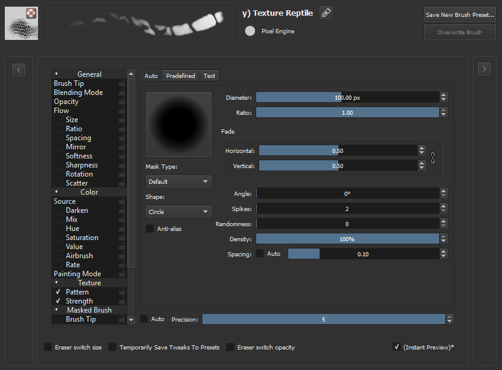
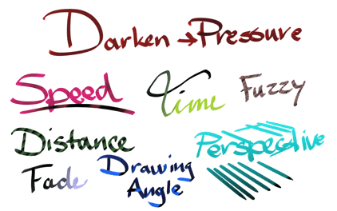
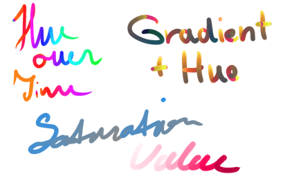
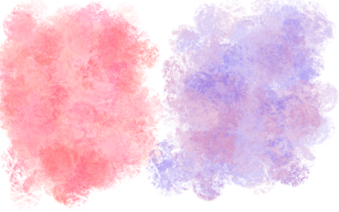

# 理解 Pixel Brush 引擎：笔尖、间距与颜色变化

> **内容边界**：下方“授权原文”是官方主内容的 Markdown 转换；中文操作路线、练习与验收由整理者编写，不是作者逐句翻译，也不代表已在本机运行软件验证。

## 中文任务导读

了解一次笔画由连续笔尖印记组成，找出边缘软化和意外颜色变化来自哪里。

**前提**：能够新建、保存和打开 Krita 文档；先确定目标像素尺寸、色板与透明度要求。

### 操作路线

1. 选择笔尖类型并用短笔画观察单个印记形状。
2. 改变间距，比较连续线与可见印记之间的差异。
3. 逐项检查尺寸、透明度和 HSV 参数是否由压力、速度或随机传感器控制。
4. 保存一个固定参数版本，和原笔刷并排测试颜色数及边缘清晰度。

### 配图怎么读

笔刷设置面板中的参数列表提示哪些属性可能影响笔触；图中的软笔刷只是引擎示例，不是推荐的像素修边配置。 图内界面与作品保留原貌；示例转用于像素素材时仍按本篇验收条件检查。

### 练习与验收（整理者补充）

在 32×32 画布上用同一颜色画三条线，只改变间距或压力响应，记录结果。

- [ ] 能够说明每种笔画变化对应哪个参数。
- [ ] 目标固定色笔刷没有随机 HSV 变化。
- [ ] 边缘是否有半透明像素已检查。

### 版本与适用边界

Pixel Brush 是 Krita 的通用栅格笔刷引擎名称，不代表默认配置天然适合逐像素绘画。

抓取时页面标题标注 **Krita Manual 5.3.0**；这是文档快照版本，不构成已发布软件版本或本机功能的验证。原文中保留的 `Added/Changed/Deprecated in version` 是兼容性依据。

## 来源、许可与修改记录

- 原文：[Pixel Brush Engine](https://docs.krita.org/en/reference_manual/brushes/brush_engines/pixel_brush_engine.html)
- 作者：Wolthera van Hövell tot Westerflier；Scott Petrovic
- 页内作者与许可原始声明：[RST 源文件](../../sources/asset-production/MAKE-009/original.rst)；[线上原始声明](https://docs.krita.org/en/_sources/reference_manual/brushes/brush_engines/pixel_brush_engine.rst.txt)。
- 许可：[GNU Free Documentation License 1.3 or later](https://www.gnu.org/licenses/fdl-1.3.html)；[本地许可证全文](../../licenses/krita-GFDL-1.3.txt)。各图若有独立作者或许可，沿用原文紧邻图像的署名，不把作品许可自动泛化为文档许可。
- 修改历史：2026-10-29，Codex 为本教程库新增中文导读、练习和验收；将官方 HTML 主内容转换为 Markdown，去除导航与页脚，将控制图标转为文字、将教学图像存为本地文件。正文、步骤、代码、表格与图像说明保留。
- 本修改版沿用 GFDL 1.3 或更新版本。保留作者声明和上游链接；未添加 Invariant Sections、Front-Cover Texts 或 Back-Cover Texts。外链视频、安装包和关联页面没有自动下载或转录。

## 授权原文（英语，完整主内容转换）

## Pixel Brush Engine

[../../../\_images/pixelbrush.svg]

Brushes are ordered alphabetically. The brush that is selected by default when you start with Krita is the Pixel Brush. The pixel brush is the traditional mainstay of digital art. This brush paints impressions of the brush tip along your stroke with a greater or smaller density.

Let’s first review these mechanics:

1. Select a brush tip. This can be a generated brush tip (round, square, star-shaped), a predefined bitmap brush tip, a custom brush tip or a text.
2. Select the spacing: this determines how many impressions of the tip will be made along your stroke.
3. Select the effects: the pressure of your stylus, your speed of painting or other inputs can change the size, the color, the opacity or other aspects of the currently painted brush tip instance – some applications call that a “dab”.
4. Depending on the brush mode, the previously painted brush tip instance is mixed with the current one, causing a darker, more painterly stroke, or the complete stroke is computed and put on your layer. You will see the stroke grow while painting in both cases, of course!

Since 4.0, the Pixel Brush Engine has Multithreaded brush-tips, with the default brush being the fastest mask.

Available Options:

- [Brush Tips](https://docs.krita.org/en/reference_manual/brushes/brush_settings/brush_tips.html#option-brush-tip)
- [Blending Modes](https://docs.krita.org/en/reference_manual/blending_modes.html#blending-modes)
- [Opacity and Flow](https://docs.krita.org/en/reference_manual/brushes/brush_settings/opacity_and_flow.html#option-opacity-n-flow)
- [Size](https://docs.krita.org/en/reference_manual/brushes/brush_settings/options.html#option-size)
- [Ratio](https://docs.krita.org/en/reference_manual/brushes/brush_settings/options.html#option-ratio)
- [Spacing](https://docs.krita.org/en/reference_manual/brushes/brush_settings/options.html#option-spacing)
- [Mirror](https://docs.krita.org/en/reference_manual/brushes/brush_settings/options.html#option-mirror)
- [Softness](https://docs.krita.org/en/reference_manual/brushes/brush_settings/options.html#option-softness)
- [Sharpness](https://docs.krita.org/en/reference_manual/brushes/brush_settings/options.html#option-sharpness)
- [Rotation](https://docs.krita.org/en/reference_manual/brushes/brush_settings/options.html#option-rotation)
- [Scatter](https://docs.krita.org/en/reference_manual/brushes/brush_settings/options.html#option-scatter)
- [Source](https://docs.krita.org/en/reference_manual/brushes/brush_settings/options.html#option-source)
- [Mix](https://docs.krita.org/en/reference_manual/brushes/brush_settings/options.html#option-mix)
- [Airbrush](https://docs.krita.org/en/reference_manual/brushes/brush_settings/options.html#option-airbrush)
- [Texture](https://docs.krita.org/en/reference_manual/brushes/brush_settings/texture.html#option-texture)
- [Masked Brush](https://docs.krita.org/en/reference_manual/brushes/brush_settings/masked_brush.html#option-masked-brush)

### Specific Parameters to the Pixel Brush Engine

#### Darken

Allows you to Darken the source color with Sensors.

The color will always become black in the end, and will work with Plain Color, Gradient and Uniform random as source.

#### Hue, Saturation, Value

These parameters allow you to do an HSV adjustment filter on the [Source](https://docs.krita.org/en/reference_manual/brushes/brush_settings/options.html#option-source) and control it with Sensors.

Works with Plain Color, Gradient and Uniform random as source.

##### Uses

Having all three parameters on Fuzzy will help with rich color texture. In combination with [Mix](https://docs.krita.org/en/reference_manual/brushes/brush_settings/options.html#option-mix), you can have even finer control.

## 本地配图清单

| 图 | 本地文件 | 原始来源 |
|---|---|---|
| 1 | [Figure 1: Krita Pixel Brush Settings Popup](../../assets/asset-production/MAKE-009/Krita_Pixel_Brush_Settings_Popup.png) | [原图](https://docs.krita.org/en/_images/Krita_Pixel_Brush_Settings_Popup.png) |
| 2 | [Figure 2: Krita 2 9 brushengine darken 01](../../assets/asset-production/MAKE-009/Krita_2_9_brushengine_darken_01.png) | [原图](https://docs.krita.org/en/_images/Krita_2_9_brushengine_darken_01.png) |
| 3 | [Figure 3: Krita 2 9 brushengine HSV 01](../../assets/asset-production/MAKE-009/Krita_2_9_brushengine_HSV_01.png) | [原图](https://docs.krita.org/en/_images/Krita_2_9_brushengine_HSV_01.png) |
| 4 | [Figure 4: Krita 2 9 brushengine HSV 02](../../assets/asset-production/MAKE-009/Krita_2_9_brushengine_HSV_02.png) | [原图](https://docs.krita.org/en/_images/Krita_2_9_brushengine_HSV_02.png) |
