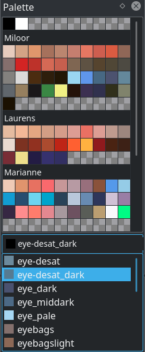

# 调色板：分组色阶、命名与素材统一

> **内容边界**：下方“授权原文”是官方主内容的 Markdown 转换；中文操作路线、练习与验收由整理者编写，不是作者逐句翻译，也不代表已在本机运行软件验证。

## 中文任务导读

把一个场景的地面、木材、植被和高光色整理成可共享的色板。

**前提**：能够新建、保存和打开 Krita 文档；先确定目标像素尺寸、色板与透明度要求。

### 操作路线

1. 在 Palette Docker 创建新色板并命名，或导入已有资源。
2. 为木材、植物、石材等用途建立分组，将亮暗色阶相邻排列。
3. 给关键色块添加名称或 ID，使用色板取色，避免靠视觉重新选近似色。
4. 保存色板到资源或文档，重新打开检查分组与色值。

### 配图怎么读

色板截图展示了按行列和分组存放的颜色；把同材质的亮暗色排在一起，可以让不同素材复用同一色阶。 图内界面与作品保留原貌；示例转用于像素素材时仍按本篇验收条件检查。

### 练习与验收（整理者补充）

建立 12 色乡村素材色板，至少含木材与植被两条色阶；用同一色板给木桶和树冠配色。

- [ ] 同用途颜色有稳定名称。
- [ ] 重新打开文档后色板仍可用。
- [ ] 未因随意拾色增加大量近似色。

### 版本与适用边界

调色板在 4.2 有过重做；本页按 5.3 手册阅读，旧版的保存与排列入口可能不同。

抓取时页面标题标注 **Krita Manual 5.3.0**；这是文档快照版本，不构成已发布软件版本或本机功能的验证。原文中保留的 `Added/Changed/Deprecated in version` 是兼容性依据。

## 来源、许可与修改记录

- 原文：[Palette Docker](https://docs.krita.org/en/reference_manual/dockers/palette_docker.html)
- 作者：Wolthera van Hövell tot Westerflier；Scott Petrovic；Raghavendra Kamath
- 页内作者与许可原始声明：[RST 源文件](../../sources/asset-production/MAKE-010/original.rst)；[线上原始声明](https://docs.krita.org/en/_sources/reference_manual/dockers/palette_docker.rst.txt)。
- 许可：[GNU Free Documentation License 1.3 or later](https://www.gnu.org/licenses/fdl-1.3.html)；[本地许可证全文](../../licenses/krita-GFDL-1.3.txt)。各图若有独立作者或许可，沿用原文紧邻图像的署名，不把作品许可自动泛化为文档许可。
- 修改历史：2026-10-29，Codex 为本教程库新增中文导读、练习和验收；将官方 HTML 主内容转换为 Markdown，去除导航与页脚，将控制图标转为文字、将教学图像存为本地文件。正文、步骤、代码、表格与图像说明保留。
- 本修改版沿用 GFDL 1.3 或更新版本。保留作者声明和上游链接；未添加 Invariant Sections、Front-Cover Texts 或 Back-Cover Texts。外链视频、安装包和关联页面没有自动下载或转录。

## 授权原文（英语，完整主内容转换）

## Palette Docker

The palette docker displays various color swatches for quick use. It also supports editing palettes and organizing colors into groups, as well as arbitrary positioning of swatches.

Added in version 4.2: The palette docker was overhauled in 4.2, allowing for grid ordering, storing palette in the document and more.

You can choose from various default palettes or you can add your own colors to the palette.

To choose from the default palettes click on the icon in the bottom left corner of the docker, it will show a list of pre-loaded color palettes.
You can click on one and to load it into the docker, or click on import resources to load your own color palette from a file. Creating a new palette can be done by pressing the +. Fill out the name input, pressing Save and Krita will select your new palette for you.

Since 4.2 Krita’s color palettes are not just a list of colors to store, but also a grid to organize them on. That’s why you will get a grid with ‘transparency checkers’, indicating that there is no entry. To add an entry, just click a swatch and a new entry will be added with a default name and the current foreground color.

- Selecting colors is done by [left mouse button] on a swatch.
- Pressing the delete icon will remove the selected swatch or group. When removing a group, Krita will always ask whether you’d like to keep the swatches. If so, the group will be merged with the default group.
- Double [left mouse button] a swatch will call up the edit window where you can change the color, the name, the id and whether it’s a spot color. On a group this will allow you to set the group name.
- [left mouse button] drag will allow you to drag and drop swatches and groups to order them.
- [right mouse button] on a swatch will give you a context menu with modify and delete options.
- Pressing the + icon will allow you to add a new swatch.
- The drop down contains all the entries, id numbers and names. When a color is a spot color the thumbnail is circular. You can use the dropdown to search on color name or id.
- By drag-and-dropping colors from the palette onto the [layer stack](https://docs.krita.org/en/reference_manual/dockers/layers.html#layer-docker), you can quickly create a [fill layer](https://docs.krita.org/en/reference_manual/layers_and_masks/fill_layers.html#fill-layers).
- By drag-and-dropping colors from the palette onto the canvas you can fill the current layer with that color. The filling options used are taken from the [fill tool](https://docs.krita.org/en/reference_manual/tools/fill.html#fill-tool) but if `Alt` is pressed when the color is dropped then all the layer (or the portion inside the current selection) will be filled.

Pressing the Folder icon will allow you to modify the palette. Here you can add more columns, modify the default group’s rows, or add more groups and modify their rows.

Palette Name
:   Modify the palette name. This is the proper name for the palette as shown in the palette chooser dropdown.

File name
:   This is the file name of the palette, which should be file system friendly. (Avoid quotation marks, for example).

Column Count
:   The amount of columns in this palette. This counts for all entries. If you accidentally make it smaller than the amount of entries that take up columns, you can still make it bigger until the next restart of Krita.

Where is the palette stored:
:   Whether to store said palette in the document or resource folder.

    Resource Folder
    :   The default, the palette will be stored in the resource folder.

    Document
    :   The palette will be removed from the resource folder and stored in the document upon save. It will be loaded into the resources upon loading the document.

    Deprecated since version 5.0: This has been disabled for now.

Add group
:   Add a new group. On clicking you will be asked for a name and a set of rows.

Group Settings
:   Here you can configure the groups. The dropdown has a selection of groups. The default group is at top.

    Row Count
    :   The amount of rows in the group. If you want to add more colors to a group and there’s no empty areas to click on anymore, increase the row count.

    Rename Group
    :   Rename the group.

    Delete Group
    :   Delete the group. It will ask whether you want to keep the colors. If so, it will merge the group’s contents with the default group.

The edit and new color dialogs ask for the following:

Color
:   The color of the swatch.

Name
:   The Name of the color in a human readable format.

ID
:   The ID is a number that can be used to index colors. Where Name can be something like “Pastel Peach”, ID will probably be something like “RY75”. Both names and ids can be used to search the color in the color entry dropdown at the bottom of the palette.

Spot color
:   Currently not used for anything within Krita itself, but spot colors are a toggle to keep track of colors that represent a real world paint that a printer can match. Keeping track of such colors is useful in a printing workflow, and it can also be used with python to recognize spot colors.

Krita’s native palette format is since 4.0 [\*.kpl](https://docs.krita.org/en/general_concepts/file_formats/file_kpl.html#file-kpl). It also supports importing…

- Gimp Palettes (.gpl)
- Microsoft RIFF palette (.riff)
- Photoshop Binary Palettes (.act)
- PaintShop Pro palettes (.psp)
- Photoshop Swatches (.aco)
- Scribus XML (.xml)
- Swatchbooker (.sbz)
- Adobe Swatch Exchange (.ase)
- Adobe Color Books (.acb)

## 本地配图清单

| 图 | 本地文件 | 原始来源 |
|---|---|---|
| 1 | [Figure 1: Palette docker](../../assets/asset-production/MAKE-010/Palette-docker.png) | [原图](https://docs.krita.org/en/_images/Palette-docker.png) |
