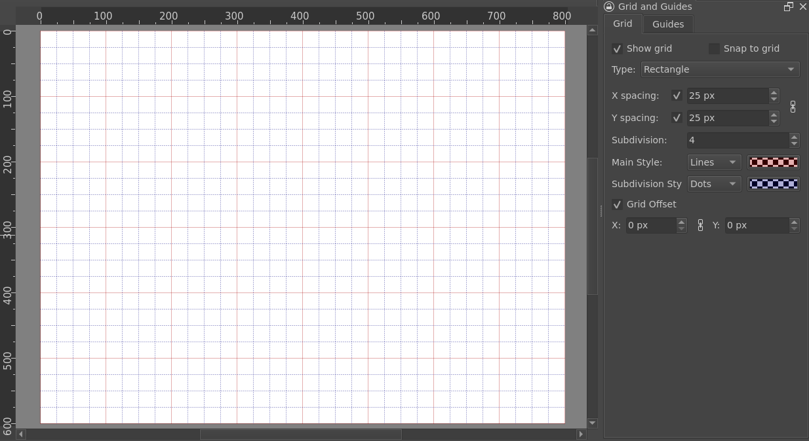
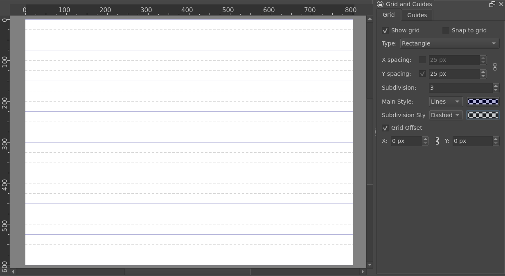
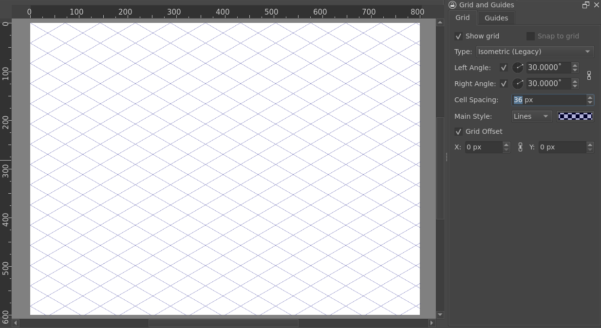
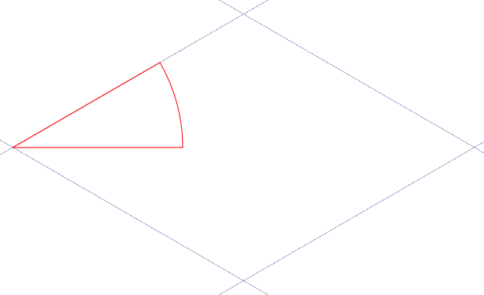
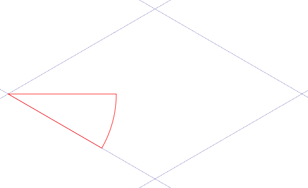
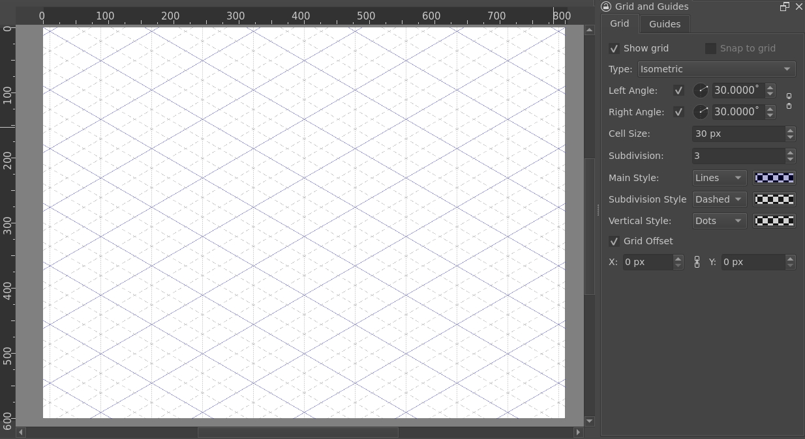
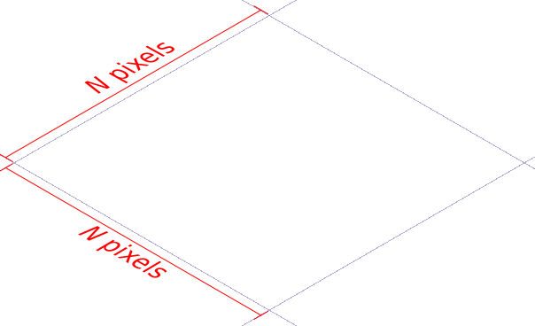
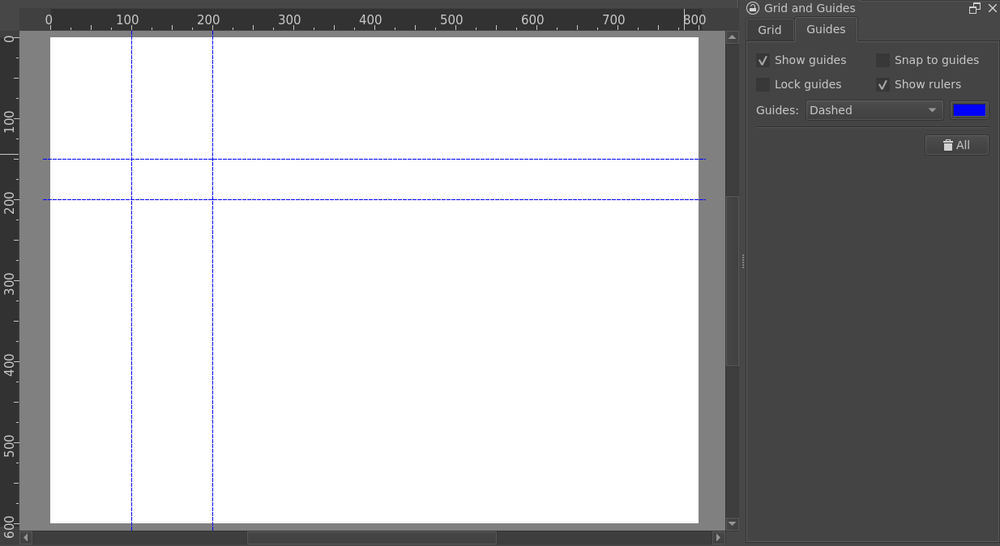

# 网格与辅助线：图块尺寸、偏移与对齐

> **内容边界**：下方“授权原文”是官方主内容的 Markdown 转换；中文操作路线、练习与验收由整理者编写，不是作者逐句翻译，也不代表已在本机运行软件验证。

## 中文任务导读

为图块、精灵表和建筑部件设置统一的坐标基准。

**前提**：能够新建、保存和打开 Krita 文档；先确定目标像素尺寸、色板与透明度要求。

### 操作路线

1. 使用矩形网格，将 X/Y 间距设置为素材约定的图块尺寸。
2. 检查 Grid Offset；有边距或间隔的图集需把它们纳入布局记录。
3. 开启或关闭吸附，分别测试绘制与移动是否符合预期。
4. 为角色脚底、房屋接地点或图集边界添加辅助线并保存文档模板。

### 配图怎么读

网格图中主线和细分线颜色不同；右侧参数控制间距与细分，不能只根据屏幕显示猜测实际像素间距。 图内界面与作品保留原貌；示例转用于像素素材时仍按本篇验收条件检查。

### 练习与验收（整理者补充）

建立 16×16 图块网格，在一张 64×64 图集中排列四类地表，并标记外边界。

- [ ] 图块边界与源像素坐标对齐。
- [ ] 辅助线不会出现在导出 PNG 中。
- [ ] 变更偏移后没有误以为素材自身移动。

### 版本与适用边界

本页区分旧版与新版等距网格；等距网格不支持吸附，不能把矩形网格的行为直接套用。

抓取时页面标题标注 **Krita Manual 5.3.0**；这是文档快照版本，不构成已发布软件版本或本机功能的验证。原文中保留的 `Added/Changed/Deprecated in version` 是兼容性依据。

## 来源、许可与修改记录

- 原文：[Grids and Guides Docker](https://docs.krita.org/en/reference_manual/dockers/grids_and_guides.html)
- 作者：Wolthera van Hövell tot Westerflier；Scott Petrovic；Nathan Lovato；Grum999
- 页内作者与许可原始声明：[RST 源文件](../../sources/asset-production/MAKE-011/original.rst)；[线上原始声明](https://docs.krita.org/en/_sources/reference_manual/dockers/grids_and_guides.rst.txt)。
- 许可：[GNU Free Documentation License 1.3 or later](https://www.gnu.org/licenses/fdl-1.3.html)；[本地许可证全文](../../licenses/krita-GFDL-1.3.txt)。各图若有独立作者或许可，沿用原文紧邻图像的署名，不把作品许可自动泛化为文档许可。
- 修改历史：2026-10-29，Codex 为本教程库新增中文导读、练习和验收；将官方 HTML 主内容转换为 Markdown，去除导航与页脚，将控制图标转为文字、将教学图像存为本地文件。正文、步骤、代码、表格与图像说明保留。
- 本修改版沿用 GFDL 1.3 或更新版本。保留作者声明和上游链接；未添加 Invariant Sections、Front-Cover Texts 或 Back-Cover Texts。外链视频、安装包和关联页面没有自动下载或转录。

## 授权原文（英语，完整主内容转换）

## Grids and Guides Docker

This docker controls the look and the visibility of both the Grid and the Guides decorations. It also features a checkbox to quickly toggle snapping on or off.

### Grids

Grids in Krita can currently only be orthogonal and diagonal. There is a single grid per canvas, and it is saved within the document. Thus it can be saved in a [Templates](https://docs.krita.org/en/user_manual/templates.html#templates).

Show Grid
:   Shows or hides the grid.

Snap to Grid
:   Toggles grid snapping on or off. This can also be achieved with the `Shift + S` shortcut.

Type
:   The type of Grid.

    Rectangle
    :   An orthogonal grid.

        Check [Orthogonal grid](#grid-orthogonal) for dedicated properties description.

    Isometric (Legacy)
    :   A diagonal grid. Isometric doesn’t support snapping.

        Check [Isometric (Legacy) grid](#grid-isometric-legacy) for dedicated properties description.

    Isometric
    :   A diagonal grid. Isometric doesn’t support snapping.

        Check [Isometric grid](#grid-isometric) for dedicated properties description.

Grid Offset
:   Offsets the grid’s position, in pixels.

#### Orthogonal grid

The following options are available for the Rectangular grid:

> 
>
> - *Main lines (solid, red) are drawn every 4 subdivisions.*
> - *Subdivision lines (dot, blue) are drawn for every subdivision between main lines.*
>
> 
>
> - *Vertical lines not rendered*
> - *Main lines (solid, blue) are drawn every 3 subdivisions.*
> - *Subdivision lines (dashed, grey) are drawn for every subdivision between main lines.*

X spacing
:   Sets the space between vertical grid lines, in pixels.

    When unchecked, vertical lines are not drawn.

Y spacing
:   Sets the space between horizontal grid lines, in pixels.

    When unchecked, horizontal lines are not drawn.

Subdivision
:   Groups cells together as larger squares and changes the look of the lines it contains. A subdivision of 2 will make cells appear twice as big, and the inner lines will become subdivisions.

Main Style
:   Controls the line style & color for grid’s main lines.

Subdivision Style
:   Controls the line style & color for grid’s subdivision lines.

#### Isometric (Legacy) grid

The Isometric (Legacy) grid is how isometric grids were rendered for Krita 5.2 and before. Cell size is calculated from Cell spacing option.

The following options are available for the Isometric (Legacy) grid:

Left Angle
:   The angle of the lines, counterclockwise.

    When unchecked, left angle lines are not drawn.

    

Right Angle
:   The angle of the lines, clockwise.

    When unchecked, right angle lines are not drawn.

    

Cell spacing
:   Determines how much both sets of lines are spaced.

Main Style
:   Controls the line style & color for grid.

Tip

Set both angles to 30° for true isometric.

#### Isometric grid

The Isometric grid use a different method than Isometric (Legacy) to generate cells. Size is defined by the Cell size option. It also provides additional parameters to render the grid.

The following options are available for the Isometric grid:

Left Angle
:   The angle of the lines, counterclockwise.

    When unchecked, left angle lines are not drawn.

    

Right Angle
:   The angle of the lines, clockwise.

    When unchecked, right angle lines are not drawn.

    

Cell Size
:   Determines size length for cells, in pixels.

    

Subdivision
:   Groups cells together as larger cells and changes the look of the lines it contains. A subdivision of 2 will make cells appear twice as big, and the inner lines will become subdivisions.

Main Style
:   Controls the line style & color for grid’s main lines.

Subdivision Style
:   Controls the line style & color for grid’s subdivision lines.

Vertical Style
:   Controls the line style & color for grid’s vertical lines.

    Vertical lines are drawn only if both Left Angle and Right Angle have the same value.

    It’s possible to force vertical lines to not be drawn by selecting None as line style.

Tip

Set both angles to 30° for true isometric.

### Guides

Guides are horizontal and vertical reference lines. You can use them to place and align layers accurately on the canvas.

#### Creating Guides

To create a guide, you need both the rulers and the guides to be visible.

1. Rulers. (View ‣ Show Rulers)
2. Guides. (View ‣ Show Guides)

To create a guide, move your cursor over a ruler and drag in the direction of the canvas. A line will appear. Dragging from the left ruler creates a vertical guide, and dragging from the top ruler creates a horizontal guide.

#### Editing Guides

Place your cursor above a guide on the canvas. If the guides are not locked, your cursor will change to a double arrow. In that case, click and drag to move the guide.
To lock and unlock the guides, open the Grid and Guides Docker. Ensure that the Guides tab is selected. From here you can lock the guides, enable snapping, and change the line style.

Note

Currently, it is not possible to create or to move guides to precise positions. The only way to achieve that for now is to zoom in on the canvas, or to use the grid and snapping to place the guide.

#### Removing Guides

Click on the guide you want to remove and drag it outside of the canvas area. When you release your mouse or stylus, the guide will be removed.

## 本地配图清单

| 图 | 本地文件 | 原始来源 |
|---|---|---|
| 1 | [Figure 1: grid rectangle overview](../../assets/asset-production/MAKE-011/grid_rectangle-overview.png) | [原图](https://docs.krita.org/en/_images/grid_rectangle-overview.png) |
| 2 | [Figure 2: grid rectangle overview2](../../assets/asset-production/MAKE-011/grid_rectangle-overview2.png) | [原图](https://docs.krita.org/en/_images/grid_rectangle-overview2.png) |
| 3 | [Figure 3: grid isometric legacy overview](../../assets/asset-production/MAKE-011/grid_isometric_legacy-overview.png) | [原图](https://docs.krita.org/en/_images/grid_isometric_legacy-overview.png) |
| 4 | [Figure 4: grid isometric left angle](../../assets/asset-production/MAKE-011/grid_isometric_left-angle.png) | [原图](https://docs.krita.org/en/_images/grid_isometric_left-angle.png) |
| 5 | [Figure 5: grid isometric right angle](../../assets/asset-production/MAKE-011/grid_isometric_right-angle.png) | [原图](https://docs.krita.org/en/_images/grid_isometric_right-angle.png) |
| 6 | [Figure 6: grid isometric overview](../../assets/asset-production/MAKE-011/grid_isometric-overview.png) | [原图](https://docs.krita.org/en/_images/grid_isometric-overview.png) |
| 7 | [Figure 7: grid isometric cellsize](../../assets/asset-production/MAKE-011/grid_isometric_cellsize.png) | [原图](https://docs.krita.org/en/_images/grid_isometric_cellsize.png) |
| 8 | [Figure 8: guides](../../assets/asset-production/MAKE-011/guides.png) | [原图](https://docs.krita.org/en/_images/guides.png) |
