# 从关键姿势到循环：Krita 行走动画实作

> **内容边界**：下方“授权原文”是官方主内容的 Markdown 转换；中文操作路线、练习与验收由整理者编写，不是作者逐句翻译，也不代表已在本机运行软件验证。

## 中文任务导读

通过官方行走示例理解关键帧、保持帧、洋葱皮和循环节奏，再迁移到像素角色。

**前提**：能够新建、保存和打开 Krita 文档；先确定目标像素尺寸、色板与透明度要求。

### 操作路线

1. 进入动画工作区，先设置画布、时间范围和帧率；把背景与动画图层分开。
2. 在动画图层创建关键帧，建立身体与四肢的主要姿势。
3. 开启洋葱皮，用相邻帧对齐头部与脚底，继续补中间姿势。
4. 循环播放并调整帧间距，最后导出图像序列供引擎使用。

### 配图怎么读

循环示例用少量姿势构成连续步态；看脚的接触顺序、身体上下运动以及最后一帧回到第一帧的衔接。 图内界面与作品保留原貌；示例转用于像素素材时仍按本篇验收条件检查。

### 练习与验收（整理者补充）

制作一个 4～6 个绘制帧的行走循环；固定脚底基线，并分别观察轮廓和最终配色版本。

- [ ] 首尾衔接不突然跳位。
- [ ] 背景层不会随角色帧一起变化。
- [ ] 脚底锚点和帧尺寸一致。

### 版本与适用边界

官方案例为侧面普通绘画，不是俯视像素成品；姿势与时间轴方法可迁移，视角与像素轮廓需另作设计。

抓取时页面标题标注 **Krita Manual 5.3.0**；这是文档快照版本，不构成已发布软件版本或本机功能的验证。原文中保留的 `Added/Changed/Deprecated in version` 是兼容性依据。

## 来源、许可与修改记录

- 原文：[Animation with Krita](https://docs.krita.org/en/user_manual/animation.html)
- 作者：Wolthera van Hövell tot Westerflier；Raghavendra Kamath；Scott Petrovic；Lundin
- 页内作者与许可原始声明：[RST 源文件](../../sources/asset-production/MAKE-012/original.rst)；[线上原始声明](https://docs.krita.org/en/_sources/user_manual/animation.rst.txt)。
- 许可：[GNU Free Documentation License 1.3 or later](https://www.gnu.org/licenses/fdl-1.3.html)；[本地许可证全文](../../licenses/krita-GFDL-1.3.txt)。各图若有独立作者或许可，沿用原文紧邻图像的署名，不把作品许可自动泛化为文档许可。
- 修改历史：2026-10-29，Codex 为本教程库新增中文导读、练习和验收；将官方 HTML 主内容转换为 Markdown，去除导航与页脚，将控制图标转为文字、将教学图像存为本地文件。正文、步骤、代码、表格与图像说明保留。
- 本修改版沿用 GFDL 1.3 或更新版本。保留作者声明和上游链接；未添加 Invariant Sections、Front-Cover Texts 或 Back-Cover Texts。外链视频、安装包和关联页面没有自动下载或转录。

## 授权原文（英语，完整主内容转换）

## Animation with Krita

Thanks to the 2015 Kickstarter, **Krita** has animation. In specific, **Krita** has frame-by-frame raster animation.

To access the animation features, the easiest way is to change your workspace to Animation. This will make the animation dockers and workflow appear.

### Workflow

In traditional animation workflow, what you do is that you make [Keyframes](https://docs.krita.org/en/reference_manual/dockers/animation_timeline.html#term-Keyframe), which contain the important poses, and then draw frames in between (*tweening* in highly sophisticated animator’s jargon).

For this workflow, there are three important dockers:

1. The [Animation Timeline Docker](https://docs.krita.org/en/reference_manual/dockers/animation_timeline.html#timeline-docker). View and control all the frames in your animation. The timeline docker also contains functions to manage your layers. The layers that are created in the timeline docker also appear on the normal Layer docker.
2. The [Onion Skin Docker](https://docs.krita.org/en/reference_manual/dockers/onion_skin.html#onion-skin-docker). This docker controls the look of the onion skin, which in turn is useful for seeing the previous frame.
3. The [Animation Curves Docker](https://docs.krita.org/en/reference_manual/dockers/animation_curves.html#animation-curves-docker). This docker allows you to do minor tweening for animation curves.
4. The [Storyboard Docker](https://docs.krita.org/en/reference_manual/dockers/storyboard_docker.html#storyboard-docker). This docker helps you create and keep track of storyboards.

Furthermore, especially when you want to do a big animation, that is, any animation longer than 3 seconds, you will need to think about how you are going to approach this. Krita is specialized in *frame by frame animation*, and because of this Krita keeps all the frames in memory. This means that animation files will eat up all of your computer’s working memory (RAM). If you don’t know what working memory is, you probably have too little to do a long sequence in Krita. Therefore, you need to take a page from professional animation and do some planning!

The storyboard docker can help you plan out the shots of a scene.

Typically, most animation projects start with a script or at the very least an outline of actions that will happen. You can do this in any kind of text editor you like. The next step is to create a [storyboard](https://docs.krita.org/en/reference_manual/dockers/storyboard_docker.html#storyboard-docker). They are sketches of the basic composition of each scene, with some extra notes on what is going to move, like camera movement, character movement, notes on audio, notes on color. These seem closer to a comic than an animation, but the key difference between the two is that in comics the composition is made to help the reader move their eyes over the page, while in animation the viewer’s eyes will stay in relatively the same spot, so consecutive storyboard frames will have their most important elements in relatively the same place. If that seems a little abstract, don’t worry. You can make a story board by using the animation functions, but the key here is that you use as little frames as possible. Export the story board using the render animation option.

Then, the next step is to make an *Animatic*. An animatic is basically the storyboard, but then animated. You are best off doing this in a video editor like [Kdenlive](http://kdenlive.org/), [OpenShot](https://www.openshot.org/), [Olive](https://olivevideoeditor.org/index.php), or even Windows Movie Maker. *If you want to put everything together into one big animation you will need to learn how to use such a program to begin with, as Krita doesn’t have extensive video and audio montage functions.*

Doing the animatic will allow you to see how the animation can be subdivided into small clips. If you are just starting out, you are best off limiting yourself to 12 frames per second. Then, a 10-second clip would be 120 frames. Try to figure out if you can subdivide your animation idea into clips of 10 seconds or shorter. You can import the story board frames associated with a specific clip by going to File ‣ Import Animation Frames. From there, slowly start building up your animation. During the sketching phase it may also help to work on a low resolution, like 800×450 pixels. High resolution only starts mattering when you are doing line art, after all. And it will be hard to get to that point if you don’t even have a rough outline.

Always keep an eye on the memory consumption. You can see the memory consumption in the status bar, by clicking the resolution label. This label should also have a little progress bar that shows how much memory Krita is using at this moment. Don’t let the memory bar get full: it will lead to Krita slowing down, and sometimes it might even mean Krita won’t be able to export the animation on your specific machine. You can reduce memory consumption by:

1. Merging together layers. Yes, you cannot afford to have a layer for every single change. Often, the fewer layers, the better.
2. In some cases by going to Image ‣ Crop Layers to Image Size, this will crop all layers to remove sections that are outside the canvas.
3. Sometimes, certain layers don’t need to be full color, especially if they’re just black and white. You can then go to Layers ‣ Convert ‣ Convert Layer Color Space and convert the layer to a grayscale one. This will half the amount of RAM this specific layer will take up.
4. Working smaller. Even if you imagined yourself animating in the 4K resolution, you might need to accept your computer just cannot handle this. Try going a step lower, on animations, even a 20% reduction can make a huge difference in memory consumption, while not being a huge difference in resolution.

Also watch out that other programs on your computer aren’t hogging all the RAM. Web browsers and chat programs tend to be the biggest culprits here, especially if you are streaming music or videos. If you are hurting for memory, see if you can get these functions to work on a separate device like a phone instead.

Another thing you will want to do is make a ton of backups. Every time you hit an important section with an animation, like you finished the line art, or you did a pretty tricky section, you will want to use File ‣ Incremental Backup to make a separate copy of the current file to continue working in. This way, if the animation file gets corrupt, which could happen due to a power outage, or a cat jumping on the keyboard, you will still have a snapshot of the last important section. Other backup techniques, like copying the files to a cloud service, or to a backup hard drive are also very recommended.

Tip

And while we’re at it, whenever you’ve hit a milestone, don’t forget to take a break as well! Doing big projects like animations take a lot of effort and concentration, so taking breaks is important to recharge yourself.

When you are done, you will want to use Render Animation again. Now either export a frame sequence or a small video file, and then compose all the frame sequences and video files together in the video editor. Then you can render it to `WebM`, and upload it to your favorite video hosting website.

This may all seem a little complicated, but if your computer doesn’t have a lot of resources, you have got to be resourceful yourself!

### Introduction to animation: How to make a walk cycle

The best way to get to understand all these different parts is to actually use them. Walk cycles are considered the most basic form of a full animation, because of all the different parts involved with them. Therefore, going over how one makes a walk cycle should serve as a good introduction.

#### Setup

First, we make a new file. On the first tab, we type in a nice ratio like 1280×1024, set the dpi to 72 (we’re making this for screens after all) and title the document ‘walk cycle’.

In the second tab, we choose a nice background color, and set the background to canvas-color. This means that Krita will automatically fill in any transparent bits with the background color. You can change this in Image ‣ Image Properties. This is very useful for animation, as the layer you do animation on **must** be semi-transparent to get *onion skinning* working.

Note

Krita has a bunch of functionality for meta-data, starting at the Create Document screen. The title will be automatically used as a suggestion for saving and the description can be used by databases, or for you to leave comments behind. Not many people use it individually, but it can be useful for working in larger groups.

Then hit Create!

Then, to get all the necessary tools for animation, select the animation workspace in Window ‣ Workspace ‣ Animation

Which should result in this:

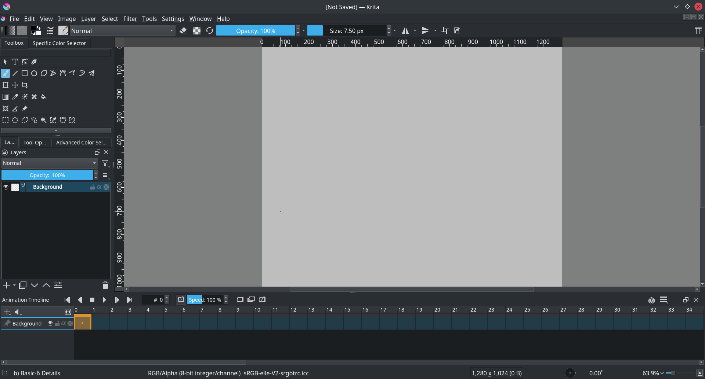

The animation workspace adds the [Animation Timeline Docker](https://docs.krita.org/en/reference_manual/dockers/animation_timeline.html#timeline-docker) at the bottom.

#### Animating

Make sure there’s two transparent layers setup in the layer docker. You can add a new layer by pressing the + or by pressing `ins`. Let’s name the bottom one ‘environment’ and the top `walkcycle` by double-clicking their names in the layer docker.

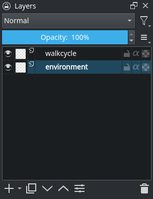

Use the [Straight Line Tool](https://docs.krita.org/en/reference_manual/tools/line.html#line-tool) to draw a single horizontal line. This is the ground.

Then, select the `walkcycle` layer and draw a head and torso (you can use any brush for this).

Now, selecting a new frame will not make a new frame automatically. Krita doesn’t actually see the `walkcycle` layer as an animated layer at all!

We can make it an animated layer by adding a frame to the timeline. A frame in the timeline to get a context menu. Select Create Duplicate Frame ( [duplicateframe] ).

Attention

If you select Create Blank Frame, the content of the layer will be dropped and a new blank frame will appear; since you want to preserve the image, you need to use Create Duplicate Frame.

You can see it has become an animated layer because of the onion skin icon ( [onionon] ) showing up in the timeline docker.

Use the Create Duplicate Frame button to copy the first frame onto the second. Then, use the [Move Tool](https://docs.krita.org/en/reference_manual/tools/move.html#move-tool) (switch to it using the `T` shortcut) with the `Shift + ↑` shortcut to move the frame contents up.

We can see the difference by turning on the onion skinning (press the [onionoff] , so it becomes [onionon] ):

Now, you should see the previous frame as red.

Warning

Krita sees white as a color, not as transparent, so make sure the animation layer you are working on is transparent in the bits where there’s no drawing. You can fix the situation by use the [Color to Alpha](https://docs.krita.org/en/reference_manual/filters/colors.html#filter-color-to-alpha) filter, but prevention is best.

Future frames are drawn in green, and both colors can be configured in the onion skin docker.

Now, we’re going to draw the two extremes of the walk cycle. These are the pose where both legs are as far apart as possible, and the pose where one leg is full stretched and the other pulled in, ready to take the next step.

The above image shows our two extremes: legs far apart, and one leg straight while the other is bent, as it’s taking a step. This also shows the power of onion skins, as we can see both extremes at once.
Notice also how the legs have been made semi-transparent. This isn’t necessary with a stick figure, but useful in this case when we start copying.

Let’s copy these two. You can do this by doing [right mouse button] on the frame, and then selecting Copy Keyframes. Then select the new position in the time line, [right mouse button] again, and Paste Keyframes.

Now then…

1. Copy frame 0 to frame 2.
2. Copy frame 1 to frame 3.
3. Erase the semi transparent lines to make it obvious which leg is in front of the other. In 0 and 1, we have the closer leg to the right, then bend, and in 2 and 3, we have the further leg to the right and then bend.

   
4. In the animation settings, set the frame-rate to 4

   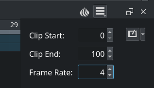
5. Select all frames in the timeline docker by dragging-selecting them.

   
6. Press play in the header.
7. Enjoy your first animation!

#### Expanding upon your rough walk cycle

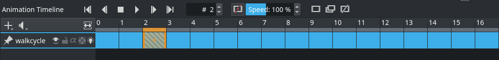

You can quickly make some space by the `Alt + drag` shortcut on any frame. This’ll move that frame and all others after it
in one go. More efficient for us, however, is to select all frames, [right mouse button] them, and then select Hold frames ‣ Insert Hold Frame, which will insert an empty space or *Hold Frame* in between each *Keyframe*.

Make new frames in between each keyframe, and try to interpolate, or inbetween each frame you add.

Note

A lot has been written about how to inbetween properly, and it’s one of the areas where animators express their own style the clearest. As such, we won’t cover inbetweening itself here. We recommend you do a search for inbetweening tutorials on the internet. We also recommend animation analyses to get an idea of how intricate this subject is.

For this particular example, I prefer to start by finding the position of the heel in a frame, then draw the rest of the foot, then the knees, and then the rest of the legs.

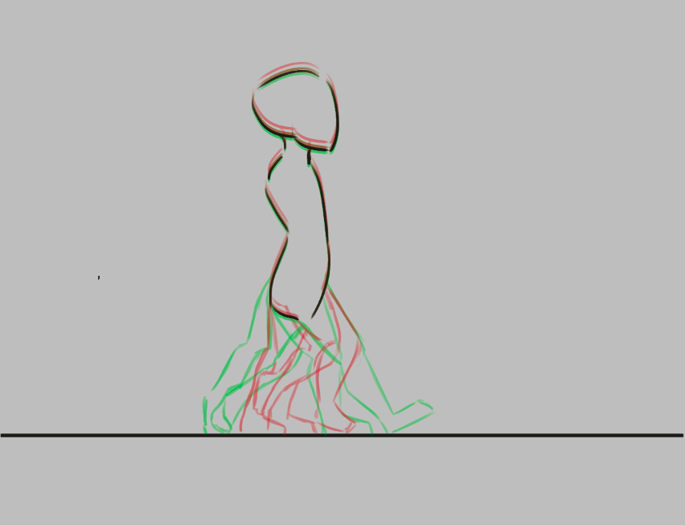

You’ll find that the more frames you add, the more difficult it becomes to keep track of the animation. There are two things you can do here. The first is to color label frames, you can do [right mouse button] on the keyframes, and select any of the colors on the bottom.

In this example, the extremes are blue, the first inbetweens green and the less important inbetweens in yellow and orange.

Another thing you can do is to adjust the onion skins.

You can modify the onion skin by using the [Onion Skin Docker](https://docs.krita.org/en/reference_manual/dockers/onion_skin.html#onion-skin-docker), where you can change how many frames are visible at once, by toggling them on the top row. The bottom row is for controlling transparency, while below there you can modify the colors and intensity of the coloring.

Here we’ve turned off all onion skinned frames except the next and previous ones.

#### Animating with multiple layers

Okay, our walk cycle is missing some hands, let’s add them on a separate
layer. So we make a new layer, and name it hands and…

Our walk cycle is gone from the timeline docker! This is a feature
actually. A full animation can have so many little parts that an
animator might want to remove the layers they’re not working on from the timeline docker.

Added in version 4.3.0: In **Krita 4.3.0** and later, all new layers are pinned to the timeline by default.

To show a layer whether it’s active or not, you can “pin” it to the
timeline by clicking the [pintimeline] icon while having the layer you want pinned selected in the [layer docker](https://docs.krita.org/en/reference_manual/dockers/layers.html#layer-docker). We recommend pinning any layers that you’re currently animating on.

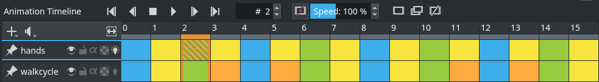
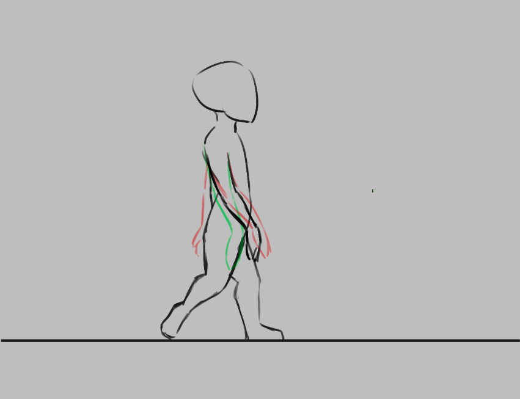

#### Exporting

When you are done, select File ‣ Render Animation. To render to a video file, you’ll need a program called **FFmpeg**. To learn more, please read [Render Animation](https://docs.krita.org/en/reference_manual/render_animation.html#render-animation).

Enjoy your walk cycle!

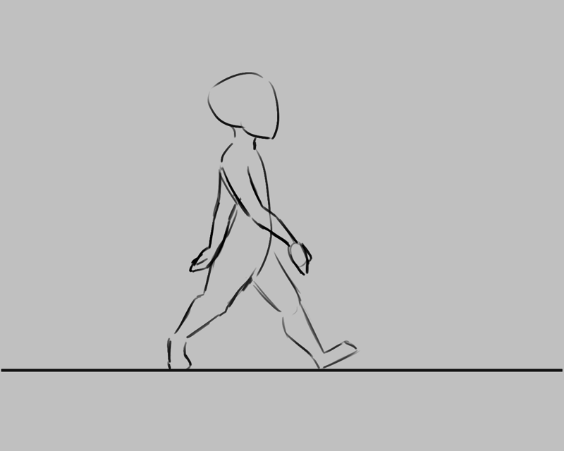

#### Animating with transform masks

Added in version 5.0.

If you want to move your walk cycle, you may use [Transform Masks](https://docs.krita.org/en/reference_manual/layers_and_masks/transformation_masks.html#transformation-masks) to move the frames from left to right without editing the pixels themselves.

First, open up the [Animation Curves Docker](https://docs.krita.org/en/reference_manual/dockers/animation_curves.html#animation-curves-docker) if it has not been opened yet, under Settings ‣ Dockers ‣ Animation Curves.

Then, group the layers that you want to transform, in our example, these are the `hands` and the `walkcycle` layers. [right mouse button] the group, Add ‣ Transform mask.

Then, go into the animation docker, select the first frame, and select Adds keyframe to control scalar property ( [scalaradd] ). In the Timeline Docker, *Scalar Frames* will be marked with a diamond.

Now select the [Transform Tool](https://docs.krita.org/en/reference_manual/tools/transform.html#transform-tool), press the screen and move the group to the start point. Press `Enter` to confirm. Select the last frame in the docker, and then press the screen again, now move everything to the end point. Press Zoom view to fit channel range to view the whole frame.

Now, when you press play, you will see the layer contents move. However, it is probably moving too fast. There are two things to reduce that problem: The first is to copy and paste the walk cycle frames, so it repeats 3-4 times, then move the scalar frame to the last frame.

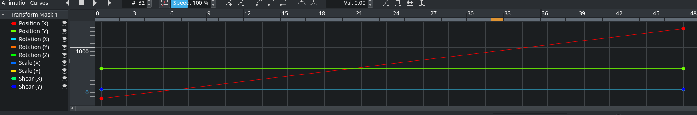
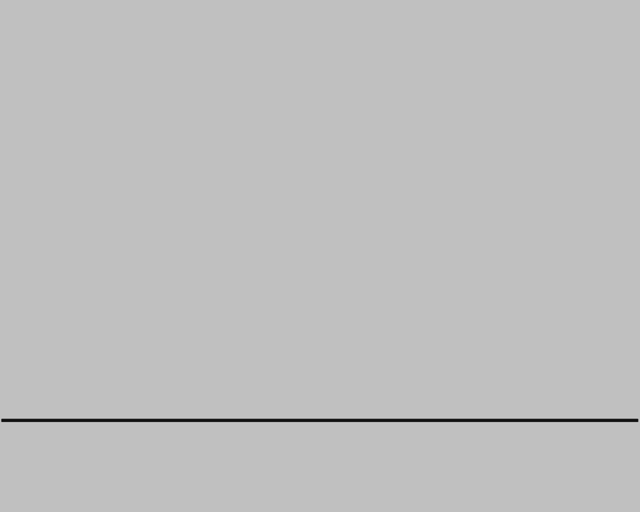

This still doesn’t sync the walk cycle directly to the speed it’s moving at. The best method, if a little laborious, is to go to the first frame where one of the feet touches the ground, and then mark that section (for example, using [guides](https://docs.krita.org/en/reference_manual/dockers/grids_and_guides.html#grids-and-guides-docker)), then, in subsequent frames, use the Transform Tool on each frame to move it so that the foot stays in the same place as long as it’s touching the ground. Do the same for the next bit where a foot touches the ground, and the next, and so on.

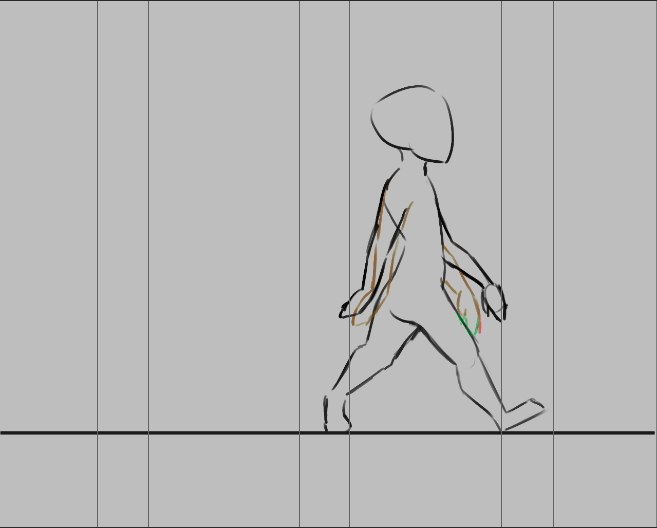

Each place where a foot touches the ground is marked using vertical guides, which allows us to adjust each frame, so the foot stays in place.

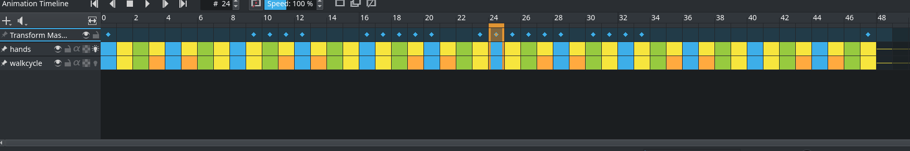

The animation curve docker after adjusting each frame to be in the right spot. Krita can do curve interpolation (so you can create an ease-in and ease-out type curves), but for a situation like this, per-frame adjustment is quicker.

After having done all that, you will end up with a smoothly moving walk cycle:

See also

- [Animation Timeline Docker](https://docs.krita.org/en/reference_manual/dockers/animation_timeline.html#timeline-docker)
- [Onion Skin Docker](https://docs.krita.org/en/reference_manual/dockers/onion_skin.html#onion-skin-docker)
- [Animation Curves Docker](https://docs.krita.org/en/reference_manual/dockers/animation_curves.html#animation-curves-docker)
- [Storyboard Docker](https://docs.krita.org/en/reference_manual/dockers/storyboard_docker.html#storyboard-docker)
- [Import Animation](https://docs.krita.org/en/reference_manual/import_animation.html#import-animation)
- [Audio for Animation](https://docs.krita.org/en/reference_manual/audio_for_animation.html#audio-animation)
- [Render Animation](https://docs.krita.org/en/reference_manual/render_animation.html#render-animation)
- [Japanese Animation Template](https://docs.krita.org/en/user_manual/japanese_animation_template.html#japanese-animation-template)

## 本地配图清单

| 图 | 本地文件 | 原始来源 |
|---|---|---|
| 1 | [Figure 1: The storyboard docker can help you plan out the shots of a scene. ¶](../../assets/asset-production/MAKE-012/Storyboard_thumbnailonly_view.png) | [原图](https://docs.krita.org/en/_images/Storyboard_thumbnailonly_view.png) |
| 2 | [Figure 2: The animation workspace adds the Animation Timeline Docker at the bottom. ¶](../../assets/asset-production/MAKE-012/Introduction_to_animation_01.png) | [原图](https://docs.krita.org/en/_images/Introduction_to_animation_01.png) |
| 3 | [Figure 3: Layout of the layer stack.](../../assets/asset-production/MAKE-012/Introduction_to_animation_02.png) | [原图](https://docs.krita.org/en/_images/Introduction_to_animation_02.png) |
| 4 | [Figure 4: Our simple environment, consisting of a single horizon.](../../assets/asset-production/MAKE-012/Introduction_to_animation_03.png) | [原图](https://docs.krita.org/en/_images/Introduction_to_animation_03.png) |
| 5 | [Figure 5: A head and torso.](../../assets/asset-production/MAKE-012/Introduction_to_animation_04.png) | [原图](https://docs.krita.org/en/_images/Introduction_to_animation_04.png) |
| 6 | [Figure 6: Location of the onion skin icon.](../../assets/asset-production/MAKE-012/Introduction_to_animation_05.png) | [原图](https://docs.krita.org/en/_images/Introduction_to_animation_05.png) |
| 7 | [Figure 7: Onion skin is turned on.](../../assets/asset-production/MAKE-012/Introduction_to_animation_06.png) | [原图](https://docs.krita.org/en/_images/Introduction_to_animation_06.png) |
| 8 | [Figure 8: The current frame in black and the silhouette of the previous frame in red.](../../assets/asset-production/MAKE-012/Introduction_to_animation_07.png) | [原图](https://docs.krita.org/en/_images/Introduction_to_animation_07.png) |
| 9 | [Figure 9: Current frame is black and silhouette of the future frame is green.](../../assets/asset-production/MAKE-012/Introduction_to_animation_08.png) | [原图](https://docs.krita.org/en/_images/Introduction_to_animation_08.png) |
| 10 | [Figure 10: The above image shows our two extremes: legs far apart, and one leg straight while the other is bent, as it’s taking a step. This also shows the power of onion skins, as we can see both extremes at once. Notice also how the legs have been made semi-transparent. This isn’t necessary with a stick figure, but useful in this case when we start copying. ¶](../../assets/asset-production/MAKE-012/Introduction_to_animation_09.png) | [原图](https://docs.krita.org/en/_images/Introduction_to_animation_09.png) |
| 11 | [Figure 11: Introduction to animation 10](../../assets/asset-production/MAKE-012/Introduction_to_animation_10.png) | [原图](https://docs.krita.org/en/_images/Introduction_to_animation_10.png) |
| 12 | [Figure 12: Introduction to animation 11](../../assets/asset-production/MAKE-012/Introduction_to_animation_11.png) | [原图](https://docs.krita.org/en/_images/Introduction_to_animation_11.png) |
| 13 | [Figure 13: Introduction to animation 12](../../assets/asset-production/MAKE-012/Introduction_to_animation_12.png) | [原图](https://docs.krita.org/en/_images/Introduction_to_animation_12.png) |
| 14 | [Figure 14: animation walkcycle 2021 4 frames](../../assets/asset-production/MAKE-012/animation_walkcycle_2021_4_frames.gif) | [原图](https://docs.krita.org/en/_images/animation_walkcycle_2021_4_frames.gif) |
| 15 | [Figure 15: Introduction to animation 13](../../assets/asset-production/MAKE-012/Introduction_to_animation_13.png) | [原图](https://docs.krita.org/en/_images/Introduction_to_animation_13.png) |
| 16 | [Figure 16: Introduction to animation 14](../../assets/asset-production/MAKE-012/Introduction_to_animation_14.png) | [原图](https://docs.krita.org/en/_images/Introduction_to_animation_14.png) |
| 17 | [Figure 17: In this example, the extremes are blue, the first inbetweens green and the less important inbetweens in yellow and orange. ¶](../../assets/asset-production/MAKE-012/Introduction_to_animation_13b.png) | [原图](https://docs.krita.org/en/_images/Introduction_to_animation_13b.png) |
| 18 | [Figure 18: Introduction to animation 15](../../assets/asset-production/MAKE-012/Introduction_to_animation_15.png) | [原图](https://docs.krita.org/en/_images/Introduction_to_animation_15.png) |
| 19 | [Figure 19: Here we’ve turned off all onion skinned frames except the next and previous ones. ¶](../../assets/asset-production/MAKE-012/Introduction_to_animation_14b.png) | [原图](https://docs.krita.org/en/_images/Introduction_to_animation_14b.png) |
| 20 | [Figure 20: Introduction to animation 16](../../assets/asset-production/MAKE-012/Introduction_to_animation_16.png) | [原图](https://docs.krita.org/en/_images/Introduction_to_animation_16.png) |
| 21 | [Figure 21: Introduction to animation 17](../../assets/asset-production/MAKE-012/Introduction_to_animation_17.png) | [原图](https://docs.krita.org/en/_images/Introduction_to_animation_17.png) |
| 22 | [Figure 22: Introduction to animation 18](../../assets/asset-production/MAKE-012/Introduction_to_animation_18.png) | [原图](https://docs.krita.org/en/_images/Introduction_to_animation_18.png) |
| 23 | [Figure 23: Introduction to animation walkcycle 02](../../assets/asset-production/MAKE-012/Introduction_to_animation_walkcycle_02.gif) | [原图](https://docs.krita.org/en/_images/Introduction_to_animation_walkcycle_02.gif) |
| 24 | [Figure 24: Introduction to animation 19](../../assets/asset-production/MAKE-012/Introduction_to_animation_19.png) | [原图](https://docs.krita.org/en/_images/Introduction_to_animation_19.png) |
| 25 | [Figure 25: introduction to animation walkcycle 03 simple tween](../../assets/asset-production/MAKE-012/introduction_to_animation_walkcycle_03_simple_tween.gif) | [原图](https://docs.krita.org/en/_images/introduction_to_animation_walkcycle_03_simple_tween.gif) |
| 26 | [Figure 26: Each place where a foot touches the ground is marked using vertical guides, which allows us to adjust each frame, so the foot stays in place. ¶](../../assets/asset-production/MAKE-012/Introduction_to_animation_20a.png) | [原图](https://docs.krita.org/en/_images/Introduction_to_animation_20a.png) |
| 27 | [Figure 27: Introduction to animation 20b](../../assets/asset-production/MAKE-012/Introduction_to_animation_20b.png) | [原图](https://docs.krita.org/en/_images/Introduction_to_animation_20b.png) |
| 28 | [Figure 28: The animation curve docker after adjusting each frame to be in the right spot. Krita can do curve interpolation (so you can create an ease-in and ease-out type curves), but for a situation like this, per-frame adjustment is quicker. ¶](../../assets/asset-production/MAKE-012/Introduction_to_animation_20c.png) | [原图](https://docs.krita.org/en/_images/Introduction_to_animation_20c.png) |
| 29 | [Figure 29: introduction to animation walkcycle 03 adjusted tween](../../assets/asset-production/MAKE-012/introduction_to_animation_walkcycle_03_adjusted_tween.gif) | [原图](https://docs.krita.org/en/_images/introduction_to_animation_walkcycle_03_adjusted_tween.gif) |
