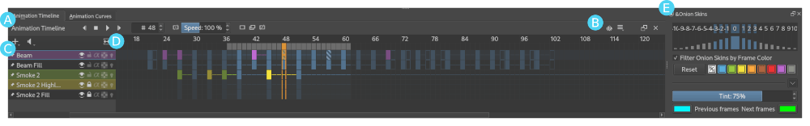
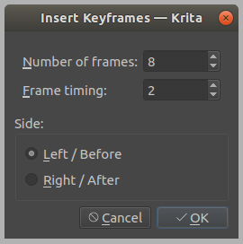

# 动画时间轴：关键帧、保持帧与播放范围

> **内容边界**：下方“授权原文”是官方主内容的 Markdown 转换；中文操作路线、练习与验收由整理者编写，不是作者逐句翻译，也不代表已在本机运行软件验证。

## 中文任务导读

让动画速度由时间安排控制，而不是随意复制帧；理解时间轴上的不同帧状态。

**前提**：能够新建、保存和打开 Krita 文档；先确定目标像素尺寸、色板与透明度要求。

### 操作路线

1. 把需要编辑的图层固定显示到 Animation Timeline，确认当前帧与当前图层。
2. 先区分创建空白关键帧、复制关键帧和已有内容持续显示的保持区间。
3. 移动或插入关键帧调整动作节奏，必要时用帧颜色帮助区分动作阶段。
4. 设置播放范围和帧率，循环检查后再导出。

### 配图怎么读

带标注的时间轴截图把图层、帧和播放控制放在同一面板；区分当前帧指示与真正存有图像内容的关键帧。 图内界面与作品保留原貌；示例转用于像素素材时仍按本篇验收条件检查。

### 练习与验收（整理者补充）

为同一待机动作做均匀节奏与“停留后快速摆动”两个版本，保持绘制帧数相同。

- [ ] 没有意外在错误图层上创建帧。
- [ ] 动作时长和帧率可由记录复现。
- [ ] 循环范围不会包含空白尾帧。

### 版本与适用边界

时间轴教程跨多个 Krita 版本；菜单名、帧状态图示以所用版本为准，先用小文档验证。

抓取时页面标题标注 **Krita Manual 5.3.0**；这是文档快照版本，不构成已发布软件版本或本机功能的验证。原文中保留的 `Added/Changed/Deprecated in version` 是兼容性依据。

## 来源、许可与修改记录

- 原文：[Animation Timeline Docker](https://docs.krita.org/en/reference_manual/dockers/animation_timeline.html)
- 作者：Wolthera van Hövell tot Westerflier；Dmitry Kazakov；Emmet O'Neill
- 页内作者与许可原始声明：[RST 源文件](../../sources/asset-production/MAKE-013/original.rst)；[线上原始声明](https://docs.krita.org/en/_sources/reference_manual/dockers/animation_timeline.rst.txt)。
- 许可：[GNU Free Documentation License 1.3 or later](https://www.gnu.org/licenses/fdl-1.3.html)；[本地许可证全文](../../licenses/krita-GFDL-1.3.txt)。各图若有独立作者或许可，沿用原文紧邻图像的署名，不把作品许可自动泛化为文档许可。
- 修改历史：2026-10-29，Codex 为本教程库新增中文导读、练习和验收；将官方 HTML 主内容转换为 Markdown，去除导航与页脚，将控制图标转为文字、将教学图像存为本地文件。正文、步骤、代码、表格与图像说明保留。
- 本修改版沿用 GFDL 1.3 或更新版本。保留作者声明和上游链接；未添加 Invariant Sections、Front-Cover Texts 或 Back-Cover Texts。外链视频、安装包和关联页面没有自动下载或转录。

## 授权原文（英语，完整主内容转换）

## Animation Timeline Docker

The *Animation Timeline Docker* is at the heart of **Krita**’s raster animation tools, providing everything you need to create, edit and preview traditional hand-drawn animations.

### Overview

As shown in the image above, Krita’s Animation Timeline Docker can be thought of as different sections:

1. *Utilities* – The left side of the toolbar gives animators quick access to all of the widgets that are critical to their workflow; *transport controls* (previous, play/pause, stop and next buttons), a frame counter, preview controls (speed and drop frames), and buttons for quickly creating new frames and deleting unwanted ones.
2. *Settings* – While all of the high-traffic controls are presented directly, the right end of the toolbar also contains buttons for opening submenus for things like [Onion Skin Docker](https://docs.krita.org/en/reference_manual/dockers/onion_skin.html#onion-skin-docker) and settings that you can generally set and forget (for example: playback range, frame rate and autokey mode).
3. *Layer List* – This area contains some subset of the layers of your current document. Similar to the [Layers](https://docs.krita.org/en/reference_manual/dockers/layers.html#layer-docker), each layer has various properties that can also be toggled here (visibility, locking, onion skins, etc.). While the currently active layer is always shown here, layers can also be “pinned” to the timeline using the pin button to the left of each layer’s name, the Pin to Timeline menu action, or the Pin Existing Layer submenu so they will be visible even when inactive.

   > > Tip
   > >
   > > Depending on your preference, newly created paint layers can start pinned or unpinned by setting the Automatically pin new layers to timeline option in Settings –> Configure Krita… –> General –> Miscellaneous.
   >
   > 
   >
   > Active Layer:
   > :   The *active layer* is the layer that you’re currently able to edit or draw on, shown as a highlighted row in the layer list. [left mouse button] a layer within the layer list will make it the currently active layer.
   > 
   >
   > Layer Menu:
   > :   A small menu for manipulating *animated layers* at the top left of the layer list. You can create new layers, remove existing ones, as well as pin or unpin the active layer. (This menu also shows up when [right mouse button] on layer headers inside of the Layer List.)
   > 
   >
   > Audio Menu:
   > :   Another small menu at the top of the layer list for animating along with audio sources. This is also where you can open or close audio sources and control output volume/muting.
   > 
   >
   > Zoom Handle:
   > :   This special widget allows you to zoom in and out on the frame table, centered around the current frame time. [left mouse button] `+ drag` from within the zoom handle controls the zoom level.
4. *Frame Table* – The *frame table* is a large grid of cells which can either hold a single keyframe or be empty. Each row of the frame table represents an *animated layer* and each column represents a *frame time*. Just like the layer list, the active layer is highlighted across the entire frame table. For those who are familiar with pen-and-paper animation, you can think of the frame table as Krita’s *dope sheet* or time sheet.

   > > Note
   > >
   > > It’s important to understand that frame timings are not based on units of time like seconds, but on *frames*, which can then be played back at any speed, depending on the animation’s *frame rate* and *play speed* settings.
   >
   > Keyframes can be moved around the timeline by [left mouse button] `+ drag` shortcut from one slot to another, even across layers. Furthermore, holding the `Ctrl` key while dragging creates a copy, and holding the `Alt` key while dragging creates a clone frame. Finally, [right mouse button] anywhere in the frame table will bring up a context menu for adding, removing, copying, pasting or adjusting timing.
   >
   > 
   >
   > Active Keyframe
   > :   Right now, it’s only possible to view and draw on one keyframe at a time. This is known as the *active keyframe*, and is represented on the frame table as a block filled with diagonal stripes. Often, in simple animations, the active keyframe will be the frame on the active layer that is on or just before the current time. However, if the active keyframe has one or more [clone frames](#term-Clone-frames) all drawing, painting and editing will also affect all of its clones.
   > 
   >
   > Clone frames
   > :   A *clone frame* of a keyframe is a reference to that keyframe at a different position. Clone frames share the exact same image data under the hood, and will have the same diagonal markings as the active frame when an active frame with clone frames is selected.
   > 
   >
   > Duplicate keyframe
   > :   Not to be confused with [Clone Frames](#term-Clone-frames), a duplicate frame is merely the [Active Keyframe](#term-Active-Keyframe) copied and pasted as a separate [Keyframe](#term-Keyframe). Where clone frames will automatically duplicate the changes you make to them to each cloned frame, a duplicated frame is just another keyframe that happens to have the same content as the source.
   > 
   >
   > Current Selection
   > :   Frames highlighted in orange represent a selection or multiple selections. While multiple frames are selected, [right mouse button] anywhere in the frame table will bring up a context menu that will allow for adding and removing keyframes or holds within the current selection. It’s also possible to have multiple separate (non-contiguous) selections if needed.
   >
   >     > Warning
   >     >
   >     > Painting always happens *only* on the [active keyframe](#term-Active-Keyframe), which is not necessarily part of your current selection on the timeline!
   > 
   >
   > Keyframe
   > :   In **Krita**, we call the images that make up your animation *keyframes*. Each keyframe can also be assigned a [Color Label](https://docs.krita.org/en/reference_manual/dockers/layers.html#term-Color-Label), as a matter of personal organization and workflow.
   > 
   >
   > Blank Keyframe
   > :   Within the frame table, keyframes that contain drawings are displayed as *filled blocks* within a cell, while a *blank keyframe* is shown as a *hollow outline*. Unlike some other tools, **Krita** automatically holds each keyframe until the next keyframe on that layer; these *holds* are shown as a *colored line* that’s drawn across all held frames.
   > 
   >
   > Frame Timing Header
   > :   The frame timing header is a ruler at the top of the frame table. This header is divided into small notched sections which are based on the current *frame rate* (set in the animation settings submenu at the right end of the toolbar). While each frame is marked with a single line, each second is marked by a subtle double-line. Major notches are also marked by a frame number.
   > 
   >
   > Cached Frames
   > :   The frame timing header also shows important information about which frames are currently *cached*. When something is said to be “cached”, that means that it is stored in your device’s working memory (RAM) for extra fast access. Cached frames are shown by the header with a small light-gray rectangle in each column. While this information isn’t always critical for us artists, it’s helpful to know that Krita is working behind the curtains to cache our animation frames for the smoothest possible experience when scrubbing through or playing back your animation.
   > 
   >
   > Current Time Scrubber:
   > :   A highlighted column in the frame table which controls the current frame time and, as such, what is currently displayed in the viewport.
   > 
   >
   > Zoomable Scrollbar
   > :   Not only can the scrollbars on the Animation Timeline Docker be used to *pan* the frame table by dragging left and right, it can also be used to quickly *zoom* in and out by dragging up and down. Pan and zoom in one flick of a wrist!
5. *Onion Skins Docker* – While technically a separate docker, the [Onion Skin Docker](https://docs.krita.org/en/reference_manual/dockers/onion_skin.html#onion-skin-docker) is used in conjunction with the Animation Timeline docker to help animators see how their animation changes between neighboring keyframes. The onion skins menu button on the Animation Timeline Docker can be used to quickly toggle the visibility of the Onion Skins Docker.

### Animating

In order to begin animating with **Krita**, we first need to turn our paint layer into an *animated layer* by adding our first [keyframe](#term-Keyframe). In our case we will start with a [blank keyframe](#term-Blank-Keyframe), but if you’ve already drawn something on the paint layer and would like to transfer it to your new keyframe you can create a [duplicate keyframe](#term-Duplicate-keyframe) instead.

To make a new, blank keyframe, [right mouse button] any square on the timeline docker and select Create Blank Frame. A blank frame (one that you haven’t yet drawn anything in) appears as a *hollow outline* instead of a solid box, making that frame active and drawing on the canvas will make it appear as a *solid, colored rectangle*. To move a keyframe around, you can drag and drop it into another empty frame slot, even across animation layers.

The currently selected layer will automatically be shown on the timeline. However, while animating you may find that you want to keep another layer “pinned”, making it visible in the Animation Timeline Docker regardless of which layer is selected. There are a few ways to do this in Krita, but it doesn’t get any simpler than [left mouse button] on the little pushpin icon next to the layer’s name.

It’s not much of an animation with only one frame, so to add another new frame you can do the same thing we did last time by selecting Create Blank Frame from the [right mouse button] menu or by double- [left mouse button] on a particular frame slot. For the sake of this lesson, however, we will mix it up by creating a duplicate keyframe by scrubbing to a different *time* and press the Create Duplicate Keyframe button on toolbar at the top of the Animation Timeline Docker.

As you can see, there are quick a few convenient ways to add or remove keyframes from your animation in Krita, depending on your personal preference, input devices and workflow!

Now that we have more than one keyframe, we can do different drawings in each and play back our simple animation by press the Play/Pause button on the toolbar at the top of the docker. Another crucial technique for animating is manually switching between frames at your own pace to inspect the frame-by-frame movement of your animation as you work, also known as “scrubbing”. Like everything else, we’ve made sure that there are a few different ways to scrub through you animation, but one of my favorites is to simply [left mouse button] `+ drag` between different times on the [Frame Timing Header](#term-Frame-Timing-Header) at the top of the frame table.

I know that’s a lot of info to digest, but all you really need to know to get started is how to create new keyframes and scrub through your animation to check your progress. From there, all that’s left is the hard but rewarding work of drawing lots and lots (and lots) of animation frames!

### Tips

- There are a couple subtle features built into the docker’s transport controls that you might find useful. For example, press the Stop button *while your animation is playing* will jump back to whatever frame you started playing from, and press it again *when your animation is not playing* will jump back to the first frame of your animation. Similarly, the next keyframe button will jump the selection to the next available keyframe on the active layer, but *if there is no next keyframe on that layer it will use the timing of your animation to estimate where you may want to place your next keyframe, and jump to that position.* While a bit advanced, nuances like this mean that the Animation Timeline Docker’s buttons (and keybind-able actions) almost always do something useful for animators.
- It’s possible to add multiple keyframes by [right mouse button] inside the frame table and selecting the Keyframes ‣ Insert Multiple Keyframes pop-up submenu item. With this option you can specify the number of frames to add with the option of built in timing for quickly creating a series of 1s, 2s, 3s, etc. These settings are saved between uses.
- You can also change the color of keyframes within the frame table so that you can easily identify important frames or distinguish between different sections of your animation. The current color selection is remembered for new frames so that you can easily make a set of colored frames and then switch to another color. (By the way, it’s even possible to quickly jump between frames of the same color by assigning a keyboard shortcut to Previous/Next Matching Keyframe.)
- [right mouse button] within the [Frame Timing Header](#term-Frame-Timing-Header) instead of the frame table gives you access to a few more option which allow you to add or remove entire columns of frames or holds at a time, as well as reset your animation cache if needed. For example, selecting the Keyframe Columns ‣ Insert Keyframe Column Left pop-up submenu item will add new frames to each layer that’s currently visible in the Timeline Docker.

- To delete frames, [right mouse button] the frame and press Remove Keyframe. This will delete all selected frames. Similarly, selecting Remove Frame and Pull will delete the selected frames and pull or shift all subsequent frames back/left as much as possible.

### Controls

1. *Layer List*

   > - [left mouse button] : Select active layer.
   > - [right mouse button] : Layers Menu (add/remove/show layers, etc.).
2. [Frame Timing Header](#term-Frame-Timing-Header)

   > - [left mouse button] : Move to time and select frame of the active layer.
   > - [left mouse button] `+ drag` : Scrub through time and select frame of the active layer.
   > - [right mouse button] : Frame Columns Menu (insert/remove/copy/paste columns and hold columns).
3. *Frames Table*

   > - [left mouse button] : Selects a single frame or slot and switches time, but *does not switch active layer*.
   > - `Space +` [left mouse button] : Pan.
   > - `Space +` [right mouse button] : Zoom.
4. *Frames Table* (On Empty Slot).

   > - [right mouse button] : Frames menu (insert/copy/paste frames and insert/remove holds).
   > - [left mouse button] `+ drag` : Select multiple frames and switch time to the last selected, but *does not switch active layer*.
   > - `Shift +` [left mouse button] : Select all frames between the active and the clicked frame.
   > - `Ctrl +` [left mouse button] : Select individual frames together. [left mouse button] `+ drag` them into place.
5. *Frames Table* (On Existing Frame)

   > - [right mouse button] : Frames menu (remove/copy/paste frames and insert/remove holds).
   > - [left mouse button] `+ drag` : *Move* a frame or multiple frames.
   > - `Ctrl +` [left mouse button] `+ drag` : Copy a frame or multiple frames.
   > - `Alt +` [left mouse button] `+ drag` : Clone a frame or multiple frames.
   > - `Shift +` [left mouse button] `+ drag` : Move selected frame(s) and *all* the frames to the right of it. (This is useful for when you need to clear up some space in your animation, but don’t want to select all the frames to the right of a particular frame!)

## 本地配图清单

| 图 | 本地文件 | 原始来源 |
|---|---|---|
| 1 | [Figure 1: Animation Timeline Docker](../../assets/asset-production/MAKE-013/Animation_Timeline_Docker.png) | [原图](https://docs.krita.org/en/_images/Animation_Timeline_Docker.png) |
| 2 | [Figure 2: Timeline insertkeys](../../assets/asset-production/MAKE-013/Timeline_insertkeys.png) | [原图](https://docs.krita.org/en/_images/Timeline_insertkeys.png) |
