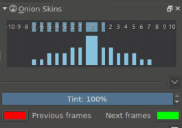
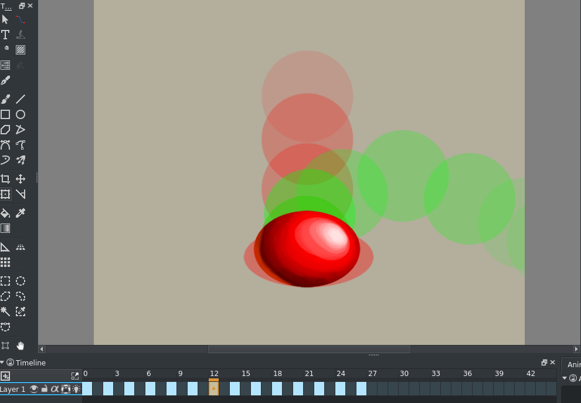
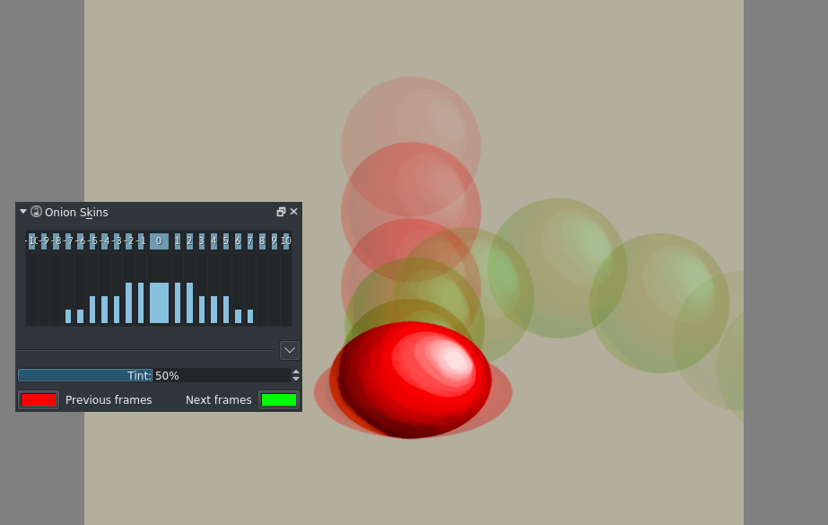

# 洋葱皮：比较前后姿势与消除帧间漂移

> **内容边界**：下方“授权原文”是官方主内容的 Markdown 转换；中文操作路线、练习与验收由整理者编写，不是作者逐句翻译，也不代表已在本机运行软件验证。

## 中文任务导读

在当前帧上显示前后关键姿势，检查轮廓变化、重心和锚点。

**前提**：能够新建、保存和打开 Krita 文档；先确定目标像素尺寸、色板与透明度要求。

### 操作路线

1. 在包含关键帧的透明动画图层上打开灯泡图标。
2. 在 Onion Skin Docker 选定要显示的前后帧偏移，先只保留最近一帧。
3. 调节总透明度、每个偏移的透明度与前后帧颜色，保持当前帧最清楚。
4. 逐帧检查脚底、头部及道具位置，修正无意的漂移，再关闭洋葱皮看真实播放。

### 配图怎么读

洋葱皮面板把当前帧两侧的偏移分开控制，红绿颜色区分过去与未来；透明度只影响参照，不应写进输出图。 图内界面与作品保留原貌；示例转用于像素素材时仍按本篇验收条件检查。

### 练习与验收（整理者补充）

用洋葱皮检查一个四帧眨眼或呼吸循环，列出并修正三处无意移动。

- [ ] 当前帧与参考帧可清晰区分。
- [ ] 背景的白色没有被误当透明。
- [ ] 关闭洋葱皮后最终轮廓无残留。

### 版本与适用边界

完全不透明的默认像素图层不能正常提供所需洋葱皮效果；使用新建透明动画图层。

抓取时页面标题标注 **Krita Manual 5.3.0**；这是文档快照版本，不构成已发布软件版本或本机功能的验证。原文中保留的 `Added/Changed/Deprecated in version` 是兼容性依据。

## 来源、许可与修改记录

- 原文：[Onion Skin Docker](https://docs.krita.org/en/reference_manual/dockers/onion_skin.html)
- 作者：Wolthera van Hövell tot Westerflier
- 页内作者与许可原始声明：[RST 源文件](../../sources/asset-production/MAKE-014/original.rst)；[线上原始声明](https://docs.krita.org/en/_sources/reference_manual/dockers/onion_skin.rst.txt)。
- 许可：[GNU Free Documentation License 1.3 or later](https://www.gnu.org/licenses/fdl-1.3.html)；[本地许可证全文](../../licenses/krita-GFDL-1.3.txt)。各图若有独立作者或许可，沿用原文紧邻图像的署名，不把作品许可自动泛化为文档许可。
- 修改历史：2026-10-29，Codex 为本教程库新增中文导读、练习和验收；将官方 HTML 主内容转换为 Markdown，去除导航与页脚，将控制图标转为文字、将教学图像存为本地文件。正文、步骤、代码、表格与图像说明保留。
- 本修改版沿用 GFDL 1.3 或更新版本。保留作者声明和上游链接；未添加 Invariant Sections、Front-Cover Texts 或 Back-Cover Texts。外链视频、安装包和关联页面没有自动下载或转录。

## 授权原文（英语，完整主内容转换）

## Onion Skin Docker

To make animation easier, it helps to see both the next frame as well as the previous frame sort of layered on top of the current. This is called *onion-skinning*.

Basically, they are images that represent the frames before and after the current frame, usually colored or tinted.

You can toggle them by clicking the lightbulb icon on a layer that is animated (so, has frames), and isn’t fully opaque. (Krita will consider white to be white, not transparent, so don’t animated on an opaque layer if you want onion skins.)

Changed in version 4.2: Since 4.2 onion skins are disabled on layers whose default pixel is fully opaque. These layers can currently only be created by using background as raster layer in the content section of the new image dialog. Just don’t try to animate on a layer like this if you rely on onion skins, instead make a new one.

The term onionskin comes from the fact that onions are semi-transparent. In traditional animation animators would make their initial animations on semitransparent paper on top of an light-table (of the special animators variety), and they’d start with so called keyframes, and then draw frames in between. For that, they would place said keyframes below the frame they were working on, and the light table would make the lines of the keyframes shine through, so they could reference them.

Onion-skinning is a digital implementation of such a workflow, and it’s very useful when trying to animate.

The slider and the button with zero offset control the master opacity and visibility of all the onion skins. The boxes at the top allow you to toggle them on and off quickly, the main slider in the middle is a sort of ‘master transparency’ while the sliders to the side allow you to control the transparency per keyframe offset.

Tint controls how strongly the frames are tinted, the first screen has 100%, which creates a silhouette, while below you can still see a bit of the original colors at 50%.

The Previous Frame and Next Frame color labels allows you set the colors.

## 本地配图清单

| 图 | 本地文件 | 原始来源 |
|---|---|---|
| 1 | [Figure 1: Onion skin docker](../../assets/asset-production/MAKE-014/Onion_skin_docker.png) | [原图](https://docs.krita.org/en/_images/Onion_skin_docker.png) |
| 2 | [Figure 2: Onion skin 01](../../assets/asset-production/MAKE-014/Onion_skin_01.png) | [原图](https://docs.krita.org/en/_images/Onion_skin_01.png) |
| 3 | [Figure 3: Onion skin 02](../../assets/asset-production/MAKE-014/Onion_skin_02.png) | [原图](https://docs.krita.org/en/_images/Onion_skin_02.png) |
