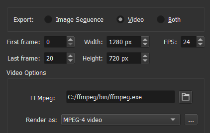

# 导出动画：PNG 序列、像素放大与编码

> **内容边界**：下方“授权原文”是官方主内容的 Markdown 转换；中文操作路线、练习与验收由整理者编写，不是作者逐句翻译，也不代表已在本机运行软件验证。

## 中文任务导读

把可编辑动画变成引擎可接收的图像序列，同时理解预览视频的缩放与编码限制。

**前提**：能够新建、保存和打开 Krita 文档；先确定目标像素尺寸、色板与透明度要求。

### 操作路线

1. 设置 First Frame 与 Last Frame，并核对导出范围是否包含完整循环。
2. 启用图像序列导出，选择保存位置、基础名称与编号起点。
3. 区分逐时间帧导出与 Only Unique Frames；后者需要另行保留各关键帧的持续时长。
4. 需要放大预览时选整数倍和 Nearest Neighbour；保存后检查透明度、帧数与顺序。

### 配图怎么读

导出窗口同时显示序列与视频设置；源截图采用旧版界面，重点识别范围、尺寸和编码器字段，再对照所用版本。 图内界面与作品保留原貌；示例转用于像素素材时仍按本篇验收条件检查。

### 练习与验收（整理者补充）

把同一循环导出为透明 PNG 序列与两倍预览，比较每帧尺寸和时长是否可重建。

- [ ] 实际序列帧数与导出范围对应。
- [ ] 透明资产没有只保留带黑底的视频。
- [ ] 放大预览没有引入模糊插值。

### 版本与适用边界

手册注明 5.2 起包含部分 FFmpeg 功能；Android 路径不同。原文某些旧编号例子可能有笔误，实际文件名需检查。

抓取时页面标题标注 **Krita Manual 5.3.0**；这是文档快照版本，不构成已发布软件版本或本机功能的验证。原文中保留的 `Added/Changed/Deprecated in version` 是兼容性依据。

## 来源、许可与修改记录

- 原文：[Render Animation](https://docs.krita.org/en/reference_manual/render_animation.html)
- 作者：Scott Petrovic；Wolthera van Hövell tot Westerflier；Beelzy；Lewis Fuller Hill
- 页内作者与许可原始声明：[RST 源文件](../../sources/asset-production/MAKE-015/original.rst)；[线上原始声明](https://docs.krita.org/en/_sources/reference_manual/render_animation.rst.txt)。
- 许可：[GNU Free Documentation License 1.3 or later](https://www.gnu.org/licenses/fdl-1.3.html)；[本地许可证全文](../../licenses/krita-GFDL-1.3.txt)。各图若有独立作者或许可，沿用原文紧邻图像的署名，不把作品许可自动泛化为文档许可。
- 修改历史：2026-10-29，Codex 为本教程库新增中文导读、练习和验收；将官方 HTML 主内容转换为 Markdown，去除导航与页脚，将控制图标转为文字、将教学图像存为本地文件。正文、步骤、代码、表格与图像说明保留。
- 本修改版沿用 GFDL 1.3 或更新版本。保留作者声明和上游链接；未添加 Invariant Sections、Front-Cover Texts 或 Back-Cover Texts。外链视频、安装包和关联页面没有自动下载或转录。

## 授权原文（英语，完整主内容转换）

## Render Animation

Render animation allows you to render your animation to an image sequence and to `.gif`, `.mp4`, `.mkv`, or other video files.

For rendering to an animated file format, Krita will first render to a PNG sequence and then use a video encoder to render that sequence to an animated file format. The reason for this two-step process is that animation files can be really complex and really big, and this is the best way to allow you to keep control over the export process. For example, if your computer has a hiccup, and one frame saves out weird, first saving the image sequence allows you to only resave that one weird frame before rendering.

This means that you will need to find a good place to stick your frames before you can start rendering. If you only do throwaway animations, you can use a spot on your hard-drive with enough room and select Delete Sequence After Rendering.

Note

On Android, file handling and video rendering works differently. You can only either export an image sequence or a video, not both. FFmpeg is not used, do not attempt to install it.

### General

First Frame
:   The first frame of the range of frames you wish to adjust. Automatically set to the first frame of your current selection in the timeline. This is useful when you only want to re-render a little part.

Last Frame
:   As above, the last frame of the range of frames you wish to adjust. Automatically set to the last frame of your current selection in the timeline.

### Export as Image Sequence

File Format
:   The file format to export the sequence to. When rendering we enforce PNG. The usual export options can be modified with the edit button next to the drop-down.

Image Location
:   Where you render the image sequence to. Some people prefer to use a flash-drive or perhaps a harddrive that is fast. On Android, you will be prompted for a directory instead.

Base Name
:   The base name of your image sequence. This will get suffixed with a number depending on the frame.

Start numbering at
:   The frames are named by using Base Name above and adding a number for the frame. This allows you to set where the frame number starts, so rendering from 8 to 10 with starting point 3 will give you images named 11 and 15. Useful for programs that don’t understand sequences starting with 0, or for precision output.

Only Unique Frames
:   Normally Krita generates a frame for every FPS in the sequence. Ticking this will only generate keyframes, saving space.

### Export as Video

Width
:   Set the desired width in pixels.

Height
:   Set the desired height in pixels.

FPS
:   Set the desired frames per second.

Note

Widths and heights above 1920 pixels and FPS values beyond 30 are not widely supported. They can cause the video export to fail outright or the resulting video may not play back properly on some devices. Krita will warn you about this, but still allows you to try such exports.

Some video formats require width and height to be even numbers. Krita will automatically adjust the size if necessary.

Filter
:   Set the scaling filter. Bicubic is fine for most cases, but if you want to, say, export a pixel art animation at twice the size, Nearest Neighbour will preserve the fine details better.

Render As
:   The file format to render to. Some have extra options that can be manipulated via the edit button next to the drop-down.

Video Location
:   Location and name of the rendered animation. On Android, you will be prompted for a file name instead.

    Include Audio
    :   Include any audio you have added.

FFmpeg
:   The location where your have FFmpeg. On Android, the operating system’s video encoder is used instead.

    Changed in version 5.2: This is now optional. Krita’s bundled FFMpeg functionality is able to provide some options, but it is still useful to set this if you want to use a specific version of FFMpeg for rendering videos.

Delete Sequence After Rendering
:   Delete the prerendered image sequence after done rendering. This allows you to choose whether to try and save some space, or to save the sequence for when encoding fails. On Android, the image sequence is only stored internally and always deleted afterwards.

    Deprecated since version 5.2: Since 5.2, Krita will always delete the image sequence if Export as Image Sequence is not checked while Export as Video is.

Warning

Krita currently does not support rendering video with transparent elements, and will instead render them as black. To combat this, you can add in a fully colored, opaque layer at the bottom of the file before rendering.

### Setting Up Krita for Exporting Animations

Changed in version 5.2.

Since Krita 5.2, Krita bundles a small part of FFmpeg. This means that you will not strictly have to download and setup FFMpeg to render animations. Different versions of the program have different options however, and video experts might want to use a specific version of FFMpeg to get more codec options.

The bundled FFmpeg supports the following containers: `Webm`, `Matroska` and `OGG`, which are a wrapper around the video data (amongst others), which are encoded with codecs, of which the bundled FFMpeg supports:

- AOM AV1
- VPX VP9
- VPX VP8
- 8. 264 (via openH264)
- Theora

The following instructions will explain how to get a non-bundled version of FFMpeg and set it up. The setup is a one-time thing so you won’t have to do it again.

#### Step 1 - Downloading FFmpeg

##### For Windows

Open the FFmpeg [download page.](https://www.gyan.dev/ffmpeg/builds/)

Go to release section and choose the download link that says `ffmpeg-release-essentials.zip`.

Note

**Don’t** download the file which filename contains the word `shared`. It won’t work with Krita.

If the filename ends with `.7z`, you can still use it, but then you need to have a program that can open 7zip archives (for example [7zip itself](https://www.gyan.dev/ffmpeg/builds/)). In case of a `.zip` file, you can open it just using the Windows file browser.

##### For macOS

Please see the section above. However, FFmpeg is obtained from [here](https://evermeet.cx/ffmpeg/) instead. Just pick the big green button on the left under the FFmpeg heading. You will also need an archiving utility that supports .7z, since FFmpeg provides their macOS builds in .7z format. If you don’t have one, try something like [Keka](https://www.kekaosx.com).

Alternatively you can find the smaller text under the big green button that says Download as ZIP. Then you should be able to extract it just using Finder.

##### For Linux

FFmpeg can be installed from the repositories on most Linux systems. Version 2.6 is required for proper GIF support, as we use the palettegen functionality.

##### For Android

Krita does not use FFmpeg on Android. Don’t attempt to install it.

#### Step 2 - Unzipping and Linking to Krita

##### For Windows

Once you’ve downloaded, go to the file location. Right click on the FFmpeg file, and select `Extract All...`. Select the file destination, and rename the file to ‘ffmpeg’.

Hint

It is easiest to save the file under C: drive, but any location is fine.

Open Krita back up and go to File ‣ Render Animation…. Under `Export > Video`, click the file icon next to FFmpeg. Select this file `C:/ffmpeg/bin/ffmpeg.exe` and click OK.

Tip

If you have saved FFmpeg to a different location, choose `<ffmpeg location>/ffmpeg/bin/ffmpeg.exe`.

##### For macOS

After downloading FFmpeg, you just need to extract it and then simply point to it in the FFmpeg location in Krita like `/Users/user/Downloads/ffmpeg` (assuming you downloaded and extracted the .7z file to /Users/user/Downloads).

##### For Linux

FFmpeg is, if installed from the repositories, usually found in `/usr/bin/ffmpeg`.

#### Step 3 - Testing out an animation

ffmpeg.exe is what Krita uses to do all of its animation export magic. Now that it is hooked up, let us test it out.

Let’s make an animated GIF. In the Render Animation dialog, change the Render As field to “GIF image”. Choose the file location where it will save with the “File” menu below. I just saved it to my desktop and called it “*export.gif*”. When it is done, you should be able to open it up and see the animation.

Warning

By default, FFmpeg will render MP4 files with a too new codec, which means that Windows Media Player won’t be able to play it. So for Windows, select “baseline” for the profile instead of “high422” before rendering.

Note

macOS does not come with any software to play MP4 and MKV files. If you use Chrome for your web browser, you can drag the video file into that and the video should play. Otherwise you will need to get a program like VLC to see the video.

## 本地配图清单

| 图 | 本地文件 | 原始来源 |
|---|---|---|
| 1 | [Figure 1: FFmpeg path.](../../assets/asset-production/MAKE-015/ffmpeg_screenshot_path.png) | [原图](https://docs.krita.org/en/_images/ffmpeg_screenshot_path.png) |
