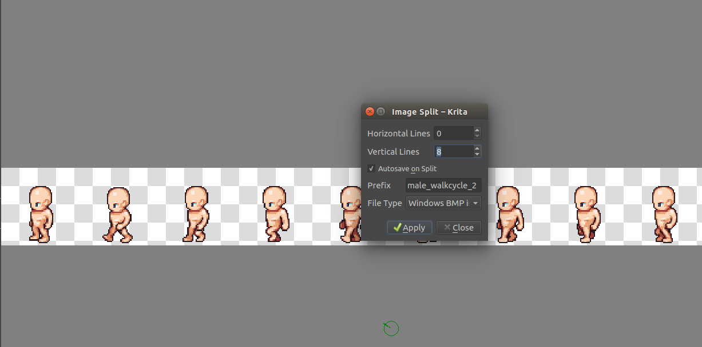
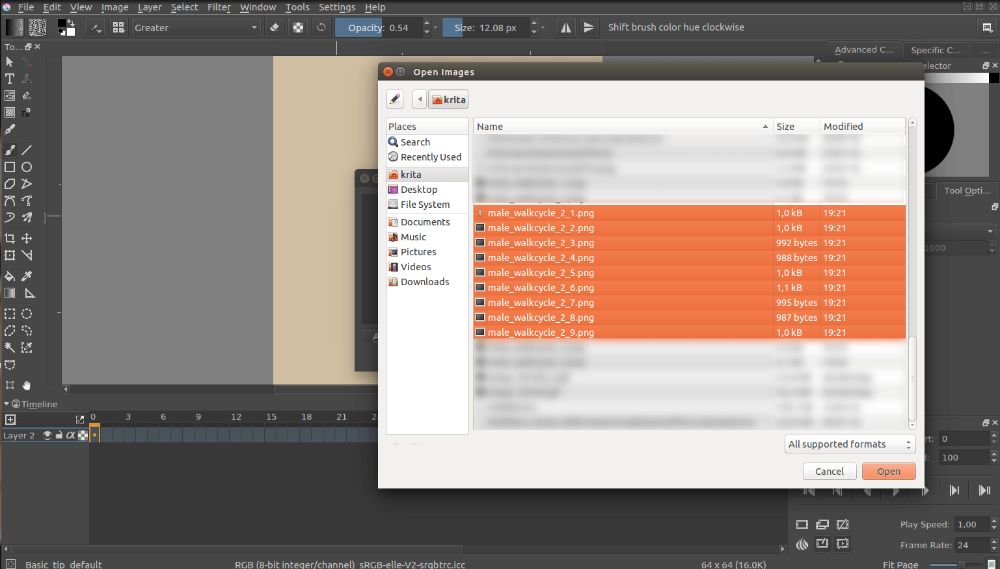
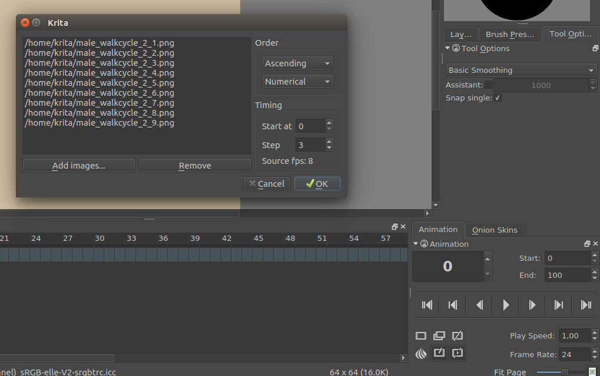
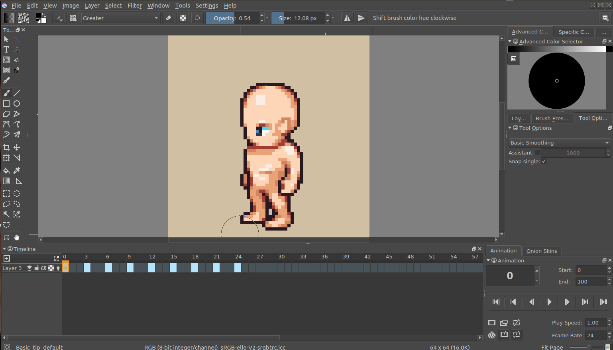
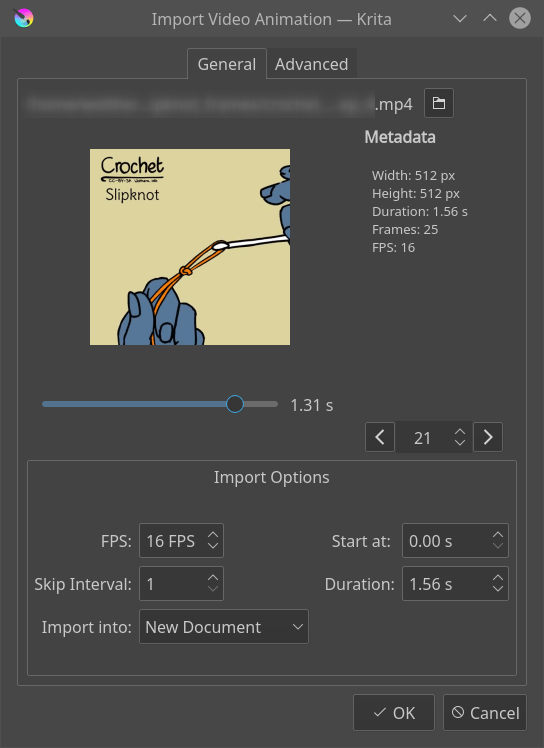

# 导入精灵表与序列帧：顺序和帧率换算

> **内容边界**：下方“授权原文”是官方主内容的 Markdown 转换；中文操作路线、练习与验收由整理者编写，不是作者逐句翻译，也不代表已在本机运行软件验证。

## 中文任务导读

把已有角色动作导入为可编辑帧，避免文件排序和帧率变化造成动作错乱。

**前提**：能够新建、保存和打开 Krita 文档；先确定目标像素尺寸、色板与透明度要求。

### 操作路线

1. 精灵表需先按确定的行列或切片数拆成等尺寸图像；原文示例展示九张精灵的切分。
2. 新建目标文档，通过 File → Import Animation Frames 添加图像。
3. 检查数字排序与字母排序，尤其是 frame_2 和 frame_10 等未补零名称。
4. 设置 Start at 与 Step；例如 6 fps 的动作进入 24 fps 文档，可用 Step=4 保持时长。

### 配图怎么读

第一张图展示在等间隔精灵表上切分；后续图片展示添加序列与导入后的时间轴，注意切片数和输出帧数的差别。 图内界面与作品保留原貌；示例转用于像素素材时仍按本篇验收条件检查。

### 练习与验收（整理者补充）

把六张编号帧导入 24 fps 文档，先采用 Step=1 再改为 Step=4，记录时长区别。

- [ ] 帧顺序与动作原意相同。
- [ ] 所有帧画布与锚点一致。
- [ ] 导入后的动作时长与目标一致。

### 版本与适用边界

原文演示使用 Libre Pixel Cup 角色，引用保留在原文脚注；下载成品用于游戏时需另核资产许可和署名。

抓取时页面标题标注 **Krita Manual 5.3.0**；这是文档快照版本，不构成已发布软件版本或本机功能的验证。原文中保留的 `Added/Changed/Deprecated in version` 是兼容性依据。

## 来源、许可与修改记录

- 原文：[Import Animation](https://docs.krita.org/en/reference_manual/import_animation.html)
- 作者：Wolthera van Hövell tot Westerflier
- 页内作者与许可原始声明：[RST 源文件](../../sources/asset-production/MAKE-016/original.rst)；[线上原始声明](https://docs.krita.org/en/_sources/reference_manual/import_animation.rst.txt)。
- 许可：[GNU Free Documentation License 1.3 or later](https://www.gnu.org/licenses/fdl-1.3.html)；[本地许可证全文](../../licenses/krita-GFDL-1.3.txt)。各图若有独立作者或许可，沿用原文紧邻图像的署名，不把作品许可自动泛化为文档许可。
- 修改历史：2026-10-29，Codex 为本教程库新增中文导读、练习和验收；将官方 HTML 主内容转换为 Markdown，去除导航与页脚，将控制图标转为文字、将教学图像存为本地文件。正文、步骤、代码、表格与图像说明保留。
- 本修改版沿用 GFDL 1.3 或更新版本。保留作者声明和上游链接；未添加 Invariant Sections、Front-Cover Texts 或 Back-Cover Texts。外链视频、安装包和关联页面没有自动下载或转录。

## 授权原文（英语，完整主内容转换）

## Import Animation

Krita has several options for allowing you to import an animation.

### Import Frames

Frame import will import a list of images into an animation layer. This is a format that most other animation software can export, and thus very useful for interchange.

First let us take a sprite sheet from Open Game Art. (This is the Libre Pixel Cup male walkcycle

[[1]](#id4)).

We’ll use [Image Split](https://docs.krita.org/en/reference_manual/image_split.html#image-split) to split up the sprite sheet.

The slices are even, so for a sprite sheet of 9 sprites, use 8 vertical slices and 0 horizontal slices. Give it a proper name and save it as png.

Then, make a new canvas, and select File ‣ Import Animation Frames. This will give you a little window. Select Add images. This should get you a file browser where you can select your images.

You can select multiple images at once.

The frames are currently automatically
ordered. You can set the ordering with the top-left two drop-down boxes.

Press OK, and your animation should be imported as a new layer.

Add images.
:   Add frames. You can select multiple frames in the file chooser.

Remove.
:   Remove the selected frame

Add hold frames automatically.
:   If a frame sequence has gaps, such as a sequence that has frames 1, 2 and 5, ticking this option will input empty frames at 3 and 4.

#### Order

Ascending vs Descending
:   Whether it will import the frames in order from lowest to highest (ascending), or from highest to lowest (descending).

Numerical vs Alphabetical
:   Whether it will use numbers or Alphabetical ordering for the frames.

#### Timing

Start at
:   The frame number to import at. Importing at 3 will have the resulting animation start at frame 3 within Krita.

Step
:   The amount of frames to input for each imported frame. For importing a 6 fps animation into a 24 fps animation, you will need to set this to 24 / 6 = 4. This will ensure the playback speed stays the same.

Source FPS
:   This displays what Krita thinks the fps of the input is with the current timing settings. You can use this to make sure that the input you made is correct with the FPS of your document.

### Import video file

Video import allows you to import a sample of a video file as an animated paint layer.

Note

On Android, importing video files is unavailable. You have to use a computer to import the video, save it to a KRA file and transfer it to your device.

Choose a video file
:   This will bring up a file chooser for you to select the file in question.

Preview
:   Gives a preview of the file to import.

Slider
:   Allows you to scrub through the file in question.

Frame Counter
:   Allows you to select the frame in question

Frame Switcher
:   Two buttons to switch per frame.

#### Video file info

Width
:   The width of the current file.

Height
:   The height of the current file.

Duration
:   The duration in seconds.

Frames
:   The total amount of frames

FPS
:   The frames per second.

Color Primaries
:   The name of the color space primaries Krita has detected. These will be used for the color profile with which the file imports. Only shows up on files where this data is detected.

Color Transfer
:   The name of the color space trc that Krita has found. This too will be used for the color profile. Only shows up on files where this data is detected.

#### Import Options

FPS
:   The FPS to import at. Importing 2 seconds of footage at 24 fps will import 48 frames, and at 60 fps, 120 frames will be imported.

Skip Interval
:   Same as Step in the [Import Frames](#import-frames) section.

Start at
:   Time code to start at.

Duration
:   Length of the imported animation.

Import into
:   Document to import the file into. Options are current document and new document. With new document, extra options become available on the second tab.

Warning

Videos, because you usually only play them in a media player, are compressed in special ways. Because Krita is designed to allow you to draw each individual frame, this data gets uncompressed. What this means is that even though you can watch a video file on your computer, you likely cannot import all the frames into Krita. A warning will be displayed and inform you how many frames you can import with your current setup.

#### Options

##### Document Options

Only enabled when the import is into a new document.

Width
:   Width of the new document.

Height
:   Height of the new document.

##### Import Video Scale

Width
:   The desired width in pixels

Height
:   The desired height in pixels

Filter
:   The filter to use for the resizing.

##### FFMpeg

FFMpeg Path
:   Path to the ffmpeg executable, necessary for importing the video data.

FFProbe path
:   Path to the ffmpeg probe executable, which is included with ffmpeg. This allows Krita to learn the video information from the file.

See also

[[1](#id3)]

[The source for the libre pixel cup male walk cycle](https://opengameart.org/content/liberated-pixel-cup-lpc-base-assets-sprites-map-tiles)

## 本地配图清单

| 图 | 本地文件 | 原始来源 |
|---|---|---|
| 1 | [Figure 1: Animation split spritesheet](../../assets/asset-production/MAKE-016/Animation_split_spritesheet.png) | [原图](https://docs.krita.org/en/_images/Animation_split_spritesheet.png) |
| 2 | [Figure 2: Animation import sprites](../../assets/asset-production/MAKE-016/Animation_import_sprites.png) | [原图](https://docs.krita.org/en/_images/Animation_import_sprites.png) |
| 3 | [Figure 3: Animation set everything](../../assets/asset-production/MAKE-016/Animation_set_everything.png) | [原图](https://docs.krita.org/en/_images/Animation_set_everything.png) |
| 4 | [Figure 4: Animation import done](../../assets/asset-production/MAKE-016/Animation_import_done.png) | [原图](https://docs.krita.org/en/_images/Animation_import_done.png) |
| 5 | [Figure 5: import video](../../assets/asset-production/MAKE-016/import_video.png) | [原图](https://docs.krita.org/en/_images/import_video.png) |
