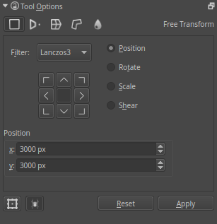
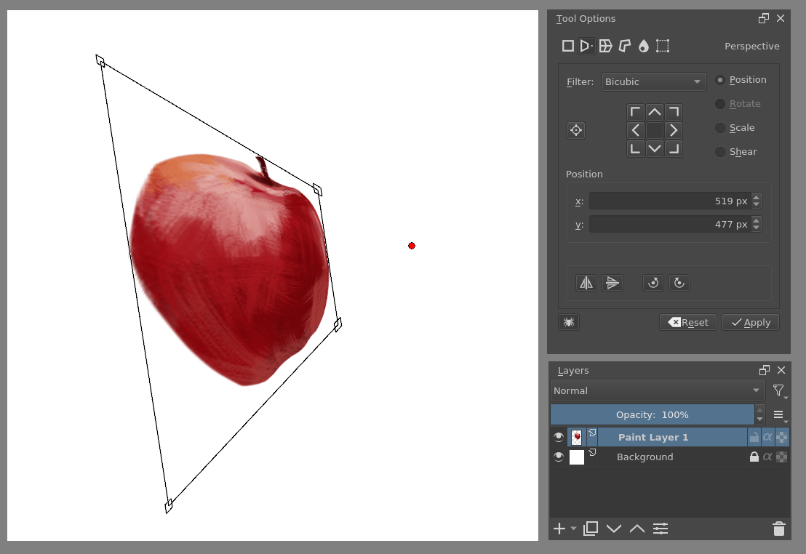
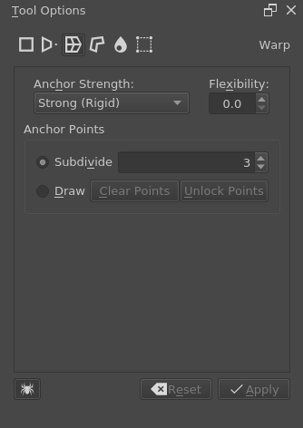
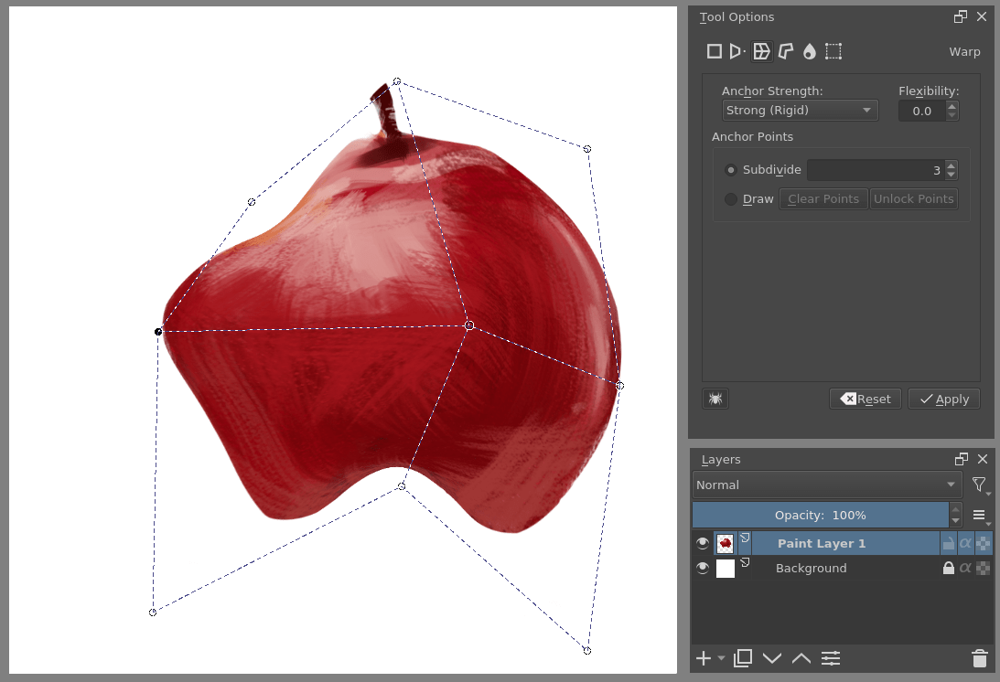
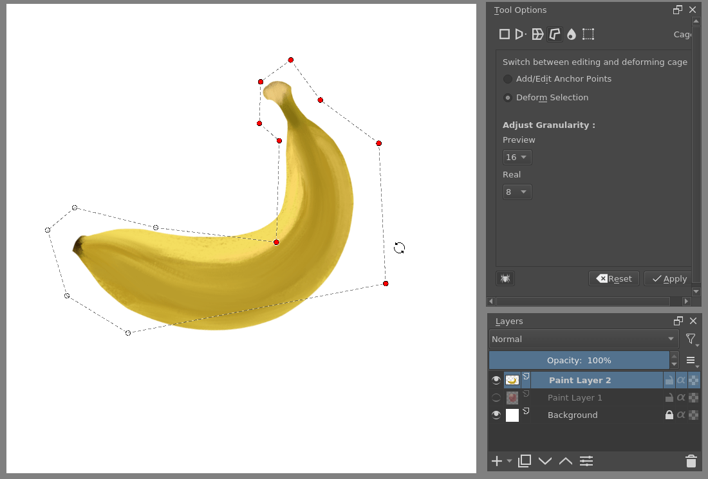
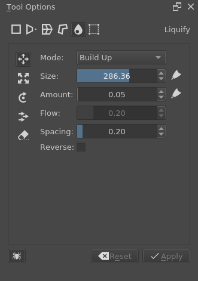
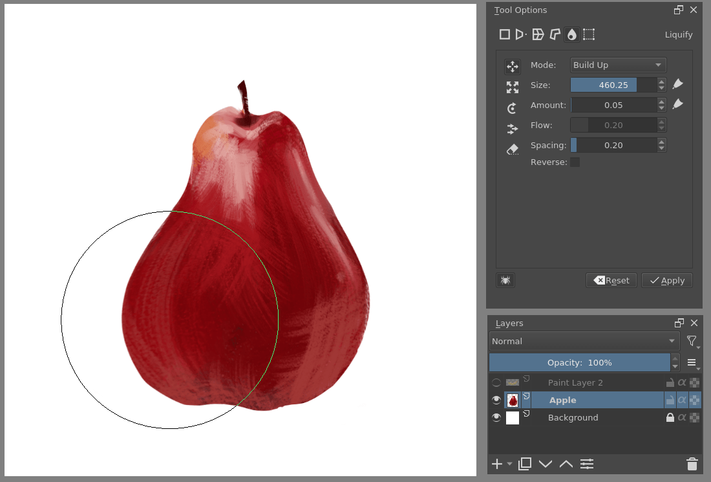
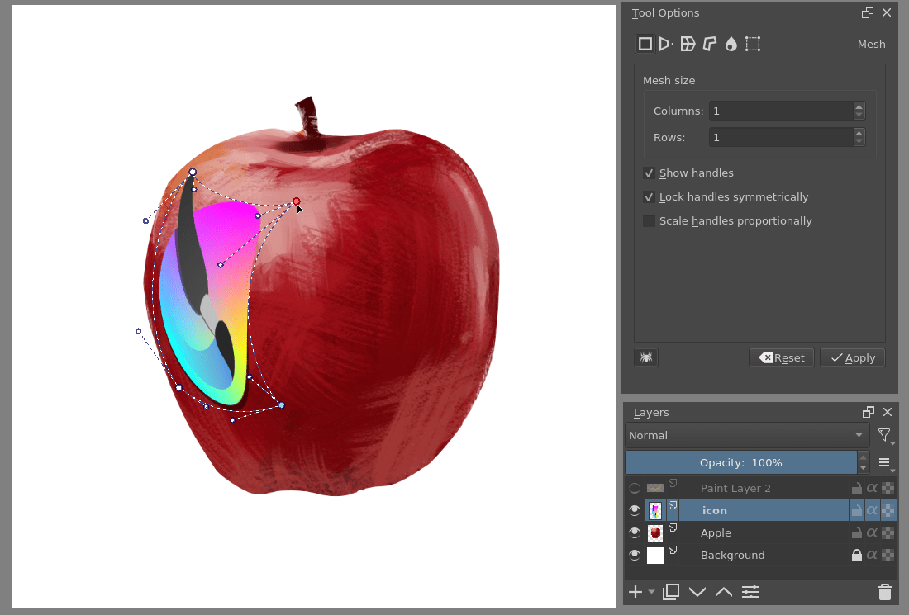
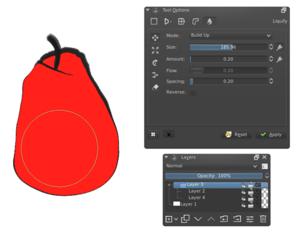

# 变换工具：缩放、翻转与形变的适用边界

> **内容边界**：下方“授权原文”是官方主内容的 Markdown 转换；中文操作路线、练习与验收由整理者编写，不是作者逐句翻译，也不代表已在本机运行软件验证。

## 中文任务导读

区分可保留网格结构的简单操作与需要重新精修的任意变形。

**前提**：能够新建、保存和打开 Krita 文档；先确定目标像素尺寸、色板与透明度要求。

### 操作路线

1. 先复制图层或保存原稿，再选择当前图层或选区作为变换对象。
2. 在 Tool Options 输入可复现的位置、尺寸和角度，避免仅凭拖拽估计。
3. 对像素资产优先测试整数平移、整倍缩放和 90° 旋转；对任意角度或形变单独审查。
4. 确认后在原始尺寸对比边缘、色数、细杆和透明孔洞，必要时手工重画受损部分。

### 配图怎么读

变换面板含坐标、尺寸与过滤器；过滤器会影响低分辨率边缘，不能仅凭预览位置正确就认定像素未受损。 图内界面与作品保留原貌；示例转用于像素素材时仍按本篇验收条件检查。

### 练习与验收（整理者补充）

对一把像素椅子做 90° 旋转和小角度旋转两个副本，对比轮廓、细腿与孔洞。

- [ ] 原图留存且可回退。
- [ ] 变换的插值与目标规范一致。
- [ ] 薄结构没有被缩放或形变吞掉。

### 版本与适用边界

本页的透视、网格和液化面向一般绘画；它们不保证像素网格或既定俯视投影保持一致。

抓取时页面标题标注 **Krita Manual 5.3.0**；这是文档快照版本，不构成已发布软件版本或本机功能的验证。原文中保留的 `Added/Changed/Deprecated in version` 是兼容性依据。

## 来源、许可与修改记录

- 原文：[Transform Tool](https://docs.krita.org/en/reference_manual/tools/transform.html)
- 作者：Wolthera van Hövell tot Westerflier；Scott Petrovic；Micheal Abrahams；Raghavendra Kamath
- 页内作者与许可原始声明：[RST 源文件](../../sources/asset-production/MAKE-017/original.rst)；[线上原始声明](https://docs.krita.org/en/_sources/reference_manual/tools/transform.rst.txt)。
- 许可：[GNU Free Documentation License 1.3 or later](https://www.gnu.org/licenses/fdl-1.3.html)；[本地许可证全文](../../licenses/krita-GFDL-1.3.txt)。各图若有独立作者或许可，沿用原文紧邻图像的署名，不把作品许可自动泛化为文档许可。
- 修改历史：2026-10-29，Codex 为本教程库新增中文导读、练习和验收；将官方 HTML 主内容转换为 Markdown，去除导航与页脚，将控制图标转为文字、将教学图像存为本地文件。正文、步骤、代码、表格与图像说明保留。
- 本修改版沿用 GFDL 1.3 或更新版本。保留作者声明和上游链接；未添加 Invariant Sections、Front-Cover Texts 或 Back-Cover Texts。外链视频、安装包和关联页面没有自动下载或转录。

## 授权原文（英语，完整主内容转换）

## Transform Tool

[tooltransform]

The Transform tool lets you quickly transform the current selection or layer. Basic transformation options include resize, rotate and skew. In addition, you have the option to apply advanced transforms such as Perspective, Warp, Cage and Liquid. These are all powerful options and will give you complete control over your selections/layers.

When you first invoke the tool, handles will appear at the corners and sides, which you can use to resize your selection or layer. You can perform rotations by moving the mouse above or to the left of the handles and dragging it. You can also click anywhere inside the selection or layer and move it by dragging the mouse.

You can fine-tune the transform tool parameters using tool options docker. The parameters are split between five tabs: Free Transform, Warp, Perspective, Cage and Liquify.

Free Transform docker.

### Free transform

This allows you to do basic rotation, resizing, flipping, and even perspective skewing if you hold the `Ctrl` key. Holding the `Shift` key will maintain your aspect ratio throughout the transform.
When you move the center pivot point, pressing `Alt` will allow you to limit it to the transformation bounds.

Free transform in action.

If you look at the bottom, there are quick buttons for flipping horizontally, vertically and rotating 90 degrees left and right. Furthermore, the button to the left of the anchor point widget allows you to choose whether to always transform using the anchor point, or not.

[Video of how to use the anchor point for resizing.](https://www.youtube.com/watch?v=grzccBVd0O8)

#### Rotating the Transformation Bounds

It is possible to rotate the visual transformation bounds without transforming the image itself. This is particularly useful when dealing with sections of an image that were drawn diagonally, like for example, a stick at an angle.

When using Krita’s default key bindings, pressing `Ctrl + Alt` before trying to rotate, the cursor will switch to a bounds-rotation cursor, at which point a [left mouse button] + drag will rotate the visual bounds. Then, releasing the keys, a regular transformation can be performed. By rotating the transformation bounds to the actual image being transformed, it can be easier to transform the image afterwards, especially when aligning at a certain angle.

The actual keys used for this can be configured under Settings ‣ Configure Krita… ‣ Canvas input settings ‣ Alternate invocation and assigning any of the actions that sample a color from the current layer. Depending on which presets you use, this may not be bound to anything by default.

Added in version 5.3.

### Perspective

While free transform has some perspective options, the perspective transform allows for maximum control. You can drag the corner points, or even the designated vanishing point.

You can also change the size, shear and position transform while remaining in perspective with the tool-options.

Perspective transform.

### Warp

Warp allows you to deform the image by dragging from a grid or choosing the dragging points yourself.

Warp Option.

Free transform in action.

There are warp options: Rigid, Affine and Similitude. These change the algorithm used to determine the strength of the deformation. The flexibility determines, how strong the effect of moving these points are.

#### Anchor Points

You can divide these either by subdivision or drawing custom points.

Subdivision
:   This allows you to subdivide the selected area into a grid.

Draw
:   Draw the anchor points yourself. Locking the points will put you in transform mode. Unlocking the points back into edit mode.

### Cage

Create a cage around an image, and when it’s closed, you can use it to deform the image. If you have at least 3 points on the canvas, you can choose to switch between deforming and editing the existing points.

Transforming a straight banana to be curved with the cage tool.

#### Adjust Granularity

Added in version 4.2.

This adjusts the precision of the cage transform grid. The lower the value, the higher the quality of the transformation (and consequently, the lower the speed). When the granularity is too high, the result starts to look “blocky”.

Preview
:   Adjusts the granularity of the preview. It is recommended to have this higher than the Real value, as it speeds up adjusting.

Real
:   Adjusts the granularity of the final result.

#### Hotkeys

Both Cage and Warp use little nodes. These nodes can be selected and deselected together by pressing the `Ctrl` key before clicking nodes.

Then you can move them by pressing the cursor inside the bounding box. Rotating is done by pressing and dragging the cursor outside the bounding box and scaling the same, only one presses the `Ctrl` key before doing the motion.

### Liquify

Like our deform brush, the liquify brush allows you to draw the deformations straight on the canvas.

Move
:   Drag the image along the brush stroke.

Scale
:   Grow/Shrink the image under the cursor.

Rotate
:   Twirl the image under the cursor.

Offset
:   Shift the image under the cursor.

Undo
:   Erases the actions of other tools.

Liquify used to turn an apple into a pear.

In the options for each brush there are:

Mode
:   This is either Wash or Build up. Wash will normalize the effect to be between none, and the amount parameter as maximum. Build up will just add on until it’s impossible.

Size
:   The brush size. The button to the right allows you to let it scale with pressure.

Amount
:   The strength of the brush. The button to the right lets it scale with tablet pressure.

Flow
:   Only applicable with Build up.

Spacing
:   The spacing of the liquify dabs.

Reverse
:   Reverses the action, so grow becomes shrink, rotate results in clockwise becoming counter-clockwise.

Liquify on the left and deform brush on the right.

Krita also has a [Deform Brush Engine](https://docs.krita.org/en/reference_manual/brushes/brush_engines/deform_brush_engine.html#deform-brush-engine) which is much faster than liquify, but has less quality. If you are attempting to make liquify a little faster, note that it speeds up with the less information it needs to process, so working with liquify within a selection or using liquify on a separate layer with little on it will greatly enhance the speed.

### Mesh

Added in version 4.4.2.

The mesh transform is similar to the warp and the cage transform, except that its interface uses patches comprised of Bezier curve segments. This transform mode is particularly useful for placing images and textures on curved surfaces:

Curving a logo to an apple with the mesh transform, with the control points shown.

This is a very keyboard shortcut heavy transform mode. When you start the transform you will see the overlay, which consists of several nodes that can be dragged around. You can drag on the segments between the nodes to curve them precisely, or drag on patches themselves to freely transform them. `Ctrl + Alt +` [left mouse button] `+ drag` shortcut on nodes and segments will allow you to subdivide the mesh. For more precision, enable the control points in the tool options, so each Bezier segment can be fine-tuned to your content.

To assist in maintaining the curvature of a mesh, this tool has a concept of ‘locked’ transform. This mode is signalled by the lock icon in the cursor, and on by default. When this is enabled, adjusting one segment will also adjust its neighbouring segment in another patch. You can press `Shift` key while dragging a segment or control point to turn this feature off, allowing for sharp angles in the mesh. After a sharp angle has been created, the locked mode will try to keep this as well.

#### Shortcuts

Node or control point move
:   [left mouse button] `+ drag` any of the round points. The big ones are the ‘nodes’ which determine the corners of a patch, and the small ones are the ‘control points’, which determine the curvature for their associated segment.

Unlocked node or control point move
:   `Shift +` [left mouse button] `+ drag` on a node or control point.

Locked segment move:
:   [left mouse button] `+ drag` on a segment. As explained above, this will adjust neighbouring segments as well, to keep the curvature of the node intact.

Segment move
:   `Shift +` [left mouse button] `+ drag` on a segment of the mesh.

Free patch deform:
:   [left mouse button] `+ drag` on an empty area inside the mesh. This will allow you to intuitively adjust a segment by just clicking anywhere and dragging. The whole segment will then adjust all its control points around the point of the cursor.

Split mesh or Move/Delete split:
:   - `Ctrl + Alt +` [left mouse button] `+ drag` on a border segment to split the mesh
    - `Ctrl + Alt +` [left mouse button] `+ drag` on a node to change the split
    - `Ctrl + Alt +` [left mouse button] `+ drag` away a node to remove the split

Select multiple nodes
:   `Ctrl +` [left mouse button] on a node or control or segment, these can then be moved

Move selection or mesh
:   `Shift +` [left mouse button] `+ drag` on empty area outside the mesh.

Rotate selection or mesh
:   [left mouse button] `+ drag` on an empty area outside the mesh, if there is a selection of nodes, it will rotate only them, otherwise the whole mesh will be rotated.

Scale selection or mesh
:   `Ctrl +` [left mouse button] `+ drag` on empty area outside the mesh, if there is a selection of nodes, it will scale only them, otherwise the whole mesh will be scaled.

#### Tool options

Mesh Size
:   Gives precise controls to change the amount of patches vertically and horizontally. When increasing or decreasing the amount of patches, Krita will try to keep the curvature the same, which can be used to your advantage.

Show control points
:   This will toggle the control points.

### Transform Multiple Layers

Krita allows you to transform multiple layers at once.

In Krita versions older than 5.0 this required using the Recursive Transform option while transforming a group layer, whose icon was a little spider. Since 5.0, this option is enabled by default for group layers (To achieve non-recursive transformation you can use the layer lock feature).

Changed in version 5.2: Transforming multiple layers doesn’t require a group anymore, now all layers selected in the layer docker will be transformed at once.

Krita allows you to transforms all the layers in the group, so with this apple, both the lineart as the fill will be transformed.

### Continuous Transform

If you apply a transformation, and try to start a new one directly afterwards, Krita will attempt to recall the previous transform, so you can continue it. This is a *continuous transform*. You can press the `Esc` key to cancel this and start a new transform, or press Reset in the tool options while no transform is active.

### Transformation Masks

These allow you to make non-destructive transforms, check [here](https://docs.krita.org/en/reference_manual/layers_and_masks/transformation_masks.html#transformation-masks) for more info.

## 本地配图清单

| 图 | 本地文件 | 原始来源 |
|---|---|---|
| 1 | [Figure 1: Free Transform docker. ¶](../../assets/asset-production/MAKE-017/Transform_Tool_Options.png) | [原图](https://docs.krita.org/en/_images/Transform_Tool_Options.png) |
| 2 | [Figure 2: Free transform in action. ¶](../../assets/asset-production/MAKE-017/Krita_transforms_free.png) | [原图](https://docs.krita.org/en/_images/Krita_transforms_free.png) |
| 3 | [Figure 3: Perspective transform. ¶](../../assets/asset-production/MAKE-017/Krita_transforms_perspective.png) | [原图](https://docs.krita.org/en/_images/Krita_transforms_perspective.png) |
| 4 | [Figure 4: Warp Option. ¶](../../assets/asset-production/MAKE-017/Transform_Tool_Options_Warp.png) | [原图](https://docs.krita.org/en/_images/Transform_Tool_Options_Warp.png) |
| 5 | [Figure 5: Free transform in action. ¶](../../assets/asset-production/MAKE-017/Krita_transforms_warp.png) | [原图](https://docs.krita.org/en/_images/Krita_transforms_warp.png) |
| 6 | [Figure 6: Transforming a straight banana to be curved with the cage tool. ¶](../../assets/asset-production/MAKE-017/Krita_transforms_cage.png) | [原图](https://docs.krita.org/en/_images/Krita_transforms_cage.png) |
| 7 | [Figure 7: Transform Tool Options Liquify](../../assets/asset-production/MAKE-017/Transform_Tool_Options_Liquify.png) | [原图](https://docs.krita.org/en/_images/Transform_Tool_Options_Liquify.png) |
| 8 | [Figure 8: Liquify used to turn an apple into a pear. ¶](../../assets/asset-production/MAKE-017/Krita_transforms_liquefy.png) | [原图](https://docs.krita.org/en/_images/Krita_transforms_liquefy.png) |
| 9 | [Figure 9: Liquify on the left and deform brush on the right. ¶](../../assets/asset-production/MAKE-017/Krita_transforms_deformvsliquefy.png) | [原图](https://docs.krita.org/en/_images/Krita_transforms_deformvsliquefy.png) |
| 10 | [Figure 10: Curving a logo to an apple with the mesh transform, with the control points shown. ¶](../../assets/asset-production/MAKE-017/Krita_transforms_mesh.png) | [原图](https://docs.krita.org/en/_images/Krita_transforms_mesh.png) |
| 11 | [Figure 11: Krita allows you to transforms all the layers in the group, so with this apple, both the lineart as the fill will be transformed. ¶](../../assets/asset-production/MAKE-017/Krita_transforms_recursive.png) | [原图](https://docs.krita.org/en/_images/Krita_transforms_recursive.png) |
