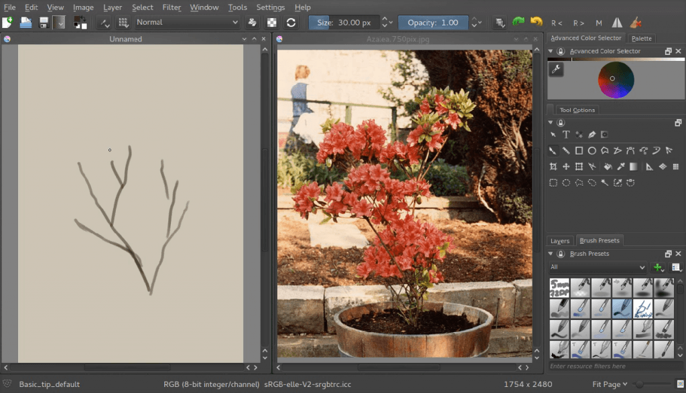
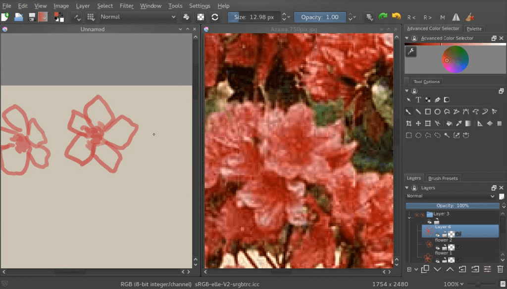
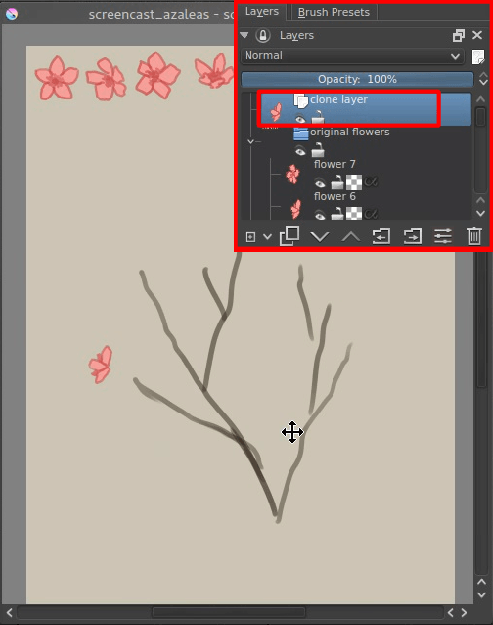
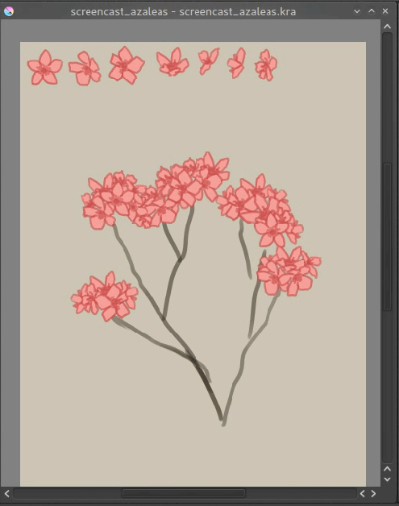
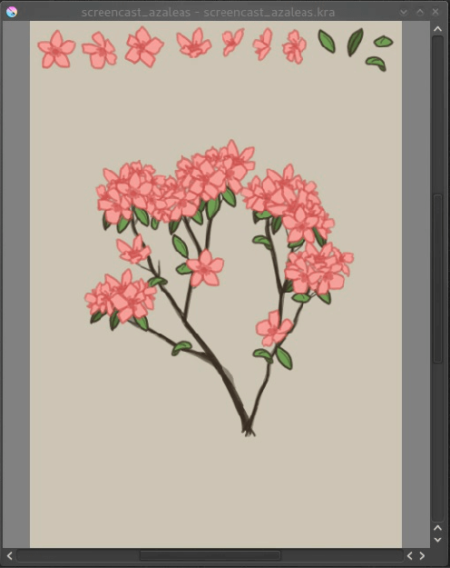
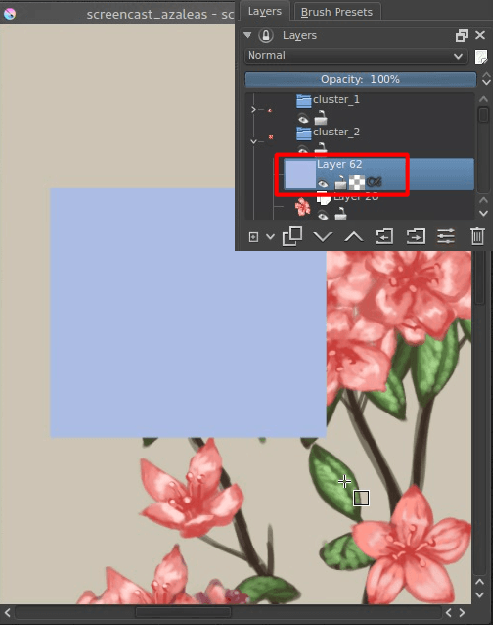
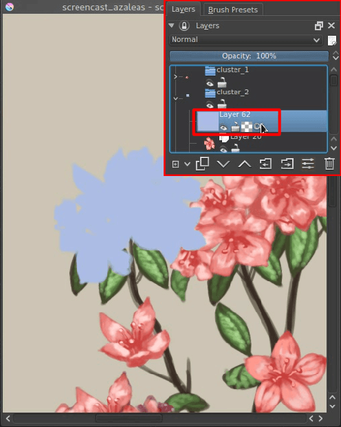
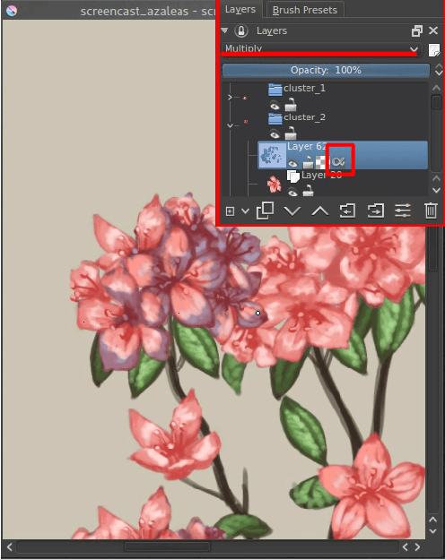
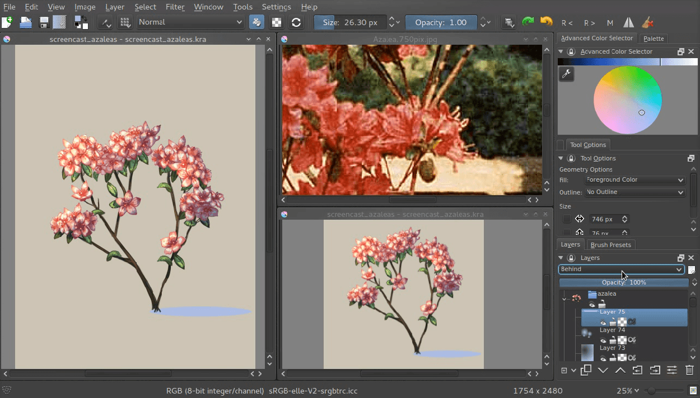

# 可复用植物组件：克隆图层与变换遮罩

> **内容边界**：下方“授权原文”是官方主内容的 Markdown 转换；中文操作路线、练习与验收由整理者编写，不是作者逐句翻译，也不代表已在本机运行软件验证。

## 中文任务导读

理解从少量花叶母版组合成植物的编辑结构，再决定哪些部分适合像素素材复用。

**前提**：能够新建、保存和打开 Krita 文档；先确定目标像素尺寸、色板与透明度要求。

### 操作路线

1. 按原文将树干、花朵和叶片分开制作，保留清楚的母版图层。
2. 为重复花簇创建 Clone Layer，使母版修正可以传播到克隆。
3. 给克隆加 Transform Mask，调整位置与朝向以组织植物轮廓。
4. 在组内使用透明度继承添加阴影，最后统一检查尺度、光源与重复痕迹。

### 配图怎么读

成品植物由多个花叶簇组合而成；后续截图追踪母版、克隆和变换遮罩，重点学习编辑结构而不是复制成品造型。 图内界面与作品保留原貌；示例转用于像素素材时仍按本篇验收条件检查。

### 练习与验收（整理者补充）

用两种叶簇母版组合一个灌木；修改其中一个母版，检查所有克隆是否同步。

- [ ] 母版与克隆关系可追溯。
- [ ] 花叶重复不造成明显机械图案。
- [ ] 像素版导出后仍保持统一光源与网格。

### 版本与适用边界

原文为普通绘画示范；像素版任意旋转和缩放后需重新整理轮廓，不能把克隆结果直接当合格精灵。

抓取时页面标题标注 **Krita Manual 5.3.0**；这是文档快照版本，不构成已发布软件版本或本机功能的验证。原文中保留的 `Added/Changed/Deprecated in version` 是兼容性依据。

## 来源、许可与修改记录

- 原文：[Making An Azalea With The Transformation Masks](https://docs.krita.org/en/tutorials/making_an_azalea_with_the_transformation_masks.html)
- 作者：Wolthera van Hövell tot Westerflier
- 页内作者与许可原始声明：[RST 源文件](../../sources/asset-production/MAKE-018/original.rst)；[线上原始声明](https://docs.krita.org/en/_sources/tutorials/making_an_azalea_with_the_transformation_masks.rst.txt)。
- 许可：[GNU Free Documentation License 1.3 or later](https://www.gnu.org/licenses/fdl-1.3.html)；[本地许可证全文](../../licenses/krita-GFDL-1.3.txt)。各图若有独立作者或许可，沿用原文紧邻图像的署名，不把作品许可自动泛化为文档许可。
- 修改历史：2026-10-29，Codex 为本教程库新增中文导读、练习和验收；将官方 HTML 主内容转换为 Markdown，去除导航与页脚，将控制图标转为文字、将教学图像存为本地文件。正文、步骤、代码、表格与图像说明保留。
- 本修改版沿用 GFDL 1.3 或更新版本。保留作者声明和上游链接；未添加 Invariant Sections、Front-Cover Texts 或 Back-Cover Texts。外链视频、安装包和关联页面没有自动下载或转录。

## 授权原文（英语，完整主内容转换）

## Making An Azalea With The Transformation Masks

Note

This page was ported from the original post on the main page to KDE UserBase wiki.

Okay, so I’ve wanted to do a tutorial for transform masks for a while now, and this is sorta ending up to be a flower-drawing tutorial. Do note that this tutorial requires you to use **Krita 2.9.4 at MINIMUM**. It has a certain speed-up that allows you to work with transform masks reliably!

I like drawing flowers because they are a bit of an unappreciated subject, yet allow for a lot of practice in terms of rendering. Also, you can explore cool tricks in Krita with them.

Today’s flower is the Azalea flower. These flowers are usually pink to red and appear in clusters, the clusters allow me to exercise with transform masks!

I got an image from Wikipedia for reference, mostly because it’s public domain, and as an artist I find it important to respect other artists. You can copy it and, if you already have a canvas, Edit ‣ Paste into New Image or New ‣ Create from Clipboard.

Then, if you didn’t have a new canvas make one. I made an A5 300dpi canvas. This is not very big, but we’re only practicing. I also have the background color set to a yellow-grayish color (#CAC5B3), partly because it reminds me of paper, and partly because bright screen white can strain the eyes and make it difficult to focus on values and colors while painting. Also, due to the lack of strain on the eyes, you’ll find yourself soothed a bit. Other artists use #c0c0c0, or even more different values.

So, if you go to Window ‣ Tile, you will find that now your reference image and your working canvas are side by side. The reason I am using this instead of the docker is because I am lazy and don’t feel like saving the wikipedia image. We’re not going to touch the image much.

### Let’s get to drawing!

First we make a bunch of branches. I picked a slightly darker color here than usual, because I know that I’ll be painting over these branches with the lighter colors later on. Look at the reference how branches are formed.

Then we make an approximation of a single flower on a layer. We make a few of these, all on separate layers. We also do not sample the red from the image with the color sampler tool, but we guess at it. This is good practice, so we can learn to analyze a color as well as how to use our color selector. If we’d only sample colors from the image, it would be difficult to understand the relationship between them, so it’s best to attempt matching them by eye.

I chose to make the flower shape opaque quickly by using the *behind* blending mode. This’ll mean Krita is painting the new pixels behind the old ones. Very useful for quickly filling up shapes, just don’t forget to go back to *normal* once you’re done.

Now, we’ll put the flowers in the upper left corner, and group them. You can group by making a group layer, and selecting the flower layers in your docker with the `Ctrl +` [left mouse button] shortcut and dragging them into the group. The reason why we’re putting them in the upper left corner is because we’ll be selecting them a lot, and Krita allows you to select layers with the `R +` [left mouse button] shortcut on the canvas quickly. Just hold the `R` key and [left mouse button] the pixels belonging to the layer you want, and Krita will select the layer in the Layer docker.

### Clone Layers

Now, we will make clusters. What we’ll be doing is that we select a given flower and then make a new clone layer. A clone layer is a layer that is literally a clone of the original. They can’t be edited themselves, but edit the original and the clone layer will follow suit. Clone Layers, and File layers, are our greatest friends when it comes to transform masks, and you’ll see why in a moment.

You’ll quickly notice that our flowers are not good enough for a cluster: we need far more angles on the profile for example. If only there was a way to transform them… but we can’t do that with clone layers. Or can we?

### Enter Transform Masks!

Transform Masks are a really powerful feature introduced in 2.9. They are in fact so powerful, that when you first use them, you can’t even begin to grasp where to use them.

Transform masks allow us to do a transform operation onto a layer, any given layer, and have it be completely dynamic! This includes our clone layer flowers!

How to use them:

[right mouse button] the layer you want to do the transform on, and add a **Transform mask**.

A transform mask should now have been added. You can recognize them by the little ‘scissor’ icon.

Now, with the transform mask selected, select the [tooltransform] , and rotate our clone layer. Apply the transform. You know you’re successful when you can hide the transform mask, and the layer goes back to its original state!

You can even go and edit your transform! Just activate the [tooltransform] again while on a transform mask, and you will see the original transform so you can edit it. If you go to a different transform operation however, you will reset the transform completely, so watch out.

We’ll be only using affine transformations in this tutorial (which are the regular and perspective transform), but this can also be done with warp, cage and liquify, which’ll have a bit of a delay (3 seconds to be precise). This is to prevent your computer from being over-occupied with these more complex transforms, so you can keep on painting.

We continue on making our clusters till we have a nice arrangement.

Now do the same thing for the leaves.

Now, if you select the original paint layers and draw on them, you can see that all clone masks are immediately updated!

Above you can see there’s been a new view added so we can focus on painting the flower and at the same time see how it’ll look. You can make a new view by going Window ‣ New View and selecting the name of your current canvas (save first!). Views can be rotated and mirrored differently.

Now continue painting the original flowers and leaves, and we’ll move over to adding extra shadow to make it seem more lifelike!

We’re now going to use *Alpha Inheritance*. Alpha inheritance is an ill-understood concept, because a lot of programs use *clipping masks* instead, which clip the layer’s alpha using only the alpha of the first next layer.

Alpha inheritance, however, uses all layers in a stack, so all the layers in the group that haven’t got alpha inheritance active themselves, or all the layers in the stack when the layer isn’t in a group. Because most people have an opaque layer at the bottom of their layer stack, alpha inheritance doesn’t seem to do much.

But for us, alpha inheritance is useful, because we can use all clone-layers in a cluster (if you grouped them), transformed or not, for clipping. Just draw a light blue square over all the flowers in a given cluster.

Then press the last icon in the layer stack, the alpha-inherit button, to activate alpha-inheritance.

Set the layer to *multiply* then, so it’ll look like everything’s darker blue.

Then, with multiply and alpha inheritance on, use an eraser to remove the areas where there should be no shadow.

For the highlights use exactly the same method, AND exactly the same color, but instead set the layer to Divide (you can find this amongst the Arithmetic blending modes). Using Divide has exactly the opposite effect as using multiply with the same color. The benefit of this is that you can easily set up a complementary harmony in your shadows and highlights using these two.

Do this with all clusters and leaves, and maybe on the whole plant (you will first need to stick it into a group layer given the background is opaque) and you’re done!

Transform masks can be used on paint layers, vector layers, group layers, clone layers and even file layers. I hope this tutorial has given you a nice idea on how to use them, and hope to see much more use of the transform masks in the future!

You can get the file I made [here](https://share.kde.org/public.php?service=files&t=48c601aaf17271d7ca516c44cbe8590e) to examine it further! (Caution: It will freeze up Krita if your version is below 2.9.4. The speed-ups in 2.9.4 are due to this file.)

## 本地配图清单

| 图 | 本地文件 | 原始来源 |
|---|---|---|
| 1 | [Figure 1: Making azalea with transform masks.](../../assets/asset-production/MAKE-018/Krita-screencast-azaleas.png) | [原图](https://docs.krita.org/en/_images/Krita-screencast-azaleas.png) |
| 2 | [Figure 2: Starting with the trunk and reference image.](../../assets/asset-production/MAKE-018/Azelea_01_trunk-.png) | [原图](https://docs.krita.org/en/_images/Azelea_01_trunk-.png) |
| 3 | [Figure 3: Making the outline of the flowers.](../../assets/asset-production/MAKE-018/Azelea_02_drawing-flowers.png) | [原图](https://docs.krita.org/en/_images/Azelea_02_drawing-flowers.png) |
| 4 | [Figure 4: Coloring the details and filling the flowers.](../../assets/asset-production/MAKE-018/Azelea_03_filling-flowers.png) | [原图](https://docs.krita.org/en/_images/Azelea_03_filling-flowers.png) |
| 5 | [Figure 5: Finished setup for making azalea.](../../assets/asset-production/MAKE-018/Azelea_04_finished-setup.png) | [原图](https://docs.krita.org/en/_images/Azelea_04_finished-setup.png) |
| 6 | [Figure 6: Create clone layers of the flowers.](../../assets/asset-production/MAKE-018/Azelea_05_clonelayer.png) | [原图](https://docs.krita.org/en/_images/Azelea_05_clonelayer.png) |
| 7 | [Figure 7: Adding transform masks to the cloned layers.](../../assets/asset-production/MAKE-018/Azelea_06_transformmask.png) | [原图](https://docs.krita.org/en/_images/Azelea_06_transformmask.png) |
| 8 | [Figure 8: Adding more clusters.](../../assets/asset-production/MAKE-018/Azelea_07_clusters.png) | [原图](https://docs.krita.org/en/_images/Azelea_07_clusters.png) |
| 9 | [Figure 9: Making leaves.](../../assets/asset-production/MAKE-018/Azelea_08_leaves.png) | [原图](https://docs.krita.org/en/_images/Azelea_08_leaves.png) |
| 10 | [Figure 10: Painting originals.](../../assets/asset-production/MAKE-018/Azelea_09_paintingoriginals.png) | [原图](https://docs.krita.org/en/_images/Azelea_09_paintingoriginals.png) |
| 11 | [Figure 11: Using the alpha inheritance.](../../assets/asset-production/MAKE-018/Azelea_10_alphainheritance_1.png) | [原图](https://docs.krita.org/en/_images/Azelea_10_alphainheritance_1.png) |
| 12 | [Figure 12: Clipping the cluster with alpha inheritance.](../../assets/asset-production/MAKE-018/Azelea_11_alphainheritance_2.png) | [原图](https://docs.krita.org/en/_images/Azelea_11_alphainheritance_2.png) |
| 13 | [Figure 13: Activate alpha inheritance.](../../assets/asset-production/MAKE-018/Azelea_12_alphainheritance_3.png) | [原图](https://docs.krita.org/en/_images/Azelea_12_alphainheritance_3.png) |
| 14 | [Figure 14: Multiplying the clipped shape.](../../assets/asset-production/MAKE-018/Azelea_13_alphainheritance_4.png) | [原图](https://docs.krita.org/en/_images/Azelea_13_alphainheritance_4.png) |
| 15 | [Figure 15: Remove extra areas with the eraser.](../../assets/asset-production/MAKE-018/Azelea_14_alphainheritance_5.png) | [原图](https://docs.krita.org/en/_images/Azelea_14_alphainheritance_5.png) |
| 16 | [Figure 16: Add shadows and highlights with alpha inheritance technique.](../../assets/asset-production/MAKE-018/Azelea_15_alphainheritance_6.png) | [原图](https://docs.krita.org/en/_images/Azelea_15_alphainheritance_6.png) |
