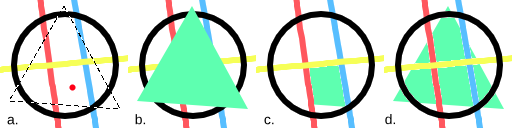
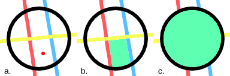
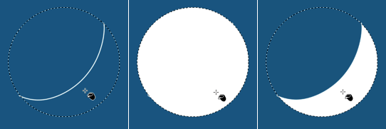

# 填充工具：连通区域、边界与缝隙

> **内容边界**：下方“授权原文”是官方主内容的 Markdown 转换；中文操作路线、练习与验收由整理者编写，不是作者逐句翻译，也不代表已在本机运行软件验证。

## 中文任务导读

通过填充模式与参考图层设置控制“该填哪里”，尤其适合封闭道具与地表色块。

**前提**：能够新建、保存和打开 Krita 文档；先确定目标像素尺寸、色板与透明度要求。

### 操作路线

1. 先确认填充范围是当前选区、连通区域还是全图相似颜色。
2. 选择参考当前层、所有层或带颜色标签的层，使边界来源明确。
3. 调整 Threshold、Spread 与选区增减，观察是否跨过细线；严格像素边缘另查抗锯齿与羽化。
4. 有断口时比较 Close Gap 的前后效果，保留真正应当开放的孔洞。

### 配图怎么读

四个并排图对比同一次点击在不同填充模式下影响的范围；看绿色覆盖了选区、连通块还是所有相似颜色。 图内界面与作品保留原貌；示例转用于像素素材时仍按本篇验收条件检查。

### 练习与验收（整理者补充）

制作含窄把手与 1px 缝隙的杯子，比较不同填充模式并保存参数。

- [ ] 只填目标区域，没有穿出边界。
- [ ] 孔洞与窄通道的处理符合形体意图。
- [ ] 低分辨率边缘没有残留白缝。

### 版本与适用边界

Close Gap 标注为 5.3 新增；类似颜色区域和若干扩张选项在 5.2 才出现。

抓取时页面标题标注 **Krita Manual 5.3.0**；这是文档快照版本，不构成已发布软件版本或本机功能的验证。原文中保留的 `Added/Changed/Deprecated in version` 是兼容性依据。

## 来源、许可与修改记录

- 原文：[Fill Tool](https://docs.krita.org/en/reference_manual/tools/fill.html)
- 作者：Wolthera van Hövell tot Westerflier；Scott Petrovic；Deif Lou
- 页内作者与许可原始声明：[RST 源文件](../../sources/asset-production/MAKE-020/original.rst)；[线上原始声明](https://docs.krita.org/en/_sources/reference_manual/tools/fill.rst.txt)。
- 许可：[GNU Free Documentation License 1.3 or later](https://www.gnu.org/licenses/fdl-1.3.html)；[本地许可证全文](../../licenses/krita-GFDL-1.3.txt)。各图若有独立作者或许可，沿用原文紧邻图像的署名，不把作品许可自动泛化为文档许可。
- 修改历史：2026-10-29，Codex 为本教程库新增中文导读、练习和验收；将官方 HTML 主内容转换为 Markdown，去除导航与页脚，将控制图标转为文字、将教学图像存为本地文件。正文、步骤、代码、表格与图像说明保留。
- 本修改版沿用 GFDL 1.3 或更新版本。保留作者声明和上游链接；未添加 Invariant Sections、Front-Cover Texts 或 Back-Cover Texts。外链视频、安装包和关联页面没有自动下载或转录。

## 授权原文（英语，完整主内容转换）

## Fill Tool

[toolfill]

Krita has one of the most powerful and capable Fill functions available. The options found in the Tool Options docker and outlined below will give you a great deal of flexibility working with layers and selections.

To get started, clicking anywhere on screen with the fill-tool will allow that area to be filed with the foreground color.

### Tool Options

Fill Mode
:   Current Selection
    :   Activating this will result in the shape filling the whole of the active selection.

    Contiguous Region
    :   This option is the default and allows filling a region of contiguous pixels obtained from the image at the point where the user clicks.

    Regions of Similar Color
    :   Added in version 5.2.

        This option allows filling all the regions similar in color to the pixel where the user clicks

    
    

    a: An image with a selection. The red dot marks where the user clicked to fill. b: The region filled using Current Selection. c: The region filled using Contiguous Pixels, filling all pixels that are both similar and contiguous to the one the user clicked. d: The region filled with Regions of Similar Color, filling pixels similarly colored to the one the user clicked.

Fill Source
:   Foreground Color
    :   Selecting this option will fill the obtained region with the foreground color.

    Background Color
    :   Added in version 5.1.

        Selecting this option will fill the obtained region with the background color.

    Pattern
    :   Selecting this option will fill the obtained region with the current pattern.

        Scale
        :   Added in version 4.4.

            This allows you to scale the pattern used in the fill.

        Rotation
        :   Added in version 4.4.

            This allows you to rotate the pattern used in the fill.

Fill Extent
:   Pixel Selection Modes
    :   Added in version 5.2.

        When filling a contiguous region, the user can choose how the pixels are selected based on color similarity.

        Fill Similar Pixels
        :   

            The contiguous pixels that are similar to the one the user clicked on are selected.

        Fill All Pixels Until a Boundary
        :   

            All the contiguous pixels are selected as long as they are not similar to the user defined boundary color.

            Boundary Color
            :   Defines the color used as a boundary.

        
        

        a: An image with a red dot marking where the user clicked to fill. b: The filled region when selecting only the similar contiguous pixels. c: The filled region all the pixels until the boundary color (here set to the color black).

    Threshold
    :   Determines when the fill-tool sees another color as a border. In other words, how far the region should extend from the selected pixel in terms of color similarity.

    Spread
    :   Added in version 5.1.

        Set how far the fully opaque portion of the region should extend. 0% will make opaque only the pixels that are exactly equal to the selected pixel. 100% will make opaque all the pixels in the region up to its boundary.

        
        

        Left: Original image. The black dot indicates where the fill operation starts. Top-right: a row of images that show the result of filling with a threshold value of 30 and a spread value of 0, 30, 60 and 100 percent from left to right. Bottom-right: a row of images that show the result of filling with a threshold value of 65 and a spread value of 0, 30, 60 and 100 percent from left to right.

    Close Gap
    :   Added in version 5.3.

        This option sets the minimum gap size that the contiguous fill will be able to propagate into.

        
        

        Left: The original image (black over white) and a green dot marking where the fill will be initiated. Center: The image after a fill operation using a gap size of 0 pixels. Right: The image after a fill operation using a gap size of 8 pixels.

    Use Selection as Boundary
    :   Added in version 4.4.

        When checked, this will count the borders of the selection as an extra boundary on top of the pixel difference.

        
        

        Left: Original selection with a line. Middle: Filled with ‘use selection as boundary’ off. Right: Filled with ‘use selection as boundary’ on.

Adjustments
:   Anti-aliasing
    :   Added in version 5.1.

        This will smooth the jagged edges present in the region. It differs from feathering in that this will smooth in the direction of the edge instead of all directions, and only if the edge is jagged (high contrast).

    Grow Selection
    :   This value extends (positive values) or contracts (negative values) the region.

        Stop Growing at the Darkest and/or More Opaque Pixels
        :   Added in version 5.2.

            

            This option is useful when filling inner regions of a lineart. When the lines have smooth borders, some unwanted pixels may remain unfilled between the line’s darkest or more opaque parts and the filled region. To improve that, it is common to grow the region a bit to cover those pixels.

            One issue that may arise is that the lines vary in width and the expanded region exceeds some of the thinner ones. If this option is selected, the growing process will stop adaptively if the color of the pixels begins to get lighter or less opaque. This effectively prevents the expanded region from reaching the opposite side of the lines.

            
            ![Figure 9: Comparison of the filled region with and without the option selected. The filled regions were painted with the multiply blending mode for clarity. a: An image with some lineart that varies in width and a red dot indicating where the user clicked to fill. b: The filled region without being expanded. c: The filled region after being expanded by twelve pixels. Note that the region exceeds the line in some points. d: The filled region after being expanded by twelve pixels, but stopping adaptively at the darkest pixels. ¶](../../assets/asset-production/MAKE-020/fill_tool_stop_growing.png)

            Comparison of the filled region with and without the option selected. The filled regions were painted with the multiply blending mode for clarity. a: An image with some lineart that varies in width and a red dot indicating where the user clicked to fill. b: The filled region without being expanded. c: The filled region after being expanded by twelve pixels. Note that the region exceeds the line in some points. d: The filled region after being expanded by twelve pixels, but stopping adaptively at the darkest pixels.

    Feathering Radius
    :   This value will add a soft border to the region.

Reference
:   Added in version 4.3.

    Select which layers to use as a reference for the fill tool. The options are:

    Current Layer
    :   Only use the currently selected layer.

    All layers
    :   Use all visible layers.

    Color Labeled Layers
    :   Use only the layers specified with a certain color label. This is useful for complex images, where you might have multiple lineart layers. Label them with the appropriate color label and use these labels to mark which layers to use as a reference.

        Labels Used
        :   Select the color labels of the layers that should be used as reference.

Drag-Fill Mode
:   Added in version 5.1.

    Select what should happen when one clicks and drags the pointer on the canvas.

    Do not use
    :   With this option selected, dragging won’t fill additional regions, only the one where the user first clicked.

    Fill Regions of Any Color
    :   With this option selected, the tool will fill any region along the path described by the pointer while dragging, regardless of its color.

    Fill Regions of Similar Colors
    :   With this option selected, the tool will fill the regions along path described by the pointer while dragging that have the same color as the first region filled.

## 本地配图清单

| 图 | 本地文件 | 原始来源 |
|---|---|---|
| 1 | [Figure 1: a: An image with a selection. The red dot marks where the user clicked to fill. b: The region filled using Current Selection . c: The region filled using Contiguous Pixels , filling all pixels that are both similar and contiguous to the one the user clicked. d: The region filled with Regions of Similar Color , filling pixels similarly colored to the one the user clicked. ¶](../../assets/asset-production/MAKE-020/fill_tool_what_to_fill.png) | [原图](https://docs.krita.org/en/_images/fill_tool_what_to_fill.png) |
| 2 | [Figure 2: fill tool region filling flood fill](../../assets/asset-production/MAKE-020/fill_tool_region-filling-flood-fill.svg) | [原图](https://docs.krita.org/en/_images/fill_tool_region-filling-flood-fill.svg) |
| 3 | [Figure 3: fill tool region filling boundary fill](../../assets/asset-production/MAKE-020/fill_tool_region-filling-boundary-fill.svg) | [原图](https://docs.krita.org/en/_images/fill_tool_region-filling-boundary-fill.svg) |
| 4 | [Figure 4: a: An image with a red dot marking where the user clicked to fill. b: The filled region when selecting only the similar contiguous pixels. c: The filled region all the pixels until the boundary color (here set to the color black). ¶](../../assets/asset-production/MAKE-020/fill_tool_pixel_selection_policies.png) | [原图](https://docs.krita.org/en/_images/fill_tool_pixel_selection_policies.png) |
| 5 | [Figure 5: Left: Original image. The black dot indicates where the fill operation starts. Top-right: a row of images that show the result of filling with a threshold value of 30 and a spread value of 0, 30, 60 and 100 percent from left to right. Bottom-right: a row of images that show the result of filling with a threshold value of 65 and a spread value of 0, 30, 60 and 100 percent from left to right. ¶](../../assets/asset-production/MAKE-020/opacity_spread.png) | [原图](https://docs.krita.org/en/_images/opacity_spread.png) |
| 6 | [Figure 6: Left: The original image (black over white) and a green dot marking where the fill will be initiated. Center: The image after a fill operation using a gap size of 0 pixels. Right: The image after a fill operation using a gap size of 8 pixels. ¶](../../assets/asset-production/MAKE-020/fill_tool_close_gap.png) | [原图](https://docs.krita.org/en/_images/fill_tool_close_gap.png) |
| 7 | [Figure 7: Left: Original selection with a line. Middle: Filled with ‘use selection as boundary’ off. Right: Filled with ‘use selection as boundary’ on. ¶](../../assets/asset-production/MAKE-020/fill_selection_boundary.png) | [原图](https://docs.krita.org/en/_images/fill_selection_boundary.png) |
| 8 | [Figure 8: fill tool stop at boundary](../../assets/asset-production/MAKE-020/fill_tool_stop-at-boundary.svg) | [原图](https://docs.krita.org/en/_images/fill_tool_stop-at-boundary.svg) |
| 9 | [Figure 9: Comparison of the filled region with and without the option selected. The filled regions were painted with the multiply blending mode for clarity. a: An image with some lineart that varies in width and a red dot indicating where the user clicked to fill. b: The filled region without being expanded. c: The filled region after being expanded by twelve pixels. Note that the region exceeds the line in some points. d: The filled region after being expanded by twelve pixels, but stopping adaptively at the darkest pixels. ¶](../../assets/asset-production/MAKE-020/fill_tool_stop_growing.png) | [原图](https://docs.krita.org/en/_images/fill_tool_stop_growing.png) |
