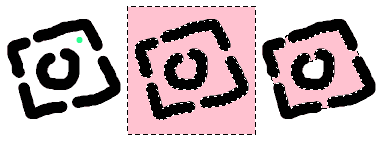

# 连续选区：按颜色精确选择局部区域

> **内容边界**：下方“授权原文”是官方主内容的 Markdown 转换；中文操作路线、练习与验收由整理者编写，不是作者逐句翻译，也不代表已在本机运行软件验证。

## 中文任务导读

通过连续颜色范围建立局部选区，用于修边、重着色和检查封闭区域。

**前提**：能够新建、保存和打开 Krita 文档；先确定目标像素尺寸、色板与透明度要求。

### 操作路线

1. 点击目标区域，先用较保守阈值查看选择范围。
2. 使用增加、减去或相交模式处理多个局部，避免每次点击替换已选区域。
3. 检查 Reference 设置与 Grow Selection，决定边界来自哪个图层以及是否扩张。
4. 完成操作前检查羽化、抗锯齿与 Close Gap，避免跨越细杆或真正的开口。

### 配图怎么读

原图、未闭合缝隙时的选区和闭合缝隙后的选区并排出现；粉色用于突出选择范围，不是作品最终颜色。 图内界面与作品保留原貌；示例转用于像素素材时仍按本篇验收条件检查。

### 练习与验收（整理者补充）

选择树冠中同一连续色块并改色，同时保留树叶间透明空隙；与全图同色选择进行对比。

- [ ] 没有选到不连通的背景区域。
- [ ] 选区边缘与需要修整的像素一致。
- [ ] 选择模式与阈值已记录。

### 版本与适用边界

Close Gap 属于 5.3 功能，Spread 在 5.1 加入；不同版本的工具选项需先核对。

抓取时页面标题标注 **Krita Manual 5.3.0**；这是文档快照版本，不构成已发布软件版本或本机功能的验证。原文中保留的 `Added/Changed/Deprecated in version` 是兼容性依据。

## 来源、许可与修改记录

- 原文：[Contiguous Selection Tool](https://docs.krita.org/en/reference_manual/tools/contiguous_select.html)
- 作者：Wolthera van Hövell tot Westerflier；Scott Petrovic
- 页内作者与许可原始声明：[RST 源文件](../../sources/asset-production/MAKE-021/original.rst)；[线上原始声明](https://docs.krita.org/en/_sources/reference_manual/tools/contiguous_select.rst.txt)。
- 许可：[GNU Free Documentation License 1.3 or later](https://www.gnu.org/licenses/fdl-1.3.html)；[本地许可证全文](../../licenses/krita-GFDL-1.3.txt)。各图若有独立作者或许可，沿用原文紧邻图像的署名，不把作品许可自动泛化为文档许可。
- 修改历史：2026-10-29，Codex 为本教程库新增中文导读、练习和验收；将官方 HTML 主内容转换为 Markdown，去除导航与页脚，将控制图标转为文字、将教学图像存为本地文件。正文、步骤、代码、表格与图像说明保留。
- 本修改版沿用 GFDL 1.3 或更新版本。保留作者声明和上游链接；未添加 Invariant Sections、Front-Cover Texts 或 Back-Cover Texts。外链视频、安装包和关联页面没有自动下载或转录。

## 授权原文（英语，完整主内容转换）

## Contiguous Selection Tool

[toolselectcontiguous]

This tool, represented by a magic wand, allows you to make [Selections](https://docs.krita.org/en/user_manual/selections.html#selections-basics) by selecting a point of color. It will select any contiguous areas of a similar color to the one you selected. You can adjust the “fuzziness” of the tool in the tool options dock. A lower number will select colors closer to the color that you chose in the first place.

### Hotkeys and Sticky keys

- `Shift +` [left mouse button] sets the subsequent selection to ‘add’. You can release the `Shift` key while dragging, but it will still be set to ‘add’. Same for the others.
- `Alt +` [left mouse button] sets the subsequent selection to ‘subtract’.
- `Ctrl +` [left mouse button] sets the subsequent selection to ‘replace’.
- `Shift + Alt +` [left mouse button] sets the subsequent selection to ‘intersect’.

Added in version 4.2:

- Hovering over a selection allows you to move it.
- [right mouse button] will open up a selection quick menu with amongst others the ability to edit the selection.

Note

You can switch the behavior of the `Alt` key to use the `Ctrl` key instead by toggling the switch in the [General Settings](https://docs.krita.org/en/reference_manual/preferences/general_settings.html#general-settings).

### Tool Options

Selection Extent
:   Threshold
    :   This controls whether or not the contiguous selection sees another color as a border.

    Spread
    :   Added in version 5.1.

        Set how far the fully opaque portion of the selection should extend. See [Fill Tool](https://docs.krita.org/en/reference_manual/tools/fill.html#fill-tool) for extra explanation.

    Close Gap
    :   Added in version 5.3.

        This option sets the minimum gap size that the contiguous fill will be able to propagate into.

        
        

        Left: The original image (black over white) and a green dot marking where the contiguous selection will be initiated. Center: The selection marquee after a selection operation using a gap size of 0 pixels. Right: The selection marquee after a selection operation using a gap size of 8 pixels. Note that the selected regions are emphasized with a light pink color for clarity sake.

Adjustments
:   Anti-alias
    :   This will smooth the jagged edges present in the selection. It differs from feathering in that this will smooth in the direction of the edge instead of all directions, and only if the edge is jagged (high contrast).

    Grow Selection
    :   This value extends (positive values) or contracts (negative values) the selection.

    Feathering Radius
    :   This value will add a soft border to the selection.

Reference
:   Added in version 4.3.

    Select which layers to use as a reference for the contiguous select tool. The options are:

    Current Layer
    :   Only use the currently selected layer.

    All layers
    :   Use all visible layers.

    Color Labeled Layers
    :   Use only the layers specified with a certain color label. This is useful for complex images, where you might have multiple lineart layers. Label them with the appropriate color label and use these labels to mark which layers to use as a reference.

        Labels Used
        :   Select the color labels of the layers that should be used as reference.

## 本地配图清单

| 图 | 本地文件 | 原始来源 |
|---|---|---|
| 1 | [Figure 1: Left: The original image (black over white) and a green dot marking where the contiguous selection will be initiated. Center: The selection marquee after a selection operation using a gap size of 0 pixels. Right: The selection marquee after a selection operation using a gap size of 8 pixels. Note that the selected regions are emphasized with a light pink color for clarity sake. ¶](../../assets/asset-production/MAKE-021/contiguous_selection_close_gap.gif) | [原图](https://docs.krita.org/en/_images/contiguous_selection_close_gap.gif) |
