# 着色遮罩：从颜色提示生成可编辑底色

> **内容边界**：下方“授权原文”是官方主内容的 Markdown 转换；中文操作路线、练习与验收由整理者编写，不是作者逐句翻译，也不代表已在本机运行软件验证。

## 中文任务导读

理解按颜色提示填色的流程和限制，适合概念或底色阶段的快速试色。

**前提**：能够新建、保存和打开 Krita 文档；先确定目标像素尺寸、色板与透明度要求。

### 操作路线

1. 选择独立线稿层，添加 Colorize Mask 并用少量笔画标记各区域颜色。
2. 为背景指定透明提示色，再点击 Update 查看填色结果。
3. 按需要调整边缘检测、缝隙处理和清理参数，检查算法误连通之处。
4. 确认颜色布局后保留原遮罩，另存或转换副本做逐像素修整。

### 配图怎么读

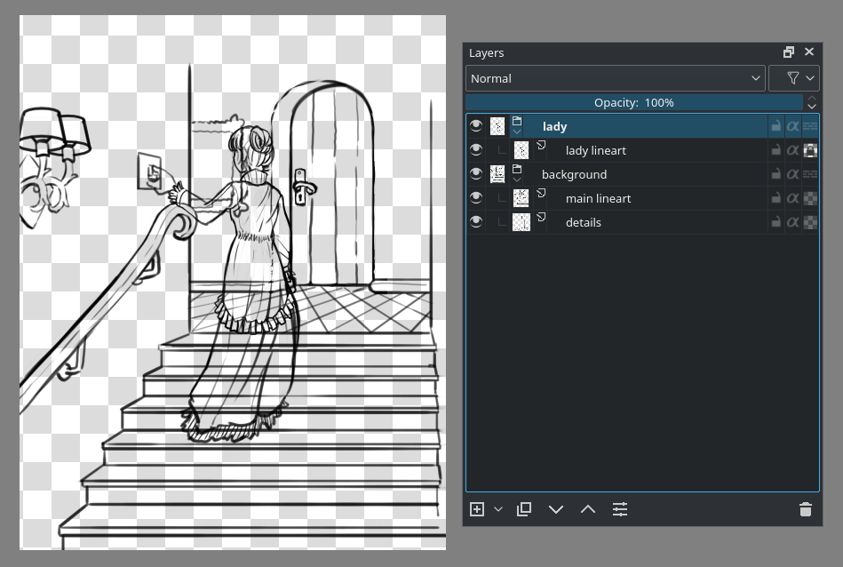

图层面板中独立的线稿是着色遮罩的输入；后续截图依次展示提示色、透明色与更新结果，避免把提示笔画当输出。 图内界面与作品保留原貌；示例转用于像素素材时仍按本篇验收条件检查。

### 练习与验收（整理者补充）

为一个简单农具线稿标注三种颜色和透明背景，比较更新前的提示笔画与最终输出。

- [ ] 透明提示没有变成实际背景色。
- [ ] 颜色边界没有越过细线。
- [ ] 输出前已人工检查像素轮廓。

### 版本与适用边界

原文开头保留 3.1 实验开关的历史说明；4.0 起已正式提供，不要在新版本照抄旧配置步骤。

抓取时页面标题标注 **Krita Manual 5.3.0**；这是文档快照版本，不构成已发布软件版本或本机功能的验证。原文中保留的 `Added/Changed/Deprecated in version` 是兼容性依据。

## 来源、许可与修改记录

- 原文：[Colorize Mask](https://docs.krita.org/en/reference_manual/tools/colorize_mask.html)
- 作者：Wolthera van Hövell tot Westerflier；Scott Petrovic
- 页内作者与许可原始声明：[RST 源文件](../../sources/asset-production/MAKE-022/original.rst)；[线上原始声明](https://docs.krita.org/en/_sources/reference_manual/tools/colorize_mask.rst.txt)。
- 许可：[GNU Free Documentation License 1.3 or later](https://www.gnu.org/licenses/fdl-1.3.html)；[本地许可证全文](../../licenses/krita-GFDL-1.3.txt)。各图若有独立作者或许可，沿用原文紧邻图像的署名，不把作品许可自动泛化为文档许可。
- 修改历史：2026-10-29，Codex 为本教程库新增中文导读、练习和验收；将官方 HTML 主内容转换为 Markdown，去除导航与页脚，将控制图标转为文字、将教学图像存为本地文件。正文、步骤、代码、表格与图像说明保留。
- 本修改版沿用 GFDL 1.3 或更新版本。保留作者声明和上游链接；未添加 Invariant Sections、Front-Cover Texts 或 Back-Cover Texts。外链视频、安装包和关联页面没有自动下载或转录。

## 授权原文（英语，完整主内容转换）

## Colorize Mask

[toolcolorizemask]

A tool for quickly coloring line art, the Colorize Mask Editing tool can be found next to the gradient tool on your toolbox.

This feature is technically already in 3.1, but disabled by default because we had not optimized the filling algorithm for production use yet. To enable it, find your krita configuration file, open it in notepad, and add “disableColorizeMaskFeature=false” to the top. Then restart Krita. Its official incarnation is in 4.0.

### Usage

This tool works in conjunction with the colorize mask, and the usage is as follows:

For this example, we’ll be using the ghost lady also used to explain masks on [the basic concepts page](https://docs.krita.org/en/user_manual/getting_started/basic_concepts.html#basic-concepts).

This image has the line art for the lady separated from the background, and what’s more, the background is made up of two layers: one main and one for the details.

First, select the colorize mask editing tool while having the line art layer selected. [left mouse button] the canvas will add a colorize mask to the layer.
You can also [right mouse button] the line art layer, and then Add ‣ Colorize Mask. The line art will suddenly become really weird, this is the prefiltering which are filters through which we put the line art to make the algorithm easier to use. The tool options overview below shows which options control that.

[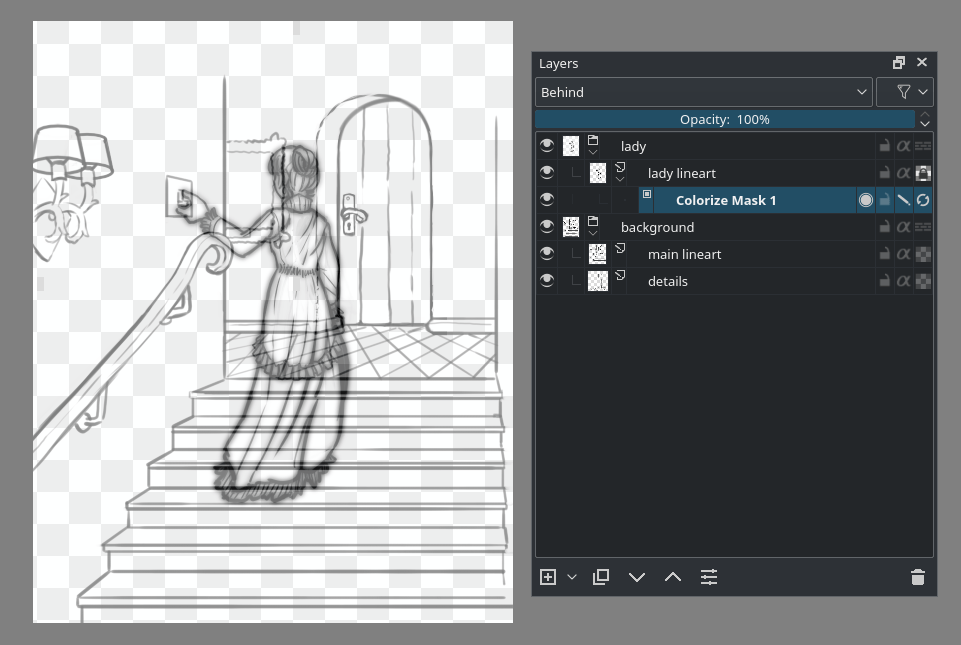](../../assets/asset-production/MAKE-022/Krita_4_0_colorize_mask_usage_02.png)

Now, you make strokes with brush colors, press Update in the tool options, or tick the last icon of the colorize mask properties. In the layer docker, you will be able to see a little progress bar appear on the colorize mask indicating how long it takes. The bigger your file, the longer it will take.

[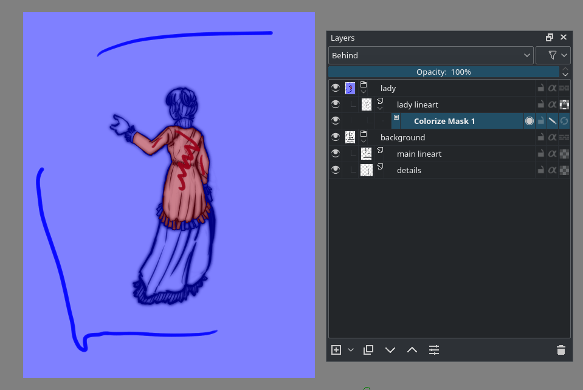](../../assets/asset-production/MAKE-022/Krita_4_0_colorize_mask_usage_03.png)

We want to have the blue transparent. In the tool options of the colorize editing tool you will see a small palette. These are the colors already used. You can remove colors here, or mark a single color as standing for transparent, by selecting it and pressing “transparent”. Updating the mask will still show the blue stroke, but the result will be transparent:

[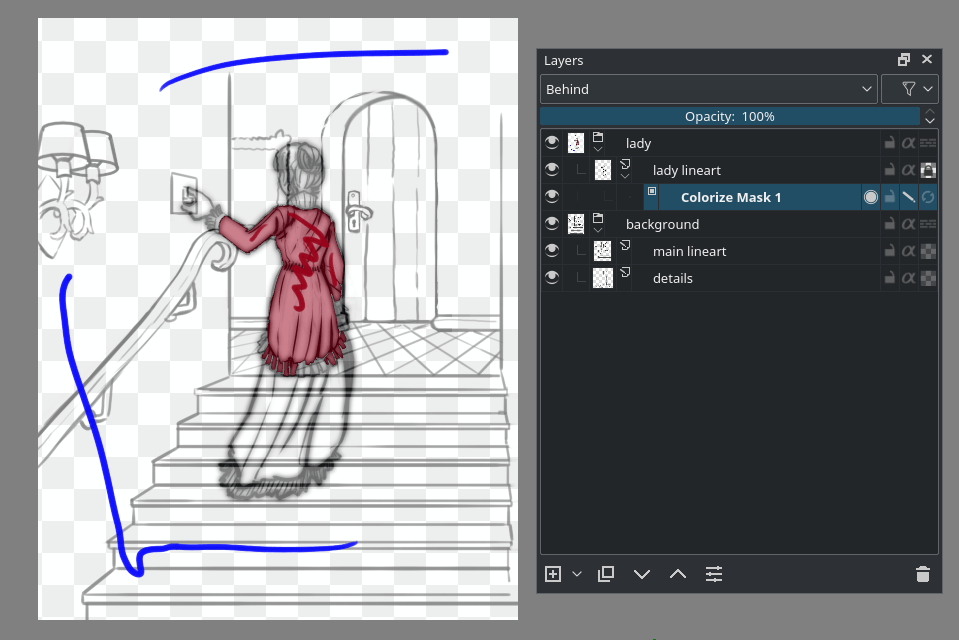](../../assets/asset-production/MAKE-022/Krita_4_0_colorize_mask_usage_04.png)

Because the colorize mask algorithm is slow, and we only need a part of our layer to be filled to fill the whole ghost lady figure, we can make use of Limit to layer bounds. This will limit Colorize Mask to use the combined size of the line art and the coloring key strokes. Therefore, make sure that the colorizing keystrokes only take up as much as they really need.

[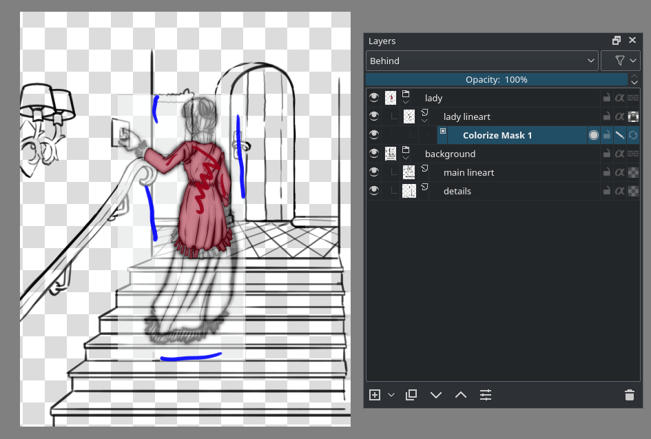](../../assets/asset-production/MAKE-022/Krita_4_0_colorize_mask_usage_05.png)

Now the algorithm will be possibly a lot faster, allowing us to add strokes and press Update in rapid succession:

[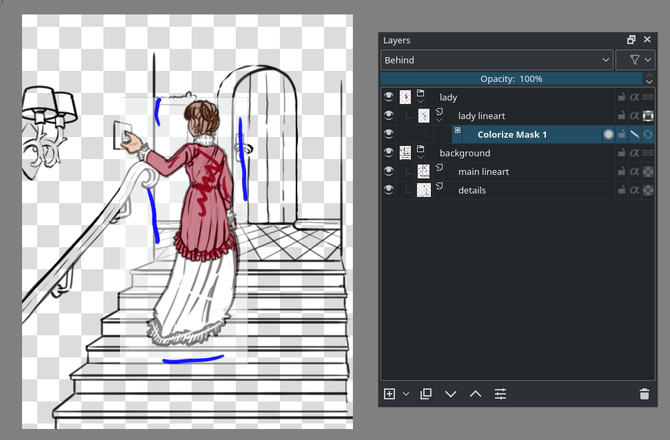](../../assets/asset-production/MAKE-022/Krita_4_0_colorize_mask_usage_06.png)

To see the final result, disable Edit Key Strokes or toggle the second to last icon on the colorize mask.

[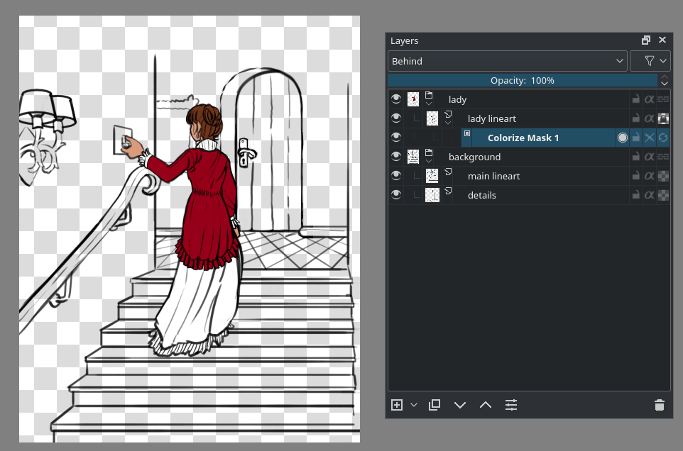](../../assets/asset-production/MAKE-022/Krita_4_0_colorize_mask_usage_07.png)

If you want to edit the strokes again, re-enable Edit Key Strokes.

Now, the colorize mask, being a mask, can also be added to a group of line art layers. It will then use the composition of the whole group as the line art. This is perfect for our background which has two separate line art layers. It also means that the colorize mask will be disabled when added to a group with pass-through enabled, because those have no final composition. You can recognize a disabled colorize mask because its name is stricken through.

To add a colorize mask to a group, select the group and [left mouse button] the canvas with the Colorize Mask editing tool, or [right mouse button] the layer to Add ‣ Colorize Mask.

[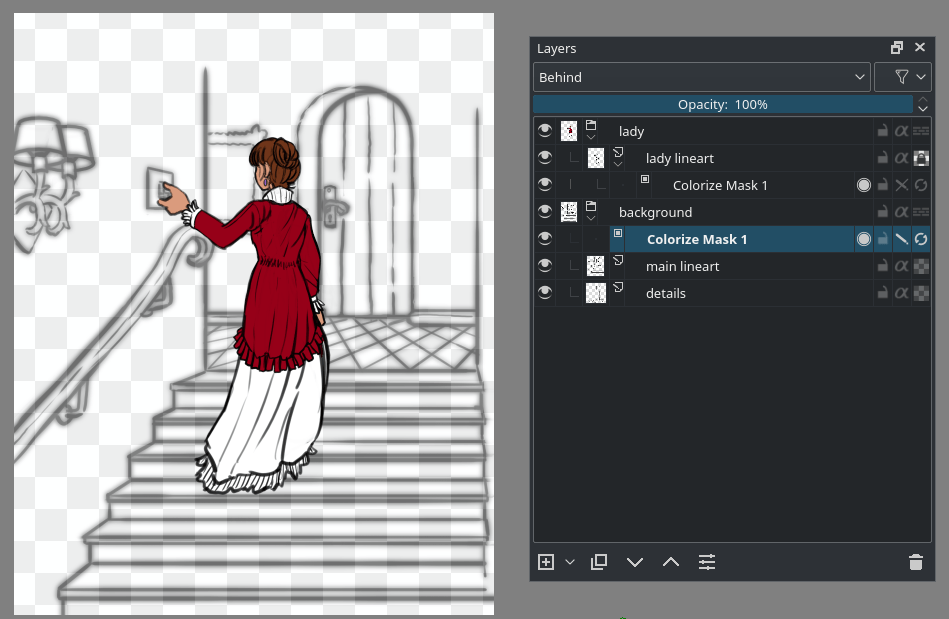](../../assets/asset-production/MAKE-022/Krita_4_0_colorize_mask_usage_08.png)

Now, we add strokes to the background quickly. We do not need to use the Limit to Layer Bounds because the background covers the whole image.

[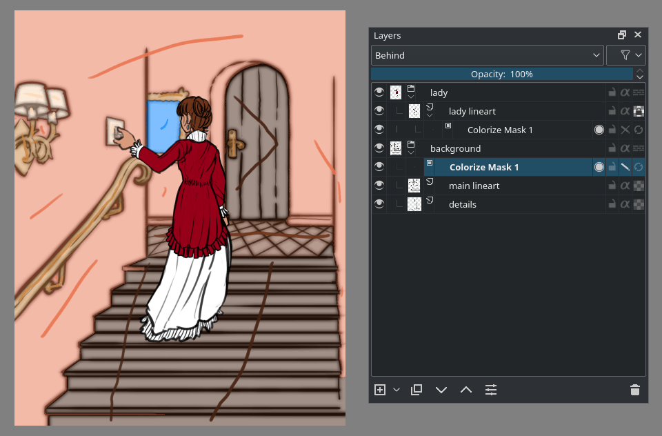](../../assets/asset-production/MAKE-022/Krita_4_0_colorize_mask_usage_09.png)

For the record, you can use other brushes and tools also work on the colorize mask as long as they can draw. The Colorize Mask Editing tool is just the most convenient because you can get to the algorithm options.

Out final result looks like this:

[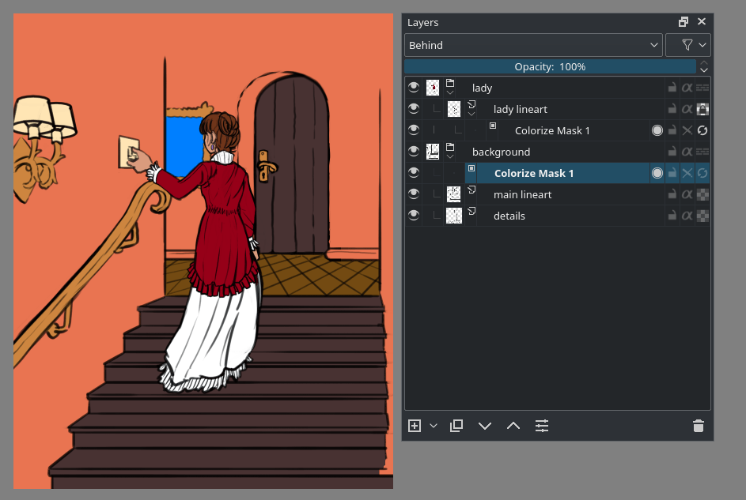](../../assets/asset-production/MAKE-022/Krita_4_0_colorize_mask_usage_10.png)

Now we are done, [right mouse button] the colorize mask and Convert ‣ to Paint Layer. Then, Layer ‣ Split ‣ Split Layer. This will give separate color islands that you can easily edit:

[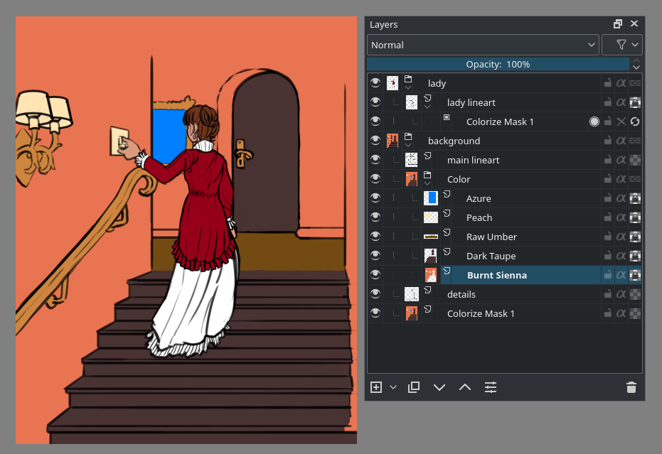](../../assets/asset-production/MAKE-022/Krita_4_0_colorize_mask_usage_11.png)

This way we can very quickly paint the image. Due to the colorize mask going from the first image to the following took only 30 minutes, and would’ve taken quite a bit longer.

[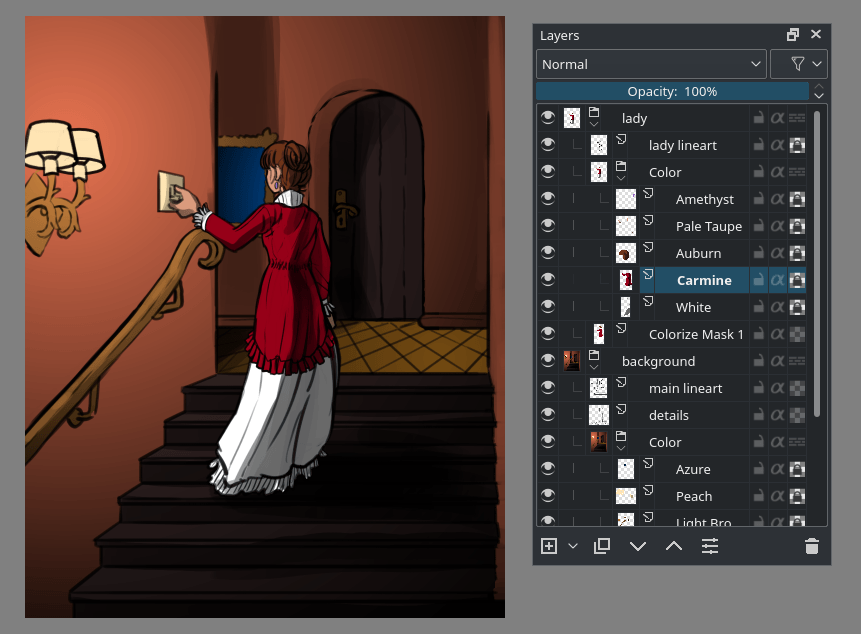](../../assets/asset-production/MAKE-022/Krita_4_0_colorize_mask_usage_12.png)

The colorize masks are saved to the `.kra` file, so as long as you don’t save and open to a different file format, nor convert the colorize mask to a paintlayer, you can keep working adjust the results.

### Tool Options

Update
:   Run the colorize mask algorithm. The progress bar for updates on a colorize mask shows only in the layer docker.

Edit key strokes
:   Put the mask into edit mode. In edit mode, it will also show the ‘prefiltering’ on the line art, which is for example a blur filter for gap closing.

Show output
:   Show the output of the colorize mask. If Edit key strokes is active, this will be shown semi-transparently, so it will be easy to recognize the difference between the strokes and the output.

    
    [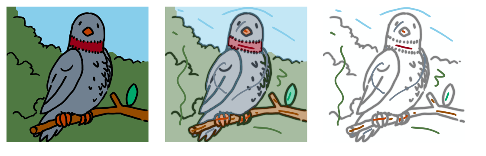](../../assets/asset-production/MAKE-022/Krita_4_0_colorize_mask_show_output_edit_strokes.png)

    On the **Left**: Show Output is on, Edit Key Strokes is off. In the **Middle**: Show Output and Edit Key Strokes are on. On the **Right**: Show Output is off and Edit Key Strokes is on.

Limit to layer bounds
:   Limit the colorize mask to the combined layer bounds of the strokes and the line art it is filling. This can speed up the use of the mask on complicated compositions, such as comic pages.

Edge detection
:   Activate this for line art with large solid areas, for example shadows on an object. For the best use, set the value to the thinnest lines on the image. In the image below, note how edge detection affects the big black areas:

    
    

    From left to right: an example with big black shadows on an object but no edge detection, the same example without the edit key strokes enabled. Then the same example with edge detection enabled and set to 2px, and that same example without edit key strokes enabled.

Gap close hint
:   While the algorithm is pretty good against gaps in contours, this will improve the gap recognition. The higher this value is, the bigger the gaps it will try to close, but a too high value can lead to other errors. Note how the prefiltered line art (that’s the blurry haze) affects the color patches.

    
    [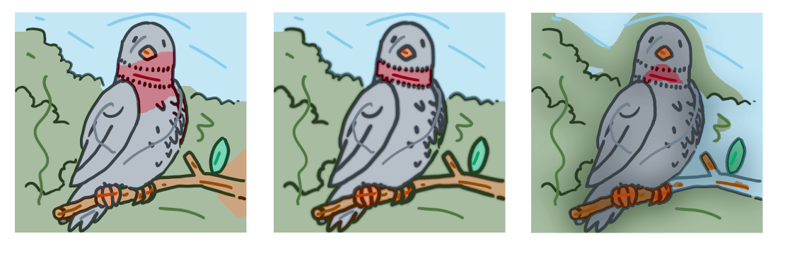](../../assets/asset-production/MAKE-022/Krita_4_0_colorize_mask_gap_close_hint.png)

    On the **Left**: Gap close hint is 0px. In the **Middle**: Gap close hint is 15px (the lines are 10px). On the **Right**: Gap close hint is 275px.

Clean up
:   This will attempt to handle messy strokes that overlap the line art where they shouldn’t. At 0 no clean up is done, at 100% the clean-up is most aggressive.

    [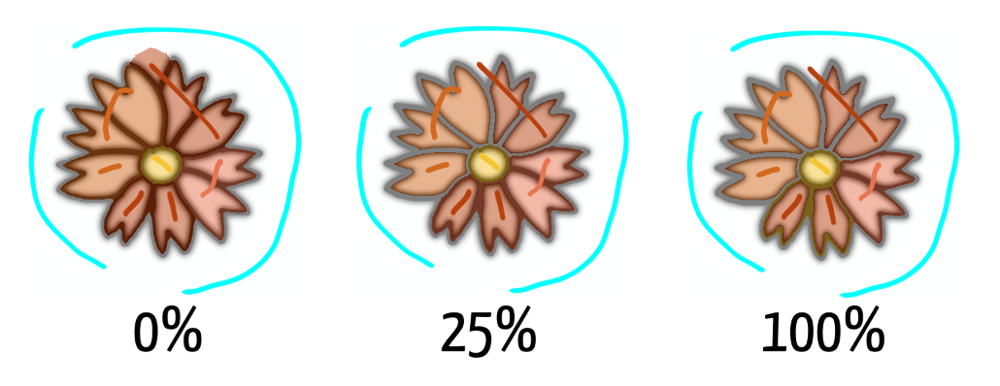](../../assets/asset-production/MAKE-022/Krita_4_0_colorize_mask_clean_up.png)

Key strokes
:   This palette keeps track of the colors used by the strokes. This is useful so you can switch back to colors easily. You can increase the swatch size by hovering over it with the mouse, and doing `Ctrl +` [mouse wheel] .

Transparent
:   This button is under the keystrokes palette, you can mark the selected color to be interpreted a ‘transparent’ with this. In the clean-up screenshot above, cyan had been marked as transparent.

### Layer properties

The colorize mask layer has four properties. They are all the buttons on the right side of the colorize mask layer:

Show output
:   [show-output] The show output icon allows you to toggle whether you’ll see the output from the colorize algorithm.

Lock
:   [lock-icon] This icon stops the mask from being edited.

Edit key strokes
:   [edit-strokes] This icon shows whether the colorize mask is in edit mode. In edit mode it’ll show the strokes, and the output will be semi-transparent.

Update
:   [update-icon] This icon will force the colorize mask to update, even when you’re in a different tool.

Note

Colorize masks cannot be animated.

## 本地配图清单

| 图 | 本地文件 | 原始来源 |
|---|---|---|
| 1 | [Figure 1: Krita 4 0 colorize mask usage 01](../../assets/asset-production/MAKE-022/Krita_4_0_colorize_mask_usage_01.png) | [原图](https://docs.krita.org/en/_images/Krita_4_0_colorize_mask_usage_01.png) |
| 2 | [Figure 2: Krita 4 0 colorize mask usage 02](../../assets/asset-production/MAKE-022/Krita_4_0_colorize_mask_usage_02.png) | [原图](https://docs.krita.org/en/_images/Krita_4_0_colorize_mask_usage_02.png) |
| 3 | [Figure 3: Krita 4 0 colorize mask usage 03](../../assets/asset-production/MAKE-022/Krita_4_0_colorize_mask_usage_03.png) | [原图](https://docs.krita.org/en/_images/Krita_4_0_colorize_mask_usage_03.png) |
| 4 | [Figure 4: Krita 4 0 colorize mask usage 04](../../assets/asset-production/MAKE-022/Krita_4_0_colorize_mask_usage_04.png) | [原图](https://docs.krita.org/en/_images/Krita_4_0_colorize_mask_usage_04.png) |
| 5 | [Figure 5: Krita 4 0 colorize mask usage 05](../../assets/asset-production/MAKE-022/Krita_4_0_colorize_mask_usage_05.png) | [原图](https://docs.krita.org/en/_images/Krita_4_0_colorize_mask_usage_05.png) |
| 6 | [Figure 6: Krita 4 0 colorize mask usage 06](../../assets/asset-production/MAKE-022/Krita_4_0_colorize_mask_usage_06.png) | [原图](https://docs.krita.org/en/_images/Krita_4_0_colorize_mask_usage_06.png) |
| 7 | [Figure 7: Krita 4 0 colorize mask usage 07](../../assets/asset-production/MAKE-022/Krita_4_0_colorize_mask_usage_07.png) | [原图](https://docs.krita.org/en/_images/Krita_4_0_colorize_mask_usage_07.png) |
| 8 | [Figure 8: Krita 4 0 colorize mask usage 08](../../assets/asset-production/MAKE-022/Krita_4_0_colorize_mask_usage_08.png) | [原图](https://docs.krita.org/en/_images/Krita_4_0_colorize_mask_usage_08.png) |
| 9 | [Figure 9: Krita 4 0 colorize mask usage 09](../../assets/asset-production/MAKE-022/Krita_4_0_colorize_mask_usage_09.png) | [原图](https://docs.krita.org/en/_images/Krita_4_0_colorize_mask_usage_09.png) |
| 10 | [Figure 10: Krita 4 0 colorize mask usage 10](../../assets/asset-production/MAKE-022/Krita_4_0_colorize_mask_usage_10.png) | [原图](https://docs.krita.org/en/_images/Krita_4_0_colorize_mask_usage_10.png) |
| 11 | [Figure 11: Krita 4 0 colorize mask usage 11](../../assets/asset-production/MAKE-022/Krita_4_0_colorize_mask_usage_11.png) | [原图](https://docs.krita.org/en/_images/Krita_4_0_colorize_mask_usage_11.png) |
| 12 | [Figure 12: Krita 4 0 colorize mask usage 12](../../assets/asset-production/MAKE-022/Krita_4_0_colorize_mask_usage_12.png) | [原图](https://docs.krita.org/en/_images/Krita_4_0_colorize_mask_usage_12.png) |
| 13 | [Figure 13: On the Left : Show Output is on, Edit Key Strokes is off. In the Middle : Show Output and Edit Key Strokes are on. On the Right : Show Output is off and Edit Key Strokes is on. ¶](../../assets/asset-production/MAKE-022/Krita_4_0_colorize_mask_show_output_edit_strokes.png) | [原图](https://docs.krita.org/en/_images/Krita_4_0_colorize_mask_show_output_edit_strokes.png) |
| 14 | [Figure 14: From left to right: an example with big black shadows on an object but no edge detection, the same example without the edit key strokes enabled. Then the same example with edge detection enabled and set to 2px, and that same example without edit key strokes enabled. ¶](../../assets/asset-production/MAKE-022/Krita_4_0_colorize_mask_edge_detection.png) | [原图](https://docs.krita.org/en/_images/Krita_4_0_colorize_mask_edge_detection.png) |
| 15 | [Figure 15: On the Left : Gap close hint is 0px. In the Middle : Gap close hint is 15px (the lines are 10px). On the Right : Gap close hint is 275px. ¶](../../assets/asset-production/MAKE-022/Krita_4_0_colorize_mask_gap_close_hint.png) | [原图](https://docs.krita.org/en/_images/Krita_4_0_colorize_mask_gap_close_hint.png) |
| 16 | [Figure 16: Krita 4 0 colorize mask clean up](../../assets/asset-production/MAKE-022/Krita_4_0_colorize_mask_clean_up.png) | [原图](https://docs.krita.org/en/_images/Krita_4_0_colorize_mask_clean_up.png) |
