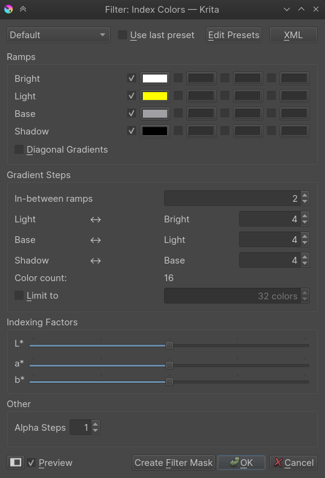
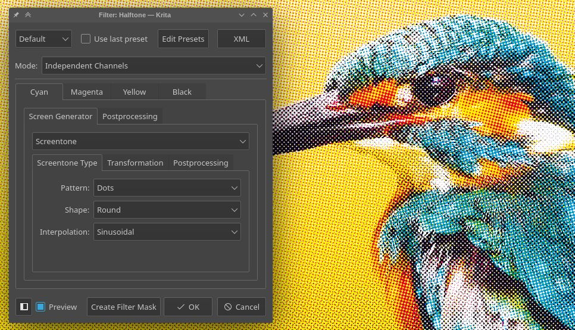
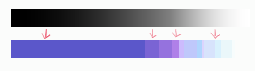
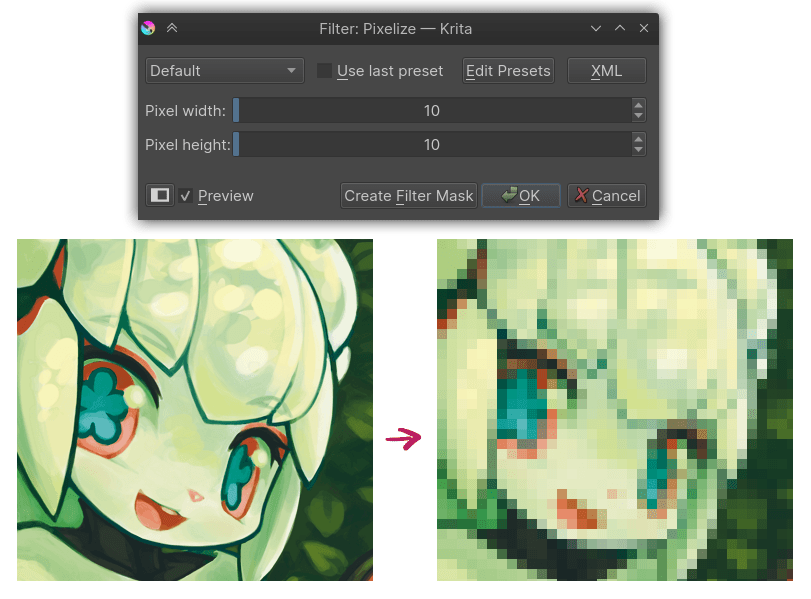
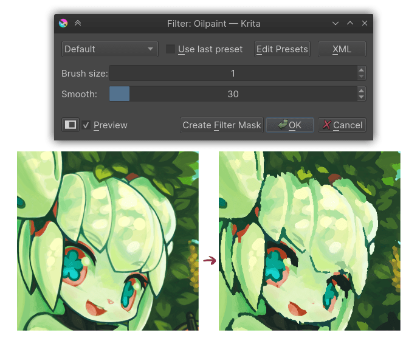
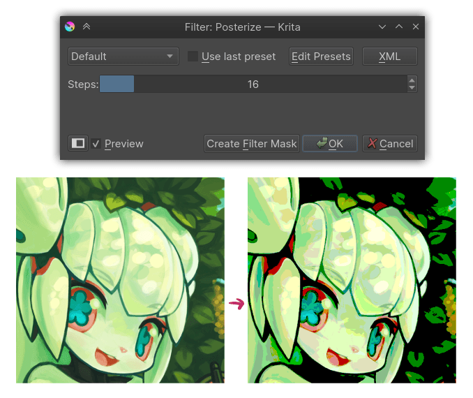

# 索引色、像素化与色阶压缩的区别

> **内容边界**：下方“授权原文”是官方主内容的 Markdown 转换；中文操作路线、练习与验收由整理者编写，不是作者逐句翻译，也不代表已在本机运行软件验证。

## 中文任务导读

区分颜色映射、降低空间细节和减少色阶，避免把滤镜效果误当完整像素画制作。

**前提**：能够新建、保存和打开 Krita 文档；先确定目标像素尺寸、色板与透明度要求。

### 操作路线

1. 先复制原稿，对同一小区域分别测试 Index Color、Pixelize 和 Posterize。
2. 在 Index Color 中指定颜色与明度映射，观察灰阶转色板后的信息保留。
3. 使用 Pixelize 时明确区块尺寸；随后对照目标像素网格检查细节与轮廓。
4. 根据结果选择辅助步骤，并在输出前重整必要的边缘、色簇与透明孔洞。

### 配图怎么读

索引色设置图把选定颜色对应到亮暗范围；它主要重新分配颜色，并不会自动修复不合适的轮廓或透视。 图内界面与作品保留原貌；示例转用于像素素材时仍按本篇验收条件检查。

### 练习与验收（整理者补充）

对同一块岩石草稿做三种滤镜对照，列出颜色、轮廓和纹理分别发生什么变化。

- [ ] 能够分辨三种处理影响的对象。
- [ ] 目标颜色数量和网格大小有明确记录。
- [ ] 没有用“已像素化”代替视觉质量验收。

### 版本与适用边界

本篇保留全部 Artistic 滤镜参考；与严格像素制作直接相关的是 Index Color、Pixelize 和 Posterize 段落。

抓取时页面标题标注 **Krita Manual 5.3.0**；这是文档快照版本，不构成已发布软件版本或本机功能的验证。原文中保留的 `Added/Changed/Deprecated in version` 是兼容性依据。

## 来源、许可与修改记录

- 原文：[Artistic](https://docs.krita.org/en/reference_manual/filters/artistic.html)
- 作者：Wolthera van Hövell tot Westerflier；Raghavendra Kamath
- 页内作者与许可原始声明：[RST 源文件](../../sources/asset-production/MAKE-023/original.rst)；[线上原始声明](https://docs.krita.org/en/_sources/reference_manual/filters/artistic.rst.txt)。
- 许可：[GNU Free Documentation License 1.3 or later](https://www.gnu.org/licenses/fdl-1.3.html)；[本地许可证全文](../../licenses/krita-GFDL-1.3.txt)。各图若有独立作者或许可，沿用原文紧邻图像的署名，不把作品许可自动泛化为文档许可。
- 修改历史：2026-10-29，Codex 为本教程库新增中文导读、练习和验收；将官方 HTML 主内容转换为 Markdown，去除导航与页脚，将控制图标转为文字、将教学图像存为本地文件。正文、步骤、代码、表格与图像说明保留。
- 本修改版沿用 GFDL 1.3 或更新版本。保留作者声明和上游链接；未添加 Invariant Sections、Front-Cover Texts 或 Back-Cover Texts。外链视频、安装包和关联页面没有自动下载或转录。

## 授权原文（英语，完整主内容转换）

## Artistic

The artistic filter are characterised by taking an input, and doing a deformation on them.

### Halftone

The [halftone](https://en.wikipedia.org/wiki/Halftone) filter tries to replicate the continuous-tone of the original image through the use of simple shapes that vary in size.

Mode
:   Intensity
    :   In this mode the image is first converted to grayscale and then the halftoning is applied. The resulting effect is like the one used in black and white newspaper images.

    Independent Channels
    :   This allows applying the halftoning to each channel of the image independently, potentially with different parameters, giving an effect similar to the one in colored magazine images.

    Alpha
    :   With this option the halftoning is applied only to the alpha channel (you may see no change when all the pixels of the image are fully opaque). This is useful to add texture to the smooth semi-transparent borders of a layer.

Halftoning Options
:   When the selected mode is *Independent Channels*, multiple tabs for the different channels appear to let the user choose different options for each one; otherwise no tabs for the channels appear and there is only one set of options.
    The halftoning process works by making a pattern image (commonly named *screen*) that is combined with the original image in a specific way.

    Screen Generator
    :   The filter uses the *fill layer generators* to create the screen (pattern) image instead of using a predefined set of patterns and options. This way the range of possible results can grow as new generators are added to Krita. Also the user can make his own patterns by using the pattern generator and custom pattern images. For more information see [this page on fill layer generators and their options](https://docs.krita.org/en/reference_manual/layers_and_masks/fill_layers.html#fill-layers).

    Postprocessing
    :   These options apply to the result of combining the screen image with the original image.

        Hardness
        :   Controls how hard or soft are the borders of the halftone shapes.

        Invert
        :   Invert the resulting image/channel.

        Foreground & Background
        :   Change what color and opacity are used for the foreground (part of the image formed by the pattern shapes) and the background.

### Index Color

The index color filter maps specific user selected colors to the grayscale value of the artwork. You can see the example below, the strip below the black and white gradient has index color applied to it so that the black and white gradient gets the color selected to different values.

You can choose the required colors and ramps in the index color filter dialog as shown below .

You can create index painting such as one shown below with the help of this filter.

### Pixelize

Makes the input-image pixely by creating small cells and inputting an average color.

### Raindrops

Adds random raindrop-deformations to the input-image.

### Oilpaint

Does semi-posterisation to the input-image, with the ‘brush-size’ determining the size of the fields.

Brush-size
:   Determines how large the individual patches are. The lower, the more detailed.

Smoothness
:   Determines how much each patch’s outline is smoothed out.

### Posterize

This filter decreases the amount of colors in an image. It does this per component (channel).

The Steps parameter determines how many colors are allowed per component.

## 本地配图清单

| 图 | 本地文件 | 原始来源 |
|---|---|---|
| 1 | [Figure 1: Krita halftone filter](../../assets/asset-production/MAKE-023/Krita_halftone_filter.jpg) | [原图](https://docs.krita.org/en/_images/Krita_halftone_filter.jpg) |
| 2 | [Figure 2: Gradient pixelart](../../assets/asset-production/MAKE-023/Gradient-pixelart.png) | [原图](https://docs.krita.org/en/_images/Gradient-pixelart.png) |
| 3 | [Figure 3: Index color filter](../../assets/asset-production/MAKE-023/Index-color-filter.png) | [原图](https://docs.krita.org/en/_images/Index-color-filter.png) |
| 4 | [Figure 4: Kiki pixel art](../../assets/asset-production/MAKE-023/Kiki-pixel-art.png) | [原图](https://docs.krita.org/en/_images/Kiki-pixel-art.png) |
| 5 | [Figure 5: Pixelize filter](../../assets/asset-production/MAKE-023/Pixelize-filter.png) | [原图](https://docs.krita.org/en/_images/Pixelize-filter.png) |
| 6 | [Figure 6: Oilpaint filter](../../assets/asset-production/MAKE-023/Oilpaint-filter.png) | [原图](https://docs.krita.org/en/_images/Oilpaint-filter.png) |
| 7 | [Figure 7: Posterize filter](../../assets/asset-production/MAKE-023/Posterize-filter.png) | [原图](https://docs.krita.org/en/_images/Posterize-filter.png) |
