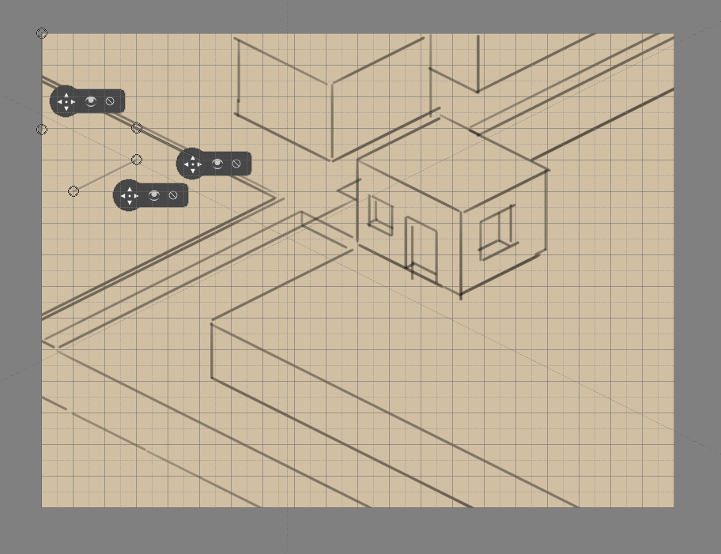
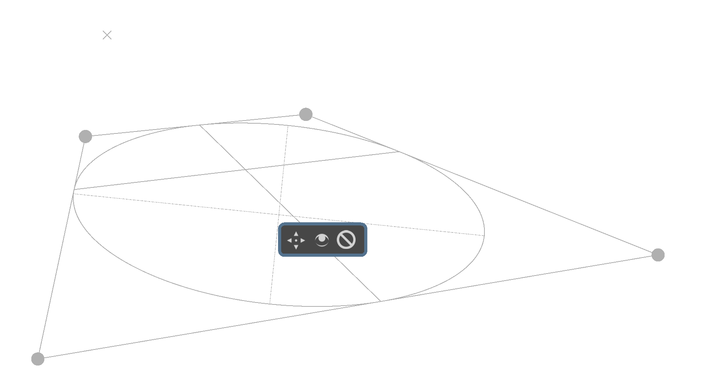
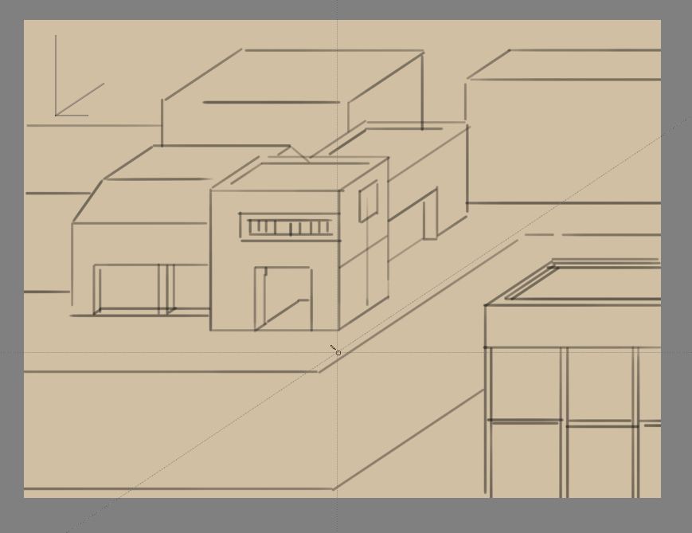
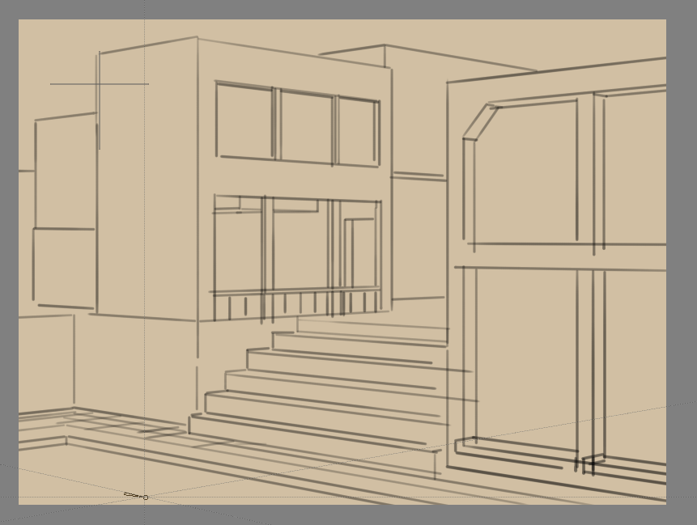
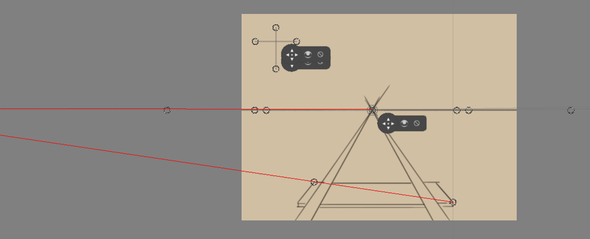
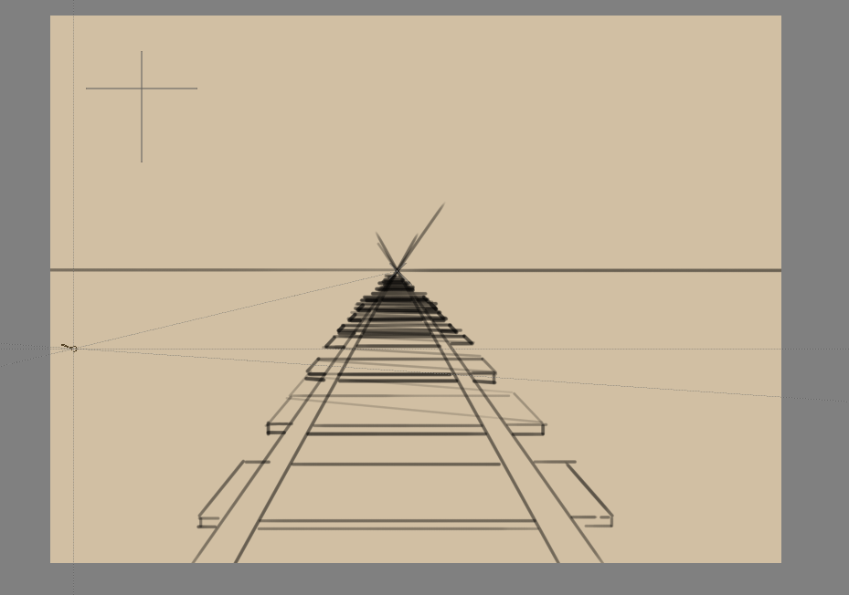
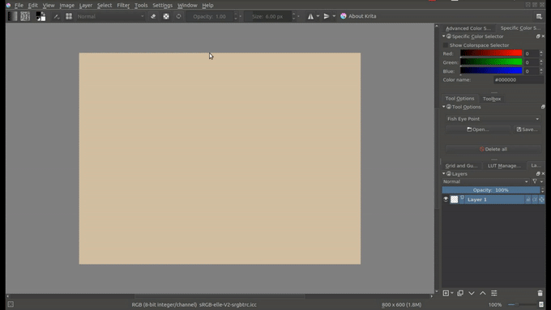

# 透视辅助工具：为建筑和道具建立一致的空间关系

> **内容边界**：下方“授权原文”是官方主内容的 Markdown 转换；中文操作路线、练习与验收由整理者编写，不是作者逐句翻译，也不代表已在本机运行软件验证。

## 中文任务导读

认识平行投影与消失点透视的差别，先选择与游戏视角相符的结构，再用辅助线组织建筑。

**前提**：能够新建、保存和打开 Krita 文档；先确定目标像素尺寸、色板与透明度要求。

### 操作路线

1. 先在项目规范里确定俯视正交、斜投影、等距还是消失点透视；不要把不同透视混入同一组素材。
2. 按目标选择尺、平行尺或透视辅助工具，设置基线、方向和必要的消失点。
3. 启用画笔对辅助工具的吸附，用简单箱体验证墙面、屋顶与门窗方向。
4. 空间结构确定后缩回目标像素尺寸，人工整理斜线节奏和轮廓，不让辅助曲线代替像素精修。

### 配图怎么读

平行投影示意中的各组边保持各自方向；与后文一点、两点透视的汇聚线比较，先确定项目到底使用哪种投影。 图内界面与作品保留原貌；示例转用于像素素材时仍按本篇验收条件检查。

### 练习与验收（整理者补充）

为同一间小屋画平行投影与一点透视两份结构草图，标出两者哪些边平行、哪些边汇聚。

- [ ] 主体采用同一种投影约定。
- [ ] 门窗与墙面的方向一致。
- [ ] 辅助线只作为编辑参照，不混入导出精灵。

### 版本与适用边界

官方页面介绍多种一般绘画透视；俯视游戏通常需要固定投影规范，是否采用消失点必须由项目视角决定。

抓取时页面标题标注 **Krita Manual 5.3.0**；这是文档快照版本，不构成已发布软件版本或本机功能的验证。原文中保留的 `Added/Changed/Deprecated in version` 是兼容性依据。

## 来源、许可与修改记录

- 原文：[Painting with Assistants](https://docs.krita.org/en/user_manual/painting_with_assistants.html)
- 作者：Wolthera van Hövell tot Westerflier；Scott Petrovic
- 页内作者与许可原始声明：[RST 源文件](../../sources/asset-production/MAKE-024/original.rst)；[线上原始声明](https://docs.krita.org/en/_sources/user_manual/painting_with_assistants.rst.txt)。
- 许可：[GNU Free Documentation License 1.3 or later](https://www.gnu.org/licenses/fdl-1.3.html)；[本地许可证全文](../../licenses/krita-GFDL-1.3.txt)。各图若有独立作者或许可，沿用原文紧邻图像的署名，不把作品许可自动泛化为文档许可。
- 修改历史：2026-10-29，Codex 为本教程库新增中文导读、练习和验收；将官方 HTML 主内容转换为 Markdown，去除导航与页脚，将控制图标转为文字、将教学图像存为本地文件。正文、步骤、代码、表格与图像说明保留。
- 本修改版沿用 GFDL 1.3 或更新版本。保留作者声明和上游链接；未添加 Invariant Sections、Front-Cover Texts 或 Back-Cover Texts。外链视频、安装包和关联页面没有自动下载或转录。

## 授权原文（英语，完整主内容转换）

## Painting with Assistants

The assistant system allows you to have a little help while drawing straight lines or circles.

They can function as a preview shape, or you can snap onto them with the freehand brush tool. In the tool options of free hand brush, you can toggle Snap to Assistants to turn on snapping.

Krita’s vanishing point assistants in action.

The following assistants are available in Krita:

### Types

There are several types in Krita. You can select a type of assistant via the tool options docker.

#### Ellipse

An assistant for drawing ellipses and circles.

This assistant consists of three points: the first two are the axis of the ellipse, and the last one is to determine its width.

Concentric Ellipse
:   The same an ellipse, but allows for making ellipses that are concentric to each other.

If you press the `Shift` key while holding the first two handles, they will snap
to perfectly horizontal or vertical lines. Press the `Shift` key while holding the
third handle, and it’ll snap to a perfect circle.

#### Perspective Ellipse

Alternative assistant for drawing ellipses. It can be used either simply, to draw an ellipse defined by a tetragon which the ellipse is tangential to, or in a perspective as an ellipse representing the perspective transformation of a circle.

The assistant consists of four points, which are the corners for the tetragon defining the ellipse.

The X-like marks show the locations of the vanishing points for the perspective.

There are two sets of lines inside the ellipse: one, solid, are the lines connecting points where the ellipse touches the tetragon. They are the axis of the circle in perspective. The dotted lines represent the current, actual axis of the final ellipse.

#### Perspective

This ruler allows you to draw and manipulate grids on the canvas that can serve as perspective guides for your painting. A grid can be added to your canvas by first clicking the tool in the toolbar and then clicking four points on the canvas which will serve as the four corners of your grid.

This grid can be used with the ‘perspective’ sensor, which can influence brushes.

The grid can be manipulated by pulling on any of its four corners. The grid can be extended by clicking and dragging a midpoint of one of its edges. This will allow you to expand the grid at other angles. This process can be repeated on any subsequent grid or grid section.

If you press the `Shift` key while holding any of the corner handles, they’ll snap to one of the other corner handles, in sets. You can delete any grid by clicking on the cancel button at its center. This tool can be used to build reference for complex scenes.

#### Ruler

There are three assistants in this group:

Ruler
:   Helps create a straight line between two points.

Infinite Ruler
:   Extrapolates a straight line beyond the two visible points on the canvas.

Parallel Ruler
:   This ruler allows you to draw a line parallel to the line between the two points anywhere on the canvas.

If you press the `Shift` key while holding the first two handles, they will snap to perfectly horizontal or vertical lines.

Added in version 5.1: Of these, the Ruler assistant also has extra options to add markers:

Subdivisions
:   This adds notches to the length of the assistant, evenly spread over the assistant.

Minor Subdivisions
:   This adds extra smaller notches between the Subdivisions.

#### Spline

This assistant allows you to position and adjust four points to create a cubic bézier curve. You can then draw along the curve, snapping your brush stroke directly to the curve line. Perfect curves every time!

If you press the `Shift` key while holding the first two handles, they will snap to perfectly horizontal or vertical lines. Press the `Shift` key while holding the third or fourth handle, they will snap relative to the handle they are attached to.

#### Vanishing Point

This assistant allows you to create a vanishing point, typically used for a horizon line. A preview line is drawn and all your snapped lines are drawn to this line.

It is one point, with four helper points to align it to previously created perspective lines.

They are made and manipulated with the [Assistant Tool](https://docs.krita.org/en/reference_manual/tools/assistant.html#assistant-tool).

If you press the `Shift` key while holding the center handle, they will snap to perfectly horizontal or vertical lines depending on the position of where it previously was.

Changed in version 4.1: The vanishing point assistant also shows several general lines.

When you’ve just created, or when you’ve just moved a vanishing point assistant, it will be selected. This means you can modify the amount of lines shown in the tool options of the [Assistant Tool](https://docs.krita.org/en/reference_manual/tools/assistant.html#assistant-tool).

#### Fish Eye Point

Like the vanishing point assistant, this assistant is per a set of parallel lines in a 3d space. So to use it effectively, use two, where the second is at a 90 degrees angle of the first, and add a vanishing point to the center of both. Or combine one with a parallel ruler and a vanishing point, or even one with two vanishing points. The possibilities are quite large.

This assistant will not just give feedback/snapping between the vanishing points, but also give feedback to the relative left and right of the assistant. This is so you can use it in edge-cases like panoramas with relative ease.

If you press the `Shift` key while holding the first two handles, they will snap to perfectly horizontal or vertical lines. Press the `Shift` key while holding the third handle, and it’ll snap to a perfect circle.

#### 2 Point Perspective

Added in version 5.0.

This assistant simplifies the setup of a two point perspective by combining the functions of the [Vanishing Point](#assistant-vanishing-point) assistant and the parallel vertical [Ruler](#assistant-ruler) into one single assistant. Additionally, it displays accurate square grid planes of the configured perspective, which can help you visually tune the intensity of the perspective distortion.

It requires 3 points to achieve this: the first 2 of which are the vanishing points, while the third point is used to determine the *center of vision*, which affects how the grid is displayed. In two point perspective the *center of vision* is a point on the horizon line, so the assistant displays a small notch to indicate its location. Generally, the center of vision is also where the main focus of an illustration is.

Density
:   An extra option in the tool options, this controls how dense the grid is.

Enable Vertical Ruler
:   This allows you to disable the vertical ruler, so that the assistant is only two vanishing points and a grid.

In the above image, a two point perspective with an area limiter is enough to draw an indoor area. The assistant is colored blue here.

#### Curvilinear Perspective

Added in version 5.3.

Using this assistant, one can draw parallel lines that curve to converge at two specified vanishing points. This assistant is similar to the [Fish Eye Point](#assistant-fish-eye) assistant, except that it uses circular arcs to create curvature instead of ellipses. This allows for a different type of curved perspective compared to the [Fish Eye Point](#assistant-fish-eye), especially whenever it comes to drawing outside of the vanishing points.

The assistant can be used to create 4-point, 5-point, and certain forms of 6-point perspectives through utilizing combinations of this assistant and other assistants, such as [Vanishing Point](#assistant-vanishing-point).

##### Tips

You can hold specific key combinations while moving a vanishing point to activate the following behaviours:

`Alt`
:   The vanishing point will only move along the horizon line

`Ctrl`
:   The grid will rotate along with the vanishing point on the horizon line. This allows you to easily draw several two-point objects that belong in the same scene at various angles to each other.

`Ctrl+Shift`
:   Both vanishing points move to change the visual size of the grid’s *field of view*.

##### Tutorials

Check out this in depth discussion and tutorial on
<https://www.youtube.com/watch?v=OhEv2pw3EuI>

### Setting up Krita for technical drawing-like perspectives

So now that you’ve seen the wide range of drawing assistants that Krita offers, here is an example of how using these assistants you can set up Krita for technical drawing.

This tutorial below should give you an idea of how to set up the assistants for specific types of technical views.

If you want to instead do the true projection, check out [the projection category](https://docs.krita.org/en/general_concepts/projection.html#cat-projection).

#### Orthographic

Orthographic is a mode where you try to look at something from the left or the front. Typically, you try to keep everything in exact scale with each other, unlike perspective deformation.

The key assistant you want to use here is the Parallel Ruler. You can set these up horizontally or vertically, so you always have access to a Grid.

#### Axonometric

All of these are set up using three Parallel Rulers.

Oblique
:   For oblique, set two parallel rulers to horizontal and vertical, and one to an angle, representing depth.

Dimetric & Isometric
:   Isometric perspective has technically all three rulers set up at 120° from each other. Except when it’s game isometric, then it’s a type of dimetric projection where the diagonal values are a 116.565° from the main. The latter can be easily set up by snapping the assistants to a grid.

Trimetric
:   Is when all the angles are slightly different. Often looks like a slightly angled isometric.

#### Linear Perspective

1 Point Perspective
:   A 1 point perspective is set up using 1 vanishing point, and two crossing perpendicular parallel rulers.

2 Point Perspective
:   A 2 point perspective is set up using 2 vanishing point and 1 vertical parallel ruler. Often, putting the vanishing points outside the frame a little can decrease the strength of it. You can also use a [2 Point Perspective](#assistant-2-point) Ruler to set this one up very quickly.

3 Point Perspective
:   A 3 point perspective is set up using 3 vanishing point rulers.

#### Logic of the vanishing point

There’s a little secret that perspective tutorials don’t always tell you, and that’s that a vanishing point is the point where any two parallel lines meet. This means that a 1 point perspective and 2 point perspective are virtually the same.

We can prove this via a little experiment. That good old problem: drawing a rail-road.

You are probably familiar with the problem: How to determine where the next beam is going to be, as perspective projection will make them look closer together.

Typically, the solution is to draw a line in the middle and then draw lines diagonally across. After all, those lines are parallel, meaning that the exact same distance is used.

But because they are parallel, we can use a vanishing point assistant instead, and we use the alignment handles to align it to the diagonal of the beam, and to the horizontal (here marked with red).

That diagonal can then in turn be used to determine the position of the beams:

Because any given set of lines has a vanishing point (outside the ones flat on the view-plane), there can be an infinite amount of vanishing points in a linear perspective. Therefore, Krita allows you to set vanishing points yourself instead of forcing you to only use a few.

#### Fish Eye perspective

Fish eye perspective works much the same as the linear perspective, the big difference being that in a fish-eye perspective, any parallel set of lines has two vanishing points, each for one side.

So, to set them up, the easiest way is one horizontal, one vertical, on the same spot, and one vanishing point assistant in the middle.

But, you can also make one horizontal one that is just as big as the other horizontal one, and put it halfway:

## 本地配图清单

| 图 | 本地文件 | 原始来源 |
|---|---|---|
| 1 | [Figure 1: Krita’s vanishing point assistants in action. ¶](../../assets/asset-production/MAKE-024/Krita_basic_assistants.png) | [原图](https://docs.krita.org/en/_images/Krita_basic_assistants.png) |
| 2 | [Figure 2: Assistants ellipse in perspective](../../assets/asset-production/MAKE-024/Assistants_ellipse_in_perspective.png) | [原图](https://docs.krita.org/en/_images/Assistants_ellipse_in_perspective.png) |
| 3 | [Figure 3: Perspectivegrid](../../assets/asset-production/MAKE-024/Perspectivegrid.png) | [原图](https://docs.krita.org/en/_images/Perspectivegrid.png) |
| 4 | [Figure 4: In the above image, a two point perspective with an area limiter is enough to draw an indoor area. The assistant is colored blue here. ¶](../../assets/asset-production/MAKE-024/Assistants_2_pointperspective_03.png) | [原图](https://docs.krita.org/en/_images/Assistants_2_pointperspective_03.png) |
| 5 | [Figure 5: CurvilinearPerspective](../../assets/asset-production/MAKE-024/CurvilinearPerspective.png) | [原图](https://docs.krita.org/en/_images/CurvilinearPerspective.png) |
| 6 | [Figure 6: Assistants oblique](../../assets/asset-production/MAKE-024/Assistants_oblique.png) | [原图](https://docs.krita.org/en/_images/Assistants_oblique.png) |
| 7 | [Figure 7: Assistants dimetric](../../assets/asset-production/MAKE-024/Assistants_dimetric.png) | [原图](https://docs.krita.org/en/_images/Assistants_dimetric.png) |
| 8 | [Figure 8: Assistants trimetric](../../assets/asset-production/MAKE-024/Assistants_trimetric.png) | [原图](https://docs.krita.org/en/_images/Assistants_trimetric.png) |
| 9 | [Figure 9: Assistants 1 point perspective](../../assets/asset-production/MAKE-024/Assistants_1_point_perspective.png) | [原图](https://docs.krita.org/en/_images/Assistants_1_point_perspective.png) |
| 10 | [Figure 10: Assistants 2 point perspective](../../assets/asset-production/MAKE-024/Assistants_2_point_perspective.png) | [原图](https://docs.krita.org/en/_images/Assistants_2_point_perspective.png) |
| 11 | [Figure 11: Assistants 2 pointperspective 02](../../assets/asset-production/MAKE-024/Assistants_2_pointperspective_02.png) | [原图](https://docs.krita.org/en/_images/Assistants_2_pointperspective_02.png) |
| 12 | [Figure 12: Assistants 3 point perspective](../../assets/asset-production/MAKE-024/Assistants_3_point_perspective.png) | [原图](https://docs.krita.org/en/_images/Assistants_3_point_perspective.png) |
| 13 | [Figure 13: Assistants vanishing point logic 01](../../assets/asset-production/MAKE-024/Assistants_vanishing_point_logic_01.png) | [原图](https://docs.krita.org/en/_images/Assistants_vanishing_point_logic_01.png) |
| 14 | [Figure 14: Assistants vanishing point logic 02](../../assets/asset-production/MAKE-024/Assistants_vanishing_point_logic_02.png) | [原图](https://docs.krita.org/en/_images/Assistants_vanishing_point_logic_02.png) |
| 15 | [Figure 15: Assistants vanishing point logic 03](../../assets/asset-production/MAKE-024/Assistants_vanishing_point_logic_03.png) | [原图](https://docs.krita.org/en/_images/Assistants_vanishing_point_logic_03.png) |
| 16 | [Figure 16: Fish eye](../../assets/asset-production/MAKE-024/Fish-eye.gif) | [原图](https://docs.krita.org/en/_images/Fish-eye.gif) |
| 17 | [Figure 17: Assistants fish eye 2 02](../../assets/asset-production/MAKE-024/Assistants_fish-eye_2_02.png) | [原图](https://docs.krita.org/en/_images/Assistants_fish-eye_2_02.png) |
