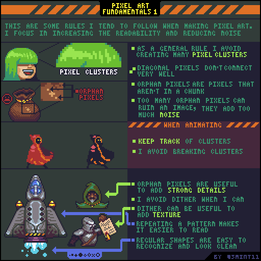
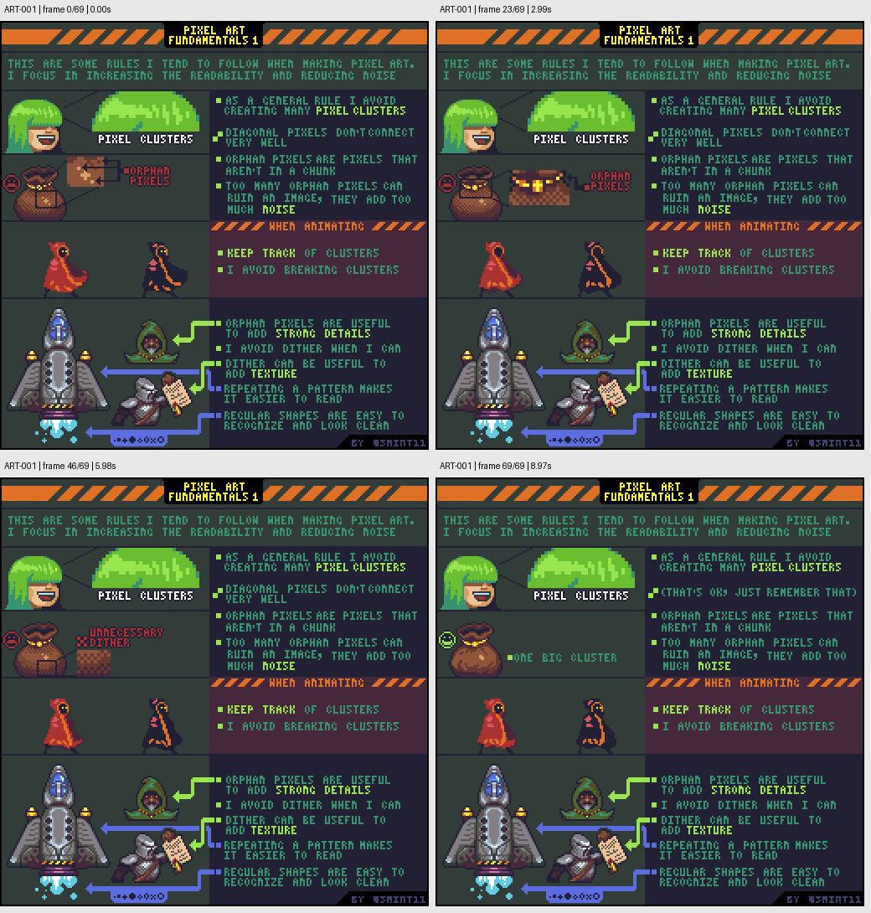

# ART-001 · 像素簇、孤立像素与画面噪点

通过连贯的像素簇组织形状，区分有信息价值的单像素细节与破坏阅读的杂点。

## 使用前先读

**适用层级：** 入门。**前置：** 能够使用1像素铅笔和橡皮。

本篇依据原图中的主要说明和示例编写中文讲解，保留原始英文动态图；不是逐字全文OCR。原作者的经验性建议不自动等于所有项目的硬性规则。练习、验收与适用边界是整理者补充。

## 学习目标

- 识别孤立像素与色块连接
- 减少噪点并保留识别性细节
- 在动画中保持像素簇连贯

## 原始图文教程

图1：Pedro Medeiros / Saint11 原始GIF，512×512，70帧，总时长9.10秒。原文件未改像素或重编码。部分阅读器只显示首帧，请结合下面的静态图和说明。

图2：整理者从原GIF按时间抽取的静态辅助图，阅读顺序为左上→右上→左下→右下。只选取四个时间点，并不代表完整动画或所有中间步骤；原始帧未缩放，标签加在图外。

## 图示读法

左上头发比较整片亮部；左中圈出孤立亮点。人物动画演示移动时簇的完整性；下半部的飞船、人物与小图案展示单像素的有效用途及重复节奏。

## 关键概念

像素簇（pixel cluster）是相邻像素组成的可读形状；孤立像素（orphan pixel）没有归属到明显色块。教程重点是可读性，不是禁止所有单像素。

## 根据原图整理的步骤

1. 先在原尺寸看整体轮廓，再放大检查颜色是否形成可识别的块。头发示例用成片的亮部表达体积，而不是逐根散点画发丝。

2. 检查只靠对角接触的区域。这类连接较弱；需要连续的形状时，调整邻接像素，使观者能读出整体。

3. 圈出孤立像素，逐个问它是否承担眼睛、星点、铆钉等明确任务。没有任务的点并入附近色块或删除。

4. 把高频纹理集中到需要说明材质的区域。图中抖色可以增加纹理，但作者会尽量避免无目的的大面积抖色。

5. 为动画保存主要像素簇的连续关系，避免帧间随意打散。重复纹样和规则形状有助于维持阅读和逐帧制作。

## 实作练习（整理者补充）

整理者练习：画一个24×24的竹篮图标，只用4色。保存A版，再做B版，把每个无语义孤立像素合并或删除。列出保留下来的单像素分别表达什么；比较两个版本在100%大小时能否更快辨认篮口与提手。

## 验收清单（整理者补充）

- [ ] 缩回100%后，主要形状仍可辨认
- [ ] 保留的孤立像素有明确用途
- [ ] 没有为降低噪点而堵住提手等必要空洞
- [ ] 修改依据是阅读效果，而不只是颜色数量变少

## 适用边界与常见误区（整理者补充）

不要把作者的“少用抖色”变成所有风格的硬性禁令；也不要机械删除所有孤立像素，眼睛与高光常常需要它们。

## 来源与授权

- 原作者：**Pedro Medeiros（Saint11）**。
- 原图：[固定版本的 Fundamentals.gif](https://github.com/saint11/Saint11Tutorials/blob/ce1393eb2c46441d917134a9fd52e15575ee10a7/Fundamentals.gif)；[原始文件](https://raw.githubusercontent.com/saint11/Saint11Tutorials/ce1393eb2c46441d917134a9fd52e15575ee10a7/Fundamentals.gif)。
- 作者教程入口：[Pixel Art Tutorials](https://saint11.art/blog/pixel-art-tutorials/)。
- 授权：[Creative Commons Attribution 4.0 International](https://creativecommons.org/licenses/by/4.0/)。
- 授权证据：[仓库README固定版本](https://github.com/saint11/Saint11Tutorials/blob/ce1393eb2c46441d917134a9fd52e15575ee10a7/README.md)；[本地证据副本](../../licenses/saint11-README.md)。
- 固定提交：`ce1393eb2c46441d917134a9fd52e15575ee10a7`。收集日期：`2026-10-29`。
- 原始GIF SHA-256：`df3b73e36b2c86afb41c3e6ba450044373fc21816822b3f0ee8d6454c51a2f0a`。
- 变更声明：原始GIF字节保留；新增中文解释性转述、练习、验收和适用范围说明；另从GIF抽帧生成静态辅助图。新增中文整理和派生图按CC BY 4.0提供，继续署名原作者并说明这些改动。
- 使用边界：这份开放授权针对仓库中的教程图文；教程中出现的软件名称和商标仍属于其权利人。授权不表示原作者认可本中文整理。
