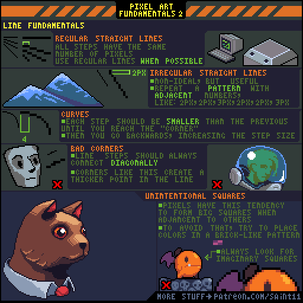
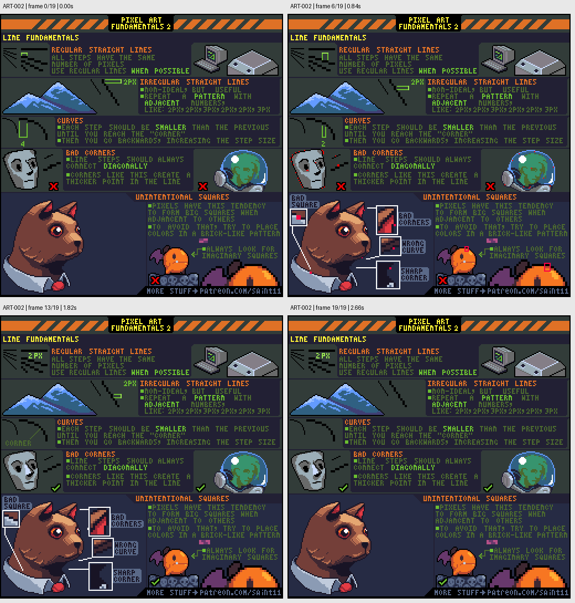

# ART-002 · 直线步长、曲线与意外方块

用有规律的像素步长构造直线和曲线，清理意外加粗的角与局部方块。

## 使用前先读

**适用层级：** 入门。**前置：** ART-001。

本篇依据原图中的主要说明和示例编写中文讲解，保留原始英文动态图；不是逐字全文OCR。原作者的经验性建议不自动等于所有项目的硬性规则。练习、验收与适用边界是整理者补充。

## 学习目标

- 用步长描述像素线
- 修整曲线拐角
- 识别由邻接像素造成的意外方块

## 原始图文教程

图1：Pedro Medeiros / Saint11 原始GIF，512×512，20帧，总时长2.80秒。原文件未改像素或重编码。部分阅读器只显示首帧，请结合下面的静态图和说明。

图2：整理者从原GIF按时间抽取的静态辅助图，阅读顺序为左上→右上→左下→右下。只选取四个时间点，并不代表完整动画或所有中间步骤；原始帧未缩放，标签加在图外。

## 图示读法

上部依次展示规则直线、可用的不规则节奏和曲线；中部骷髅与圆形物体旁标出坏角。下部人物耳朵与小鸟的放大区说明像素相邻后可能形成意外正方形。

## 关键概念

步长表示一段水平或垂直像素在转折前延续的长度。规则直线有重复步长；曲线需要有节奏地变化，而不是任意长短跳跃。

## 根据原图整理的步骤

1. 画斜直线时，先选择统一步长；若理想斜率无法用单一步长表达，可用相邻长度重复形成规律。图中列出2像素与3像素相间的做法。

2. 画弧线时，从长段逐渐缩短步长，跨过转向位置后再逐渐变长；以轮廓读起来连贯为准。

3. 检查直角附近是否多挤入一个像素。原图强调线段转折采用清楚的对角连接，避免角点忽然变厚。

4. 观察相邻颜色拼成的大方块。必要时错开边界，像砖块错缝一样组织颜色，打破不希望出现的方形团。

5. 同时在放大和原尺寸下看人物脸部、尖角与小图标，确认修线没有抹掉需要强调的形状。

## 实作练习（整理者补充）

整理者练习：制作一张32×32线条练习图，分别画一条2:1斜线、一条2/3交替步长线、一个圆弧和一只鸟的剪影。保留修正前后两版，用文字标出你调整的三个角点。

## 验收清单（整理者补充）

- [ ] 斜线具有可说明的重复节奏
- [ ] 曲线转向处没有突兀的长段或加粗
- [ ] 局部修正没有改变主体尺寸
- [ ] 尖角仍符合物体设计而非被全部磨圆

## 适用边界与常见误区（整理者补充）

不是所有方块都应移除。机械构件、砖石、衣服折角可以故意使用方形；本课处理的是与目标形状冲突的意外团块。

## 来源与授权

- 原作者：**Pedro Medeiros（Saint11）**。
- 原图：[固定版本的 Fundamentals2.gif](https://github.com/saint11/Saint11Tutorials/blob/ce1393eb2c46441d917134a9fd52e15575ee10a7/Fundamentals2.gif)；[原始文件](https://raw.githubusercontent.com/saint11/Saint11Tutorials/ce1393eb2c46441d917134a9fd52e15575ee10a7/Fundamentals2.gif)。
- 作者教程入口：[Pixel Art Tutorials](https://saint11.art/blog/pixel-art-tutorials/)。
- 授权：[Creative Commons Attribution 4.0 International](https://creativecommons.org/licenses/by/4.0/)。
- 授权证据：[仓库README固定版本](https://github.com/saint11/Saint11Tutorials/blob/ce1393eb2c46441d917134a9fd52e15575ee10a7/README.md)；[本地证据副本](../../licenses/saint11-README.md)。
- 固定提交：`ce1393eb2c46441d917134a9fd52e15575ee10a7`。收集日期：`2026-10-29`。
- 原始GIF SHA-256：`4588d5c6f156f0e436eaaddb2316981779304201ea22bb400fe01ad067ac175d`。
- 变更声明：原始GIF字节保留；新增中文解释性转述、练习、验收和适用范围说明；另从GIF抽帧生成静态辅助图。新增中文整理和派生图按CC BY 4.0提供，继续署名原作者并说明这些改动。
- 使用边界：这份开放授权针对仓库中的教程图文；教程中出现的软件名称和商标仍属于其权利人。授权不表示原作者认可本中文整理。
