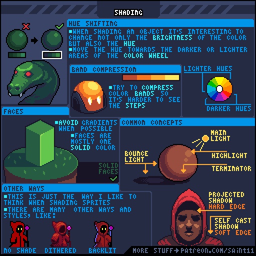
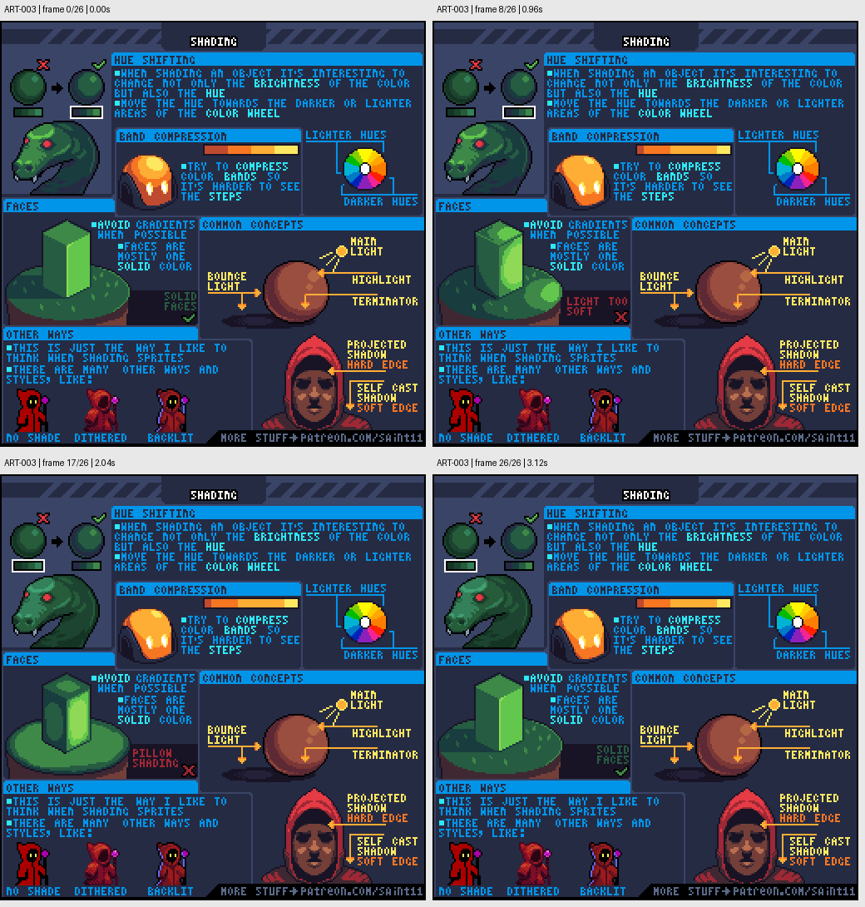

# ART-003 · 光影体积、色相偏移与受光面

从固定光源和大受光面出发，用有限颜色表达体积、投影与反射光。

## 使用前先读

**适用层级：** 入门。**前置：** ART-001。

本篇依据原图中的主要说明和示例编写中文讲解，保留原始英文动态图；不是逐字全文OCR。原作者的经验性建议不自动等于所有项目的硬性规则。练习、验收与适用边界是整理者补充。

## 学习目标

- 建立亮部与暗部色阶
- 区分高光、明暗交界和投影
- 避免所有物体使用同一种柔和渐变

## 原始图文教程

图1：Pedro Medeiros / Saint11 原始GIF，512×512，27帧，总时长3.24秒。原文件未改像素或重编码。部分阅读器只显示首帧，请结合下面的静态图和说明。

图2：整理者从原GIF按时间抽取的静态辅助图，阅读顺序为左上→右上→左下→右下。只选取四个时间点，并不代表完整动画或所有中间步骤；原始帧未缩放，标签加在图外。

## 图示读法

左上比较只改变亮度与加入色相变化的球；中部方柱说明纯色面。右中球体标出主光、高光、明暗交界和反射光；人物脸部区分投影硬边与自身阴影软边。

## 关键概念

Hue shifting是在改变明度时同时调整色相；terminator指明暗交界；bounce light指周围表面反射回来的光。原图提供的是作者常用方式，也展示不打光、抖色和逆光等其他风格。

## 根据原图整理的步骤

1. 先选一个主光方向，决定球体或方柱的大亮面与暗面。不要在还没有确定体积时堆高光。

2. 制作少量亮暗色阶。变亮或变暗时尝试让色相向合适方向移动，并用实际环境判断，而不是只拉亮度滑杆。

3. 方柱的面可以用大块纯色明确区分；原图建议有条件时减少渐变，保住面的结构。

4. 球面需要过渡时，控制色带的宽度和位置。教程的band compression示例是让阶梯过渡不那么显眼，并不是模糊所有边界。

5. 把高光、明暗交界与反射光放到有依据的位置。区分外部物体投下的影子和角色自身遮挡造成的阴影，并决定边缘软硬。

## 实作练习（整理者补充）

整理者练习：用同一套5色色阶画木箱、圆罐和布包，每件32×32。给文件写明光从左上来。另存一版把色相全部固定，再比较两版的体积和材质；选择更符合项目风格的一版并记录原因。

## 验收清单（整理者补充）

- [ ] 三件物体的主光方向一致
- [ ] 方柱或箱子的面有清楚的明度分组
- [ ] 高光位置与体积一致
- [ ] 反射光没有亮到误读为第二个主光源

## 适用边界与常见误区（整理者补充）

原图色轮只是配色思路。不要机械套用“暗部永远偏紫、亮部永远偏黄”，具体颜色取决于材质、光源和场景风格。

## 来源与授权

- 原作者：**Pedro Medeiros（Saint11）**。
- 原图：[固定版本的 Shading.gif](https://github.com/saint11/Saint11Tutorials/blob/ce1393eb2c46441d917134a9fd52e15575ee10a7/Shading.gif)；[原始文件](https://raw.githubusercontent.com/saint11/Saint11Tutorials/ce1393eb2c46441d917134a9fd52e15575ee10a7/Shading.gif)。
- 作者教程入口：[Pixel Art Tutorials](https://saint11.art/blog/pixel-art-tutorials/)。
- 授权：[Creative Commons Attribution 4.0 International](https://creativecommons.org/licenses/by/4.0/)。
- 授权证据：[仓库README固定版本](https://github.com/saint11/Saint11Tutorials/blob/ce1393eb2c46441d917134a9fd52e15575ee10a7/README.md)；[本地证据副本](../../licenses/saint11-README.md)。
- 固定提交：`ce1393eb2c46441d917134a9fd52e15575ee10a7`。收集日期：`2026-10-29`。
- 原始GIF SHA-256：`9a5bd9bdcd32578452fe4b14049e66f0b001c290530a3a1fa8c1ecc0a66b4536`。
- 变更声明：原始GIF字节保留；新增中文解释性转述、练习、验收和适用范围说明；另从GIF抽帧生成静态辅助图。新增中文整理和派生图按CC BY 4.0提供，继续署名原作者并说明这些改动。
- 使用边界：这份开放授权针对仓库中的教程图文；教程中出现的软件名称和商标仍属于其权利人。授权不表示原作者认可本中文整理。
