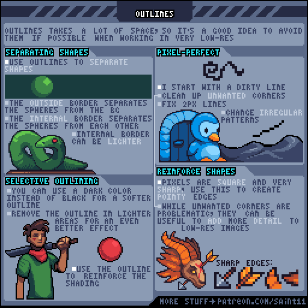
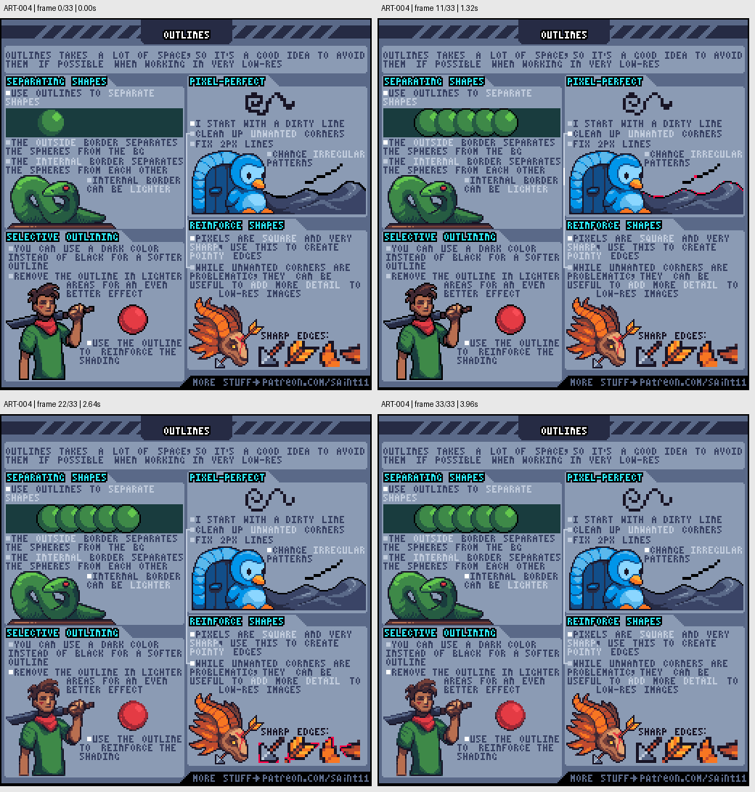

# ART-004 · 外轮廓、选择性描边与形状分离

在有限像素空间中决定哪些边需要描线，哪些边可以靠色块和明暗分开。

## 使用前先读

**适用层级：** 入门。**前置：** ART-002、ART-003。

本篇依据原图中的主要说明和示例编写中文讲解，保留原始英文动态图；不是逐字全文OCR。原作者的经验性建议不自动等于所有项目的硬性规则。练习、验收与适用边界是整理者补充。

## 学习目标

- 区分外轮廓与内部边界
- 控制描边的颜色和粗细
- 保留有设计目的的锐角

## 原始图文教程

图1：Pedro Medeiros / Saint11 原始GIF，512×512，34帧，总时长4.08秒。原文件未改像素或重编码。部分阅读器只显示首帧，请结合下面的静态图和说明。

图2：整理者从原GIF按时间抽取的静态辅助图，阅读顺序为左上→右上→左下→右下。只选取四个时间点，并不代表完整动画或所有中间步骤；原始帧未缩放，标签加在图外。

## 图示读法

左侧圆球与生物示意内外边界，人物展示受光处减弱轮廓。右上鸟的例子给出清线过程，右下尖锐翅缘说明角不一定是错误。

## 关键概念

外描边用于把物体从背景分开；内描边用于分开物体内部形体。选择性描边允许亮处减弱或去掉轮廓，暗处保留强调。

## 根据原图整理的步骤

1. 先检查分辨率是否容得下描边。原图提醒轮廓会占用很大空间，极低分辨率时应慎用。

2. 为需要从背景跳出来的对象画外轮廓；内部接缝不必和外轮廓同样黑，可用较浅颜色表示层次。

3. 从粗线草稿开始，清理不希望出现的角和2像素厚线，再让不规则步长变得有节奏。

4. 尝试用深色替代纯黑，并在朝光面的边缘减少描线，让轮廓也参与受光关系。

5. 检查锐角是否有设计作用。像素擅长表达尖锐轮廓，火焰、翅角和机械尖端可以故意保留有力的角。

## 实作练习（整理者补充）

整理者练习：画一把24×24镰刀，制作全黑描边、深色描边、选择性描边三版。放在浅草地和深泥地两种背景上比较，选择一套能保持刃口、木柄与负空间的规则。

## 验收清单（整理者补充）

- [ ] 原尺寸看刃口与木柄不会粘连
- [ ] 同一物体的轮廓粗细有规律
- [ ] 内部边界没有与外边界争夺注意力
- [ ] 尖角是设计决定而非清线遗漏

## 适用边界与常见误区（整理者补充）

不要把pixel-perfect理解成所有曲线都绝对单像素粗。原图鼓励有目的地使用锐角和形状强调。

## 来源与授权

- 原作者：**Pedro Medeiros（Saint11）**。
- 原图：[固定版本的 Outlines.gif](https://github.com/saint11/Saint11Tutorials/blob/ce1393eb2c46441d917134a9fd52e15575ee10a7/Outlines.gif)；[原始文件](https://raw.githubusercontent.com/saint11/Saint11Tutorials/ce1393eb2c46441d917134a9fd52e15575ee10a7/Outlines.gif)。
- 作者教程入口：[Pixel Art Tutorials](https://saint11.art/blog/pixel-art-tutorials/)。
- 授权：[Creative Commons Attribution 4.0 International](https://creativecommons.org/licenses/by/4.0/)。
- 授权证据：[仓库README固定版本](https://github.com/saint11/Saint11Tutorials/blob/ce1393eb2c46441d917134a9fd52e15575ee10a7/README.md)；[本地证据副本](../../licenses/saint11-README.md)。
- 固定提交：`ce1393eb2c46441d917134a9fd52e15575ee10a7`。收集日期：`2026-10-29`。
- 原始GIF SHA-256：`c6a74430b44f39c8af0462f8a30353bf4926a18cb73ca3f6f296382d2b8afd46`。
- 变更声明：原始GIF字节保留；新增中文解释性转述、练习、验收和适用范围说明；另从GIF抽帧生成静态辅助图。新增中文整理和派生图按CC BY 4.0提供，继续署名原作者并说明这些改动。
- 使用边界：这份开放授权针对仓库中的教程图文；教程中出现的软件名称和商标仍属于其权利人。授权不表示原作者认可本中文整理。
