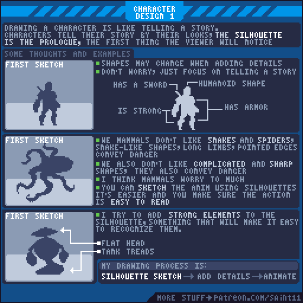
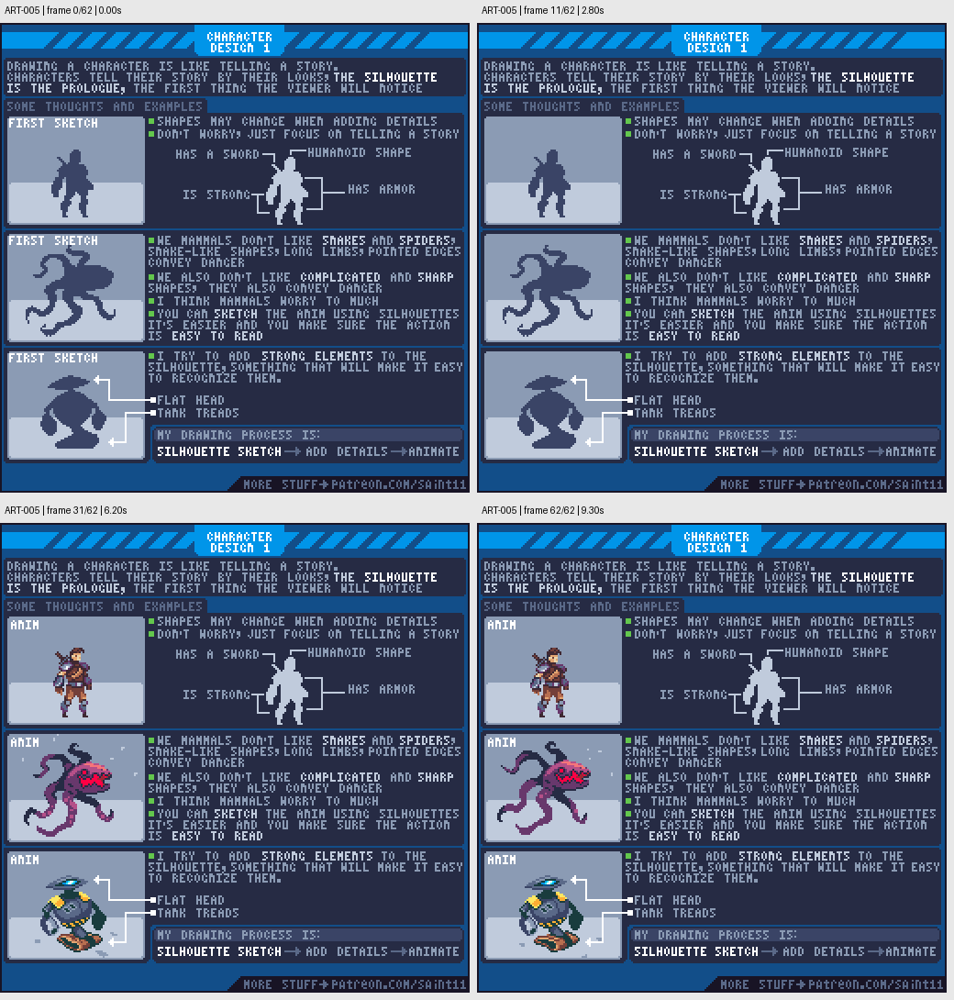

# ART-005 · 用剪影建立角色与道具识别性

先让单色外形讲清楚对象的身份，再添加颜色、细节和动画。

## 使用前先读

**适用层级：** 入门。**前置：** ART-001。

本篇依据原图中的主要说明和示例编写中文讲解，保留原始英文动态图；不是逐字全文OCR。原作者的经验性建议不自动等于所有项目的硬性规则。练习、验收与适用边界是整理者补充。

## 学习目标

- 使用单色剪影检查识别性
- 以少数强形状表达身份
- 在动态姿势中保留清楚轮廓

## 原始图文教程

图1：Pedro Medeiros / Saint11 原始GIF，512×512，63帧，总时长9.40秒。原文件未改像素或重编码。部分阅读器只显示首帧，请结合下面的静态图和说明。

图2：整理者从原GIF按时间抽取的静态辅助图，阅读顺序为左上→右上→左下→右下。只选取四个时间点，并不代表完整动画或所有中间步骤；原始帧未缩放，标签加在图外。

## 图示读法

上方战士通过剑和盔甲外形提示身份；中间触手怪展示长线与尖角；下方机器人标出平头与履带。动态示例说明识别要在运动中保持。

## 关键概念

原图把剪影视为角色故事的开场：观者先看到轮廓，之后才读到内部细节。大轮廓应先表达体型、装备和动作。

## 根据原图整理的步骤

1. 用单色画最初草稿，先说清楚角色是人形、是否有武器、是否穿护甲，不要立即填五官和花纹。

2. 加入能讲故事的强形状，例如宽肩、长剑或装甲块。添加细节后轮廓可能改变，保持身份仍然明确。

3. 对危险型怪物，图中利用蛇形长线、尖端和复杂轮廓制造感受。这是风格示例，不是所有文化和题材的通用公式。

4. 先用单色草稿测试动作；肢体与装备挤成一团时，在进入动画细化前调整姿势或留出间隙。

5. 选择两三个稳定识别特征。图中的机器人用平顶头部和履带形成记忆点，完成顺序是剪影、细节、动画。

## 实作练习（整理者补充）

整理者练习：为农夫、木匠和渔夫各画一个24×32纯黑剪影，不画脸也不写文字。只用工具、帽型、身形区分职业；然后把三者随机打乱，请另一个agent根据轮廓给出识别理由。

## 验收清单（整理者补充）

- [ ] 三种职业至少有两个明确的轮廓差异
- [ ] 工具没有与身体合成难读的大块
- [ ] 走路或拿起工具时关键特征仍在
- [ ] 细节版本没有破坏最初的剪影

## 适用边界与常见误区（整理者补充）

不能把常见形状联想当作可靠的人格判断；这些是虚构角色的视觉设计手段。道具轮廓同样适用。

## 来源与授权

- 原作者：**Pedro Medeiros（Saint11）**。
- 原图：[固定版本的 Silhouette.gif](https://github.com/saint11/Saint11Tutorials/blob/ce1393eb2c46441d917134a9fd52e15575ee10a7/Silhouette.gif)；[原始文件](https://raw.githubusercontent.com/saint11/Saint11Tutorials/ce1393eb2c46441d917134a9fd52e15575ee10a7/Silhouette.gif)。
- 作者教程入口：[Pixel Art Tutorials](https://saint11.art/blog/pixel-art-tutorials/)。
- 授权：[Creative Commons Attribution 4.0 International](https://creativecommons.org/licenses/by/4.0/)。
- 授权证据：[仓库README固定版本](https://github.com/saint11/Saint11Tutorials/blob/ce1393eb2c46441d917134a9fd52e15575ee10a7/README.md)；[本地证据副本](../../licenses/saint11-README.md)。
- 固定提交：`ce1393eb2c46441d917134a9fd52e15575ee10a7`。收集日期：`2026-10-29`。
- 原始GIF SHA-256：`8494ec087b7cdc85d6ab94da1710858b08692adcd371ab6cc08fe25de0064f3a`。
- 变更声明：原始GIF字节保留；新增中文解释性转述、练习、验收和适用范围说明；另从GIF抽帧生成静态辅助图。新增中文整理和派生图按CC BY 4.0提供，继续署名原作者并说明这些改动。
- 使用边界：这份开放授权针对仓库中的教程图文；教程中出现的软件名称和商标仍属于其权利人。授权不表示原作者认可本中文整理。
