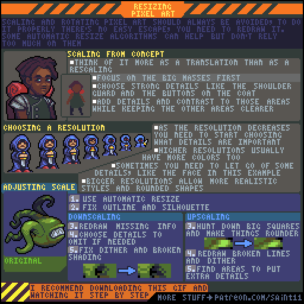
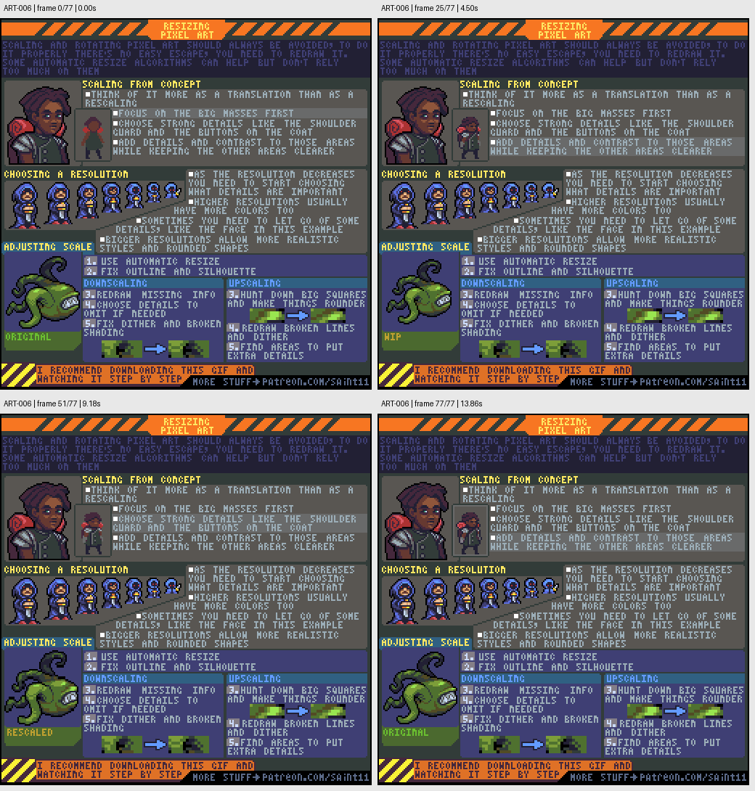

# ART-006 · 改变逻辑分辨率后的重绘与修整

区分展示用整数放大与真正改变像素资产尺寸；后者需要重新组织细节和轮廓。

## 使用前先读

**适用层级：** 进阶。**前置：** ART-001、ART-002。

本篇依据原图中的主要说明和示例编写中文讲解，保留原始英文动态图；不是逐字全文OCR。原作者的经验性建议不自动等于所有项目的硬性规则。练习、验收与适用边界是整理者补充。

## 学习目标

- 决定低分辨率下必须保留的特征
- 识别自动缩放造成的断线和方块
- 按目标尺寸重整阴影和细节

## 原始图文教程

图1：Pedro Medeiros / Saint11 原始GIF，512×512，78帧，总时长14.04秒。原文件未改像素或重编码。部分阅读器只显示首帧，请结合下面的静态图和说明。

图2：整理者从原GIF按时间抽取的静态辅助图，阅读顺序为左上→右上→左下→右下。只选取四个时间点，并不代表完整动画或所有中间步骤；原始帧未缩放，标签加在图外。

## 图示读法

上部概念图与小角色对照说明信息取舍；中部一排尺寸展示细节随分辨率减少；下部青蛙分成缩小与放大两条修整路径。

## 关键概念

教程讨论的是改变像素画的逻辑尺寸与旋转后的处理，不是禁止用最近邻把完成稿整数倍显示。分辨率下降意味着信息预算减少。

## 根据原图整理的步骤

1. 把从大概念图到小精灵的过程看成视觉翻译。先抓主要体块，再选肩部、头发等强识别细节。

2. 在目标分辨率决定哪些细节重要。越小的角色越需要舍弃面部等次要信息；更大版本才容得下更多颜色和写实细节。

3. 需要调整已有素材时，可以先自动缩放作为草稿，然后修整外轮廓，而不是把缩放结果直接当完成稿。

4. 缩小时修复杂乱的抖色与断裂明暗，重新画必须保留的要素；无法容纳的细节应删减。

5. 放大后检查大方块、断线与不自然抖色，在新的像素预算内补充必要细节。不要只在旧像素周围平均描一圈。

## 实作练习（整理者补充）

整理者练习：把一座自绘48×48小屋整理为32×32版本。先列出屋顶、门和烟囱三个必须保留的特征；保留原文件、自动缩放草稿和手工修正版，逐项说明删去的细节。

## 验收清单（整理者补充）

- [ ] 目标尺寸在像素级上正确
- [ ] 门窗等关键结构没有被自动缩放吞掉
- [ ] 透明空洞和细杆仍符合设计
- [ ] 交付文件清楚区分原图、缩放草稿和修正版

## 适用边界与常见误区（整理者补充）

本课是改变逻辑尺寸的重绘方法，不应据此在“修复原素材”的任务里擅自改变构图、尺寸或配色。

## 来源与授权

- 原作者：**Pedro Medeiros（Saint11）**。
- 原图：[固定版本的 Resizing.gif](https://github.com/saint11/Saint11Tutorials/blob/ce1393eb2c46441d917134a9fd52e15575ee10a7/Resizing.gif)；[原始文件](https://raw.githubusercontent.com/saint11/Saint11Tutorials/ce1393eb2c46441d917134a9fd52e15575ee10a7/Resizing.gif)。
- 作者教程入口：[Pixel Art Tutorials](https://saint11.art/blog/pixel-art-tutorials/)。
- 授权：[Creative Commons Attribution 4.0 International](https://creativecommons.org/licenses/by/4.0/)。
- 授权证据：[仓库README固定版本](https://github.com/saint11/Saint11Tutorials/blob/ce1393eb2c46441d917134a9fd52e15575ee10a7/README.md)；[本地证据副本](../../licenses/saint11-README.md)。
- 固定提交：`ce1393eb2c46441d917134a9fd52e15575ee10a7`。收集日期：`2026-10-29`。
- 原始GIF SHA-256：`74b1182d4a919cd5d9af2126d4e46a994f5ca73d3ac407bfc37b7760d3ea7a5c`。
- 变更声明：原始GIF字节保留；新增中文解释性转述、练习、验收和适用范围说明；另从GIF抽帧生成静态辅助图。新增中文整理和派生图按CC BY 4.0提供，继续署名原作者并说明这些改动。
- 使用边界：这份开放授权针对仓库中的教程图文；教程中出现的软件名称和商标仍属于其权利人。授权不表示原作者认可本中文整理。
