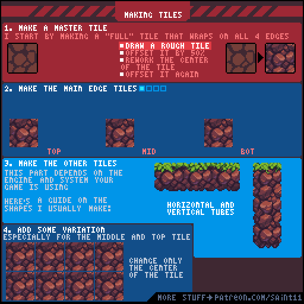
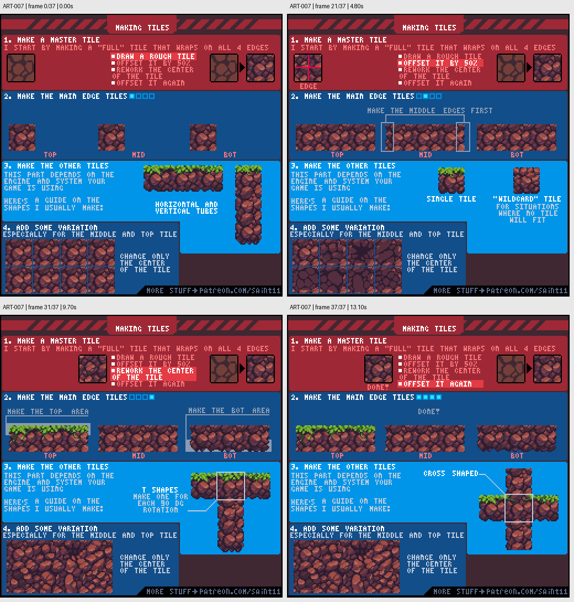

# ART-007 · 无缝主图块、边缘块与变体

先做能四边相接的主图块，再拆出边缘、连接和不破坏接缝的变体。

## 使用前先读

**适用层级：** 进阶。**前置：** ART-001、ART-003。

本篇依据原图中的主要说明和示例编写中文讲解，保留原始英文动态图；不是逐字全文OCR。原作者的经验性建议不自动等于所有项目的硬性规则。练习、验收与适用边界是整理者补充。

## 学习目标

- 使用半幅偏移检查接缝
- 区分主块与边缘块
- 制作不改变边缘契约的变化

## 原始图文教程

图1：Pedro Medeiros / Saint11 原始GIF，512×512，38帧，总时长15.10秒。原文件未改像素或重编码。部分阅读器只显示首帧，请结合下面的静态图和说明。

图2：整理者从原GIF按时间抽取的静态辅助图，阅读顺序为左上→右上→左下→右下。只选取四个时间点，并不代表完整动画或所有中间步骤；原始帧未缩放，标签加在图外。

## 图示读法

第一行演示半幅偏移修缝；第二行列出TOP/MID/BOT；第三行组合水平与垂直结构；底部以多个中心变化说明边缘保持一致。

## 关键概念

Master tile是填充区域的基本图块。无缝要求相邻边的色块关系能延续；变体需要遵守同一边缘约定。图中的具体组合是简化示例，实际图块集合取决于引擎。

## 根据原图整理的步骤

1. 先画一个可以向四边重复的完整图块。初稿完成后沿两个方向各偏移半幅，把原边界移到中间。

2. 在中间修补明显断裂的纹理，然后再次偏移检查；不要只在单张画布中央追求漂亮细节。

3. 从主图块制作顶部、中部、底部等主要边缘图块，让材质与轮廓一致。

4. 补齐水平和竖向连接所需的块。原图特别提醒所需排列依赖游戏采用的系统，不存在所有引擎统一的最少套数。

5. 为顶部和中部添加变化时，优先改中心，保留用于相接的边。把变体混排，检查是否暴露重复节奏。

## 实作练习（整理者补充）

整理者练习：制作16×16泥地基础块、上边缘、下边缘和两个中部变体，铺成8×6预览图。交付图块表与拼接预览，标注哪些像素边缘必须保持一致。

## 验收清单（整理者补充）

- [ ] 四边重复时无明显断裂线
- [ ] 变体混排不破坏边界
- [ ] 至少检查一个水平转接和一个竖向转接
- [ ] 图块表尺寸与目标编辑器的切片参数一致

## 适用边界与常见误区（整理者补充）

从一张完整插画切出大量独特小块，不等于建立了可复用tileset。本课强调可组合边界和有限可控变体。

## 来源与授权

- 原作者：**Pedro Medeiros（Saint11）**。
- 原图：[固定版本的 Tiles.gif](https://github.com/saint11/Saint11Tutorials/blob/ce1393eb2c46441d917134a9fd52e15575ee10a7/Tiles.gif)；[原始文件](https://raw.githubusercontent.com/saint11/Saint11Tutorials/ce1393eb2c46441d917134a9fd52e15575ee10a7/Tiles.gif)。
- 作者教程入口：[Pixel Art Tutorials](https://saint11.art/blog/pixel-art-tutorials/)。
- 授权：[Creative Commons Attribution 4.0 International](https://creativecommons.org/licenses/by/4.0/)。
- 授权证据：[仓库README固定版本](https://github.com/saint11/Saint11Tutorials/blob/ce1393eb2c46441d917134a9fd52e15575ee10a7/README.md)；[本地证据副本](../../licenses/saint11-README.md)。
- 固定提交：`ce1393eb2c46441d917134a9fd52e15575ee10a7`。收集日期：`2026-10-29`。
- 原始GIF SHA-256：`a0a1e439b8a99ec2b9aae13ea71f6fe33055e8b07ab1540ec53e050feeb37d33`。
- 变更声明：原始GIF字节保留；新增中文解释性转述、练习、验收和适用范围说明；另从GIF抽帧生成静态辅助图。新增中文整理和派生图按CC BY 4.0提供，继续署名原作者并说明这些改动。
- 使用边界：这份开放授权针对仓库中的教程图文；教程中出现的软件名称和商标仍属于其权利人。授权不表示原作者认可本中文整理。
