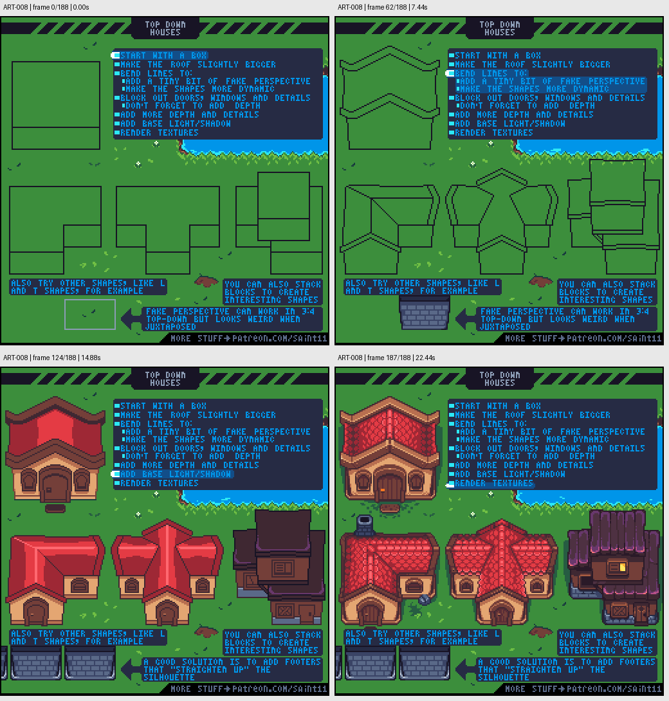

# ART-008 · 俯视斜视角房屋：从体块到屋顶材质

从简单盒子建立屋顶和墙体，在统一视角下添加门窗、深度、光影与纹理。

## 使用前先读

**适用层级：** 进阶。**前置：** ART-002、ART-003、ART-007。

本篇依据原图中的主要说明和示例编写中文讲解，保留原始英文动态图；不是逐字全文OCR。原作者的经验性建议不自动等于所有项目的硬性规则。练习、验收与适用边界是整理者补充。

## 学习目标

- 按体块顺序绘制房屋
- 识别伪透视与正俯视的边界
- 用多种组合体块制作建筑变体

## 原始图文教程

图1：Pedro Medeiros / Saint11 原始GIF，512×512，189帧，总时长22.68秒。原文件未改像素或重编码。部分阅读器只显示首帧，请结合下面的静态图和说明。

图2：整理者从原GIF按时间抽取的静态辅助图，阅读顺序为左上→右上→左下→右下。只选取四个时间点，并不代表完整动画或所有中间步骤；原始帧未缩放，标签加在图外。

## 图示读法

这是逐步展开的GIF：首帧只有体块，后续出现屋顶线、门窗、基础颜色与纹理。关键帧表按原时间排列，可看到同一流程如何应用在矩形、折角和叠层建筑上。

## 关键概念

原图展示的是常见3/4俯视斜视角风格：能看到屋顶与正面墙。它并非严格正俯视投影。教程也明确指出伪透视在平铺时可能显得奇怪。

## 根据原图整理的步骤

1. 先画盒状体块，划分屋顶与墙体；让屋顶略大于墙身，表达屋檐。

2. 根据项目视角轻微弯折线条，使造型更活泼；不要每栋房子自行改变倾角。原图这种伪透视需要与整体场景兼容。

3. 先块出门窗和细节的位置，并用厚度、门框与屋檐明确结构深度。

4. 加入基本受光和阴影之后，再画瓦片、木纹或砖缝；在纹理前应已能看出房屋。

5. 尝试L形、T形或叠放体块，做同一家族建筑。遇到平铺轮廓不顺的问题，图末建议用屋角结构把外轮廓重新理直。

## 实作练习（整理者补充）

整理者练习：按同一视角画64×64单间农舍、L形农舍和附带小仓房的农舍。先共用一张结构线规则表，固定屋檐深度与主光方向；完成后放进同一个格子场景检查尺度。

## 验收清单（整理者补充）

- [ ] 三栋建筑的可见屋顶/墙面比例一致
- [ ] 屋檐比墙体略外伸且投影合理
- [ ] 加纹理之前体块已经可读
- [ ] 与邻接建筑组合时没有透视冲突

## 适用边界与常见误区（整理者补充）

不能将本例的弯曲屋顶线直接套进要求严格正面俯视的资产规范。先确认项目投影，再决定保留哪些造型技巧。

## 来源与授权

- 原作者：**Pedro Medeiros（Saint11）**。
- 原图：[固定版本的 Top-Down-Houses-Compressed.gif](https://github.com/saint11/Saint11Tutorials/blob/ce1393eb2c46441d917134a9fd52e15575ee10a7/Top-Down-Houses-Compressed.gif)；[原始文件](https://raw.githubusercontent.com/saint11/Saint11Tutorials/ce1393eb2c46441d917134a9fd52e15575ee10a7/Top-Down-Houses-Compressed.gif)。
- 作者教程入口：[Pixel Art Tutorials](https://saint11.art/blog/pixel-art-tutorials/)。
- 授权：[Creative Commons Attribution 4.0 International](https://creativecommons.org/licenses/by/4.0/)。
- 授权证据：[仓库README固定版本](https://github.com/saint11/Saint11Tutorials/blob/ce1393eb2c46441d917134a9fd52e15575ee10a7/README.md)；[本地证据副本](../../licenses/saint11-README.md)。
- 固定提交：`ce1393eb2c46441d917134a9fd52e15575ee10a7`。收集日期：`2026-10-29`。
- 原始GIF SHA-256：`6163defa0cf6532583d70dd63f373a485070450965f640b67b41a51abb71b11e`。
- 变更声明：原始GIF字节保留；新增中文解释性转述、练习、验收和适用范围说明；另从GIF抽帧生成静态辅助图。新增中文整理和派生图按CC BY 4.0提供，继续署名原作者并说明这些改动。
- 使用边界：这份开放授权针对仓库中的教程图文；教程中出现的软件名称和商标仍属于其权利人。授权不表示原作者认可本中文整理。
