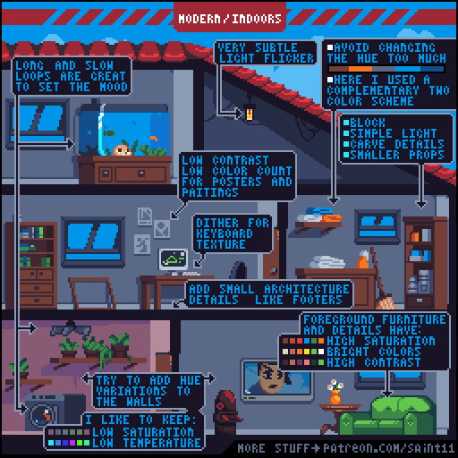
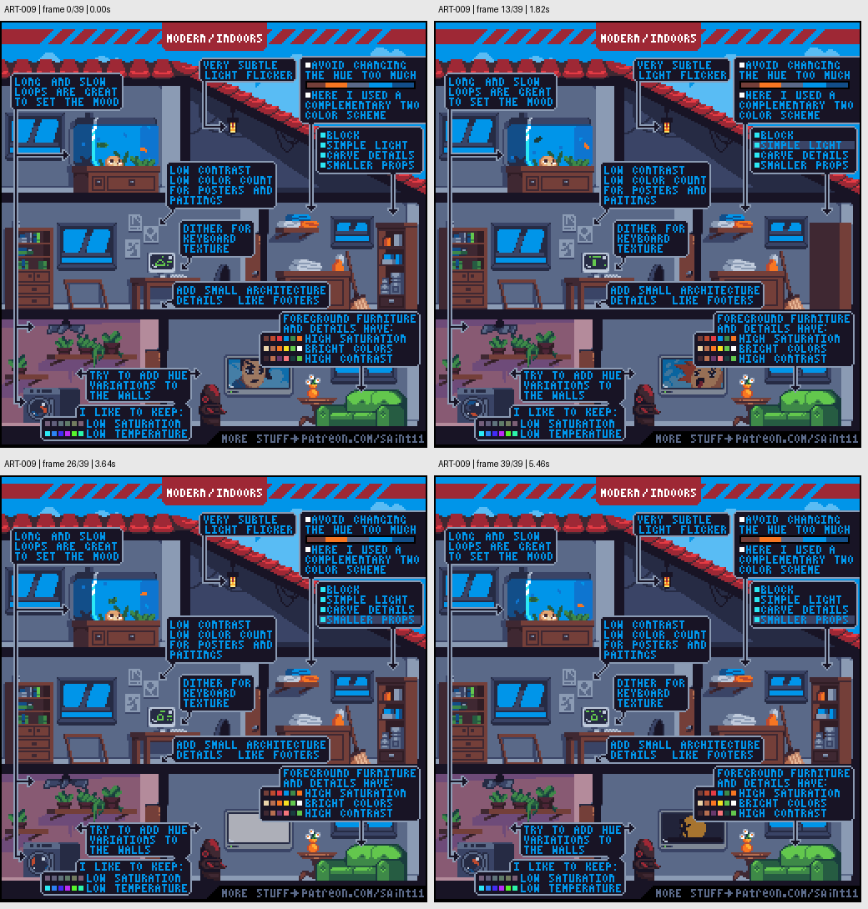

# ART-009 · 室内场景的层次、细节密度与气氛

用背景低对比、前景重点、轻微变化与建筑小结构组织可读的室内场景。

## 使用前先读

**适用层级：** 进阶。**前置：** ART-003、ART-004。

本篇依据原图中的主要说明和示例编写中文讲解，保留原始英文动态图；不是逐字全文OCR。原作者的经验性建议不自动等于所有项目的硬性规则。练习、验收与适用边界是整理者补充。

## 学习目标

- 控制背景与前景的对比层级
- 为物件安排细节密度
- 用微动画营造氛围

## 原始图文教程

图1：Pedro Medeiros / Saint11 原始GIF，512×512，40帧，总时长5.60秒。原文件未改像素或重编码。部分阅读器只显示首帧，请结合下面的静态图和说明。

图2：整理者从原GIF按时间抽取的静态辅助图，阅读顺序为左上→右上→左下→右下。只选取四个时间点，并不代表完整动画或所有中间步骤；原始帧未缩放，标签加在图外。

## 图示读法

图上部用箭头指出灯光、墙上装饰、键盘、书桌和踢脚线；下半部比较背景墙面与绿色沙发等前景元素的色阶。动图中的微变化承担气氛作用。

## 关键概念

教程中的现代室内采用有限色相与互补关系，区分墙面背景和前景家具。高饱和、亮色和高对比用于强调可关注的物件。

## 根据原图整理的步骤

1. 先用简单明暗块布局室内结构，墙面采用较低饱和度与较低色温的组合，并添加适度色相变化。

2. 用低对比色绘制海报和挂画，使它们存在但不抢走人物和前景物件的注意力。

3. 先做大块家具，再加入小道具。教程建议先block大形与受光，再补较小物品。

4. 用踢脚线等小建筑结构解释墙地连接；用适量抖色表现键盘等高频纹理，而不是给所有表面加颗粒。

5. 以缓慢循环与很细微的灯光闪动营造气氛。前景家具和关键小物可以使用更鲜明的颜色与对比。

## 实作练习（整理者补充）

整理者练习：画一间128×96农舍室内，放床、柜、灶台三件主物和五件小道具。列出一个视觉焦点；把背景装饰先全部降为低对比，再逐件恢复必要的细节。

## 验收清单（整理者补充）

- [ ] 不看文字也能找到视觉焦点
- [ ] 墙与地面的交界清楚
- [ ] 小道具没有与主物争抢亮度
- [ ] 动画关闭后静态画面仍完整可读

## 适用边界与常见误区（整理者补充）

原图是斜视室内示例，具体相机视角不能直接视为俯视地图标准。它的层次和细节密度方法可迁移到其他投影。

## 来源与授权

- 原作者：**Pedro Medeiros（Saint11）**。
- 原图：[固定版本的 indoors.gif](https://github.com/saint11/Saint11Tutorials/blob/ce1393eb2c46441d917134a9fd52e15575ee10a7/indoors.gif)；[原始文件](https://raw.githubusercontent.com/saint11/Saint11Tutorials/ce1393eb2c46441d917134a9fd52e15575ee10a7/indoors.gif)。
- 作者教程入口：[Pixel Art Tutorials](https://saint11.art/blog/pixel-art-tutorials/)。
- 授权：[Creative Commons Attribution 4.0 International](https://creativecommons.org/licenses/by/4.0/)。
- 授权证据：[仓库README固定版本](https://github.com/saint11/Saint11Tutorials/blob/ce1393eb2c46441d917134a9fd52e15575ee10a7/README.md)；[本地证据副本](../../licenses/saint11-README.md)。
- 固定提交：`ce1393eb2c46441d917134a9fd52e15575ee10a7`。收集日期：`2026-10-29`。
- 原始GIF SHA-256：`dcbe8e7d07b31f837b11e8292c7bac89d0089a643113931893f41ea8f64bbf27`。
- 变更声明：原始GIF字节保留；新增中文解释性转述、练习、验收和适用范围说明；另从GIF抽帧生成静态辅助图。新增中文整理和派生图按CC BY 4.0提供，继续署名原作者并说明这些改动。
- 使用边界：这份开放授权针对仓库中的教程图文；教程中出现的软件名称和商标仍属于其权利人。授权不表示原作者认可本中文整理。
