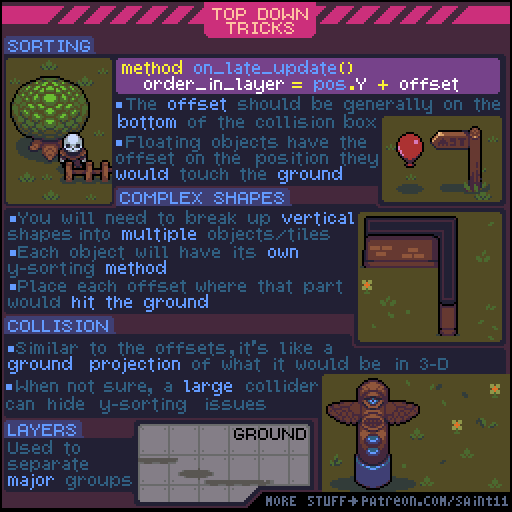
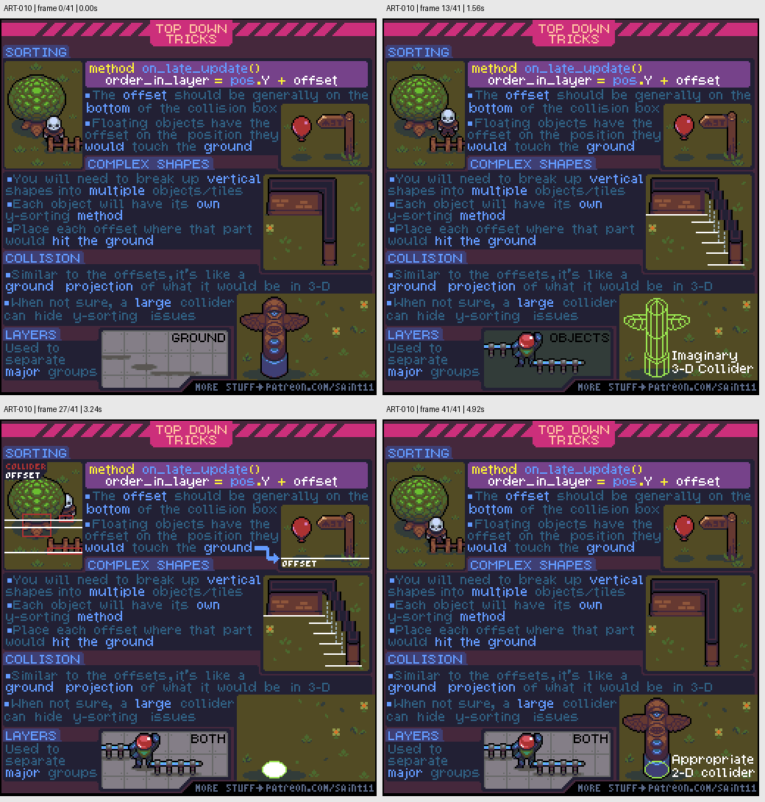

# ART-010 · 俯视场景的脚底排序、复杂遮挡与碰撞投影

把绘制顺序锚定在物体接地处，并为复杂高结构拆分遮挡和碰撞。

## 使用前先读

**适用层级：** 进阶。**前置：** 知道sprite、图层和碰撞体的区别。

本篇依据原图中的主要说明和示例编写中文讲解，保留原始英文动态图；不是逐字全文OCR。原作者的经验性建议不自动等于所有项目的硬性规则。练习、验收与适用边界是整理者补充。

## 学习目标

- 选择与地面相关的排序基准
- 拆分跨越多个遮挡关系的形状
- 区分视觉边界与地面占地

## 原始图文教程

图1：Pedro Medeiros / Saint11 原始GIF，512×512，42帧，总时长5.04秒。原文件未改像素或重编码。部分阅读器只显示首帧，请结合下面的静态图和说明。

图2：整理者从原GIF按时间抽取的静态辅助图，阅读顺序为左上→右上→左下→右下。只选取四个时间点，并不代表完整动画或所有中间步骤；原始帧未缩放，标签加在图外。

## 图示读法

上部树、角色和气球说明接地排序基准；中部折角墙演示复杂形状拆分；下部透明区域显示碰撞投影与地面图层。

## 关键概念

原图的order_in_layer = pos.Y + offset是说明性伪代码。具体排序方向、更新阶段和Y轴约定由引擎决定；offset通常描述接地位置。

## 根据原图整理的步骤

1. 为每个物体确定地面接触基准。一般接近碰撞盒底部，而不是图像顶部或透明画布中心。

2. 浮动物体也需要一个投影到地面的参考位置；示例气球按它若落地时对应的点处理前后关系。

3. 遇到L形墙或其他复杂竖向结构时，拆成多个对象或图块。每个部分用自己的接地位置参与排序。

4. 把碰撞理解成物体在地面的投影，不要默认整张高树或墙面的所有可见像素都是占地。

5. 用固定图层分离地面等大类别，再在需要互相穿行的对象中进行动态排序。原图提到较大碰撞体可掩盖某些排序问题，但仍应检查通行是否合理。

## 实作练习（整理者补充）

整理者练习：准备一棵树、L形围墙和悬挂灯笼，给每个图像标注脚底锚点与地面占地。制作角色在前、后、左、右四种位置的摆放图，再在目标引擎验证这些预期遮挡。

## 验收清单（整理者补充）

- [ ] 每个对象有明确脚底/地面锚点
- [ ] 角色从树后到树前时不会反向遮挡
- [ ] L形墙拐角处不会整块突然翻层
- [ ] 碰撞区和可通行区符合画面语义

## 适用边界与常见误区（整理者补充）

不要把伪代码当Godot、Unity或其他引擎的现成API；也不要靠无原则扩大碰撞体长期掩盖错误的资产拆分。

## 来源与授权

- 原作者：**Pedro Medeiros（Saint11）**。
- 原图：[固定版本的 TopDownTricks.gif](https://github.com/saint11/Saint11Tutorials/blob/ce1393eb2c46441d917134a9fd52e15575ee10a7/TopDownTricks.gif)；[原始文件](https://raw.githubusercontent.com/saint11/Saint11Tutorials/ce1393eb2c46441d917134a9fd52e15575ee10a7/TopDownTricks.gif)。
- 作者教程入口：[Pixel Art Tutorials](https://saint11.art/blog/pixel-art-tutorials/)。
- 授权：[Creative Commons Attribution 4.0 International](https://creativecommons.org/licenses/by/4.0/)。
- 授权证据：[仓库README固定版本](https://github.com/saint11/Saint11Tutorials/blob/ce1393eb2c46441d917134a9fd52e15575ee10a7/README.md)；[本地证据副本](../../licenses/saint11-README.md)。
- 固定提交：`ce1393eb2c46441d917134a9fd52e15575ee10a7`。收集日期：`2026-10-29`。
- 原始GIF SHA-256：`83517e29fad45addbaabacb9023bb1c346e19bf9d590a64e05951bd97145c65d`。
- 变更声明：原始GIF字节保留；新增中文解释性转述、练习、验收和适用范围说明；另从GIF抽帧生成静态辅助图。新增中文整理和派生图按CC BY 4.0提供，继续署名原作者并说明这些改动。
- 使用边界：这份开放授权针对仓库中的教程图文；教程中出现的软件名称和商标仍属于其权利人。授权不表示原作者认可本中文整理。
