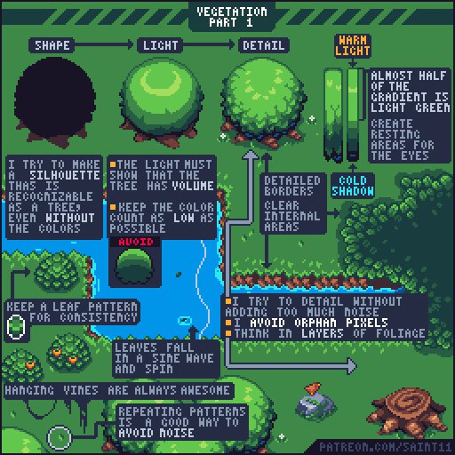
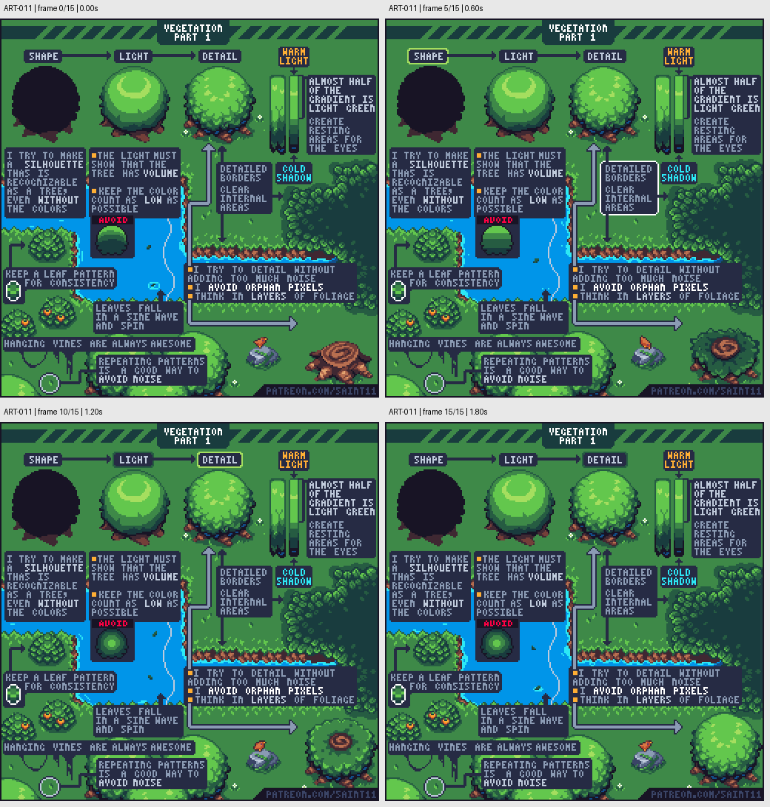

# ART-011 · 树冠：剪影、体积与有节制的叶片纹理

按形状、受光、细节的顺序画树，用连续叶团表达体积并留下安静区域。

## 使用前先读

**适用层级：** 入门。**前置：** ART-001、ART-003。

本篇依据原图中的主要说明和示例编写中文讲解，保留原始英文动态图；不是逐字全文OCR。原作者的经验性建议不自动等于所有项目的硬性规则。练习、验收与适用边界是整理者补充。

## 学习目标

- 从剪影建立树冠
- 让叶片细节服从整体体积
- 使用稳定的叶片模式与疏密关系

## 原始图文教程

图1：Pedro Medeiros / Saint11 原始GIF，512×512，16帧，总时长1.92秒。原文件未改像素或重编码。部分阅读器只显示首帧，请结合下面的静态图和说明。

图2：整理者从原GIF按时间抽取的静态辅助图，阅读顺序为左上→右上→左下→右下。只选取四个时间点，并不代表完整动画或所有中间步骤；原始帧未缩放，标签加在图外。

## 图示读法

顶部三棵树展示剪影、体积和纹理三阶段；右侧色带标出暖光与冷影；左下叶片模块与右下叶团展示重复节奏、边缘细化和内部留白。

## 关键概念

图中主流程是shape → light → detail。叶片不是独立随机亮点；树冠先作为一个有体积的大形，再分成有方向的叶团。

## 根据原图整理的步骤

1. 先画即使没有颜色也能认作树的剪影，不要只从一团随机叶子开始。

2. 为树冠安排整体明暗，清楚表现圆团或层叠的体积，并控制用色数量。

3. 建立一种稳定叶片模式，在边缘和转折处细化；内部留较大的干净区域，给眼睛休息。

4. 使用暖亮部与冷暗部作为一种可选配色关系。图中大面积亮绿承担中间色，避免每一小片叶子都用完整高对比色阶。

5. 将叶子看作层叠群组，减少孤立像素；沿轮廓安排丰富细节，吊藤、地面落叶可保持相近尺寸和形状语言。

## 实作练习（整理者补充）

整理者练习：画一棵48×48果树，先单独保存剪影、明暗、细节三个阶段。选一个4×4以内的叶片模式，在树冠边缘重复变形使用；在大亮面保留至少一块没有小纹理的区域。

## 验收清单（整理者补充）

- [ ] 纯黑剪影可认作树
- [ ] 去掉叶片纹理后仍有树冠体积
- [ ] 树冠内部没有均匀撒满单像素
- [ ] 树叶、落叶和藤蔓属于同一套形状语言

## 适用边界与常见误区（整理者补充）

减少噪点不等于抹平所有叶缘；也不必逐片叶子绘制强高光，整体明暗应先成立。

## 来源与授权

- 原作者：**Pedro Medeiros（Saint11）**。
- 原图：[固定版本的 Vegetation.gif](https://github.com/saint11/Saint11Tutorials/blob/ce1393eb2c46441d917134a9fd52e15575ee10a7/Vegetation.gif)；[原始文件](https://raw.githubusercontent.com/saint11/Saint11Tutorials/ce1393eb2c46441d917134a9fd52e15575ee10a7/Vegetation.gif)。
- 作者教程入口：[Pixel Art Tutorials](https://saint11.art/blog/pixel-art-tutorials/)。
- 授权：[Creative Commons Attribution 4.0 International](https://creativecommons.org/licenses/by/4.0/)。
- 授权证据：[仓库README固定版本](https://github.com/saint11/Saint11Tutorials/blob/ce1393eb2c46441d917134a9fd52e15575ee10a7/README.md)；[本地证据副本](../../licenses/saint11-README.md)。
- 固定提交：`ce1393eb2c46441d917134a9fd52e15575ee10a7`。收集日期：`2026-10-29`。
- 原始GIF SHA-256：`f9c31ca5e51abc294a083f205b2aa6662783f5f25c5e12e31fda4fe768d679af`。
- 变更声明：原始GIF字节保留；新增中文解释性转述、练习、验收和适用范围说明；另从GIF抽帧生成静态辅助图。新增中文整理和派生图按CC BY 4.0提供，继续署名原作者并说明这些改动。
- 使用边界：这份开放授权针对仓库中的教程图文；教程中出现的软件名称和商标仍属于其权利人。授权不表示原作者认可本中文整理。
