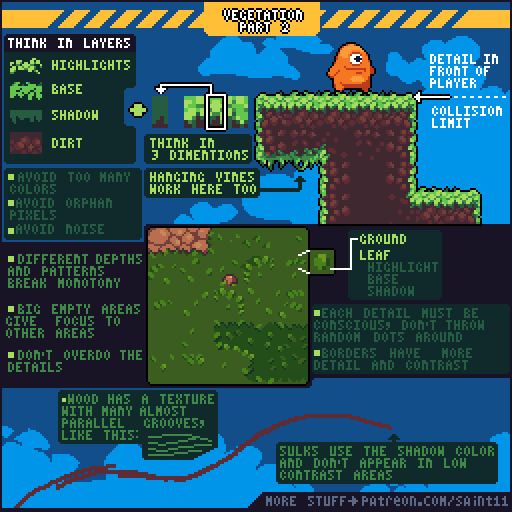
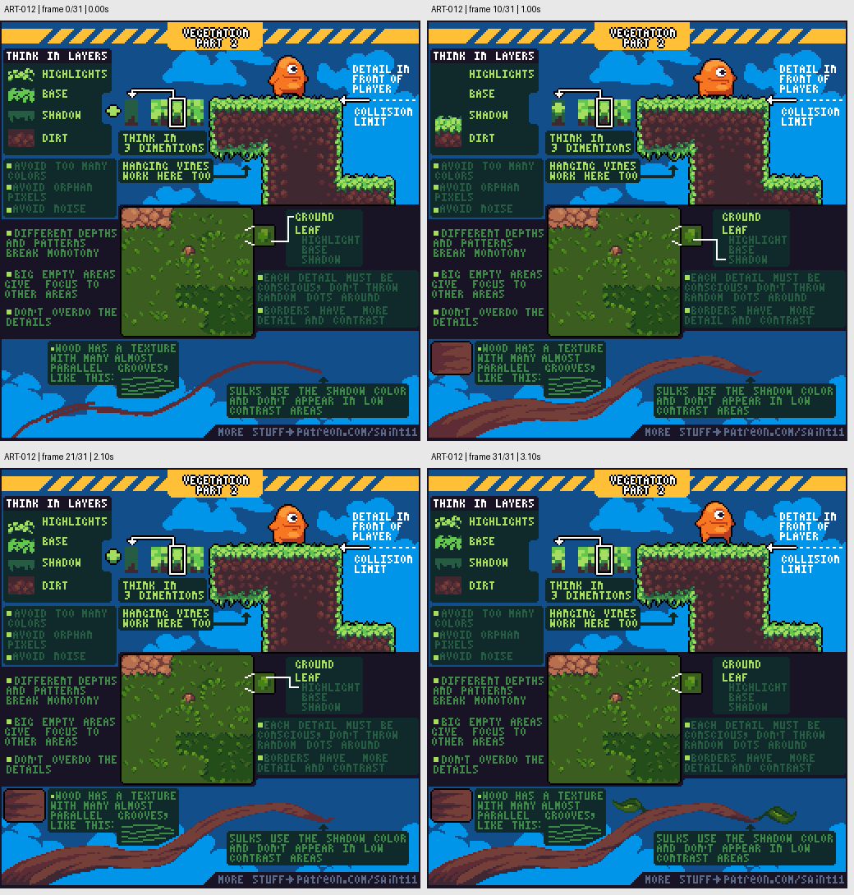

# ART-012 · 草地与土层：地面纹理的分层和疏密

把草地拆成高光、草面、阴影与土层，控制纹理在边缘和大片地面的分布。

## 使用前先读

**适用层级：** 进阶。**前置：** ART-007、ART-011。

本篇依据原图中的主要说明和示例编写中文讲解，保留原始英文动态图；不是逐字全文OCR。原作者的经验性建议不自动等于所有项目的硬性规则。练习、验收与适用边界是整理者补充。

## 学习目标

- 用层次表示草地厚度
- 为大地面设计疏密分布
- 协调装饰草和碰撞边界

## 原始图文教程

图1：Pedro Medeiros / Saint11 原始GIF，512×512，32帧，总时长3.20秒。原文件未改像素或重编码。部分阅读器只显示首帧，请结合下面的静态图和说明。

图2：整理者从原GIF按时间抽取的静态辅助图，阅读顺序为左上→右上→左下→右下。只选取四个时间点，并不代表完整动画或所有中间步骤；原始帧未缩放，标签加在图外。

## 图示读法

左上分层色块解释草缘厚度，右上角色脚边示意装饰前后层；中间整块地面展示稀疏叶片和空地的平衡，下方树根示例强调沟槽方向与低对比。

## 关键概念

原图把草缘分为highlight、base、shadow、dirt，并用立体方块提醒这些不是随意画出的条纹，而是在解释地形厚度。

## 根据原图整理的步骤

1. 先确定草面、下沿阴影和土层的关系，再加高光；从三维体积角度理解平台或台地的侧面。

2. 草缘可以有覆盖在角色前方的装饰，但它与实际碰撞图块应分别规划，不要让玩家误认可站立边界。

3. 减少重复亮线和孤立像素。允许藤蔓垂下，但让它们服务于方向和层次。

4. 为大片地面安排不同深浅的斑块，保留较大的空白区域，避免平均分布的噪点。

5. 每处细节都应有明确形状；边缘区域可以细节更多、对比更强。图末的树根用接近平行的沟槽与较暗颜色示范低对比附加结构。

## 实作练习（整理者补充）

整理者练习：制作一块96×64草地预览，包含可走地面、一个台阶和一段垂藤。分别导出地面、草缘装饰、碰撞示意三层，检查角色在边缘移动时是否容易判断落脚位置。

## 验收清单（整理者补充）

- [ ] 草面、阴影和土层关系一致
- [ ] 大地面有安静区域
- [ ] 装饰草不会掩盖关键可走边界
- [ ] 地面细节具有形状而非随机散点

## 适用边界与常见误区（整理者补充）

教程中的平台剖面是侧视示例；把方法迁移到俯视地图时，应重新按目标视角解释台阶厚度与遮挡。

## 来源与授权

- 原作者：**Pedro Medeiros（Saint11）**。
- 原图：[固定版本的 Vegetation2.gif](https://github.com/saint11/Saint11Tutorials/blob/ce1393eb2c46441d917134a9fd52e15575ee10a7/Vegetation2.gif)；[原始文件](https://raw.githubusercontent.com/saint11/Saint11Tutorials/ce1393eb2c46441d917134a9fd52e15575ee10a7/Vegetation2.gif)。
- 作者教程入口：[Pixel Art Tutorials](https://saint11.art/blog/pixel-art-tutorials/)。
- 授权：[Creative Commons Attribution 4.0 International](https://creativecommons.org/licenses/by/4.0/)。
- 授权证据：[仓库README固定版本](https://github.com/saint11/Saint11Tutorials/blob/ce1393eb2c46441d917134a9fd52e15575ee10a7/README.md)；[本地证据副本](../../licenses/saint11-README.md)。
- 固定提交：`ce1393eb2c46441d917134a9fd52e15575ee10a7`。收集日期：`2026-10-29`。
- 原始GIF SHA-256：`4e324c3336f8b776ee08c95f1ffd2259e99bbabb51eebe73bf1699c292fc8cd0`。
- 变更声明：原始GIF字节保留；新增中文解释性转述、练习、验收和适用范围说明；另从GIF抽帧生成静态辅助图。新增中文整理和派生图按CC BY 4.0提供，继续署名原作者并说明这些改动。
- 使用边界：这份开放授权针对仓库中的教程图文；教程中出现的软件名称和商标仍属于其权利人。授权不表示原作者认可本中文整理。
